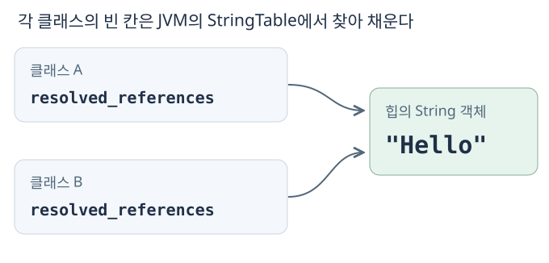

3장에서는 `System.out.println("Hello")`가 실행될 때 스택에 값이 두 개 올라가는 걸 봤다. 하나는 출력 객체의 참조, 다른 하나는 문자열의 참조였다. 그런데 컴파일한 파일을 보면 그 자리에 객체는 없고 `#7`, `#13` 같은 번호가 적혀 있다. JVM은 번호만 보고 어떻게 출력할 객체와 글자를 찾았을까?

## javac가 번호를 적는 이유

Microsoft OpenJDK 21에서 위 코드를 `HelloWorld.java`로 저장하고 두 명령을 차례로 실행했다.

```sh
javac HelloWorld.java
javap -v HelloWorld
```

첫 명령에서 `HelloWorld.class`가 생긴다. 두 번째 명령으로 그 파일의 `main`을 열면 아래 네 줄이 나온다. 아직 `Hello`는 출력되지 않았다.

```text
0: getstatic     #7
3: ldc           #13
5: invokevirtual #15
8: return
```

첫 줄의 `getstatic`은 정적 필드의 값을 읽으라는 명령이다. 자바에는 정적 필드가 많은데 하필 `System.out`을 어떻게 골라 읽을까? 바로 뒤의 `#7`이 **이 클래스 파일의 상수 풀 7번 항목을 보라**는 뜻이다.

**상수 풀은 컴파일러가 클래스 파일에 기록하는, 번호가 붙은 항목들의 모음이다.** 여기에는 `"Hello"`처럼 소스에서 정해진 값도 있고, `System.out`처럼 실행할 때 찾아야 할 필드의 이름과 타입도 있다. 그래서 명령에는 항목 번호만 써도 된다. 같은 필드를 읽는 코드가 또 나오면 같은 번호를 쓸 수 있다.

`javac`가 이 한 줄을 컴파일할 때 이미 확인할 수 있는 게 있다. `System.out`의 선언 타입은 `PrintStream`이고, 여기에 문자열을 넘기면 `println(String)`을 호출한다. 반면 프로그램을 실행할 때 `System.out`에 어떤 출력 객체가 들어 있을지는 파일을 쓰는 시점에 정해 둘 수 없다. 그래서 컴파일러는 **어느 필드를 읽을지** 7번에 적고, **그 필드의 값을 읽는 일**은 JVM이 실행할 `getstatic` 명령으로 남긴다.

| main에 쓴 명령 | 이 파일의 상수 풀에서 찾을 수 있는 것 |
| --- | --- |
| `getstatic #7` | `System.out` 필드의 클래스 이름, 필드 이름, 선언 타입 |
| `ldc #13` | 문자열 리터럴. 13번의 `String #14`에서 14번 `Utf8 Hello`로 이어진다 |
| `invokevirtual #15` | `PrintStream.println`이라는 메서드 이름과 `String` 하나를 받고 `void`를 반환하는 타입 정보 |

7번이나 15번처럼 이름과 타입으로 대상을 지정한 항목을 **심볼 참조**라고 한다. 13번에서는 왜 굳이 14번까지 갈까? 클래스 파일 형식에서 `String` 항목은 글자를 보관한 `Utf8` 항목의 번호(`string_index`)를 담는다. `Utf8`은 메서드 이름을 적을 때도 쓰인다. 13번의 `String` 표시가 있어야 이 글자를 **문자열 리터럴로** 쓴다는 걸 알 수 있다.

<details>
<summary>7번에서 System.out을 찾는 과정</summary>

첫 줄만 보면 `getstatic #7`이다. 상수 풀 7번을 열면 바로 `out`이라는 글자가 보일까? `javap -v` 출력에서 7번부터 잘라 왔다.

```text
 #7 = Fieldref       #8.#9
 #8 = Class          #10
 #9 = NameAndType    #11:#12
#10 = Utf8           java/lang/System
#11 = Utf8           out
#12 = Utf8           Ljava/io/PrintStream;
```

7번에는 `Fieldref #8.#9`라고 적혀 있다. 8번에서 10번으로 가면 `java/lang/System`이 나온다. 9번은 두 갈래다. 11번이 필드 이름 `out`, 12번이 필드 타입 `Ljava/io/PrintStream;`이다. `javap`가 명령 옆에 붙여 주는 주석 `Field java/lang/System.out:Ljava/io/PrintStream;`은 바로 이 항목들을 풀어 쓴 것이다. 여기서 확인한 건 필드의 이름과 타입이다.

</details>

## 7번을 읽고 실제 System.out 필드를 찾는 곳

`java HelloWorld`를 실행하면 JVM은 애플리케이션 클래스 로더를 통해 `HelloWorld`를 로드한다. 이때 파일의 상수 풀을 바탕으로 **HelloWorld의 런타임 상수 풀**을 만든다. `main`이 호출되면 메인 스레드에 프레임이 생기고, 처음에는 피연산자 스택이 비어 있다. 첫 명령은 `getstatic #7`이다. 파일의 7번에는 필드 이름과 타입 말고도 한 가지가 더 있었다. **그 필드를 어느 클래스에서 찾을지**, 여기서는 `java/lang/System`이다.

그럼 이 세 가지로 누가 필드를 찾을까? OpenJDK 21 HotSpot에서 인터프리터가 아직 연결되지 않은 필드 참조를 처음 만나는 경우를 따라가 봤다. 메인 스레드에서 인터프리터가 HotSpot의 런타임 함수 `InterpreterRuntime::resolve_get_put`을 호출한다. 이 함수는 지금 실행하는 메서드가 `HelloWorld.main`이므로 **HelloWorld의 상수 풀**을 가져와 필드 조회를 `LinkResolver`에 맡긴다. 여기서 디스크의 클래스 파일을 다시 열지는 않는다.

**먼저 클래스를 찾는다.** HotSpot은 `java/lang/System`에 해당하는 클래스가 이미 이 참조에 연결돼 있으면 그 결과를 쓴다. 아직이면 `HelloWorld`를 정의한 로더를 기준으로 이름을 해석한다. 일반적인 JDK 실행에서 애플리케이션 로더가 부모에게 위임하면 `java.lang.System`은 부트스트랩 로더가 정의한 클래스로 연결된다. 이미 로드된 `System`을 이때 새로 만들 필요는 없다.

**그다음 그 클래스에서 필드를 찾는다.** HotSpot 소스에서 실제 조회는 이 한 줄이다.

```cpp
Klass* sel_klass = resolved_klass->find_field(field, sig, &fd);
```

이 예제에서 `resolved_klass`는 방금 찾은 `System`, `field`는 `out`, `sig`는 `Ljava/io/PrintStream;`이다. `find_field`는 클래스에 선언된 필드 정보에서 이름과 타입이 일치하는 필드를 찾아 결과를 `fd`에 채운다. 이어서 `LinkResolver`는 `HelloWorld`에서 이 필드에 접근할 수 있는지, `getstatic`에 맞는 정적 필드인지 검사한다. 이 과정이 끝나면 HotSpot은 필드를 선언한 클래스와 필드의 **오프셋**(기준 위치에서 몇 바이트 떨어져 있는지)을 캐시에 기록할 수 있다. 파일 속 심볼 참조를 실제 필드에 연결하는 이 작업을 **해석(resolution)**이라고 한다. JVM은 참조를 미리 해석할 수도 있다.

여기까지 알아낸 건 **어디를 읽을지**다. 스택에 올릴 출력 객체는 언제 읽을까?

## 필드 위치를 찾은 다음에야 값을 읽는다

OpenJDK 21의 AArch64 인터프리터에서 `getstatic`은 캐시에 기록된 선언 클래스로부터 `System.class` 객체를 얻는다. HotSpot이 `System`의 정적 필드 값을 보관하는 곳이다. 인터프리터는 이 객체의 시작 위치에 `out`의 오프셋을 더한 자리에서 **현재 들어 있는 참조값**을 읽어 `main`의 피연산자 스택에 올린다. 이제 스택에는 출력 객체의 참조가 하나 있다. 다음번에도 필드 위치는 재사용할 수 있지만 값은 그때 다시 읽는다.

두 번째 명령 `ldc #13`은 문자열 리터럴 `"Hello"`에 해당하는 `String` 객체의 참조를 그 위에 올린다. 파일의 14번에서 본 것은 문자 데이터였다. JVM은 같은 내용으로 인턴된 객체가 있으면 그 참조를 쓰고, 없으면 객체를 만들어 등록한다. 이 참조는 첫 `ldc` 전에 이미 준비돼 있을 수도 있다.

세 번째 명령 `invokevirtual #15`까지 오면 스택에 값이 둘이다. 위에 있는 문자열을 인수로, 아래의 출력 객체를 호출 대상으로 삼아 `println(String)`을 호출한다. 표준 출력이 터미널에 연결된 이 예제에서는 여기서 `Hello` 한 줄이 찍힌다. 마지막 `return`에서 `main`이 끝난다.

## Hello를 Bye로 바꿔 봤다

`java HelloWorld`를 실행하면 터미널에 `Hello`가 한 줄 찍힌다. 같은 파일에서 `println("Hello")`를 `println("Bye")`로 고치고 다시 컴파일했다. 이번에도 `javap -v HelloWorld`로 같은 자리를 열어 봤다.

| 확인한 곳 | 처음 컴파일했을 때 | 글자를 바꿔 다시 컴파일했을 때 |
| --- | --- | --- |
| 문자열을 읽는 명령 | `ldc #13` | `ldc #13` |
| 상수 풀 14번 | `Utf8 Hello` | `Utf8 Bye` |
| `java HelloWorld` 출력 | `Hello` | `Bye` |

이 두 파일에서는 명령도 번호도 같았다. 바뀐 건 13번을 따라갔을 때 나오는 글자다. 그래서 똑같이 `ldc #13`을 실행해도 이번에는 `println`에 `Bye`가 넘어간다.

## 다른 클래스도 같은 Hello를 쓴다면

같은 JVM에서 클래스 A와 B가 각각 `"Hello"`를 출력한다고 해보자. A에서 쓰던 문자열 객체가 이미 있는데, B의 참조 배열은 아직 비어 있다. B는 어느 객체를 쓰게 될까?



HotSpot은 B의 런타임 상수 풀에 딸린 참조 배열(`resolved_references`)부터 확인한다. 여기에 참조가 없으면 JVM에서 공유하는 인턴 문자열 표(`StringTable`)에서 내용이 `Hello`인 객체를 찾는다. A가 쓴 객체가 이미 등록돼 있으니 B는 그 참조를 **자기 배열**에 저장한다. 이게 그림에서 두 화살표의 끝이 만나는 이유다. A가 처음 찾았을 때도 등록된 객체가 없었다면, 그때 JVM이 문자열 객체를 만들어 인턴한다.

B에서 같은 `ldc`를 다시 실행할 때는 B의 배열에 참조가 들어 있다. 그 참조를 이번 호출의 피연산자 스택에 올리면 된다. 앞 예제의 `#13`은 클래스 파일 안의 번호이고, HotSpot은 여기에 대응하는 내부 인덱스로 배열을 읽는다. 다른 클래스에서 같은 리터럴을 몇 번에 기록했는지는 상관없다. 참조를 처음 준비하는 일은 첫 `ldc`보다 앞서 끝날 수도 있다.

## 참고

- [OpenJDK 21, 인터프리터의 필드 해석 요청과 캐시 기록](https://github.com/openjdk/jdk/blob/jdk-21-ga/src/hotspot/share/interpreter/interpreterRuntime.cpp#L657-L727)
- [OpenJDK 21, 상수 풀의 클래스 이름 해석](https://github.com/openjdk/jdk/blob/jdk-21-ga/src/hotspot/share/oops/constantPool.cpp#L490-L535)
- [OpenJDK 21, 필드의 이름과 타입 조회 및 접근 검사](https://github.com/openjdk/jdk/blob/jdk-21-ga/src/hotspot/share/interpreter/linkResolver.cpp#L952-L1000)
- [OpenJDK 21, AArch64 인터프리터의 정적 필드 기준 위치](https://github.com/openjdk/jdk/blob/jdk-21-ga/src/hotspot/cpu/aarch64/templateTable_aarch64.cpp#L2283-L2307)
- [OpenJDK 21, AArch64 인터프리터의 필드값 읽기](https://github.com/openjdk/jdk/blob/jdk-21-ga/src/hotspot/cpu/aarch64/templateTable_aarch64.cpp#L2489-L2535)
- [OpenJDK 21 HotSpot, StringTable 구현](https://github.com/openjdk/jdk/blob/jdk-21-ga/src/hotspot/share/classfile/stringTable.cpp)
- [OpenJDK 21 HotSpot, 문자열 상수의 참조를 읽고 저장하는 코드](https://github.com/openjdk/jdk/blob/jdk-21-ga/src/hotspot/share/oops/constantPool.cpp#L1246-L1255)
- [JVM 명세, 문자열 상수의 클래스 파일 형식](https://docs.oracle.com/javase/specs/jvms/se21/html/jvms-4.html#jvms-4.4.3)
- [JVM 명세, ldc 명령](https://docs.oracle.com/javase/specs/jvms/se21/html/jvms-6.html#jvms-6.5.ldc)
- [3장. 자바 가상 머신 개요](https://hyungkishin.github.io/books/optimizing-java/chapter-03-jvm/)
- [JVM 명세, 클래스 파일의 상수 풀](https://docs.oracle.com/javase/specs/jvms/se21/html/jvms-4.html#jvms-4.4)
- [JVM 명세, 런타임 상수 풀](https://docs.oracle.com/javase/specs/jvms/se21/html/jvms-5.html#jvms-5.1)
- [JVM 명세, 심볼 참조 해석](https://docs.oracle.com/javase/specs/jvms/se21/html/jvms-5.html#jvms-5.4.3)
- [JVM 명세, getstatic 명령](https://docs.oracle.com/javase/specs/jvms/se21/html/jvms-6.html#jvms-6.5.getstatic)
