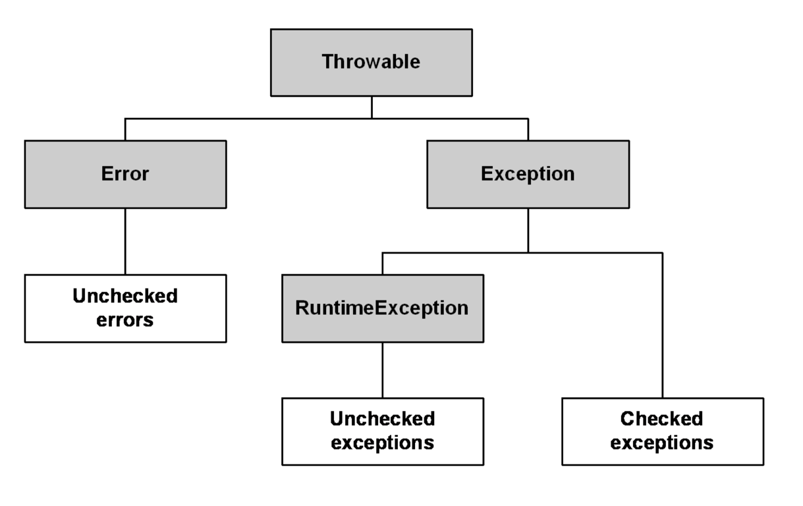
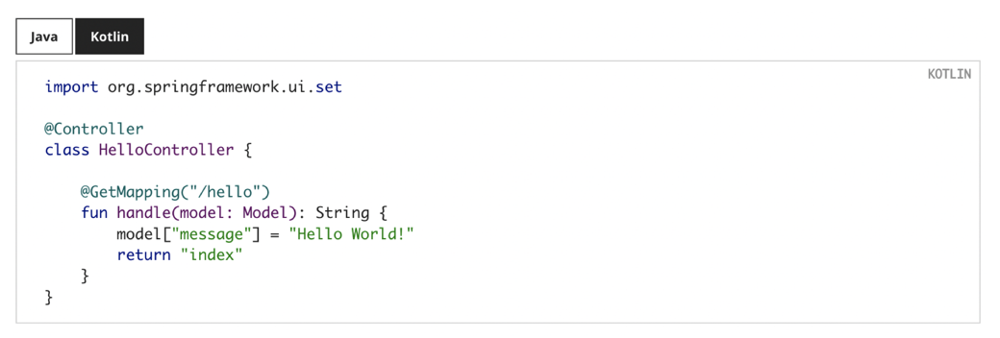

회원의 이름, 나이, 이메일을 보관하는 클래스를 코틀린으로 옮겨 보자. 아래 `Person`은 생성자 인수 세 개를 선언하면서 같은 이름의 프로퍼티도 만든다. IntelliJ의 코드 변환 기능으로 자바 선언과 비교해 볼 수 있다.

```kotlin
data class Person(
    val name: String,
    val age: Int,
    val email: String
)

object MyCompany {
    const val name: String = "MyCompany"
}

fun main() {
    val person = Person("이상훈", 35, "member@example.com")
    println("${MyCompany.name}: ${person.name}")
}
```

## 예제에 쓰인 코틀린 문법

`Person`에 붙인 `data` 덕분에 주 생성자의 프로퍼티를 기준으로 `equals()`, `hashCode()`, `toString()`이 생긴다. `Person(...)`만 쓰면 인스턴스를 만들 수 있다.

같은 파일의 `MyCompany`는 인스턴스 하나를 공유하는 `object`다. 맨 아래의 `main`은 어느 클래스에도 넣지 않은 최상위 함수다. 이 문법은 서버와 안드로이드 등 모바일 앱에서 모두 볼 수 있고, 코틀린은 프론트엔드의 JavaScript를 대상으로도 컴파일할 수 있다.

## 안드로이드의 코틀린 도입

Google Home 팀은 코틀린 도입 뒤 1년 동안 앱에서 `NullPointerException`으로 발생한 크래시가 33% 줄었다고 보고했다. 이 수치는 Google Home 앱에서 관찰한 변화다. [Android 개발자 문서의 Google Home 사례](https://developer.android.com/kotlin/build-better-apps)

### 코틀린과 스프링, 안드로이드의 주요 발표

- 2016년 2월 코틀린 1.0 출시
- 2017년 1월 Spring Framework 5.0의 코틀린 지원 발표
- 2017년 5월 Google I/O에서 안드로이드의 코틀린 지원 발표
- 2019년 5월 Google I/O에서 안드로이드 개발의 Kotlin-first 방침 발표
- 2022년 5월 코틀린 1.7 베타 출시

## 자바 문법을 코틀린으로 옮기면

### 체크 예외

자바에서는 메서드가 선언한 체크 예외에 호출자가 대응해야 한다. 파일을 열다 발생하는 `IOException`과 그 하위 타입 `FileNotFoundException`이 그 예다. `Throwable`의 다른 계열인 `Error`에는 `OutOfMemoryError`, `StackOverflowError`가 있다.

`NullPointerException`과 `ArrayIndexOutOfBoundsException`은 `RuntimeException`에 속한다. 컴파일러는 이 예외의 처리를 강제하지 않는다. Spring의 기본 트랜잭션 설정에서 체크 예외로도 롤백하려면 `@Transactional`의 `rollbackFor`에 해당 타입을 지정한다.



호출자가 인터럽트를 처리하려면 `catch`에서 인터럽트 상태를 복원하고 작업을 끝낼 수 있다. 호출자에게 넘기려면 메서드의 `throws` 절에 선언한다.

```java
static void waitBriefly() {
    try {
        Thread.sleep(1);
    } catch (InterruptedException e) {
        Thread.currentThread().interrupt();
    }
}
```

코틀린 호출자는 같은 자바 메서드를 호출할 때도 체크 예외 처리를 강제받지 않는다. 복구 동작이 필요하다면 `try/catch`를 쓸 수 있다.

### 기본 자료형

자바에서는 기본형 `int`와 래퍼 클래스 `Integer`를 구분한다. 다음 코드에서 `toString()`을 호출하는 대상은 `Integer`다.

```java
int value = 0;
Integer boxed = value;
String text = boxed.toString();
```

코틀린에서는 같은 값을 `Int`로 선언하고 곧바로 `toString()`을 호출한다.

```kotlin
val value: Int = 0
val text = value.toString()
```

소스에서 메서드를 호출하더라도 JVM이 정수마다 객체를 만들 필요는 없다. 컴파일러는 null을 허용하지 않는 `Int`를 보통 JVM의 `int`로 표현한다. `Int?`처럼 null도 담아야 하는 자리에서는 래퍼 타입을 사용한다. [Kotlin의 숫자 타입](https://kotlinlang.org/docs/numbers.html)

### 정적 멤버

자바의 `static` 멤버는 인스턴스를 만들지 않고 클래스 이름으로 접근한다.

```java
public class JavaClass {
    private static int count = 0;

    public static int currentCount() {
        return count;
    }
}
```

코틀린에서는 클래스 안의 `companion object`에 함수를 두고 `KotlinClass.currentCount()`처럼 호출할 수 있다.

```kotlin
class KotlinClass {
    companion object {
        private var count = 0
        fun currentCount(): Int = count
    }
}
```

### 삼항 연산자

자바에서는 조건에 따라 값을 고르는 데 `? :`를 쓴다.

```java
String animal = "호랑이";
String animalSound = "호랑이".equals(animal) ? "어흥" : "야홍";
```

코틀린에서는 `if`와 `else` 두 분기에서 나온 값을 바로 대입한다.

```kotlin
val animal = "호랑이"
val animalSound = if (animal == "호랑이") "어흥" else "야홍"
```

### 세미콜론

자바에서는 아래 대입문 끝에 세미콜론을 쓴다. 코틀린에서는 줄이 끝나는 곳의 세미콜론을 생략할 수 있다.

```java
boolean isAdmin = true;
```

```kotlin
val isAdmin = true
```

## 코틀린에서 쓸 수 있는 표현

### 확장 함수

`String`을 직접 수정하지 않아도 확장 함수를 마침표로 호출할 수 있다. 여기서는 빈 문자열을 받으면 `firstLetter()`의 인덱스 접근이 실패하므로 값이 있는 문자열로 시험한다.

```kotlin
fun String.firstLetter(): Char = this[0]

fun String.addFirst(char: Char): String = char + this

fun main() {
    println("ABCD".firstLetter())  // A
    println("ABCD".addFirst('Z'))  // ZABCD
}

```

### 데이터 클래스

아래의 `Person`은 이름과 나이를 `val`로 선언해 생성 후 두 프로퍼티에 다른 값을 대입할 수 없다. 데이터를 보관하고 전달할 때 이런 형태를 쓸 수 있다.

```kotlin
data class Person(val name: String, val age: Int)
```

자바에서 같은 두 값을 일반 클래스로 보관할 때는 생성자에서 `final` 필드를 초기화한다. 접근자는 아래처럼 작성하거나 Lombok의 `@Getter`로 생성할 수 있다.

```java
public class Person {
    private final String name;
    private final int age;

    public Person(String name, int age) {
        this.name = name;
        this.age = age;
    }

    public String getName() { return name; }
    public int getAge() { return age; }
}
```

Java 16에서 정식 기능이 된 `record`는 생성자, 컴포넌트 접근자, `equals()`, `hashCode()`, `toString()`을 선언 한 줄에서 제공한다. 위 클래스와 아래 레코드는 서로 다른 `Person.java` 예시다. [OpenJDK JEP 395](https://openjdk.org/jeps/395)

```java
public record Person(String name, int age) {}
```

### 문자열 템플릿

문자열에 변수 하나를 넣을 때는 `$text`, 표현식을 넣을 때는 `${...}`를 쓴다. 주문 조회처럼 조건이 달라지는 SQL에서는 조건절을 선택해 넣고 실제 값은 파라미터로 바인딩할 수 있다.

```kotlin
fun sql(nameIncluded: Boolean): String {
    val nameCondition = if (nameIncluded) " AND name = :name" else ""
    return """
        SELECT id, name, email, age
        FROM users
        WHERE id = :id$nameCondition
    """.trimIndent()
}

fun main() {
    val text = "World"
    println("Hello, $text")
    println(sql(nameIncluded = true))
}
```

### 함께 살펴볼 언어 기능

`if (value is String)`처럼 타입을 검사하면 조건이 참인 분기에서 스마트 캐스트로 문자열의 멤버를 쓸 수 있다. `sealed class`는 직접 상속할 수 있는 타입의 범위를 제한한다. 코틀린 자체의 언어 기능이다. 이 밖에도 위임, 중위 표현식, 연산자 오버로딩, 코루틴을 지원한다. [Kotlin의 sealed 클래스](https://kotlinlang.org/docs/sealed-classes.html)

## 스프링 공식 문서에서 코틀린 예제 찾기

[Spring MVC 문서](https://docs.spring.io/spring-framework/reference/web/webmvc/mvc-servlet.html)에서 언어 탭이 있는 예제는 Java와 Kotlin 코드를 번갈아 볼 수 있다.



## Spring Initializr로 코틀린 프로젝트 만들기

Spring Initializr에서 언어를 Kotlin, 빌드 방식을 Gradle Kotlin DSL로 선택하면 `build.gradle.kts`가 생긴다. 아래는 당시 예제의 Spring Boot 2.6.7, Kotlin 1.6.21과 Java 11을 유지한 설정이다.

```kotlin
import org.jetbrains.kotlin.gradle.tasks.KotlinCompile

plugins {
    id("org.springframework.boot") version "2.6.7"
    id("io.spring.dependency-management") version "1.0.11.RELEASE"
    kotlin("jvm") version "1.6.21"
    kotlin("plugin.spring") version "1.6.21"
}

group = "com.example"
version = "0.0.1-SNAPSHOT"
java.sourceCompatibility = JavaVersion.VERSION_11

repositories {
    mavenCentral()
}

dependencies {
    implementation("org.springframework.boot:spring-boot-starter")
    implementation("org.jetbrains.kotlin:kotlin-reflect")
    implementation("org.jetbrains.kotlin:kotlin-stdlib-jdk8")
    testImplementation("org.springframework.boot:spring-boot-starter-test")
}

tasks.withType<KotlinCompile>().configureEach {
    kotlinOptions {
        freeCompilerArgs = listOf("-Xjsr305=strict")
        jvmTarget = "11"
    }
}

tasks.withType<Test>().configureEach {
    useJUnitPlatform()
}
```

`kotlin("plugin.spring")`은 스프링이 프록시를 만들 때 필요한 클래스와 멤버를 열어 준다. `kotlin-reflect`는 런타임에 코틀린 타입 정보를 읽는 데 쓰이고, 표준 라이브러리는 `kotlin-stdlib`이 제공한다. JPA 엔티티용 생성자가 필요하거나 Jackson으로 코틀린 클래스를 읽어야 한다면 프로젝트에 맞춰 `plugin.jpa`나 `jackson-module-kotlin`을 추가한다.

## 스프링 부트 애플리케이션 실행하기

`src/main/kotlin/com/example/demo/DemoApplication.kt`에 진입점을 둔다. 최상위 함수 `main`이 스프링에 시작할 클래스와 실행 인자를 넘긴다.

```kotlin
package com.example.demo

import org.springframework.boot.autoconfigure.SpringBootApplication
import org.springframework.boot.context.properties.ConfigurationPropertiesScan
import org.springframework.boot.runApplication

@SpringBootApplication
@ConfigurationPropertiesScan
class DemoApplication

fun main(args: Array<String>) {
    runApplication<DemoApplication>(*args)
}
```

### @ConfigurationProperties

이 예제의 Spring Boot 2.6.7에서는 `@ConstructorBinding`으로 설정값을 생성자 인수에 바인딩한다. 다음 클래스를 `DemoApplication`과 같은 패키지에 두면 위의 `@ConfigurationPropertiesScan`이 찾아서 등록한다.

```kotlin
package com.example.demo

import java.net.URI
import org.springframework.boot.context.properties.ConfigurationProperties
import org.springframework.boot.context.properties.ConstructorBinding

@ConstructorBinding
@ConfigurationProperties("example.kotlin")
data class KotlinExampleProperties(
    val name: String,
    val description: String,
    val myService: MyService
) {
    data class MyService(val apiToken: String, val uri: URI)
}
```

`src/main/resources/application.yml`에 생성자에 필요한 값을 채운다. 아래 주소와 토큰은 로컬 예시다.

```yaml
example:
  kotlin:
    name: demo
    description: Local example
    my-service:
      api-token: local-example
      uri: https://example.com
```

프로젝트 루트에서 `./gradlew bootRun`으로 실행한다. 이 예제에는 웹 의존성이 없어 HTTP 서버를 시작하지 않는다.

### 테스트 지원

앞의 빌드 설정은 `spring-boot-starter-test`와 `useJUnitPlatform()`으로 JUnit 5 테스트를 실행한다. 서비스의 의존성을 테스트 대역으로 바꿀 때는 Mockito를 쓰거나 코틀린용 MockK를 추가할 수 있다.
