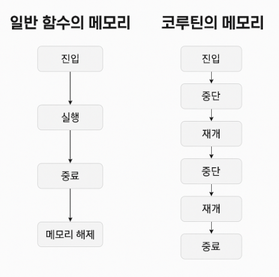

커피를 몇 잔 마셨는지 출력하는 함수를 하나 만들었다. 아래 코드에서 커피보다 먼저 `sleep`을 출력할 방법이 있을까?

```kotlin
fun main() {
    println("wake up")
    goToCompany()
    println("sleep")
}

fun goToCompany() {
    val num1 = 1
    val num2 = 2
    println("오늘도 커피 ${num1 + num2} 잔 ...")
}
```

이대로 실행하면 `wake up`, 커피 세 잔, `sleep` 순서다. `main`은 `goToCompany()`가 반환된 뒤에야 마지막 줄을 실행한다.


## 같은 스레드에서 두 코루틴 실행하기

`goToCompany()`를 자식 코루틴에서 실행하고, 두 함수에 `yield()`를 한 번씩 넣어 보자. 출력할 때 스레드 이름도 찍는다.

```kotlin
import kotlinx.coroutines.launch
import kotlinx.coroutines.runBlocking
import kotlinx.coroutines.yield

fun main(): Unit = runBlocking {
    printWithThread("wake up")
    launch { goToCompany() }
    yield()
    printWithThread("sleep")
}

suspend fun goToCompany() {
    val num1 = 1
    val num2 = 2
    yield()
    printWithThread("오늘도 커피 ${num1 + num2} 잔 ...")
}

fun printWithThread(message: String) {
    println("${Thread.currentThread().name} : $message")
}
```

Kotlin 2.2.21, kotlinx.coroutines 1.10.2, JDK 21에서 실행했을 때는 이렇게 찍혔다.

```text
main : wake up
main : sleep
main : 오늘도 커피 3 잔 ...
```

커피가 마지막에 나왔다. 세 줄 모두 스레드 이름은 `main`이다. 별도 디스패처를 지정하지 않아 두 코루틴이 같은 `runBlocking` 이벤트 루프에서 실행됐다.

부모가 첫 번째 `yield()`에 도달하면 자식이 실행될 수 있다. 자식은 두 변수를 선언하고 다시 `yield()`를 호출한다. 그사이에 부모가 `sleep`을 출력하고, 자식이 재개되면 커피 잔 수가 찍힌다. `yield()`를 호출해도 다른 코루틴이 실행된다는 보장은 없다. [kotlinx.coroutines의 yield 문서](https://kotlinlang.org/api/kotlinx.coroutines/kotlinx-coroutines-core/kotlinx.coroutines/yield.html)

## 두 번째 yield 다음 줄로 어떻게 돌아올까?

일반 함수는 실행 중인 스레드의 호출 스택에 프레임이 있다. 코루틴은 중단되면 스레드를 다른 작업에 쓸 수 있다. 그러면 다시 실행할 줄과 그때 쓸 값은 어디에 남을까?

코틀린 컴파일러는 중단 지점이 있는 함수를 여러 단계로 나눈다. 중단 후에도 필요한 지역 변수와 재개할 단계 번호를 `Continuation` 구현 객체에 저장할 수 있다. 재개할 때는 그 번호에 따라 중단 지점 다음 코드를 실행한다. 이 예에서 필요한 건 합계를 출력하는 데 쓸 값이다. 상수까지 각각 별도 필드가 되는지는 컴파일 결과에 따라 다르다. [코틀린 명세의 코루틴 상태 머신](https://kotlinlang.org/spec/asynchronous-programming-with-coroutines.html#coroutine-state-machine)

<span id="article-section-3"></span>


