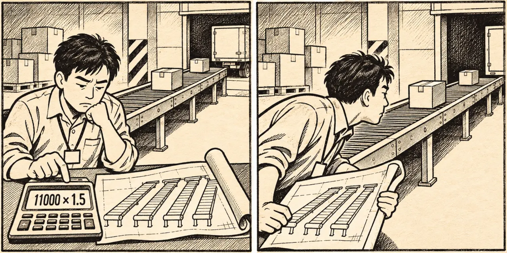

며칠째 “알림이 느리다”는 신고가 들어왔다. 발송 대상 1만 1천 건에 건당 1.5초를 곱해 보니 약 다섯 시간. 파티션이 하나라 컨슈머만 늘려서는 나눠 처리할 수도 없었다. 팀에서는 파티션 증설 견적까지 냈다.

잠깐. 1.1만 건은 발송 대상인데, 그게 전부 큐에 쌓여 있었나?

<svg class="fig-defs" width="0" height="0" aria-hidden="true" focusable="false" style="position:absolute;width:0;height:0">
  <defs>
    <filter id="fx-glow" x="-60%" y="-60%" width="220%" height="220%">
      <feGaussianBlur stdDeviation="3" result="b"/>
      <feMerge><feMergeNode in="b"/><feMergeNode in="SourceGraphic"/></feMerge>
    </filter>
  </defs>
</svg>

## 측정된 time lag은 최대 12초였다

파티션 끝과 consumer group이 커밋한 offset의 차이는 관측 구간 내내 많아야 1이었다. 파티션을 늘리는 비용까지 계산해 놓고, 정작 줄이 얼마나 긴지는 이제 본 거다.

| 단계 | 확인한 것 | 결과 |
|---|---|---|
| 단순 추산 | 1.1만 × 1.5초 ≈ 5시간 | 가설(추정) |
| offset lag | 최대 1 (offset 차이) | "큐에 쌓였다"가 지워짐 |
| time lag | 최대 12초 | "5시간 지연"이 지워짐 |
| 처리량과 입력량 그래프 | 밀린 구간 없음 | backlog 자체가 없음 |

<figure class="metric-fig">
  
estimated processing time vs measured lag11,260 msgs

  <svg viewBox="0 0 720 264" role="img" aria-label="같은 시작점에서 단순 추산은 5시간으로 치솟고 실측 지연은 12초에 붙어 있다" xmlns="http://www.w3.org/2000/svg">
    <defs>
      <linearGradient id="g-env" x1="0" y1="0" x2="0" y2="1">
        <stop offset="0" stop-color="var(--c-orange)" stop-opacity="0.32"/><stop offset="1" stop-color="var(--c-orange)" stop-opacity="0"/>
      </linearGradient>
      <linearGradient id="g-meas" x1="0" y1="0" x2="0" y2="1">
        <stop offset="0" stop-color="var(--c-blue)" stop-opacity="0.28"/><stop offset="1" stop-color="var(--c-blue)" stop-opacity="0"/>
      </linearGradient>
      <linearGradient id="g-envline" x1="0" y1="1" x2="1" y2="0">
        <stop offset="0" stop-color="var(--c-orange)" stop-opacity="0.7"/><stop offset="1" stop-color="var(--c-orange)"/>
      </linearGradient>
    </defs>
    <g stroke="var(--fig-grid)" stroke-width="1">
      <line x1="52" y1="40" x2="684" y2="40"/><line x1="52" y1="97" x2="684" y2="97"/><line x1="52" y1="154" x2="684" y2="154"/>
    </g>
    <line x1="52" y1="212" x2="684" y2="212" stroke="var(--fig-baseline)" stroke-width="1.4"/>
    <path d="M52 210 C 240 208, 430 150, 684 46 L684 212 L52 212 Z" fill="url(#g-env)">
      <animate attributeName="opacity" values="0;0.95;0.95;0" keyTimes="0;0.42;0.9;1" dur="6.5s" calcMode="spline" keySplines="0.45 0 0.15 1;0 0 1 1;0.45 0 0.15 1" repeatCount="indefinite"/>
    </path>
    <path d="M52 210 L150 209 L300 208 L360 208 L378 199 L398 208 L520 208 L684 207 L684 212 L52 212 Z" fill="url(#g-meas)">
      <animate attributeName="opacity" values="0;0.95;0.95;0" keyTimes="0;0.42;0.9;1" dur="6.5s" calcMode="spline" keySplines="0.45 0 0.15 1;0 0 1 1;0.45 0 0.15 1" repeatCount="indefinite"/>
    </path>
    <path d="M52 210 L150 209 L300 208 L360 208 L378 199 L398 208 L520 208 L684 207" fill="none" stroke="var(--c-blue)" stroke-width="2.6" stroke-linecap="round" stroke-linejoin="round" pathLength="100" stroke-dasharray="100">
      <animate attributeName="stroke-dashoffset" values="100;0;0;100" keyTimes="0;0.42;0.9;1" dur="6.5s" calcMode="spline" keySplines="0.45 0 0.15 1;0 0 1 1;0.45 0 0.15 1" repeatCount="indefinite"/>
    </path>
    <path d="M52 210 C 240 208, 430 150, 684 46" fill="none" stroke="url(#g-envline)" stroke-width="2.8" stroke-linecap="round" pathLength="100" stroke-dasharray="100">
      <animate attributeName="stroke-dashoffset" values="100;0;0;100" keyTimes="0;0.42;0.9;1" dur="6.5s" calcMode="spline" keySplines="0.45 0 0.15 1;0 0 1 1;0.45 0 0.15 1" repeatCount="indefinite"/>
    </path>
    <circle r="9" fill="var(--c-orange)" opacity="0.18">
      <animateMotion path="M52 210 C 240 208, 430 150, 684 46" keyPoints="0;1;1;0" keyTimes="0;0.42;0.9;1" dur="6.5s" calcMode="spline" keySplines="0.45 0 0.15 1;0 0 1 1;0.45 0 0.15 1" repeatCount="indefinite"/>
    </circle>
    <circle r="4.5" fill="var(--c-orange)" filter="url(#fx-glow)">
      <animateMotion path="M52 210 C 240 208, 430 150, 684 46" keyPoints="0;1;1;0" keyTimes="0;0.42;0.9;1" dur="6.5s" calcMode="spline" keySplines="0.45 0 0.15 1;0 0 1 1;0.45 0 0.15 1" repeatCount="indefinite"/>
    </circle>
    <circle cx="52" cy="211" r="4" fill="var(--fig-surface)" stroke="var(--fig-ink2)" stroke-width="1.6"/>
    <g transform="translate(556,30)"><rect width="128" height="21" rx="7" fill="var(--c-orange)" opacity="0.16"/><text x="12" y="14.5" fill="var(--c-orangeink)" font-size="12" font-weight="700">직렬 추산 약 5시간</text></g>
    <g transform="translate(520,224)"><rect width="164" height="21" rx="7" fill="var(--c-blue)" opacity="0.16"/><text x="12" y="14.5" fill="var(--c-blueink)" font-size="12" font-weight="700">최대 12초, offset lag 최대 1</text></g>
    <text x="56" y="230" fill="var(--fig-muted)" font-size="10.5" letter-spacing="0.03em">발송 시작</text>
  </svg>
  <figcaption>같은 지점에서 출발한 두 선. 위는 <b>건수 x 건당시간</b>이 그린 추정, 아래는 컨슈머가 실제로 보고한 지연. 추정 처리 시간과 관측된 대기 시간은 측정 대상이 다르므로 직접 같은 값으로 해석할 수 없다.</figcaption>
</figure>

관측 구간에서는 추정치에 해당하는 대규모 적체가 확인되지 않았다.
offset lag 1과 time lag 12초는 각각의 최댓값이다. 두 값이 같은 시점에 찍힌 것은 아니다.

## lag은 어디를 재고 있나

12초와 5시간의 간극을 설명하려면 lag이 재는 구간의 경계가 필요하다.

Kafka는 producer가 메시지를 broker의 파티션에 넣고 consumer가 순서대로 읽어 가는 구조다.
각 파티션에서 lag을 계산할 때 두 경계를 쓴다. 하나는 consumer가 조회한 end offset이다. 기본 격리 수준인 `read_uncommitted`에서는 high watermark, 즉 복제가 끝난 마지막 레코드의 다음 위치를 쓴다. 다른 하나는 consumer group이 커밋한 offset이다. 이것도 다음에 읽을 위치를 가리킨다.

- **offset lag** = 두 경계 사이의 offset 거리.
- **time lag**은 대시보드가 시간으로 표시한 지연이다. 초 단위 값을 해석하려면 그 지표가 어느 레코드의 어떤 시각을 기준으로 삼는지 확인해야 한다.

offset 거리는 메시지 수와 같지 않을 수 있다. compaction으로 지워진 레코드나 트랜잭션의 커밋 마커 같은 제어 레코드도 offset을 하나씩 차지한다. 이런 빈 구간이 있으면 애플리케이션이 받을 메시지는 거리보다 적다.
앞의 표에서 읽을 수 있는 건 이 거리의 최댓값이 1이었다는 데까지다. offset 하나에 해당하는 레코드를 애플리케이션이 실제로 받았는지는 별개의 문제다.

끝 경계도 하나가 아니다. consumer를 `read_committed`로 돌리면 아직 끝나지 않은 트랜잭션 앞, LSO(last stable offset)까지만 읽을 수 있다. 그래서 lag을 잴 때 어느 끝 경계를 조회했는지도 같이 봐야 한다.

실행 중인 consumer의 읽기 위치(position)는 커밋한 offset보다 앞서 있을 수 있다. 어느 쪽을 기준으로 재느냐에 따라 값도 달라진다.
컨슈머가 읽어 간 위치(position)를 기준으로 하면 처리 중인 메시지는 이미 읽힌 뒤라 lag에 잡히지 않는다.
커밋 오프셋을 기준으로 하면 처리한 뒤 커밋하는 흔한 설정에서 처리 중 메시지도 lag에 남는다.
그리고 Kafka 밖의 지연은 어느 쪽으로도 보이지 않는다. producer가 늦게 넣는 것, 벤더가 접수한 뒤 늦게 배송하는 것 모두.

<figure class="metric-fig">
  
읽기 위치로 lag을 잴 때consumer position

  <svg viewBox="0 0 660 196" role="img" aria-label="consumer의 position을 기준으로 잰 offset lag은 poll 전의 대기를 반영한다. 이미 읽은 뒤의 처리는 포함하지 않는다" xmlns="http://www.w3.org/2000/svg">
    <defs>
      <linearGradient id="e2-blue" x1="0" y1="0" x2="0" y2="1"><stop offset="0" stop-color="var(--c-blue)"/><stop offset="1" stop-color="var(--c-blue)" stop-opacity="0.7"/></linearGradient>
      <linearGradient id="e2-slate" x1="0" y1="0" x2="0" y2="1"><stop offset="0" stop-color="var(--fig-baseline)"/><stop offset="1" stop-color="var(--fig-baseline)" stop-opacity="0.55"/></linearGradient>
    </defs>
    <g stroke="var(--c-blue)" stroke-width="1.2">
      <line x1="174" y1="52" x2="174" y2="60"/><line x1="374" y1="52" x2="374" y2="60"/><line x1="174" y1="52" x2="374" y2="52"/>
    </g>
    <text x="274" y="42" text-anchor="middle" fill="var(--c-blueink)" font-size="11" font-weight="700">position 기준 offset lag</text>
    <g stroke="var(--fig-surface)" stroke-width="2">
      <rect x="44"  y="64" width="130" height="44" rx="2" fill="url(#e2-slate)"/>
      <rect x="174" y="64" width="200" height="44" rx="2" fill="url(#e2-blue)"/>
      <rect x="374" y="64" width="120" height="44" rx="2" fill="url(#e2-slate)"/>
      <rect x="494" y="64" width="122" height="44" rx="2" fill="url(#e2-slate)"/>
    </g>
    <g font-size="13" font-weight="700" text-anchor="middle">
      <text x="274" y="91" fill="#ffffff" font-size="11">lag</text>
    </g>
    <circle r="5" fill="var(--c-blue)" filter="url(#fx-glow)">
      <animateMotion path="M50 86 L610 86" dur="4s" repeatCount="indefinite"/>
      <animate attributeName="opacity" values="0;1;1;0" keyTimes="0;0.1;0.9;1" dur="4s" repeatCount="indefinite"/>
    </circle>
    <g font-size="11" text-anchor="middle" fill="var(--fig-muted)">
      <text x="109" y="128">producer 투입 전</text>
      <text x="274" y="128" fill="var(--c-blueink)" font-weight="700">파티션 대기</text>
      <text x="434" y="128">consumer 처리 중</text>
      <text x="555" y="128">벤더 배송</text>
    </g>
    <text x="330" y="166" text-anchor="middle" fill="var(--fig-muted)" font-size="10.5">이미 poll한 레코드는 처리 중이어도 읽기 위치 뒤에 있다.</text>
  </svg>
  <figcaption>메시지 한 건은 네 구간을 지난다. position 기준 lag은 <b>읽기 전 파티션 대기</b>를 확인하는 데 사용한다. producer 투입 전, consumer가 이미 읽어 처리 중, 벤더 접수 후 배송의 지연은 lag에 보이지 않는다.</figcaption>
</figure>

## 파티션 증설은 보류했다

미수신 건 가운데 상당수는 앞 편에서 발송 성공 판정을 고치면서 찾았다. 늦었다는 신고까지 설명하려면 메시지가 Kafka에 들어가기 전과 벤더가 접수한 뒤도 재야 한다. 이번 기록에는 그 시간이 없었다.

파티션은 그대로 두고 발송 대시보드에 offset lag과 time lag을 상시 표시했다.

다시 잰 결과는 이렇다. 평시 offset lag은 0 근처, time lag 최대 12초 그대로. 월말 월간 리포트 1.1만 건 버스트 때 time lag 최대 약 10분. 단순 추산의 5시간과는 자릿수가 다르다. 파티션은 늘리지 않았고 발송은 정상으로 돌아왔다.

파티션을 늘릴지 판단할 때는 건당 시간에 전체 건수를 곱하는 대신, 브로커의 끝 위치와 컨슈머 그룹의 커밋 위치가 계속 벌어지는지 확인했다.

수집 간격보다 짧게 밀렸다 풀리는 순간은 그래프에서도 놓칠 수 있다.

발송이 늦어질 수 있는 또 한 곳은 컨슈머가 사용하는 캐시다. Redis 조회 P95로 기록된 5.68초 중 어디까지가 Redis 서버에서 보낸 시간인지 다음 편에서 확인한다.

## 참고자료

- [Apache Kafka 4.0, KafkaConsumer (offset, position, committed position, read_committed)](https://kafka.apache.org/40/javadoc/org/apache/kafka/clients/consumer/KafkaConsumer.html)
