웹 서버가 요청을 처리하는 데 1초가 걸렸다고 하자. 큰 데이터의 합계를 내느라 CPU를 1초 썼을 때와 DB의 답을 기다리느라 1초가 지났을 때, 스레드를 더 띄우면 똑같은 효과가 날까? Java 21의 가상 스레드를 공부하면서 먼저 이 두 경우를 그림으로 그려 봤다.

## 한 코어에서 두 작업을 번갈아 실행할 때

첫 그림은 앱과 하드웨어 사이에 커널이 있는 단순한 모형이다. 여기서는 한 번에 한 스레드를 실행하는 CPU 코어 하나를 가정한다.

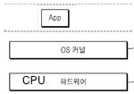

앱 하나가 암호화나 집계를 계속 수행하는 동안에는 그 앱이 CPU에서 계산한다.

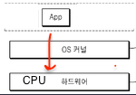

같은 코어에 계산할 앱을 더 추가하면 어떻게 될까? 여러 앱이 동시에 진도를 내는 것처럼 보여도 각 스레드는 스케줄러가 실행 기회를 줄 때 계산을 이어간다.

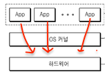

### 작업을 바꿀 때 옮겨야 하는 값

첫 작업이 잠깐 멈춰도 지금까지 계산한 값은 남아야 한다. 그림의 레지스터는 CPU가 현재 실행에 쓰는 값을 보관하는 곳이고, ALU는 산술·논리 연산을 맡는다.

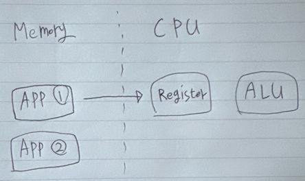

다음 그림에서는 두 번째 작업이 CPU를 쓴다. 운영체제는 첫 번째 작업의 레지스터 상태를 저장해 뒀다가 그 작업의 차례가 돌아오면 복원한다. 이렇게 실행하던 작업을 바꾸는 일을 문맥 교환(context switch)이라고 한다.

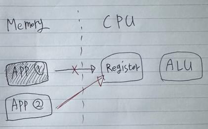

계산할 작업이 이미 코어 하나를 채웠다면 차례를 더 자주 바꾼다고 계산 능력이 늘지는 않는다. 아래처럼 독립적인 두 작업이 각각 다른 코어를 배정받으면 같은 시간에 둘 다 계산할 수 있다.

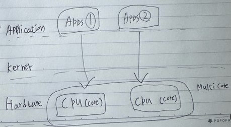

## 서버가 네트워크 입력을 기다릴 때

이번에는 클라이언트가 서버에 `Hello`를 보낸다. 서버 쪽에서 보면 다음 바이트가 도착하기까지는 계산을 더 해도 읽을 수 있는 데이터가 늘지 않는다.

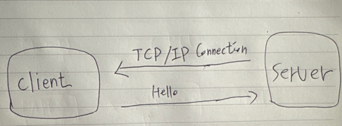

아래쪽에는 패킷을 받는 네트워크 인터페이스(NIC)가 있다. 커널이 수신 데이터를 처리하는 데에도 CPU가 든다. 그동안 블로킹 읽기를 호출한 앱의 스레드는 데이터가 준비될 때까지 기다릴 수 있다. 이 대기가 요청 시간의 대부분을 차지하는 경우가 I/O 중심 작업이다.

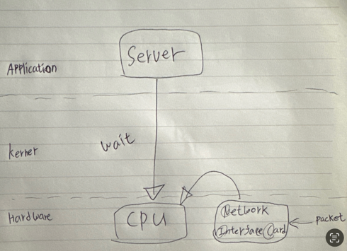

실제 요청에는 두 종류의 시간이 섞인다. 그림의 웹 앱은 클라이언트에서 HTTP 요청을 받고, DB에 쿼리를 보내고, 외부 API에서 결과를 받는다. DB가 내부에서 디스크를 읽는 동안 웹 앱에서는 DB 응답을 기다리는 시간으로 보인다.

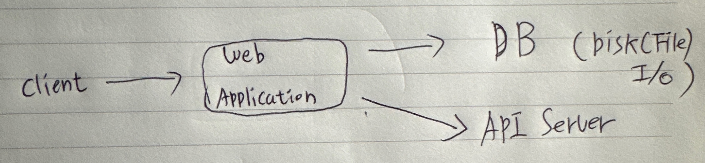

## 기다리는 요청마다 플랫폼 스레드가 하나씩 필요하다면

그림은 요청 하나를 플랫폼 스레드 하나가 맡는 방식이다. 첫 번째 요청이 I/O를 기다릴 때 다른 스레드는 다음 요청을 처리할 수 있다. 한 코어에서 계산만 번갈아 하던 첫 그림과 다른 점이다.

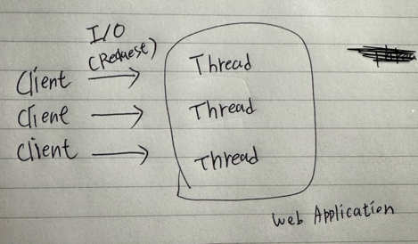

대기 중인 스레드에도 스택 등 자원이 필요하다. 동시 요청이 10만 건이라고 플랫폼 스레드를 10만 개 만들면 프로세스 메모리나 운영체제의 스레드 한도에 먼저 닿을 수 있다. 스레드 풀은 정해진 수의 스레드를 여러 요청이 재사용한다. 그러면 생성·종료에 드는 비용과 스레드 수를 줄이는 대신, 풀이 가득 찬 동안 새 요청이 기다리거나 거절된다.

가상 스레드를 검토할 때도 먼저 이 대기의 비중을 본다. 독립적인 요청이 많고 대부분의 시간을 I/O에 쓴다면, 기다리는 요청마다 플랫폼 스레드를 하나씩 붙잡아 둘 필요를 줄일 수 있다. 코어에서 해야 하는 계산량은 그대로다. [Java 21 가상 스레드 가이드](https://docs.oracle.com/en/java/javase/21/core/virtual-threads.html)

처음 공부할 때 붙인 그림 세 장

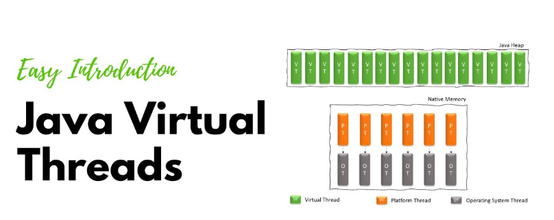

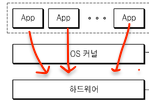

