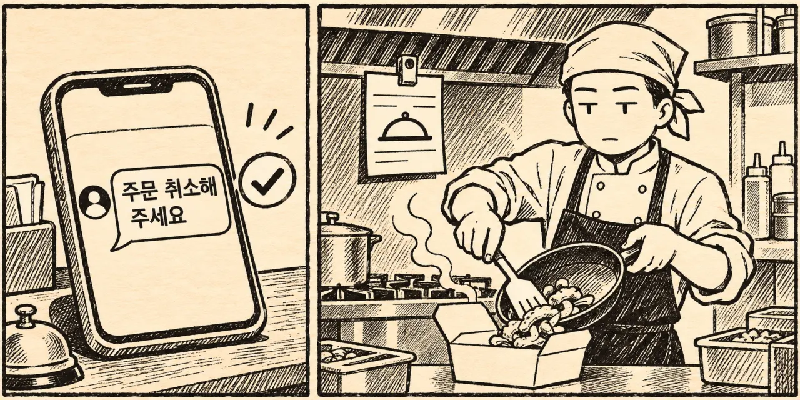
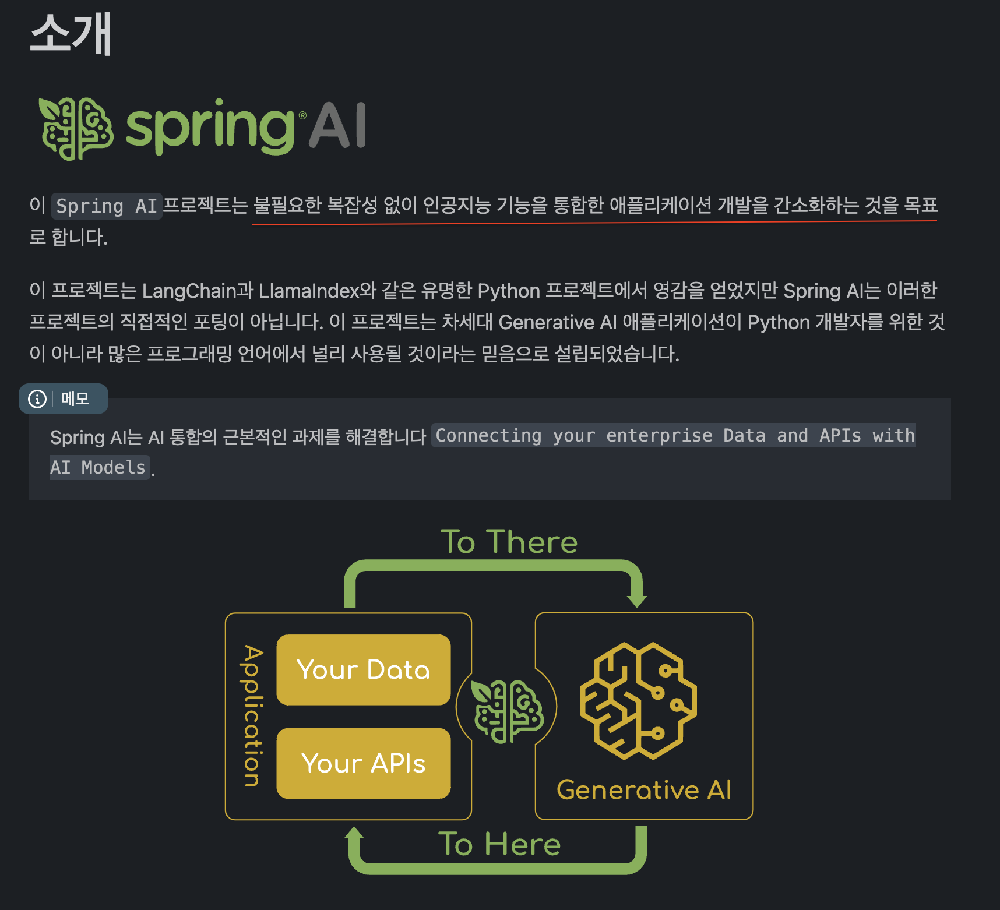

## Spring AI를 검토한 배경

2024년 여름 여러 프로젝트를 병행하면서 생성형 AI를 코드 작성과 리팩터링에 사용했다. 반복 작업에 드는 시간은 줄었지만, 결과의 정확성과 요구사항 충족 여부는 직접 검토해야 했다. 생산성 증가 폭을 일관된 기준으로 측정하지는 않았다.

코드를 고칠 때는 모델이 틀려도 내가 읽고 고치면 됐다. 이걸 배달 상담에 붙이면 어떨까? “주문 취소해 주세요”라는 문장을 알아들었다고 해서 취소할 수 있는 주문인지까지 알 수는 없다. 이미 가게에서 조리를 시작했을 수도 있다.

문의에서 취소 의도를 읽는 일은 모델에 맡겨 볼 만하다. 주문 상태를 조회하고 취소할 수 있는지 판단하는 일은 주문 서비스가 맡는다. 그러려면 모델의 답을 다음 코드가 받아 읽을 수 있어야 한다. 상담 API를 만들면서 가장 먼저 확인하고 싶었던 부분이다.

## Spring AI를 선택한 이유

Spring AI는 Java와 Spring 애플리케이션에 모델 호출, Tool Calling, 벡터 검색 등을 연결하는 프레임워크다. 이 프로젝트에서는 기존 Spring 구성 방식을 유지하면서 각 기능을 비교하고 시험하기 위해 선택했다.

모델이나 저장소를 교체하면 같은 호출 코드로도 응답 형식과 검색 결과가 달라질 수 있다. 연결 설정을 재사용하더라도 업무에 쓸 수 있는 답인지 다시 확인한다.

## 이 시리즈에서 구현할 기능

배달 문의 하나를 분류할 수 있으면 그다음에는 실제로 주문을 조회하는 도구를 연결해 볼 수 있다. 고객이 “그럼 언제 환불되나요?”라고 이어서 물으면 앞의 대화가 필요하고, 환불 기한까지 대답하려면 정책 문서도 찾아야 한다. 검색한 문서를 모델에 건네 답변에 쓰게 하는 방식이 RAG다. 그 문서를 찾아냈는지와 답이 문서대로 나왔는지는 따로 확인할 일이다.

아래는 각 실험에서 쓸 Spring AI 기능과 확인할 항목이다.

| 기능 | 역할 | 확인할 사항 |
| --- | --- | --- |
| Spring Boot 자동 구성 | 모델과 저장소 연결 설정 | 환경별 설정과 Bean 충돌 |
| 모델 연동 추상화 | 모델 호출 인터페이스 제공 | 모델별 기능과 응답 차이 |
| ChatClient API | 프롬프트 전달과 응답 처리 | 응답 형식, 지연, 실패 처리 |
| Prompt Template | 입력값을 반영해 프롬프트 구성 | 입력 검증과 변경 후 응답 품질 |
| Vector Embedding and Search | 문서 임베딩과 유사도 검색 | 청크 크기, 검색 범위, 관련성 |
| Advisors API | 호출 전후 공통 처리 | 실행 순서와 데이터 저장 범위 |
| RAG | 검색 문서를 모델 입력에 추가 | 근거와 답변의 일치 여부 |
| Observability and Model Evaluation | 호출 측정과 결과 평가 | 지표의 측정 범위와 평가 기준 |

첫 실험에는 아직 주문 조회를 붙이지 않았다. 문의 유형과 긴급도를 JSON으로 달라고 했을 때, 그 응답을 자바 코드에서 그대로 읽을 수 있을까? 걸린 시간과 사용한 토큰도 함께 기록했다. [첫 상담 API의 응답과 실행 로그](/backend/spring/spring-ai/round1/)
