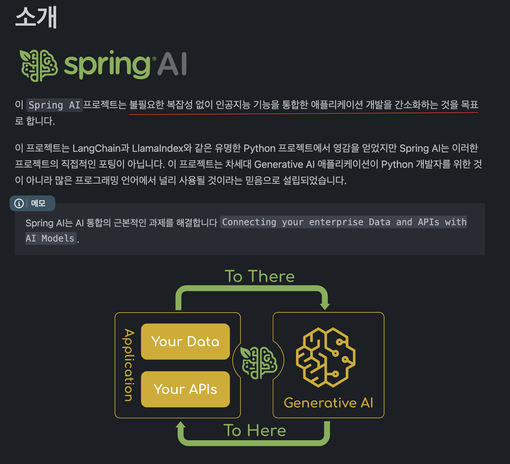

## Spring AI를 검토한 배경

2024년 여름 여러 프로젝트를 병행하면서 생성형 AI를 코드 작성과 리팩터링에 사용했다. 반복 작업에 드는 시간은 줄었지만, 결과의 정확성과 요구사항 충족 여부는 직접 검토해야 했다. 생산성 증가 폭을 일관된 기준으로 측정하지는 않았다.

도구 사용을 넘어 애플리케이션에 AI 기능을 연결해 보고 싶었다. 이 시리즈에서는 익숙한 Java와 Spring 환경에서 배달 상담 에이전트를 구현하며 다음을 확인한다.

- 모델 API 호출과 응답 변환을 어떻게 구성하는가
- Tool Calling, 대화 이력, RAG를 어떤 순서로 연결하는가
- 응답 품질, 지연, 토큰 사용량과 실패를 어떻게 측정하는가
- 프레임워크로 처리할 수 있는 부분과 서비스별로 설계해야 하는 부분은 무엇인가

## 웹 개발자 관점에서 필요한 지식

이번 학습의 범위는 모델 학습보다 애플리케이션 통합에 둔다. 다만 API를 호출할 수 있다는 사실만으로 서비스에 적용할 준비가 끝나는 것은 아니다.

- **모델의 입력과 출력**: 프롬프트, 토큰, 응답 형식과 오류 가능성
- **API 통합**: 인증, timeout, 재시도, 스트리밍 처리
- **데이터 처리**: 검색에 사용할 문서와 모델에 전달할 데이터의 범위
- **검증과 운영**: 업무 기준에 따른 평가, 지연과 비용 측정, 실패 시 대체 경로

## Spring AI를 선택한 이유

Spring AI는 Java와 Spring 애플리케이션에 모델 호출, Tool Calling, 벡터 검색 등을 연결하는 프레임워크다. 이 프로젝트에서는 기존 Spring 구성 방식을 유지하면서 각 기능을 비교하고 시험하기 위해 선택했다.

프레임워크를 사용해도 모델의 한계나 응답 검증이 없어지는 것은 아니다. 모델과 저장소를 바꿀 때도 지원 범위와 동작 차이를 확인해야 한다.

## 이 시리즈에서 구현할 기능

배달 상담 문의를 분류하는 API부터 시작해 주문 조회와 취소, 대화 이력, 정책 검색을 순서대로 연결한다. 각 단계에서는 실제 응답과 로그를 비교하고, 확인하지 못한 조건도 기록한다.

RAG는 검색한 문서를 답변의 근거로 전달하는 방식이다. 문서를 전달했다는 사실만으로 답변의 정확성을 보장할 수는 없으므로 검색 결과와 최종 응답을 함께 평가한다.

## 주요 기능과 확인할 사항

| 기능 | 역할 | 확인할 사항 |
| --- | --- | --- |
| Spring Boot 자동 구성 | 모델과 저장소 연결 설정 | 환경별 설정과 Bean 충돌 |
| 모델 연동 추상화 | 모델 호출 인터페이스 제공 | 모델별 기능과 응답 차이 |
| ChatClient API | 프롬프트 전달과 응답 처리 | 응답 형식, 지연, 실패 처리 |
| Prompt Template | 입력값을 반영해 프롬프트 구성 | 입력 검증과 변경 후 응답 품질 |
| Vector Embedding and Search | 문서 임베딩과 유사도 검색 | 청크 크기, 검색 범위, 관련성 |
| Advisors API | 호출 전후 공통 처리 | 실행 순서와 데이터 저장 범위 |
| RAG | 검색 문서를 모델 입력에 추가 | 근거와 답변의 일치 여부 |
| Observability and Model Evaluation | 호출 측정과 결과 평가 | 지표의 측정 범위와 평가 기준 |

다음 편에서는 문의를 JSON으로 분류하는 API를 구현하고 호출 지연, 형식 오류, 토큰 사용량을 측정한다.
