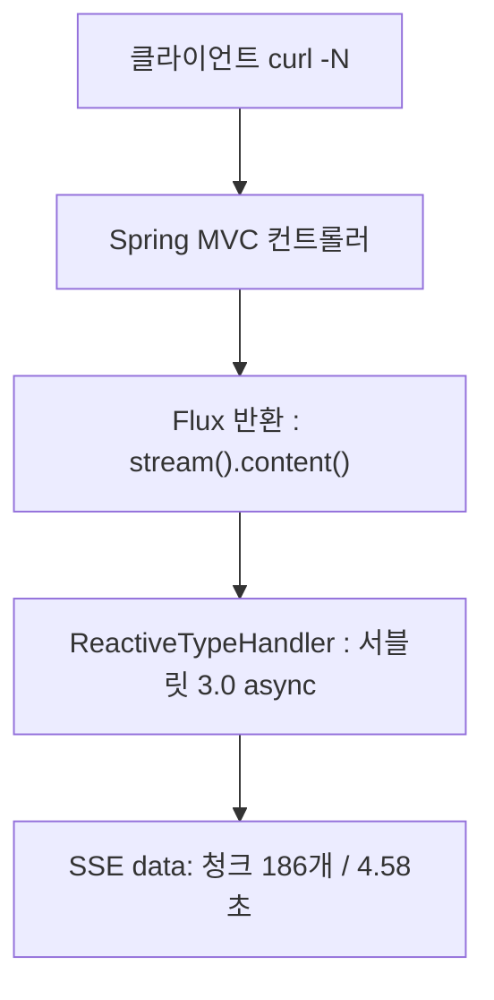

배달 상담 API가 고객 문의 한 건을 받아 유형과 긴급도를 JSON으로 돌려준다. 모델을 호출하는 코드는 `.call()` 한 줄이다. 응답을 열어 보니 형식, 걸린 시간, 사용한 토큰을 각각 확인할 필요가 있었다.

1편에서 계획했던 프로젝트를 6주간의 Spring AI 에이전트 과정(루퍼스 부트캠프)에서 구현했다. 배달 상담 에이전트를 만들며 매주 측정한 결과를 이 시리즈에 기록한다.

모델을 처음 불러오는 데 걸린 시간까지 포함하니 첫 호출은 26초였다. 프롬프트에서 한 줄을 빼자 HTTP 500이 돌아왔고, 스트리밍 응답에는 JSON이 한 글자씩 찍혔다. 형식 문제를 고친 뒤에는 입력을 바꿔도 같은 값이 나오는 필드가 눈에 띄었다.

로컬 Ollama에서 `qwen2.5:latest`(4.7GB)를 실행하고 temperature를 0.3으로 설정했다. 아래 응답 시간은 이 환경에서 curl로 요청을 보냈을 때의 값이다.

<style>
.agent-fig,.fig-defs{
  --fig-surface:#ffffff;--fig-ink:#0f172a;--fig-ink2:#334155;--fig-muted:#94a3b8;--fig-hair:#e6eaf1;
  --c-green:#16a34a;--c-greenink:#15803d;--c-red:#ef4444;--c-redink:#b91c1c;
  --c-blue:#2f6fed;--c-blueink:#1d4ed8;--c-amber:#d97706;--c-amberink:#b45309;
}
@media (prefers-color-scheme: dark){
  .agent-fig,.fig-defs{
    --fig-surface:#121317;--fig-ink:#f2f5fa;--fig-ink2:#cbd5e1;--fig-muted:#697588;--fig-hair:#252a33;
    --c-green:#34d399;--c-greenink:#6ee7b7;--c-red:#f87171;--c-redink:#fca5a5;
    --c-blue:#5b9bff;--c-blueink:#93c5fd;--c-amber:#fbbf24;--c-amberink:#fcd34d;
  }
}
.agent-fig{margin:2.4em 0;border:1px solid var(--fig-hair);border-radius:18px;background:var(--fig-surface);
  padding:18px 20px 10px;overflow:hidden;box-shadow:0 1px 2px rgba(2,6,23,.05),0 14px 40px rgba(2,6,23,.09)}
@media (prefers-color-scheme: dark){.agent-fig{box-shadow:0 1px 2px rgba(0,0,0,.4),0 18px 46px rgba(0,0,0,.5)}}
.agent-fig svg{width:100%;height:auto;display:block;max-width:100%}
.agent-fig svg text{font-family:ui-monospace,"SF Mono","JetBrains Mono",Menlo,monospace}
.agent-fig .cap-head{display:flex;justify-content:space-between;align-items:baseline;gap:14px;margin-bottom:6px}
.agent-fig .cap-tag{font-size:11px;letter-spacing:.14em;text-transform:uppercase;color:var(--fig-muted);
  font-family:ui-monospace,SFMono-Regular,Menlo,monospace}
.agent-fig figcaption{font-size:13.5px;color:var(--fig-muted);line-height:1.6;padding:12px 2px 6px;
  font-family:ui-monospace,SFMono-Regular,Menlo,monospace}
.agent-fig figcaption b{color:var(--fig-ink2);font-weight:600}
@media (prefers-reduced-motion: reduce){.agent-fig svg animate,.agent-fig svg animateMotion{display:none}}
</style>

<svg class="fig-defs" width="0" height="0" aria-hidden="true" focusable="false" style="position:absolute;width:0;height:0">
  <defs>
    <filter id="fx-glow" x="-60%" y="-60%" width="220%" height="220%">
      <feGaussianBlur stdDeviation="3" result="b"/>
      <feMerge><feMergeNode in="b"/><feMergeNode in="SourceGraphic"/></feMerge>
    </filter>
  </defs>
</svg>

## 모델 초기화를 포함한 호출과 이후 다섯 건의 응답 시간

기존 DB 조회와 외부 REST API 호출에 적용하던 지연 가정을 LLM 호출에도 그대로 적용할 수 있는지 확인했다.

이번 환경에서는 LLM 호출에 수 초가 걸렸다. 트리아지 5건을 연달아 호출한 첫 실측을 보자.

```text
LLM call elapsedMs=9736 promptTokens=1154 completionTokens=96  totalTokens=1250
LLM call elapsedMs=3909 promptTokens=1155 completionTokens=126 totalTokens=1281
LLM call elapsedMs=3737 promptTokens=1149 completionTokens=118 totalTokens=1267
LLM call elapsedMs=3803 promptTokens=1159 completionTokens=121 totalTokens=1280
LLM call elapsedMs=2938 promptTokens=1157 completionTokens=84  totalTokens=1241
```

모델 초기화를 포함한 호출은 26초였다. 이후 다섯 건은 2.9초에서 9.7초 사이였다. 처음에는 코드가 오래 걸리는 줄 알았는데, 모델을 한 번 불러온 뒤에도 사용자는 몇 초씩 기다려야 했다.

동기 `.call()`이 처리되는 동안 서블릿 스레드는 응답을 기다린다. 최대 스레드 수를 200으로 가정하면 동시 요청 증가 시 대기 요청이 쌓일 수 있다. 다만 이번 실험에서는 부하를 걸어 고갈 여부를 확인하지 않았으므로 구조상 위험으로 기록했다.

호출 객체를 다루는 방식은 처음부터 정해두는 게 좋다. 시스템 프롬프트가 고정된 컨트롤러라면 ChatClient는 생성자에서 한 번만 빌드한다.

```java
// com.baedal.support.SupportController
public SupportController(ChatClient.Builder builder) {
    this.chatClient = builder
            .defaultSystem(BaedalPrompt.SYSTEM_PROMPT)
            .build();
}
```

요청마다 `builder.build()`를 다시 부르는 코드는 AI에게 예시를 뽑아달라고 하면 자주 나오는 패턴인데, 빌드가 애플리케이션 생애에 1회인지 요청당 1회인지는 테스트로 박아두었다. 요청마다 프롬프트가 바뀌는 실험용 컨트롤러 하나만 예외다.

## SIMPLE 프롬프트에서만 500이 났다

프롬프트를 얼마나 정성 들여 써야 하는지 감을 잡고 싶었다. 그래서 같은 입력을 두 가지 프롬프트로 3회씩 돌려 분류가 얼마나 흔들리는지 보는 비교용 엔드포인트를 만들었다. 한쪽은 카테고리 정의와 금지 규칙까지 담은 전체 프롬프트(ENRICHED), 다른 한쪽은 "당신은 친절한 한국 배달 고객 상담사입니다" 한 줄(SIMPLE)이다.

총 18회 호출 중 1건이 HTTP 500으로 실패했다. 실패한 입력 조합은 다음과 같았다. SIMPLE 프롬프트에 "어제 시킨 거 먹고 토했어요" 입력. 같은 입력이 ENRICHED에서는 3회 모두 200이었다.

원인을 조사하다가 처음 세운 가설부터 틀렸다는 걸 알았다. 응답은 `.call().entity(SupportResponse.class)`로 받는다. 그런데 `.entity()`를 쓰면 Spring AI의 `BeanOutputConverter`가 응답 스키마에서 뽑은 JSON 형식 지시를 프롬프트에 자동으로 덧붙인다. 즉 SIMPLE에도 형식 지시가 아예 없던 게 아니다. 자동으로 붙는 지시 하나는 이미 있었다. ENRICHED에만 더 있던 것은 "JSON 외 다른 텍스트는 출력하지 않습니다"라는 명시적 보강 한 줄이다.

관측된 사실은 이렇다. 자동 지시만 있던 SIMPLE은 그 입력에서 3회 중 1회 자연어로 새어 나가 `BeanOutputConverter`가 JSON 추출에 실패했고 500이 났다. 자동 지시에 명시 보강까지 얹은 ENRICHED는 3회 모두 JSON을 지켰다. 다만 깨진 건 18회 전체에서 딱 1회다. 이 표본으로 "명시 한 줄이 500을 막는다"고 인과를 단정할 수는 없다. 말할 수 있는 데까지만 적으면, 형식 지시를 자동에만 맡기면 작은 페르소나 프롬프트에서도 파서가 깨질 수 있고 명시 보강이 그 확률을 낮추는 것으로 보인다. 아래 그림이 그 갈림길이다.

<figure class="agent-fig">
  <div class="cap-head"><span class="cap-tag">prompt line vs http status</span><span class="cap-tag">.entity() path</span></div>
  <svg viewBox="0 0 720 230" role="img" aria-label="같은 입력이 형식 지시가 있는 프롬프트에서는 JSON 을 거쳐 200, 없는 프롬프트에서는 자연어가 파서에 걸려 500 으로 갈라진다" xmlns="http://www.w3.org/2000/svg">
    <rect x="16" y="83" width="120" height="64" rx="12" fill="var(--c-blue)" opacity="0.10"/>
    <rect x="16" y="83" width="120" height="64" rx="12" fill="none" stroke="var(--c-blue)" stroke-opacity="0.4"/>
    <text x="76" y="110" text-anchor="middle" font-size="12" fill="var(--fig-ink)">같은 입력</text>
    <text x="76" y="128" text-anchor="middle" font-size="11" fill="var(--fig-muted)">"먹고 토했어요"</text>
    <path d="M136 100 C 190 70, 210 62, 252 62" fill="none" stroke="var(--fig-hair)" stroke-width="1.6"/>
    <path d="M136 130 C 190 160, 210 168, 252 168" fill="none" stroke="var(--fig-hair)" stroke-width="1.6"/>
    <g>
      <rect x="252" y="34" width="180" height="56" rx="12" fill="var(--c-green)" opacity="0.08"/>
      <rect x="252" y="34" width="180" height="56" rx="12" fill="none" stroke="var(--c-green)" stroke-opacity="0.4"/>
      <text x="342" y="57" text-anchor="middle" font-size="12" fill="var(--fig-ink)">자동 지시 + 명시 보강</text>
      <text x="342" y="75" text-anchor="middle" font-size="10.5" fill="var(--fig-muted)">"JSON 외 출력 금지" 한 줄</text>
    </g>
    <g>
      <rect x="252" y="140" width="180" height="56" rx="12" fill="var(--c-red)" opacity="0.07"/>
      <rect x="252" y="140" width="180" height="56" rx="12" fill="none" stroke="var(--c-red)" stroke-opacity="0.35"/>
      <text x="342" y="163" text-anchor="middle" font-size="12" fill="var(--fig-ink)">자동 지시만 (보강 없음)</text>
      <text x="342" y="181" text-anchor="middle" font-size="10.5" fill="var(--fig-muted)">자연어로 샌 1회</text>
    </g>
    <path d="M432 62 L500 62" fill="none" stroke="var(--fig-hair)" stroke-width="1.6"/>
    <path d="M432 168 L500 168" fill="none" stroke="var(--fig-hair)" stroke-width="1.6"/>
    <g>
      <rect x="500" y="34" width="200" height="56" rx="12" fill="var(--c-green)" opacity="0.12"/>
      <rect x="500" y="34" width="200" height="56" rx="12" fill="none" stroke="var(--c-green)" stroke-opacity="0.5"/>
      <text x="600" y="57" text-anchor="middle" font-size="13" font-weight="700" fill="var(--c-greenink)">200 SupportResponse</text>
      <text x="600" y="75" text-anchor="middle" font-size="10.5" fill="var(--fig-muted)">entity() 변환 성공</text>
    </g>
    <g>
      <rect x="500" y="140" width="200" height="56" rx="12" fill="var(--c-red)" opacity="0.12"/>
      <rect x="500" y="140" width="200" height="56" rx="12" fill="none" stroke="var(--c-red)" stroke-width="1.4">
        <animate attributeName="stroke-opacity" values="1;0.3;1" dur="2.4s" repeatCount="indefinite"/>
      </rect>
      <text x="600" y="163" text-anchor="middle" font-size="13" font-weight="700" fill="var(--c-redink)">500 Internal Error</text>
      <text x="600" y="181" text-anchor="middle" font-size="10.5" fill="var(--fig-muted)">JSON 추출 실패</text>
    </g>
    <circle r="4.5" fill="var(--c-green)" filter="url(#fx-glow)">
      <animateMotion path="M136 100 C 190 70, 210 62, 252 62 L432 62 L600 62" dur="5.6s" repeatCount="indefinite"/>
      <animate attributeName="opacity" values="0;1;1;0" keyTimes="0;0.08;0.9;1" dur="5.6s" repeatCount="indefinite"/>
    </circle>
    <circle r="4.5" fill="var(--c-red)" filter="url(#fx-glow)">
      <animateMotion path="M136 130 C 190 160, 210 168, 252 168 L432 168 L470 168" dur="5.6s" repeatCount="indefinite"/>
      <animate attributeName="opacity" values="0;1;1;0" keyTimes="0;0.08;0.62;0.7" dur="5.6s" repeatCount="indefinite"/>
    </circle>
  </svg>
  <figcaption>둘 다 <b>자동 형식 지시</b>는 있었다. 차이는 명시 보강 한 줄뿐이고, 18회 중 깨진 1회가 아래 레인이다. 인과 단정이 아니라 상관 관측이다.</figcaption>
</figure>

여기서 프롬프트를 보는 눈이 하나 바뀐다. 형식 지시는 자동으로 붙지만, 그 자동 지시를 모델이 지킬지는 보강 문구와 페르소나 프롬프트에 따라 흔들린다. 프롬프트와 `BeanOutputConverter`가 한 몸으로 배포된다는 사실은 그대로다. 프롬프트 변경은 컴파일 검사로 검증되지 않으며 실행 시 응답 파싱 실패로 500이 발생할 수 있다. 프롬프트 수정을 코드 수정과 같은 무게로 리뷰해야 하는 이유다.

## 일관성 1.0이라는 함정

프롬프트 비교에는 지표가 필요했다. 그래서 같은 입력 3회 중 가장 많이 나온 카테고리의 비율을 재는 categoryConsistency를 만들었다.

```java
// categoryConsistency = maxCategoryCount / totalRuns
long maxCat = catCounts.values().stream().mapToLong(Long::longValue).max().orElse(0);
return new PromptLabResult(results.size(), catCounts, urgCounts,
        results.isEmpty() ? 0 : (double) maxCat / results.size());
```

"음식에 머리카락이 나왔어요"라는 입력의 결과가 재미있다.

| 프롬프트 | category 분포 | urgency | consistency |
|---|---|---|---|
| SIMPLE | QUALITY 3 | HIGH 3 | 1.0 |
| ENRICHED | QUALITY 1, SAFETY 2 | CRITICAL 3 | 0.67 |

숫자만 보면 한 줄짜리 SIMPLE의 완승이다. 1.0 대 0.67. "프롬프트 정성 들여 쓸 필요 없는 거 아닌가?"라는 생각이 들 수 있다. 실제로 잠깐 그랬다.

SIMPLE에는 이물질 신고를 식품안전 또는 품질 중 어디로 분류할지에 관한 업무 기준(SOP)이 없었다. 같은 분류가 반복됐다는 결과만으로 업무 기준에 맞는 응답인지 판단할 수는 없다.

일관성 지표는 반복 응답의 일치도를 측정한다. 잘못된 분류가 반복돼도 1.0이 될 수 있다. 정확성을 평가하려면 업무 기준에 따라 라벨링한 골든 셋이 필요하지만 이번 실험에서는 준비하지 못했다. temperature를 바꾸면 프롬프트 효과와 샘플링 효과가 섞이므로 이번 비교에서는 값을 고정했다.

## JSON을 한 글자씩 흘려보내면 생기는 일

10초 블로킹의 다음 수순은 자연스럽게 스트리밍이다. 코드는 허무할 만큼 짧다.

```java
@PostMapping(produces = MediaType.TEXT_EVENT_STREAM_VALUE)
public Flux<String> chatStream(@Valid @RequestBody ChatRequest req) {
    return chatClient.prompt()
            .user(req.message())
            .stream()
            .content();
}
```

`Flux<String>`을 반환한다고 해서 WebFlux로 갈아타는 것은 아니다. Spring MVC 위에서 `ReactiveTypeHandler`가 서블릿 3.0 async로 처리해준다. 대신 `produces = text/event-stream`을 명시해야 한다. 빼먹으면 Jackson이 Flux를 기다렸다가 배열 하나로 통째 직렬화해버려서, 스트리밍을 붙이고도 스트리밍이 아니게 된다.



`curl -N`으로 두드리니 4.58초 동안 186개의 청크가 흘러나왔다. 여기까지는 성공이다. 문제는 내용물이었다. 트리아지용 시스템 프롬프트를 그대로 물려놓은 탓에, 흘러나오는 것이 JSON이었다.

```text
data:{
data:summary
data:고
data:객
data:님
```

JSON이 한 글자씩 도착하는 광경은 잠깐 웃기고 나서 곤란해진다. 부분 JSON은 클라이언트가 쓸 수 없다. 결국 클라이언트는 청크를 다 모아서 파싱해야 하고, 그러면 체감상 `.call()`과 똑같아진다. 얻은 것은 첫 글자가 빨리 도착한다는 사실 하나뿐이다.

정리하면 호출 방식과 응답 형식은 짝이다. 구조화된 JSON이 필요하면 `.call()`, 사람이 읽는 자연어면 `.stream()`. 짝을 어기면 500이 나거나(형식 지시 없는 `.call()`), 스트리밍이 무의미해진다(JSON 강제 `.stream()`). 스트리밍 경로에는 자연어 전용 프롬프트를 따로 둬야 한다는 숙제가 여기서 생겼다.

## 측정은 컨트롤러 밖에서

지연과 토큰을 재고 싶을 때 가장 쉬운 방법은 컨트롤러에 `log.info`를 박는 것이다. 하지만 그러면 컨트롤러마다 측정 코드가 복붙되고, 측정 구간에 `.entity()` 변환 시간까지 섞인다. 재고 싶은 것은 순수 LLM 왕복인데 말이다.

Spring AI에는 이 용도로 `CallAdvisor`라는 자리가 있다. `chain.nextCall(request)` 앞뒤를 잡으면 왕복만 정확히 잰다. Spring AOP의 `@Around`와 결이 같다.

```java
@Override public int getOrder() { return 100; }  // 스타터 주석: 큰 값일수록 바깥쪽

@Override
public ChatClientResponse adviseCall(ChatClientRequest request, CallAdvisorChain chain) {
    long startNanos = System.nanoTime();
    ChatClientResponse response = chain.nextCall(request);
    logSuccess(elapsedMs(startNanos), response);
    return response;
}
```

`getOrder()`를 100으로 둔 건 스타터 코드 주석이 "큰 값이면 체인 바깥쪽에서 측정한다"고 안내했기 때문이다. 실제로 100이 정말 바깥인지는 Advisor 둘을 끼워 실행 순서를 로그로 찍어봐야 확인되는데, 이번 주는 거기까진 안 갔다. 그래서 지금은 주석을 신뢰한 값이다.

토큰 메타데이터가 null이면 로그에 `promptTokens=null`을 그대로 남긴다. 0으로 채우면 진짜 0과 구분할 수 없기 때문이다.

측정이 붙고 나서야 보이는 것들이 있었다. 우선 promptTokens가 5건 모두 1149~1159로 거의 같았다. 상담 문의 길이와 거의 무관하게 매 호출 1150토큰 안팎이 고정으로 깔린다는 뜻이다. 다만 이 고정분을 전부 시스템 프롬프트 몫으로 볼 수는 없다. `.entity()`가 붙이는 `SupportResponse` 스키마(필드 7개, enum 3개)도 매 호출 프롬프트에 함께 실리기 때문이다. 시스템 프롬프트만 따로 토큰화하거나 `.content()`와 비교해보기 전까지, 확실한 건 "고정 오버헤드가 1150토큰쯤 된다"까지다.

주문번호까지 적힌 문의와 단서가 거의 없는 문의를 섞어 다섯 건을 보냈다. “근거가 부족하면 LOW”라고 적어 뒀는데도 `confidenceLevel`은 다섯 건 모두 MEDIUM이었다.

예상 처리 시간을 담는 `estimatedResolutionMinutes`도 전부 null이었다. 스키마 검증은 다섯 건 다 통과했다. 입력을 바꿨을 때 값도 달라지는지는 따로 시험해야 했다.

## 다음 이야기

첫 주는 예상보다 많이 넘어진 주였다. LLM 호출이 초 단위라는 것, `.entity()`가 형식 지시를 자동으로 붙이지만 작은 프롬프트에선 그게 깨질 수도 있다는 것까지는 그래도 납득이 갔다. 뜻밖은 두 가지였다. 정답 라벨이 없으니 일관성 1.0이 틀린 분류에도 찍혔고, JSON을 스트리밍했더니 첫 글자만 빨라진 채 결국 `.call()`과 같아졌다.

못 간 곳도 있다. 스트리밍 경로의 TTFT(첫 토큰까지의 시간)는 `CallAdvisor`가 `.call()` 전용이라 재지 못했다. Advisor의 실패 로그는 정상 경로만 돌린 탓에 한 번도 발화하지 않았다. 매 호출 1150토큰쯤 되는 고정 오버헤드가 시스템 프롬프트와 응답 스키마로 각각 얼마씩 나뉘는지도 아직 안 재봤다.

현재 API는 문의를 분류하며 주문 데이터를 변경하지 않는다. 다음 편에서는 주문 조회와 취소를 Tool Calling으로 연결하고, 실제 실행 결과와 모델의 안내가 일치하는지 확인한다.
