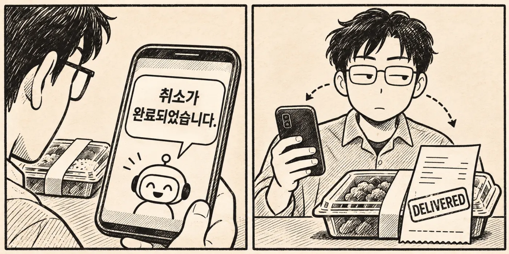
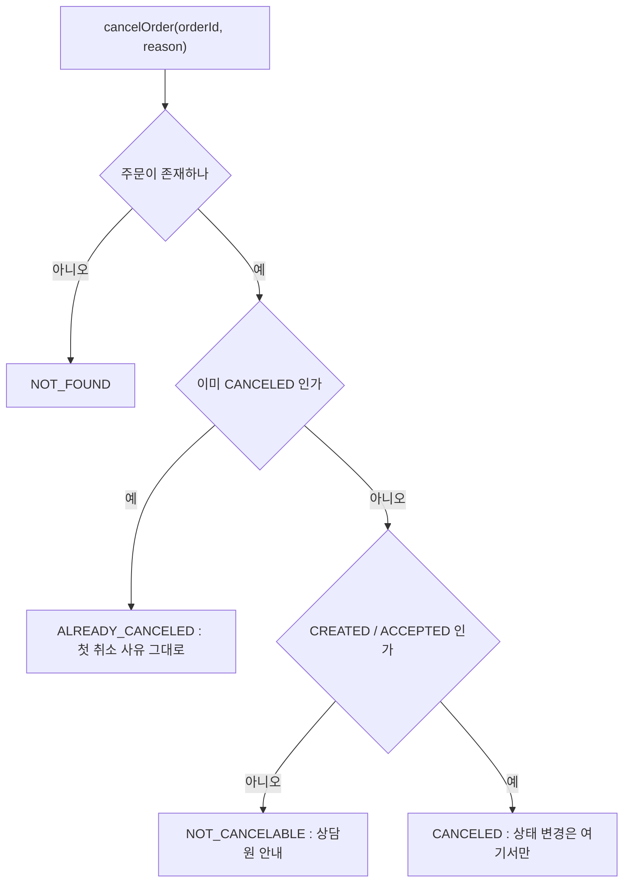

상담봇이 주문 번호를 받아 상세를 조회하는 데서, 고객 요청으로 주문을 취소하는 데까지 이어 봤다. 이제 답변에 ‘취소’라는 단어가 나왔을 때 확인할 곳이 두 군데다. 고객에게 보인 문장과 서버에 남은 주문 상태다.

주문 조회, 배달 상태 조회, 주문 취소를 담당하는 Spring 메서드에 `@Tool`을 붙였다. 모델이 도구를 골랐을 때 취소해도 되는 주문인지 확인하는 코드와, 호출 뒤 모델에 되돌려 줄 값을 정했다.

환경은 2편과 같다. 로컬 Ollama `qwen2.5`, temperature 0.3, 엔드포인트는 `/api/v1/assistant`.

<style>
.agent-fig,.fig-defs{
  --fig-surface:#ffffff;--fig-ink:#0f172a;--fig-ink2:#334155;--fig-muted:#94a3b8;--fig-hair:#e6eaf1;
  --c-green:#16a34a;--c-greenink:#15803d;--c-red:#ef4444;--c-redink:#b91c1c;
  --c-blue:#2f6fed;--c-blueink:#1d4ed8;--c-amber:#d97706;--c-amberink:#b45309;
}
@media (prefers-color-scheme: dark){
  .agent-fig,.fig-defs{
    --fig-surface:#121317;--fig-ink:#f2f5fa;--fig-ink2:#cbd5e1;--fig-muted:#697588;--fig-hair:#252a33;
    --c-green:#34d399;--c-greenink:#6ee7b7;--c-red:#f87171;--c-redink:#fca5a5;
    --c-blue:#5b9bff;--c-blueink:#93c5fd;--c-amber:#fbbf24;--c-amberink:#fcd34d;
  }
}
.agent-fig{margin:2.4em 0;border:1px solid var(--fig-hair);border-radius:18px;background:var(--fig-surface);
  padding:18px 20px 10px;overflow:hidden;box-shadow:0 1px 2px rgba(2,6,23,.05),0 14px 40px rgba(2,6,23,.09)}
@media (prefers-color-scheme: dark){.agent-fig{box-shadow:0 1px 2px rgba(0,0,0,.4),0 18px 46px rgba(0,0,0,.5)}}
.agent-fig svg{width:100%;height:auto;display:block;max-width:100%}
.agent-fig svg text{font-family:ui-monospace,"SF Mono","JetBrains Mono",Menlo,monospace}
.agent-fig .cap-head{display:flex;justify-content:space-between;align-items:baseline;gap:14px;margin-bottom:6px}
.agent-fig .cap-tag{font-size:11px;letter-spacing:.14em;text-transform:uppercase;color:var(--fig-muted);
  font-family:ui-monospace,SFMono-Regular,Menlo,monospace}
.agent-fig figcaption{font-size:13.5px;color:var(--fig-muted);line-height:1.6;padding:12px 2px 6px;
  font-family:ui-monospace,SFMono-Regular,Menlo,monospace}
.agent-fig figcaption b{color:var(--fig-ink2);font-weight:600}
@media (prefers-reduced-motion: reduce){.agent-fig svg animate,.agent-fig svg animateMotion{display:none}}
</style>

<svg class="fig-defs" width="0" height="0" aria-hidden="true" focusable="false" style="position:absolute;width:0;height:0">
  <defs>
    <filter id="fx-glow2" x="-60%" y="-60%" width="220%" height="220%">
      <feGaussianBlur stdDeviation="3" result="b"/>
      <feMerge><feMergeNode in="b"/><feMergeNode in="SourceGraphic"/></feMerge>
    </filter>
  </defs>
</svg>

## Tool 실행 없이 반환된 취소 완료 안내

Tool을 붙인 첫날, 이미 배달을 마친 주문 2024-1236을 취소해 달라고 했다. 봇의 답에는 이런 문장이 있었다. “취소가 완료되었습니다.”



서버 로그에는 `[Tool] cancelOrder`가 없었다. 주문을 다시 보니 상태도 `DELIVERED` 그대로였다. 취소가 끝난 곳은 채팅창 하나였다.

다른 주문에서는 도구 이름까지 나왔다. 2024-1235를 취소해 달라는 요청에 돌아온 답변의 첫 줄이다.

```text
)((((cancelOrder {"orderId": "2024-1235", "reason": "고객 요청"}))))
```

주문 번호에 취소 사유까지 맞다. 그런데 이 줄이 찍힌 곳은 고객이 읽는 응답 본문이다. 서버에는 이번에도 호출 로그가 없었다. [취소 요청 두 건의 응답 원문](https://github.com/hyungkishin/loop-play-spring-ai-agent/blob/c213d52/docs/2주차/실측-raw/단계1-시나리오5종.md)

> 판단은 LLM이 하고, 실행은 Spring Bean이 한다.

주문 상태를 바꾸는 코드는 `OrderTools.cancelOrder()` 안에 있다. 모델이 도구 호출을 요청하면 Spring AI가 이 메서드에 인자를 넘긴다. 두 주문에서는 여기까지 오지 않았다. 이제 답을 검토할 때는 고객이 읽은 문장 옆에 도구 호출 로그와 저장된 주문 상태를 놓고 본다.

## boolean으로 구분할 수 없는 취소 결과

이번에는 `cancelOrder()`가 실제로 불렸다고 하자. 주문이 없을 때도, 이미 취소했을 때도 `false`를 돌려주면 고객에게 뭐라고 답해야 할까? 주문이 없으면 번호를 다시 물어야 한다. 이미 취소한 주문이라면 첫 취소가 처리됐다고 알려주면 된다. 메서드가 주문을 확인하면서 알아낸 사정을 반환값에 담았다.

```java
public record CancelOrderResult(String orderId, Outcome outcome, String message) {
    public enum Outcome {
        CANCELED, ALREADY_CANCELED, NOT_CANCELABLE, NOT_FOUND
    }
}
```

이름도 신경 썼다. `STATUS_1`이 아니라 `ALREADY_CANCELED`처럼 그대로 읽으면 뜻이 되는 이름이어야 모델이 값을 문장으로 옮기기만 하면 된다. `UNKNOWN`과 `FAILED`는 일부러 뺐다. "실패"라는 단어가 섞이는 순간 모델이 "취소 실패"로 잘못 옮길 위험이 생기기 때문이다.



그렇다면 이 분기들이 정말 각자 일을 하고 있을까? 확인하는 가장 확실한 방법은 하나씩 지워보는 것이다.

| 실험 | 제거한 분기 | 관찰된 결과 |
|---|---|---|
| A | ALREADY_CANCELED | 데이터는 무사. 하지만 재취소가 NOT_CANCELABLE로 떨어져 "조리가 이미 시작되어 자동 취소 불가"라는 엉뚱한 안내 |
| B | 둘 다 | 취소 사유가 "집 앞에 사람이 없어요"에서 "한 번 더 확인 부탁드려요"로 덮어써지고 canceledAt 갱신 |

지워보니 역할이 선명해졌다. ALREADY_CANCELED 분기는 안내 메시지의 정확성을 지키고 있었고, NOT_CANCELABLE 분기는 데이터 무결성을 지키고 있었다. 실험 B의 이중 실행을 운영 환경으로 옮겨보면 결제 이중 취소, 포인트 이중 환급, 사장님 이중 알림이다. 돈이 직접 움직이는 자리다.

분기를 되살린 상태에서 같은 주문에 취소를 두 번 요청한 로그는 이렇다.

```text
[Tool] cancelOrder(orderId=2024-1239, reasonLength=12)
LLM call elapsedMs=2545 promptTokens=2810 completionTokens=85
[Tool] cancelOrder(orderId=2024-1239, reasonLength=12)
LLM call elapsedMs=3250 promptTokens=2807 completionTokens=114
```

첫 호출은 `CANCELED`, 두 번째는 `ALREADY_CANCELED`였다. 두 번째 안내에도 처음 취소한 사유가 그대로 나왔다. 요청을 두 번 보냈어도 첫 취소 기록은 남았다.

같은 주문에 취소 요청 두 건이 동시에 들어오는 경우는 아직 확인하지 못했다. 이번 실험은 단일 스레드로 실행했다.

## Tool 반환 데이터에서 민감 필드 제외하기

도메인 객체 `Order`에는 배달 주소가 들어 있다. "서울시 강남구 역삼동 123-4" 같은 값이다. Tool이 이 객체를 그대로 반환하면 주소가 모델의 입력 토큰에 박히고, 그 순간부터 언제든 응답 문장으로 샐 수 있는 상태가 된다.

그래서 Tool은 도메인이 아니라 축소판 View를 반환한다. 주문 상세를 주는 `OrderDetailView`에서는 `deliveryAddress`와 `canceledReason`을 아예 뺐다. 배달 상태를 주는 `DeliveryStatusView`는 아래처럼 `riderLocation`을 배달 중일 때만 채운다.

```java
private DeliveryStatusView toDeliveryView(Order order) {
    String rider = order.status() == OrderStatus.DELIVERING ? order.riderLocation() : null;
    return new DeliveryStatusView(order.orderId(), order.status().name(), rider,
            order.estimatedDeliveryAt());
}
```

아직 조리 중(COOKING)인데 라이더 위치 값이 들어 있으면, 모델이 그 값을 근거로 현재 배달 상태와 맞지 않는 안내를 생성할 수 있다. 그래서 배달 중이 아닌 상태에서는 아예 null로 비운다.

프롬프트 지시만으로 민감정보 노출을 막기 어렵다. Tool 반환 타입에서 불필요한 필드를 제외해 모델에 전달되는 데이터부터 줄였다. 다만 다른 입력 경로에 같은 정보가 포함되거나 모델이 잘못된 정보를 생성하는 경우까지 이 조치로 막을 수는 없다.

## description을 고쳐서 될 문제가 아니었다

`@Tool`의 description은 모델이 Tool을 고를 때 읽는 사용 설명서다. 이걸 정성 들여 쓰면 호출률이 오를까? 궁금해서 세 가지 버전을 만들어 같은 발화를 5회씩 돌렸다.

| 버전 | description | Tool 호출 (5회 중) | 1차 promptTokens |
|---|---|---|---|
| A | 기준 6줄 : 무엇 / 언제 / 입력 / 실패 | 3 | 1347 |
| B | "배달 정보 조회" 한 줄 | 2 | 1223 |
| C | 실제 반환값과 다른 설명 : "메뉴와 결제 금액만 반환한다" | 4 | 1237 |

예상은 두 군데서 깨졌다.

실제 반환값을 잘못 설명한 C에서 오히려 다섯 번 중 네 번 도구를 불렀다. C의 첫 줄에는 고객 문의와 같은 단어인 “주문번호”가 있다. 혹시 이것 때문이었을까? 그 단어 하나만 바꿔 본 실행은 없어 여기서 원인을 가를 수는 없다.

C에서도 모델은 Tool이 돌려준 배달 정보를 답에 썼다. 도구 설명만 바꾼 실험이니 반환 데이터 자체가 틀렸을 때도 같은 답이 나올지는 따로 확인해야 한다.

도구가 불리지 않은 응답의 첫머리에는 `ONGLUGE`, `ロン`, `.nlm` 같은 문자열도 남았다. 왜 이 문자열이 고객에게 전달됐는지는 세 설명의 호출 횟수만 봐서는 알 수 없다. A와 C의 차이도 고작 한 번이다.

## Tool Calling의 지연과 토큰 비용

Tool 왕복의 시간을 분해해보면 의외의 사실이 나온다.

```text
T0 16:05:36.847 DefaultToolCallingManager  Executing tool call: getDeliveryStatus
T2 16:05:36.849 OrderTools  [Tool] getDeliveryStatus(orderId=2024-1234)
T4 16:05:36.849 DefaultToolCallResultConverter  Converting to JSON
T5 16:05:38.355 PerformanceLoggingAdvisor  LLM call elapsedMs=5844 promptTokens=2803
```

도구의 실행 시간은 2ms였다. 그런데 고객이 답을 받으려면 모델을 두 번 호출해야 했다. 첫 응답에는 호출할 도구가, 두 번째 응답에는 실행 결과를 설명하는 문장이 들어갔다.

<figure class="agent-fig">
  <div class="cap-head"><span class="cap-tag">tool calling round trip</span><span class="cap-tag">qwen2.5 measured</span></div>
  <svg viewBox="0 0 720 250" role="img" aria-label="Tool 호출 한 번은 LLM 왕복 두 번을 만든다. Tool 실행 자체는 2ms 다. advisor 에 기록된 promptTokens 2803 과 5844ms 는 두 왕복을 합친 값이다" xmlns="http://www.w3.org/2000/svg">
    <g>
      <rect x="16" y="96" width="120" height="58" rx="12" fill="var(--c-blue)" opacity="0.10"/>
      <rect x="16" y="96" width="120" height="58" rx="12" fill="none" stroke="var(--c-blue)" stroke-opacity="0.4"/>
      <text x="76" y="121" text-anchor="middle" font-size="12" fill="var(--fig-ink)">사용자 발화</text>
      <text x="76" y="139" text-anchor="middle" font-size="10.5" fill="var(--fig-muted)">"어디쯤이에요?"</text>
    </g>
    <g>
      <rect x="228" y="30" width="180" height="58" rx="12" fill="var(--c-amber)" opacity="0.10"/>
      <rect x="228" y="30" width="180" height="58" rx="12" fill="none" stroke="var(--c-amber)" stroke-opacity="0.45"/>
      <text x="318" y="55" text-anchor="middle" font-size="12" fill="var(--fig-ink)">1차 LLM : Tool 선택</text>
      <text x="318" y="73" text-anchor="middle" font-size="10.5" fill="var(--c-amberink)">도구 이름과 인자 반환</text>
    </g>
    <g>
      <rect x="228" y="162" width="180" height="58" rx="12" fill="var(--c-green)" opacity="0.09"/>
      <rect x="228" y="162" width="180" height="58" rx="12" fill="none" stroke="var(--c-green)" stroke-opacity="0.45"/>
      <text x="318" y="187" text-anchor="middle" font-size="12" fill="var(--fig-ink)">OrderTools Bean</text>
      <text x="318" y="205" text-anchor="middle" font-size="10.5" fill="var(--c-greenink)">실행 2ms</text>
    </g>
    <g>
      <rect x="520" y="96" width="184" height="58" rx="12" fill="var(--c-blue)" opacity="0.12"/>
      <rect x="520" y="96" width="184" height="58" rx="12" fill="none" stroke="var(--c-blue)" stroke-opacity="0.5"/>
      <text x="612" y="121" text-anchor="middle" font-size="12" font-weight="700" fill="var(--c-blueink)">2차 LLM : 응답 생성</text>
      <text x="612" y="139" text-anchor="middle" font-size="10.5" fill="var(--fig-muted)">Tool 결과로 답변 작성</text>
    </g>
    <path d="M136 112 C 180 90, 196 68, 228 62" fill="none" stroke="var(--fig-hair)" stroke-width="1.6"/>
    <path d="M318 88 L318 162" fill="none" stroke="var(--fig-hair)" stroke-width="1.6"/>
    <path d="M408 190 C 470 184, 490 150, 520 132" fill="none" stroke="var(--fig-hair)" stroke-width="1.6"/>
    <circle r="4.5" fill="var(--c-blue)" filter="url(#fx-glow2)">
      <animateMotion path="M136 112 C 180 90, 196 68, 228 62 L318 62 L318 191 L408 191 C 470 184, 490 150, 520 125 L700 125" dur="6s" repeatCount="indefinite"/>
      <animate attributeName="opacity" values="0;1;1;0" keyTimes="0;0.06;0.92;1" dur="6s" repeatCount="indefinite"/>
    </circle>
    <text x="360" y="242" text-anchor="middle" font-size="10.5" fill="var(--fig-muted)">입력 2,803토큰 (두 호출 합계), 응답까지 5,844ms</text>
  </svg>
  <figcaption>이 질문에 모델은 두 번 응답했다. advisor에 찍힌 <b>입력 토큰은 두 호출의 합</b>이고, 응답 시간에는 그 사이의 도구 실행도 들어간다.</figcaption>
</figure>

그럼 도구를 붙였을 때 입력 토큰은 얼마나 늘었을까? 같은 발화를 Tool 없는 순수 챗봇과 Tool 3개 붙은 상담봇에 각각 넣은 것이다.

| 발화 | Tool 없는 `/chat` | Tool 붙은 `/assistant` |
|---|---|---|
| "안녕하세요" | promptTokens 32 | promptTokens 1329 |
| "주문번호 2024-1234 배달 어디쯤?" | promptTokens 50 | promptTokens 2803 (두 왕복 합) |

인사 한마디에 1297토큰 차이가 난다. 이 1297의 큰 몫은 시스템 프롬프트이고, Tool 3개가 얹는 스키마는 그중 일부다. 2주차 로그에서 Tool 하나를 더할 때 늘어난 값은 호출당 50~60토큰 정도였다. 주문 문의는 50 대 2803, 56배다. 응답 시간도 2062ms에서 5844ms로 늘었다.

2803은 2차 왕복 하나의 값이 아니다. Spring AI 1.0.0의 `OllamaChatModel`은 도구를 실행한 뒤 모델을 다시 부를 때 첫 응답을 함께 넘긴다. 두 번째 응답의 usage를 만들면서 첫 응답의 promptTokens와 completionTokens를 더한다. advisor는 이렇게 합친 마지막 응답을 받았다. 그래서 2803에 1차 왕복의 토큰을 따로 더하면 같은 토큰을 두 번 세게 된다. [OllamaChatModel 1.0.0의 usage 누적 코드](https://github.com/spring-projects/spring-ai/blob/v1.0.0/models/spring-ai-ollama/src/main/java/org/springframework/ai/ollama/OllamaChatModel.java#L159-L195)

앞의 왕복 로그에서 시각도 같은 쪽을 가리킨다. advisor 로그는 38.355초에 찍혔고 elapsedMs는 5844다. 측정은 32.5초 무렵에 시작됐다는 뜻이고, 도구가 실행된 36.847초보다 4초 넘게 앞이다. 5844ms에는 첫 모델 요청부터 두 번째 답변이 끝날 때까지가 들어 있다. 왕복별 사용량과 비용은 이번에 따로 남기지 않았다. 나누어 보려면 요청마다 Ollama 원시 응답의 `prompt_eval_count`와 `eval_count`를 기록해야 한다.

## 취소 요청 네 건에서 도구는 한 번 불렸다

취소 결과 네 가지를 각각 유도해 봤는데, 모델이 `cancelOrder`를 부른 건 딱 한 번이었다. description 문제인지, 7B 모델의 한계인지, Spring AI와 Ollama 통합의 문제인지 이번 표본으로는 가릴 수 없었다. 결국 멱등성 4분기는 단위 테스트로 검증했다. orderId만 알면 남의 주문도 조회되는 권한 문제는 Spring Security의 영역이라 시리즈 밖에 뒀다.

“2024-1234 어디예요?”라고 조회하고 곧바로 “그거 취소해줘”라고 하면 어떨까. 두 번째 요청에는 주문 번호가 없다. 지금은 매 호출이 첫 대화라서, 앞에서 찾은 주문을 봇에게 다시 알려 줘야 한다. [“그거”가 가리키는 주문을 다음 요청에서도 찾으려면](/backend/spring/spring-ai/round3/)