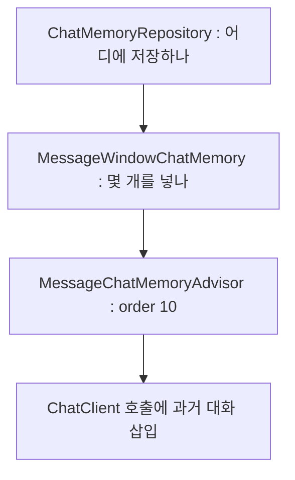

고객이 “2024-1234 어디예요?”라고 물은 다음 “그거 취소해줘”라고 했다. 두 번째 문장에는 주문 번호가 없다. 서버가 앞선 대화를 다음 프롬프트에 담아야 모델이 주문을 찾을 수 있다.

대화를 어느 세션에 저장하고 몇 개의 메시지를 다시 보낼지 나눠 실험했다. 같은 열 턴의 대화에 이력 창 크기 2, 20, 무제한을 차례로 적용했다.

환경은 지금까지와 같다. Ollama `qwen2.5`, temperature 0.3.

<style>
.agent-fig,.fig-defs{
  --fig-surface:#ffffff;--fig-ink:#0f172a;--fig-ink2:#334155;--fig-muted:#94a3b8;--fig-hair:#e6eaf1;
  --c-green:#16a34a;--c-greenink:#15803d;--c-red:#ef4444;--c-redink:#b91c1c;
  --c-blue:#2f6fed;--c-blueink:#1d4ed8;--c-amber:#d97706;--c-amberink:#b45309;
}
@media (prefers-color-scheme: dark){
  .agent-fig,.fig-defs{
    --fig-surface:#121317;--fig-ink:#f2f5fa;--fig-ink2:#cbd5e1;--fig-muted:#697588;--fig-hair:#252a33;
    --c-green:#34d399;--c-greenink:#6ee7b7;--c-red:#f87171;--c-redink:#fca5a5;
    --c-blue:#5b9bff;--c-blueink:#93c5fd;--c-amber:#fbbf24;--c-amberink:#fcd34d;
  }
}
.agent-fig{margin:2.4em 0;border:1px solid var(--fig-hair);border-radius:18px;background:var(--fig-surface);
  padding:18px 20px 10px;overflow:hidden;box-shadow:0 1px 2px rgba(2,6,23,.05),0 14px 40px rgba(2,6,23,.09)}
@media (prefers-color-scheme: dark){.agent-fig{box-shadow:0 1px 2px rgba(0,0,0,.4),0 18px 46px rgba(0,0,0,.5)}}
.agent-fig svg{width:100%;height:auto;display:block;max-width:100%}
.agent-fig svg text{font-family:ui-monospace,"SF Mono","JetBrains Mono",Menlo,monospace}
.agent-fig .cap-head{display:flex;justify-content:space-between;align-items:baseline;gap:14px;margin-bottom:6px}
.agent-fig .cap-tag{font-size:11px;letter-spacing:.14em;text-transform:uppercase;color:var(--fig-muted);
  font-family:ui-monospace,SFMono-Regular,Menlo,monospace}
.agent-fig figcaption{font-size:13.5px;color:var(--fig-muted);line-height:1.6;padding:12px 2px 6px;
  font-family:ui-monospace,SFMono-Regular,Menlo,monospace}
.agent-fig figcaption b{color:var(--fig-ink2);font-weight:600}
@media (prefers-reduced-motion: reduce){.agent-fig svg animate,.agent-fig svg animateMotion{display:none}}
</style>

## 대화 이력 처리를 세 계층으로 나누는 이유

대화 이력에는 별개로 바꿔 볼 설정이 둘 있다. 어디에 저장할지, 다음 요청에 몇 개까지 포함할지다. 이번에는 저장소를 바꾼 뒤에도 같은 보관 개수로 시험할 수 있게 나눴다.

곰곰이 보면 "기억"은 서로 다른 세 가지 질문의 합이다. 어디에 저장하나. 몇 개를 프롬프트에 넣나. 호출에 어떻게 끼워 넣나. Spring AI는 이 세 질문에 각각 레이어를 하나씩 두고 있다.

```java
@Bean @Profile("!jdbc")
ChatMemoryRepository chatMemoryRepository() {
    return new InMemoryChatMemoryRepository();          // 층 1 : 어디에 저장하나
}
@Bean
ChatMemory chatMemory(ChatMemoryRepository repository,
        @Value("${baedal.chat-memory.max-messages:20}") int maxMessages) {
    return MessageWindowChatMemory.builder()            // 층 2 : 몇 개를 넣나
            .chatMemoryRepository(repository)
            .maxMessages(maxMessages).build();
}
@Bean
MessageChatMemoryAdvisor messageChatMemoryAdvisor(ChatMemory chatMemory) {
    return MessageChatMemoryAdvisor.builder(chatMemory) // 층 3 : 어떻게 끼우나
            .order(10).build();
}
```



`order(10)`으로 설정한 Memory Advisor는 토큰을 기록하는 Advisor(order 100)보다 먼저 대화 이력을 추가한다. 저장소는 프로파일에서, 보관 개수는 설정값에서 각각 바꿨다.

## 세션 헤더 누락 시 대화 이력이 섞이는 문제

기억을 만들었으면 다음 질문은 "누구의 기억인가"다. 고객 A의 대화와 고객 B의 대화는 갈라져야 한다. 이 프로젝트에서는 `X-Session-Id` 헤더가 그 경계다.

처음에는 헤더가 없으면 Spring AI의 기본값인 `default` 세션으로 흘리도록 두었다. 관대해 보이는 이 기본값의 끝을 그려보면 좀 무섭다. 구버전 클라이언트 셋이 헤더 없이 접속하면 세 사용자의 대화가 전부 `default`라는 한 세션에 쌓인다. A가 말한 주문번호가 B의 "그거"로 풀린다. 남의 주문이 취소될 수 있는 경로다.

그래서 헤더를 필수로 바꿨다. 헤더가 없는 요청은 기억에 닿기 전에 400으로 끊긴다.

```java
@PostMapping
public String ask(@Valid @RequestBody ChatRequest req,
                  @RequestHeader("X-Session-Id") String sessionId) {
    return chatClient.prompt()
            .user(req.message())
            .advisors(a -> a.param(ChatMemory.CONVERSATION_ID, sessionId))
            .call().content();
}
```

ChatClient는 생성자에서 한 번만 빌드하고, 요청 시점에는 conversationId만 갈아 끼운다. 같은 클라이언트 객체가 요청마다 다른 세션을 태우는 구조다. 세션 A와 B가 섞이지 않는 것은 테스트로 고정해두었다. 구버전 클라이언트 호환이라는 편의를 버린 셈인데, 편의는 게이트웨이에서 헤더를 채워주면 복구할 수 있지만 오염된 기억은 복구할 방법이 없다.

## 메시지를 두 개만 남기자 여섯 번째 문의에서 주문번호가 빠졌다

기억을 몇 개까지 실어 보낼지는 `MAX_MESSAGES`가 정한다. 이 값을 2, 20, 100000(거의 무제한)으로 바꿔가며 같은 10턴 시나리오를 돌렸다. 결과부터 보자. 표의 "지시 대명사 해결"은 봇의 정답률이 아니라, 맥락을 잃지 않고 "그거"나 "1235"를 옳은 대상에 연결한 턴 수다.

| 실험 | MAX_MESSAGES | 평균 입력 토큰 | 평균 응답 시간 | 지시 대명사 해결 |
|---|---|---|---|---|
| A | 20 | 2133.5 | 2711.4ms | 6/10 |
| B | 2 | 1853.5 | 2849.8ms | 2/10 |
| C | 100000 | 2126.8 | 2706.4ms | 8/10 |

메시지를 두 개만 보관한 실험 B에서는 직전 질문과 답변 한 쌍만 남았다. 여섯 번째 문의는 “그럼 1235는 취소되죠?”였다. 전체 주문번호 `2024-1235`가 나온 세 번째 문의는 이 설정의 보관 범위를 벗어난다.

열 번째로 “지금까지 요약해줘”라고 했을 때도 답변에는 바로 앞 문의만 나왔다. 그림은 보관 개수에 따라 세 번째 문의를 다시 참조할 수 있는지 나타낸다.

<figure class="agent-fig">
  <div class="cap-head"><span class="cap-tag">여섯 번째 문의에 남은 대화</span><span class="cap-tag">MAX_MESSAGES 20 vs 2</span></div>
  <svg viewBox="0 0 720 300" role="img" aria-label="여섯 번째 문의에서 세 번째 문의의 주문번호가 필요하다. 메시지를 20개 남기면 번호를 찾았고 두 개만 남기면 찾지 못했다" xmlns="http://www.w3.org/2000/svg">
    <text x="20" y="30" font-size="12" font-weight="700" fill="var(--fig-ink2)">MAX_MESSAGES = 20</text>
    <g>
      <rect x="20" y="44" width="560" height="56" rx="10" fill="var(--c-green)" opacity="0.06"/>
      <rect x="20" y="44" width="560" height="56" rx="10" fill="none" stroke="var(--c-green)" stroke-opacity="0.45" stroke-dasharray="6 4"/>
      <text x="590" y="76" font-size="10.5" fill="var(--c-greenink)">창 안</text>
    </g>
    <g font-size="10.5" text-anchor="middle">
      <rect x="36" y="56" width="84" height="32" rx="7" fill="var(--c-blue)" opacity="0.16"/>
      <text x="78" y="76" fill="var(--fig-ink)">턴3 : 2024-1235</text>
      <rect x="132" y="56" width="60" height="32" rx="7" fill="var(--fig-muted)" opacity="0.12"/>
      <text x="162" y="76" fill="var(--fig-muted)">1, 2턴</text>
      <rect x="204" y="56" width="60" height="32" rx="7" fill="var(--fig-muted)" opacity="0.12"/>
      <text x="234" y="76" fill="var(--fig-muted)">4, 5턴</text>
      <rect x="276" y="56" width="120" height="32" rx="7" fill="var(--c-amber)" opacity="0.16"/>
      <text x="336" y="76" fill="var(--fig-ink)">턴6 : "1235는?"</text>
    </g>
    <path d="M336 56 C 300 20, 130 20, 82 52" fill="none" stroke="var(--c-green)" stroke-width="1.8" stroke-opacity="0.7"/>
    <circle r="4" fill="var(--c-green)" filter="url(#fx-glow3)">
      <animateMotion path="M336 56 C 300 20, 130 20, 82 52" dur="3s" repeatCount="indefinite"/>
      <animate attributeName="opacity" values="0;1;1;0" keyTimes="0;0.15;0.85;1" dur="3s" repeatCount="indefinite"/>
    </circle>
    <text x="614" y="94" font-size="10.5" fill="var(--c-greenink)">복원 성공</text>
    <text x="20" y="160" font-size="12" font-weight="700" fill="var(--fig-ink2)">MAX_MESSAGES = 2</text>
    <g>
      <rect x="256" y="174" width="140" height="56" rx="10" fill="var(--c-red)" opacity="0.05"/>
      <rect x="256" y="174" width="140" height="56" rx="10" fill="none" stroke="var(--c-red)" stroke-opacity="0.4" stroke-dasharray="6 4"/>
      <text x="406" y="206" font-size="10.5" fill="var(--c-redink)">창 안 : 마지막 한 쌍</text>
    </g>
    <g font-size="10.5" text-anchor="middle">
      <rect x="36" y="186" width="84" height="32" rx="7" fill="var(--c-blue)" opacity="0.05"/>
      <text x="78" y="206" fill="var(--fig-muted)" opacity="0.55">턴3 : 소실</text>
      <rect x="132" y="186" width="60" height="32" rx="7" fill="var(--fig-muted)" opacity="0.05"/>
      <text x="162" y="206" fill="var(--fig-muted)" opacity="0.45">턴1~5 소실</text>
      <rect x="276" y="186" width="100" height="32" rx="7" fill="var(--c-amber)" opacity="0.16"/>
      <text x="326" y="206" fill="var(--fig-ink)">턴6 : "1235는?"</text>
    </g>
    <path d="M326 186 C 290 150, 130 150, 82 182" fill="none" stroke="var(--c-red)" stroke-width="1.6" stroke-opacity="0.55" stroke-dasharray="4 4"/>
    <circle r="4" fill="var(--c-red)" filter="url(#fx-glow3)">
      <animateMotion path="M326 186 C 290 150, 190 150, 165 162" dur="3s" repeatCount="indefinite"/>
      <animate attributeName="opacity" values="0;1;1;0" keyTimes="0;0.15;0.7;0.85" dur="3s" repeatCount="indefinite"/>
    </circle>
    <text x="150" y="146" font-size="10.5" fill="var(--c-redink)">참조가 창 밖에서 끊긴다</text>
    <text x="360" y="272" text-anchor="middle" font-size="10.5" fill="var(--fig-muted)">모델과 질문은 같다. 이전 대화를 몇 개까지 보관할지만 바꿨다.</text>
  </svg>
  <figcaption>메시지를 두 개 남겼을 때 주문을 맞게 찾은 횟수는 10번 중 2번, 20개 남겼을 때는 8번이었다. 차이가 다른 문의에서도 반복되는지는 더 확인해야 한다.</figcaption>
</figure>

<svg class="fig-defs" width="0" height="0" aria-hidden="true" focusable="false" style="position:absolute;width:0;height:0">
  <defs>
    <filter id="fx-glow3" x="-60%" y="-60%" width="220%" height="220%">
      <feGaussianBlur stdDeviation="3" result="b"/>
      <feMerge><feMergeNode in="b"/><feMergeNode in="SourceGraphic"/></feMerge>
    </filter>
  </defs>
</svg>

그렇다면 반대쪽 극단, 무제한은 어떨까. 표에서 창 20과 무제한의 입력 토큰이 2133.5 대 2126.8로 거의 같다는 점이 눈에 걸릴 것이다. 이번 시나리오는 길이가 짧았다. 10턴이면 메시지가 정확히 20개라서 창 20도 아직 한 번도 잘라내지 않았기 때문이다. 무제한의 비용 문제는 30턴을 넘겨야 드러날 텐데 거기까지는 실험하지 못했다. 그래서 "무제한은 위험하다"는 문장은 이번 라운드에서는 결론이 아니라 추정으로 남겨둔다.

이 실험에서는 보관 개수를 줄였을 때 앞서 언급한 주문을 다시 찾는 비율이 떨어졌다. 오래 이어지는 상담에서 입력 토큰이 얼마나 늘지는 별도로 측정해야 한다.

## H2를 메모리 모드로 쓰자 재시작 뒤 대화 이력이 사라졌다

대화 이력을 JVM 메모리에 두면 서버를 재시작할 때 이전 문의도 사라진다. JDBC로 저장소를 바꾸고 H2의 메모리 모드와 파일 모드를 각각 시험했다.

Spring AI 1.0.0 jar에는 `schema-h2.sql`이 없다. PostgreSQL, SQL Server, HSQLDB, MariaDB용 스키마는 들어 있는데 H2용만 없다. 결국 H2를 `MODE=PostgreSQL`로 띄우고 `platform: postgresql`로 PostgreSQL 스키마를 빌려서 기동했다. 그리고 재시작 실험의 결과가 이렇다.

| 저장소 | 재시작 후 기억 | 확인 방법 |
|---|---|---|
| InMemory | 소실 | JVM 종료와 함께 저장소 자체가 사라짐 |
| `jdbc:h2:mem` | 소실 | 재시작 뒤 세션 조회가 `[]` |
| `jdbc:h2:file` | 유지 | 재시작 뒤 같은 세션 메시지 그대로 |

같은 JDBC 드라이버를 써도 결과가 달랐다. H2를 메모리 모드로 실행한 경우에는 재시작 뒤에 대화가 없었고, 파일 모드로 실행한 경우에는 남아 있었다.

파일에는 고객이 쓴 문의 원문이 남는다. 운영 저장소로 PostgreSQL을 고르면서 보존 기간, 백업과 암호화, 상담원의 조회 권한을 따로 검토할 필요가 생겼다.

## 답이 맞았다고 Tool을 다시 부른 것은 아니다

마지막으로, 이번 주에 발견한 가장 미묘한 함정을 소개한다. 지시 대명사 턴이 정답을 맞혔는데도 로그에 `getDeliveryStatus` 재호출이 없는 경우가 있었다. 모델은 Tool을 다시 부른 것이 아니라, 직전 assistant 답변에 남아 있던 도착 시간을 재사용했다.

배달 상태는 흐르는 데이터다. 5분 전의 "20분 후 도착"을 복사한 답은 지금 시점에는 틀린 답일 수 있다. 그런데 겉으로 보이는 응답만으로는 "다시 조회한 답"과 "과거를 복사한 답"이 구분되지 않고, advisor의 토큰 로그로도 구분되지 않았다. 기억은 지시어를 풀라고 둔 것인데 모델은 기억을 조회의 대체재로도 써버린다. "답이 맞았는가"와 "근거가 신선한가"는 다른 질문이라는 것을 여기서 배웠다.

## 다음 이야기

세션 헤더가 없으면 요청을 400으로 거절하도록 했다. 한 고객의 문의가 다른 고객의 대화 이력에 들어가는 걸 막기 위해서다.

못 본 것도 있다. Memory advisor가 모델에게 넘긴 최종 프롬프트 전문은 아직 확인하지 못했다. 창 20과 무제한이 갈라지는 턴 수도 30턴 이상을 돌려봐야 안다.

그런데 “비 오는 날 배달이 늦으면 보상되나요?”라는 문의에는 이전 대화만으로 답할 수 없다. 다음 편에서 환불 질문에 정책 검색을 추가해 봤다. 입력이 902토큰 늘었는데도 상담원 안내는 같았다.
