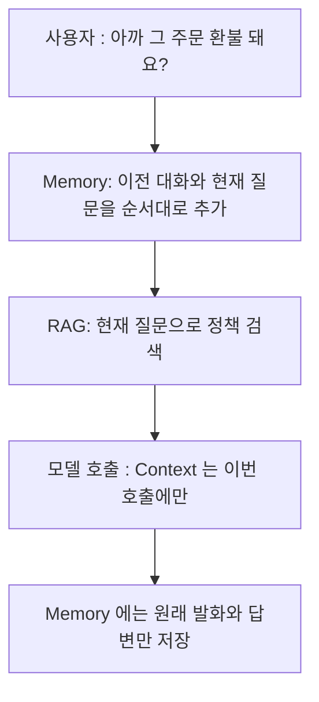

“비 오는 날 배달이 늦으면 보상받나요?” 이 질문에 답하려면 주문 번호를 기억하는 것만으로는 부족하다. 모델이 이번 주문에 적용할 정책 문구를 찾아 답변에 반영해야 한다.

이전 실험에서 대화 이력을 연결해 주문을 다시 찾을 수 있었다. 보상 안내에는 회사가 정한 기준도 필요했다. 이번에는 배달 정책 문서 7건을 PgVector에 넣고 검색 결과를 프롬프트에 넣었다. 임베딩은 Ollama `qwen3-embedding:0.6b`(1024차원), 생성은 그대로 `qwen2.5`다.

`QuestionAnswerAdvisor`를 연결한 뒤 같은 질문으로 청크 크기와 검색 건수, 유사도 기준을 바꿔 봤다. 설정 중 결과를 예상하기 어려웠던 건 Advisor의 순서였다. 순서를 한 번 바꿨더니 정책 원문이 대화 이력에 저장됐다.

<style>
.agent-fig,.fig-defs{
  --fig-surface:#ffffff;--fig-ink:#0f172a;--fig-ink2:#334155;--fig-muted:#94a3b8;--fig-hair:#e6eaf1;
  --c-green:#16a34a;--c-greenink:#15803d;--c-red:#ef4444;--c-redink:#b91c1c;
  --c-blue:#2f6fed;--c-blueink:#1d4ed8;--c-amber:#d97706;--c-amberink:#b45309;
}
@media (prefers-color-scheme: dark){
  .agent-fig,.fig-defs{
    --fig-surface:#121317;--fig-ink:#f2f5fa;--fig-ink2:#cbd5e1;--fig-muted:#697588;--fig-hair:#252a33;
    --c-green:#34d399;--c-greenink:#6ee7b7;--c-red:#f87171;--c-redink:#fca5a5;
    --c-blue:#5b9bff;--c-blueink:#93c5fd;--c-amber:#fbbf24;--c-amberink:#fcd34d;
  }
}
.agent-fig{margin:2.4em 0;border:1px solid var(--fig-hair);border-radius:18px;background:var(--fig-surface);
  padding:18px 20px 10px;overflow:hidden;box-shadow:0 1px 2px rgba(2,6,23,.05),0 14px 40px rgba(2,6,23,.09)}
@media (prefers-color-scheme: dark){.agent-fig{box-shadow:0 1px 2px rgba(0,0,0,.4),0 18px 46px rgba(0,0,0,.5)}}
.agent-fig svg{width:100%;height:auto;display:block;max-width:100%}
.agent-fig svg text{font-family:ui-monospace,"SF Mono","JetBrains Mono",Menlo,monospace}
.agent-fig .cap-head{display:flex;justify-content:space-between;align-items:baseline;gap:14px;margin-bottom:6px}
.agent-fig .cap-tag{font-size:11px;letter-spacing:.14em;text-transform:uppercase;color:var(--fig-muted);
  font-family:ui-monospace,SFMono-Regular,Menlo,monospace}
.agent-fig figcaption{font-size:13.5px;color:var(--fig-muted);line-height:1.6;padding:12px 2px 6px;
  font-family:ui-monospace,SFMono-Regular,Menlo,monospace}
.agent-fig figcaption b{color:var(--fig-ink2);font-weight:600}
@media (prefers-reduced-motion: reduce){.agent-fig svg animate,.agent-fig svg animateMotion{display:none}}
</style>

## 문서를 100토큰씩 나누자 보상 기준 시간이 답에서 빠졌다

처음 실행했을 때는 정책 문서 일곱 건이 각각 청크 하나로 저장됐다. 다시 실행해도 `vector_store`에는 일곱 행만 있었다. 이미 적재한 `faqId`는 건너뛰도록 했기 때문이다.

문서를 검색 단위로 나누는 작업이 청킹이다. 크기를 세 가지로 바꿔 같은 질문 세트를 돌렸다.

| 실험 | chunkSize / min | vector_store row | 평균 입력 토큰 |
|---|---|---|---|
| A | 800 / 350 | 7 | 약 2381 |
| B | 100 / 40 | 49 | 약 1977 |
| C | 2000 / 800 | 7 | 약 2381 |

평균 입력 토큰은 4턴 기준이다. 동시 실행 로그에서 한 턴이 누락돼 5턴을 다 모으진 못했다.

청크를 작게 나눈 B에서 "비 오는 날" 질문의 답이 이렇게 뭉개졌다. "기상 특보 발효 여부와 실제 지연 시간을 확인해야 합니다." 주요 단어는 남았지만 수치 조건은 누락됐다. 정책 원문에 있던 "예상 시간 + 30분", "60분 이상"이 답에서 사라진 것이다.

100토큰씩 자르자 기준 시간과 그 기준이 적용되는 조건이 서로 다른 청크에 들어갔다. 검색한 네 조각에는 조건만 있고 기준 시간은 없었다. 그래서 검색 결과가 네 건이나 있어도 답변에서 보상 기준이 빠졌다.

재미있는 것은 같은 B에서 반대 증거도 나왔다는 점이다. 취소 정책 질문은 오히려 A보다 정확하게 인용됐다. 잘게 쪼갠 덕에 CREATED/ACCEPTED가 적힌 조각과 더 가깝게 매칭된 것이다. 작은 청크가 늘 나쁜 게 아니라 질문에 따라 갈리는 트레이드오프라는 뜻이다. 한편 C(2000)는 실험 자체가 성립하지 않았다. 정책 문서가 전부 2000토큰 미만이라 800이든 2000이든 똑같이 1청크가 되기 때문이다. 문서가 작으면 큰 청크 실험은 의미가 없다.

기본값은 800/350으로 되돌렸다. 이 정책 문서들은 "## 접수 시한"처럼 조항 단위로 이미 끊겨 있어서, 800이면 한 조항이 한 청크에 온전히 들어간다. 숫자와 그 숫자의 조건이 한 조각에 있어야 한다는 것이 이번 실험의 교훈이다.

```java
@Bean
public TokenTextSplitter tokenTextSplitter() {
    return new TokenTextSplitter(
            800,    // chunkSize
            350,    // minChunkSizeChars : 이보다 작으면 앞 청크에 병합
            5,      // minChunkLengthToEmbed
            10_000, // maxNumChunks
            true    // keepSeparator
    );
}
```

## 검색 결과를 네 건으로 제한하면 어떤 문서가 남을까

어느 페이지를 몇 장 펴줄지는 두 값이 정한다. 몇 건을 가져올지(Top-K)와 얼마나 비슷해야 가져올지(similarityThreshold)다.

```java
private static final int TOP_K = 4;
private static final double SIMILARITY_THRESHOLD = 0.5;

@Bean
public QuestionAnswerAdvisor questionAnswerAdvisor(VectorStore vectorStore) {
    return QuestionAnswerAdvisor.builder(vectorStore)
            .searchRequest(SearchRequest.builder()
                    .topK(TOP_K)
                    .similarityThreshold(SIMILARITY_THRESHOLD)
                    .build())
            .order(20)   // memory(10) 뒤, performance(100) 앞
            .build();
}
```

“환불도 안 되고 배달도 늦었어요”처럼 정책이 두 개 필요한 질문에 검색 결과를 한 건만 쓰면 한쪽 조건이 빠질 수 있다. 반대로 정책 문서가 일곱 건뿐인데 상한을 열 건으로 높이면 관련 없는 조항까지 입력에 포함될 수 있다.

임계값을 0.5로 고정해도 답은 달랐다. 첫 실행에서는 정책을 인용했는데 다시 실행하자 “확인이 필요합니다”가 돌아왔다.

유사도 점수는 기록하지 않았다. 검색 결과가 달라졌는지, 같은 결과를 받아도 모델의 응답이 달라졌는지는 이 실험으로 구분할 수 없다.

## Advisor 순서를 뒤집으면 벌어지는 일

이번 주 가장 인상적인 실측은 파라미터가 아니라 순서에서 나왔다. 정상 체인은 memory(10) 다음 rag(20)이다.



Spring AI 1.0.0에서 Memory Advisor는 이전 메시지를 현재 질문 앞에 추가한다. RAG Advisor는 그중 마지막 사용자 메시지로 검색한다. 이때 검색어는 “아까 그 주문 환불 돼요?”다. 이전 대화의 주문번호까지 검색어에 넣으려면 질의를 따로 재작성해야 한다. [대화 메시지를 추가하는 코드](https://github.com/spring-projects/spring-ai/blob/v1.0.0/spring-ai-client-chat/src/main/java/org/springframework/ai/chat/client/advisor/MessageChatMemoryAdvisor.java#L73-L90), [검색어를 정하는 코드](https://github.com/spring-projects/spring-ai/blob/v1.0.0/advisors/spring-ai-advisors-vector-store/src/main/java/org/springframework/ai/chat/client/advisor/vectorstore/QuestionAnswerAdvisor.java#L103-L125)

순서를 rag(5), memory(10)로 바꿔 문의 한 건을 보냈다. 응답은 비슷했는데 저장된 메시지는 달랐다. “사용자 발화”에 질문과 정책 문서 본문이 함께 들어 있었다.

<figure class="agent-fig">
  <div class="cap-head"><span class="cap-tag">advisor order flip</span><span class="cap-tag">rag(5) before memory(10)</span></div>
  <svg viewBox="0 0 720 250" role="img" aria-label="Memory를 먼저 실행하면 질문을 저장한다. RAG를 먼저 실행하면 검색한 정책까지 사용자 메시지에 저장한다" xmlns="http://www.w3.org/2000/svg">
    <text x="20" y="28" font-size="12" font-weight="700" fill="var(--fig-ink2)">memory(10) 다음 rag(20), 질문 원문 저장</text>
    <g font-size="11" text-anchor="middle">
      <rect x="20" y="40" width="130" height="40" rx="9" fill="var(--c-blue)" opacity="0.12"/>
      <text x="85" y="64" fill="var(--fig-ink)">사용자 발화</text>
      <rect x="220" y="40" width="150" height="40" rx="9" fill="var(--c-amber)" opacity="0.12"/>
      <text x="295" y="64" fill="var(--fig-ink)">+ 정책 Context</text>
      <rect x="440" y="40" width="110" height="40" rx="9" fill="var(--fig-muted)" opacity="0.12"/>
      <text x="495" y="64" fill="var(--fig-ink)">모델 호출</text>
      <rect x="590" y="40" width="112" height="40" rx="9" fill="var(--c-green)" opacity="0.12"/>
      <rect x="590" y="40" width="112" height="40" rx="9" fill="none" stroke="var(--c-green)" stroke-opacity="0.45"/>
      <text x="646" y="58" fill="var(--fig-ink)">Memory</text>
      <text x="646" y="73" fill="var(--c-greenink)" font-size="9.5">발화와 답변만</text>
    </g>
    <circle r="4" fill="var(--c-amber)" filter="url(#fx-glow4)">
      <animateMotion path="M150 60 L440 60 L550 60" dur="3.4s" repeatCount="indefinite"/>
      <animate attributeName="opacity" values="0;1;1;0" keyTimes="0;0.1;0.8;0.95" dur="3.4s" repeatCount="indefinite"/>
    </circle>
    <text x="20" y="128" font-size="12" font-weight="700" fill="var(--fig-ink2)">rag(5) 다음 memory(10), 질문과 검색 결과 저장</text>
    <g font-size="11" text-anchor="middle">
      <rect x="20" y="140" width="130" height="40" rx="9" fill="var(--c-blue)" opacity="0.12"/>
      <text x="85" y="164" fill="var(--fig-ink)">사용자 발화</text>
      <rect x="220" y="140" width="150" height="40" rx="9" fill="var(--c-amber)" opacity="0.12"/>
      <text x="295" y="164" fill="var(--fig-ink)">+ 정책 Context</text>
      <rect x="440" y="140" width="262" height="72" rx="9" fill="var(--c-red)" opacity="0.08"/>
      <rect x="440" y="140" width="262" height="72" rx="9" fill="none" stroke="var(--c-red)" stroke-width="1.4">
        <animate attributeName="stroke-opacity" values="1;0.35;1" dur="2.6s" repeatCount="indefinite"/>
      </rect>
      <text x="571" y="160" fill="var(--fig-ink)">Memory</text>
      <text x="571" y="178" fill="var(--c-redink)" font-size="9.5">"사용자 발화" = 정책 원문 수백 토큰</text>
      <text x="571" y="196" fill="var(--c-redink)" font-size="9.5">이력이 남아 있는 동안 다음 요청에도 포함</text>
    </g>
    <circle r="4" fill="var(--c-red)" filter="url(#fx-glow4)">
      <animateMotion path="M150 160 L370 160 L470 160" dur="3.4s" repeatCount="indefinite"/>
      <animate attributeName="opacity" values="0;1;1;1" keyTimes="0;0.1;0.85;1" dur="3.4s" repeatCount="indefinite"/>
    </circle>
    <text x="360" y="238" text-anchor="middle" font-size="10.5" fill="var(--fig-muted)">두 순서에서 답변은 비슷했지만 저장된 사용자 메시지는 달랐다.</text>
  </svg>
  <figcaption>아래 순서에서는 <b>정책 본문까지 사용자 메시지에 저장</b>됐다. 이 메시지를 보관하는 동안 다음 요청에도 같은 본문이 들어간다.</figcaption>
</figure>

<svg class="fig-defs" width="0" height="0" aria-hidden="true" focusable="false" style="position:absolute;width:0;height:0">
  <defs>
    <filter id="fx-glow4" x="-60%" y="-60%" width="220%" height="220%">
      <feGaussianBlur stdDeviation="3" result="b"/>
      <feMerge><feMergeNode in="b"/><feMergeNode in="SourceGraphic"/></feMerge>
    </filter>
  </defs>
</svg>

응답만 봤다면 순서를 바꿔도 차이가 없다고 생각했을 것이다. 어느 문장이 실제로 저장됐는지는 ChatMemory에서 사용자 메시지의 JSON을 열어 보고 확인했다.


## 같은 환불 문의에 RAG를 켰을 때

첫 질문을 세 가지 구성에 똑같이 보냈다. 답변은 세 번 모두 “확인이 필요합니다. 상담원 연결로 도와드리겠습니다”였다. 입력 토큰 수는 달랐다.

| 조건 | 체인 | promptTokens | 응답 |
|---|---|---|---|
| (a) | performance | 1688 | Fallback |
| (b) | memory, performance | 1688 | Fallback |
| (c) | memory, rag, performance | 2590 | Fallback |

첫 문의라 이전 대화가 없었다. 대화 이력을 켜도 입력은 1,688토큰으로 같았다. 여기에 RAG를 추가했을 때 2,590토큰으로 늘었다. 차이는 902토큰이다.

배달 후 환불에는 증빙이 필요하다. 위 답변만으로는 필요한 조항이 검색되지 않았는지, 프롬프트에 있었지만 답에 반영되지 않았는지, 증빙을 확인하라는 응답인지 구분하기 어렵다. 검색한 문서, 실제 프롬프트, 답변을 함께 기록해야 구분할 수 있다.

검색에는 유사도 기준을 두고, 프롬프트에는 정책을 찾지 못했을 때 사용할 안내 문구를 적었다.

```text
[정책 인용 규칙]
- 환불, 취소, 배달 지연 보상, 쿠폰 관련 질문은 제공된 Context 를 근거로만 답합니다.
- Context 에서 답을 찾을 수 없으면 추측하지 않고:
  "해당 내용은 확인이 필요합니다. 상담원 연결로 도와드리겠습니다."
- 정책 인용 시 원문의 수치 조건("24시간 이내", "예상 시간 + 30분")을 그대로 사용합니다.
```

인용 규칙을 빼고 “오늘 점심 뭐 먹을까요?”라고 물었더니 점심 메뉴를 추천하는 답이 나왔다. 검색 결과가 비었을 때 무엇을 답할지는 검색 임계값만으로 정할 수 없었다.

## 다음 이야기

이번 보상 안내에서는 기준 시간과 적용 조건을 같은 청크에 넣어야 했다. 환불 안내가 세 번 다 같았던 이유는 추가 기록이 필요하다. 유사도 점수도 이번에는 남기지 않았다.

중복을 검사하는 `alreadyLoaded`는 faqId만 비교한다. 그래서 같은 문서의 본문을 수정해도 재적재하지 않는다. 내용 변경까지 감지하려면 본문의 해시도 비교해야 한다.

DataSource를 추가했더니 JDBC ChatMemory 자동 구성과 기존 Bean이 충돌했다. 이번 실험에서는 프로파일을 분리해 두 설정이 동시에 적용되지 않도록 했다.

현재 질문에 개인정보가 포함되면 그 문장이 검색어로도 쓰인다. 다음 편에서는 모델을 호출하기 전과 고객에게 답을 보내기 전에 각각 어떤 검사를 할 수 있는지 확인했다.
