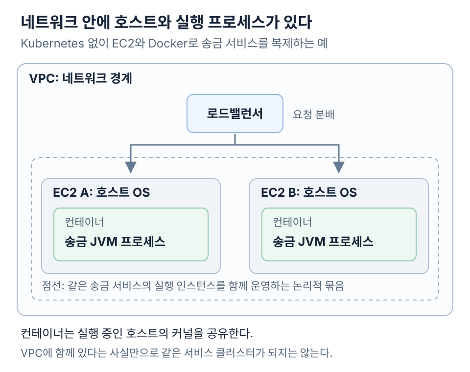
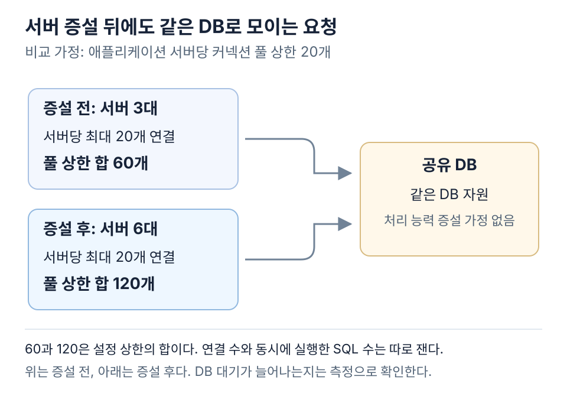

송금 API에 타이머를 하나 붙여 보자. 요청이 들어올 때 켜고 응답을 보낼 때 끄면 될 것 같다. 그런데 이 예제에서 응답으로 돌려주는 말은 ‘접수됨’이다. 받는 사람은 그때부터도 돈이 들어오기를 기다린다.



그림의 두 선은 서버가 같은 요청을 받은 순간에 출발한다. 위쪽 선은 요청을 저장하고 접수 응답을 보낼 때 멈춘다. 아래쪽 선은 심사와 외부 송금이 끝날 때까지 이어진다.

송금 서비스와 용량 수치는 이 계산을 위한 가정이다. 두 시간을 나눠 그린 이유는 간단하다. 심사가 한참 밀린 날에도 HTTP 응답 시간만 보면 아무 일도 없었던 것처럼 보이기 때문이다.

## 접수까지 걸린 시간과 입금까지 걸린 시간

비동기 API가 요청을 저장한 뒤 `202 Accepted`를 반환한다고 가정하자. 이때 서버가 확인한 건 접수까지다. 사용자가 궁금한 최종 상태는 별도 조회나 알림으로 전달한다. HTTP 명세도 202를 처리가 아직 완료되지 않은 접수 상태로 정의한다. [RFC 9110의 202 Accepted](https://www.rfc-editor.org/rfc/rfc9110.html#section-15.3.3)

그래서 HTTP 응답을 보낼 때 첫 번째 시간을 기록하고, 같은 송금이 확정되면 접수부터 거기까지 걸린 시간을 또 기록한다. 거절된 요청과 아직 심사 중인 요청도 건수가 남아야 한다. 성공한 송금만 남겨 놓으면 가장 오래 기다린 사람이 통계에서 사라질 수 있다.

측정 위치도 값을 바꾼다. 서버 내부에서 잰 시간에는 클라이언트에서 서버까지의 네트워크 대기가 빠질 수 있다. DB 호출 시간에는 커넥션을 빌리는 대기가 포함될 수도 있고 드라이버 계측 위치에 따라 빠질 수도 있다.

분산 추적의 span 이름만 읽고 포함 구간을 단정하기 어렵다. 계측 코드의 시작과 끝을 확인해야 한다.

서버 메서드가 Future를 반환한 직후 타이머를 멈추면 작업을 제출하는 데 걸린 시간만 남는다. 작업이 끝날 때까지 걸린 시간을 보려면 Future가 완료되는 시점에 타이머를 멈춘다.

## 응답을 기다린 시간도 경과 시간에 들어간다

경과시간은 시작부터 종료까지 흐른 시간이다. 스레드가 CPU에서 실행한 시간뿐 아니라 DB 응답, 락, 커넥션, 실행 순서를 기다린 시간도 포함한다. CPU 시간은 실제로 CPU를 사용한 시간을 센다. 멀티스레드 프로세스의 CPU 시간을 합하면 같은 구간의 경과시간보다 클 수도 있다.

Java 코드의 한 구간을 잴 때는 같은 JVM에서 `System.nanoTime()`의 차이를 구한다. 다음은 측정 위치를 보여 주는 예시다. `operation.run()`이 동기적으로 끝나는 구간을 전제로 한다.

```java
long startedNanos = System.nanoTime();
try {
    operation.run();
} finally {
    long elapsedNanos = System.nanoTime() - startedNanos;
    durationRecorder.record(elapsedNanos);
}
```

`nanoTime()`은 날짜나 시각을 제공하지 않는다. 기준점은 임의이며 서로 다른 JVM의 값을 빼서 원격 호출 시간을 구할 수 없다. 나노초 단위로 반환한다는 사실도 나노초 수준의 측정 해상도를 보장하지 않는다. 날짜 표시에는 시각 API를, 같은 프로세스 안의 경과시간에는 경과시간 측정용 API를 쓴다. [Java 25 System API](https://docs.oracle.com/en/java/javase/25/docs/api/java.base/java/lang/System.html#nanoTime())

이 계측만으로 짧은 메서드의 우열을 판정하기는 어렵다. JIT 컴파일, 실행 순서, 계측 비용이 결과에 섞이기 때문이다. 서비스 요청의 전체 지연을 관찰하는 일과 작은 연산의 비용을 비교하는 일은 측정 도구가 달라진다. 작은 연산은 JMH 같은 전용 하네스로 조건을 통제한다. [OpenJDK JMH](https://github.com/openjdk/jmh)

## 초당 몇 건을 끝냈고 한 건에 얼마나 걸렸나

처리량은 단위 시간 동안 끝낸 작업 수다. 지연은 작업 한 건이 측정 구간을 통과하는 데 걸린 시간이다. 요청이 여러 개 겹쳐 실행되면 처리량이 높으면서 각 요청의 지연도 길 수 있다. 처리량의 역수를 응답 시간으로 읽을 수 있는 경우는 한 번에 한 작업만 순차 처리하는 등의 제한된 조건이다.

송금 서비스에서는 무엇을 완료로 셌는지도 구분한다. 접수 HTTP 응답 수, Kafka에 기록된 이벤트 수, 최종 확정된 송금 수는 서로 다른 처리량이다.

오류 응답을 빠르게 반환하면 HTTP 완료 건수는 늘어날 수 있다. 성공한 업무 처리량과 오류율을 함께 봐야 한다. Google SRE도 지연을 성공 요청과 실패 요청으로 구분해 관찰하도록 설명한다. [Google SRE의 네 가지 주요 관측 신호](https://sre.google/sre-book/monitoring-distributed-systems/)

평균은 전체 비용을 계산할 때 유용하다. 사용자가 겪는 지연의 분포를 보려면 p50, p95, p99 같은 백분위수도 확인한다. p99는 관측 표본의 약 99%가 그 값 이하라는 뜻이다. 최댓값을 뜻하지 않으며 인스턴스별 p99를 단순 평균해 전체 p99를 만들 수도 없다. 집계 가능한 분포나 원시 관측값이 필요하다. [Prometheus의 히스토그램과 요약](https://prometheus.io/docs/practices/histograms/)

평균 처리율과 평균 체류시간의 관계는 Little의 법칙으로 설명할 수 있다. 아래 계산에서는 유입과 유출이 장기적으로 균형을 이루고 측정 구간의 대기열이 계속 증가하지 않는다고 가정한다. 세 값은 같은 시스템 경계를 사용한다.

```text
평균 체류 요청 수 L = 평균 처리율 λ × 평균 체류시간 W

가정: 초당 100건 완료, 평균 체류시간 0.2초
L = 100건/초 × 0.2초 = 20건
```

20건에는 실행 중인 요청과 기다리는 요청이 함께 들어간다. CPU에서 동시에 실행하는 스레드 수가 아니다. 이 식의 평균 자리에 p99를 넣거나 계산 결과를 그대로 커넥션 풀의 최적 크기로 정할 근거도 없다. 풀 크기를 정하려면 각 자원의 처리 능력과 대기 비용을 추가로 확인해야 한다. [Little와 Graves의 법칙 해설](https://web.eng.ucsd.edu/~massimo/ECE158A/Handouts_files/Little.pdf)

## 요청을 나누는 경계와 프로그램을 묶는 경계

VPC는 리소스를 연결하는 논리적으로 격리된 네트워크다. 같은 VPC에 Gateway, 송금, 정산 서버가 있다는 사실만으로 하나의 클러스터가 되지는 않는다. VPC는 네트워크 범위를 설명하고 서비스 이름은 업무 역할을 설명한다. [AWS의 VPC 정의](https://docs.aws.amazon.com/vpc/latest/userguide/what-is-amazon-vpc.html)

클러스터는 어떤 시스템을 함께 운영하는 묶음인지 밝혀야 의미가 분명해진다. 여러 EC2에서 같은 송금 앱을 실행하고 로드밸런서로 요청을 나누는 구성도 넓은 의미의 서비스 클러스터로 부른다. 이 말에 자동 멤버십 관리나 노드 사이의 합의 기능까지 포함되는 것은 아니다. 구성 설명에는 실행 인스턴스와 요청 전달 방식을 함께 적는 편이 정확하다. [AWS의 로드밸런서 설명](https://docs.aws.amazon.com/elasticloadbalancing/latest/userguide/how-elastic-load-balancing-works.html)

컨테이너는 프로그램의 프로세스를 격리해 실행하는 환경이다. 이미지는 실행 파일과 필요한 런타임을 묶고 컨테이너는 이를 실행한다. 별도 커널을 갖는 VM과 달리 같은 호스트의 컨테이너들은 호스트 커널을 공유한다. EC2 한 대에서 여러 컨테이너를 실행하거나 같은 앱의 컨테이너를 여러 EC2에 복제하는 조합이 가능하다. [Docker의 컨테이너 정의](https://docs.docker.com/get-started/docker-concepts/the-basics/what-is-a-container/)



Kubernetes는 이런 컨테이너 워크로드를 관리하는 선택지다. Kubernetes 없이 EC2와 Docker로 실행해도 된다. 하나의 Kubernetes 클러스터에서 게이트웨이, 송금 서비스, 정산 서비스를 함께 운영하는 구성도 가능하다. 클러스터 개수와 업무 서비스 개수는 일대일 관계가 아니다. [Kubernetes의 구성 개념](https://kubernetes.io/docs/concepts/)

작업 분배도 층위를 구분한다. 로드밸런서는 도착한 요청을 어느 실행 인스턴스로 보낼지 결정한다. 스케줄러는 프로그램을 실행할 노드를 고른다. Kubernetes에서는 컨테이너를 담는 배치 단위인 Pod를 노드에 배정한다. [Kubernetes 스케줄러](https://kubernetes.io/docs/concepts/scheduling-eviction/kube-scheduler/)

Kafka의 일반 컨슈머 그룹에서는 파티션을 컨슈머에 배정해 읽을 이벤트를 나눈다. 이는 HTTP 요청 라우팅이나 컨테이너 배치와 별개의 작업이다. 컨테이너 수를 늘려도 특정 파티션에 처리가 몰리거나 모든 요청이 같은 DB를 기다리면 병목은 남는다. [Kafka의 소비와 파티션](https://kafka.apache.org/41/design/design/)

재고 앱과 결제 앱을 따로 실행하고 배포한다면 각각 컨테이너를 두는 구성이 자연스럽다. Docker도 서비스의 책임을 나눠 컨테이너를 구성하도록 권한다. 여기서 서비스는 Spring의 Service 클래스 하나를 뜻하지 않는다. 하나의 쇼핑몰 앱 내부에 재고 모듈과 결제 모듈을 두고 같은 프로세스로 배포하는 모듈러 모놀리스도 선택지다. [Docker의 서비스 분리 기준](https://docs.docker.com/engine/containers/multi-service_container/)

이 사례에서 배포 경계는 팀의 변경 주기와 운영 비용을 기준으로 정한다. 분리하면 각 서비스의 배포와 증설을 따로 조절하지만 원격 호출과 부분 실패를 다뤄야 한다. 함께 배포하면 한 앱의 변경이 같은 배포를 거치는 대신 같은 DB의 업무를 로컬 트랜잭션에 묶기 쉽다.

컨테이너를 나눴다는 사실만으로 데이터 소유권이나 트랜잭션 경계가 정해지지는 않는다. 어느 구성에서도 송금 접수와 확정 사이에 실제로 기다리는 구간은 따로 측정해야 한다.

## 서버가 늘어나도 공유 DB의 처리 능력은 그대로일 수 있다

애플리케이션 서버가 CPU 연산으로 포화됐다면 요청을 나눠 처리할 서버를 추가하는 선택이 도움이 된다. 반대로 대부분의 요청이 같은 DB를 기다린다면 서버 증설은 DB 앞에 대기할 요청을 더 많이 허용하는 변경이 될 수 있다.

서버마다 커넥션 풀 상한이 20이라고 가정하자. 서버를 3대에서 6대로 늘리면 연결 상한의 합은 60에서 120으로 늘어난다. 실제 연결 수가 그만큼 생성된다거나 모든 연결이 동시에 SQL을 실행한다는 뜻은 아니다. 다만 이전보다 많은 작업이 DB에 동시에 들어갈 수 있는 조건이 생긴다.

동시 실행이 늘면서 DB의 락 경합이나 I/O 대기가 커지면 요청 지연은 길어질 수 있다. 이때 애플리케이션의 CPU가 낮아 보여도 시스템에 여유가 있다고 결론 내리기 어렵다. HikariCP의 풀 크기 설명도 연결 수를 늘리는 것이 처리량을 계속 높여 주지는 않는다고 지적한다. [HikariCP의 커넥션 풀 크기](https://github.com/brettwooldridge/HikariCP/wiki/About-Pool-Sizing)



새 서버의 초기 상태도 관찰 대상이다. 캐시가 비어 있으면 DB 조회가 증가할 수 있고 JVM은 실행 프로파일을 쌓으며 코드를 최적화한다. 연결 생성과 클래스 로딩 비용도 시작 구간에 나타날 수 있다. 증설 직후의 지연이 지속적인 용량 부족인지 초기 준비 비용인지 나누어 본다. AWS는 비어 있는 캐시가 하위 서비스에 부하를 몰아줄 수 있는 운영 조건을 설명한다. [AWS의 캐시 운영 전략](https://aws.amazon.com/builders-library/caching-challenges-and-strategies/)

증설 전후 비교에는 노드별 CPU만으로 부족하다. DB 커넥션 획득 대기, 실제 실행 중인 쿼리 수, 락 대기, 캐시 적중률을 같은 시간축에 놓는다. 한 계층의 작업 수를 늘려 다른 계층의 포화를 앞당겼는지 확인하는 순서다.

## CPU 100%의 의미는 분모와 실행 내용에 달려 있다

CPU 100%가 코어 하나의 사용량인지, 호스트 전체인지, 컨테이너에 할당된 CPU 기준인지부터 확인해야 한다. 도구에 따라 프로세스 사용률이 100%를 넘기도 한다. 서로 다른 대시보드의 숫자를 그대로 비교하면 분모가 다른 비율을 비교할 수 있다.

컨테이너에 CPU 사용 한도가 있으면 호스트에 남는 CPU가 있어도 해당 컨테이너의 실행이 제한될 수 있다. Linux cgroup v2의 `cpu.max`에서 사용 한도를 읽을 수 있다. `cpu.stat`에서 이 한도에 걸린 횟수와 시간을 확인한다. [Linux cgroup v2 CPU 인터페이스](https://www.kernel.org/doc/html/latest/admin-guide/cgroup-v2.html)

배치 작업이 주어진 CPU를 사용하면서 목표 시간 안에 끝난다면 높은 사용률이 의도한 결과일 수 있다. 반면 요청 급증을 받아야 하는 API가 계속 한도에 붙어 있으면 추가 요청의 대기 시간이 커질 가능성을 살펴야 한다. CPU 수치 자체보다 처리 목표와 남은 수용 여유를 같이 평가한다.

그 CPU가 무엇을 실행하는지도 확인한다. 유효한 업무 연산, GC, JIT 컴파일, 반복 재시도, busy loop는 같은 사용률을 만들 수 있다. Java Flight Recorder 같은 프로파일링 도구로 실행 지점을 좁히고 GC, 락, I/O 이벤트를 함께 읽는다. CPU가 낮아도 DB나 락을 기다리는 서비스는 느릴 수 있다. [Java 25 JFR 진단](https://docs.oracle.com/en/java/javase/25/troubleshoot/troubleshoot-performance-issues-using-jfr.html)

## 바꾸기 전에 정해 둘 측정 기준

성능 변경의 합격 기준은 결과를 본 뒤 고르기보다 실험 전에 적는 편이 낫다. 예를 들어 “동일한 요청 구성과 유입률에서 업무 성공률을 유지하고 p99 확정 지연을 줄인다”는 기준을 세울 수 있다. 목표 수치는 업무 요구에서 정하며 예쁜 그래프에 맞춰 바꾸지 않는다.

비교 기록에는 코드와 JDK 버전, CPU와 메모리 한도, 데이터 규모와 분포, 캐시 상태, 동시 실행 설정을 남긴다. 시작 성능과 안정된 실행 성능은 따로 비교한다. 여러 번 실행해 흔들림을 확인하고 측정 대상 외의 변경을 줄인다. 전체 구성을 한꺼번에 바꾼 결과는 그 구성의 비교이지 개별 변경의 효과를 분리한 증거가 아니다.

부하 생성 방식도 실험 조건이다. 응답을 받은 뒤 다음 요청을 보내는 닫힌 모델에서는 서버가 느려질수록 유입도 줄어든다. 응답을 기다리지 않고 정해 둔 속도로 요청을 보내는 열린 모델에서는 서버가 느려져도 요청을 계속 보낼 수 있다. 운영에서의 도착 패턴과 맞지 않는 모델은 과부하 시의 대기를 숨길 수 있다. 부하 발생기가 목표 유입을 실제로 만들었는지도 확인한다. [Grafana k6의 열린 모델과 닫힌 모델](https://grafana.com/docs/k6/latest/using-k6/scenarios/concepts/open-vs-closed/)

마지막 비교표에는 성공 처리량과 지연 분포, 오류율, 자원 비용을 함께 둔다. 성능 목표를 달성해도 중복 송금이나 누락이 생기면 변경을 채택할 수 없다. 실행 시간을 줄인 조건에서도 업무 결과가 같은지 확인해야 한다.

이번에는 송금 수수료를 계산하는 Java 코드 쪽으로 들어가 보자. 실행 시간을 비교하려면 배포한 JAR에서 JVM이 어느 클래스를 읽었는지부터 알아야 한다. [다음 글에서는 호출 코드를 그대로 두고 JAR만 바꿔 끼웠다.](../class-loading/)

## 이 편의 용어

| 용어 | 측정 대상 | 해석할 때 확인할 조건 |
| --- | --- | --- |
| 경과시간 | 시작부터 종료까지 흐른 시간 | 대기와 네트워크가 어디까지 포함되는지 |
| CPU 시간 | CPU에서 실행한 시간 | 스레드별 시간인지 프로세스 전체 시간인지 |
| 처리량 | 단위 시간의 완료 작업 수 | 접수, 확정, 실패 중 무엇을 세는지 |
| 지연 | 작업 한 건의 체류시간 | 시작점과 종료점 |
| 백분위수 | 지연 분포에서의 위치 | 표본과 집계 방법 |
| 포화 | 자원의 처리 한도에 접근한 상태 | 대기열과 거부가 늘어나는지 |
