수수료를 구하는 코드는 `return policy.fee(amountWon);` 한 줄이다. 소스에는 분명 `fee` 호출이 있고 `javap`로 클래스 파일을 열어 봐도 그대로 있다. 그런데 HotSpot이 인라이닝을 하면 이 호출이 사라진다고 한다. 그럼 어디를 열어 봐야 사라진 게 보일까?

`javac`가 남긴 바이트코드는 JVM의 명령이다. 처음에는 HotSpot의 인터프리터가 명령을 하나씩 해석해서 실행한다. 메서드나 루프를 자주 실행하면 JIT 컴파일러가 그 부분의 기계어를 따로 만든다.

이때 `fee`의 계산을 호출자 안에 넣을 수 있다. 이게 **인라이닝**이다. 호출 비용을 덜고 두 메서드에 걸친 계산도 함께 줄일 수 있다. 바뀌는 쪽이 실행 중인 JVM이니, 우선 클래스 파일에서 호출 위치를 찾아 두었다가 로그의 같은 자리와 맞춰 보기로 했다.

## 반복문에서 바이트코드의 주소 읽기

JIT 로그에는 소스의 줄 번호 대신 `@ 2` 같은 숫자가 찍힌다. 이 숫자를 읽기 위해 `Hello World`를 열 번 출력하는 반복문을 골랐다. `javac -g HelloLoop.java`로 컴파일하고 `javap -c -l HelloLoop`로 열어 보니 `for` 한 줄도 꽤 길다. [예제 소스](./evidence/HelloLoop.java) · [전체 바이트코드](./evidence/javap.txt) · [실행 출력](./evidence/stdout.txt)

```java
for (int i = 0; i < 10; i++) {
    System.out.println("Hello World");
}
```

```text
 0: iconst_0
 1: istore_1
 2: iload_1
 3: bipush        10
 5: if_icmpge     22
 8: getstatic     #7     // System.out
11: ldc           #13    // String Hello World
13: invokevirtual #15    // PrintStream.println
16: iinc          1, 1
19: goto          2
22: return
```

`19: goto 2`부터 거꾸로 읽으면 덜 헷갈린다. 바이트코드의 19번 위치에서 2번 위치로 돌아가라는 뜻이다. 왼쪽의 `2, 3, 5`는 메서드 첫 바이트부터 센 거리(오프셋)라서 명령의 길이만큼 커진다.

`iload_1`의 `1`은 지역변수의 슬롯 번호다. `main`의 슬롯 0은 인자 `args`가 쓰고 슬롯 1에는 `i`가 들어 있다.

첫 바퀴에서 `iload_1`이 슬롯 1에 든 `0`을 피연산자 스택에 복사하고 `bipush 10`은 그 위에 `10`을 올린다. `if_icmpge`가 둘을 꺼내 비교하면 `0 >= 10`은 거짓이니 `println`까지 내려간다. 출력 뒤에 있는 `iinc 1, 1`은 슬롯 1의 값에 바로 1을 더한다. 다음 바퀴에 `iload_1`이 꺼낼 값은 이제 `1`이다. [JVM의 명령 정의](https://docs.oracle.com/javase/specs/jvms/se25/html/jvms-6.html#jvms-6.5.iinc)



여기서 스택이 두 번 나온다. 방금 `0`과 `10`을 올려 둔 피연산자 스택은 한 메서드의 프레임 안에 있다. `println`을 호출할 때도 이곳에서 `PrintStream` 참조와 문자열 참조를 꺼내 쓴다.

메서드를 호출할 때마다 프레임이 쌓이는 곳이 **호출 스택**이다. 바이트코드대로라면 메서드 호출마다 프레임이 생기지만 인라이닝한 기계어에서는 별도의 호출과 프레임을 생략할 수 있다. [JVM 명세의 프레임](https://docs.oracle.com/javase/specs/jvms/se25/html/jvms-2.html#jvms-2.6)

## 수수료 계산의 호출 위치

이제 처음의 `policy.fee(amountWon)`로 돌아가 보자. `quote`는 원 단위 정수를 받아 수수료를 돌려준다. 정률 정책을 넘기면 금액을 100으로 나눠 원 미만을 버리고 정액 정책이면 100원이다. 어느 쪽인지 고르는 `if`는 이 메서드 안에 없다. [실행 가능한 FeeDemo.java](./evidence/FeeDemo.java)

```java
static int quote(FeePolicy policy, int amountWon) {
    return policy.fee(amountWon);
}
```

`javap -c FeeDemo`로 `quote`만 찾아보면 네 줄이다. 정책 객체와 금액을 스택에 올리고 **오프셋 2**에서 인터페이스 메서드 `fee`를 호출한 다음 7에서 정수를 반환한다. 아래는 주석만 줄인 출력이다. [javap 출력](./evidence/fee-javap.txt)

```text
0: aload_0
1: iload_1
2: invokeinterface #7,  2    // FeePolicy.fee(int)
7: ireturn
```

여기까지 읽어도 `fee`가 100원을 돌려줄지, 금액을 100으로 나눌지는 알 수 없다. 클래스 파일에는 `FeePolicy.fee`라고만 적혀 있다.

## 두 JVM의 로그에서 같은 호출 찾기



그래서 클래스 파일 하나로 JVM을 두 번 띄웠다. 두 JVM 모두 정률 객체와 정액 객체를 만들어 둔다. 첫 JVM의 `quote`에는 정률 객체만 넘기고 둘째 JVM의 같은 자리에는 정액 객체만 넘겼다. 어떤 수수료 정책을 넘겼는지가 두 로그에서 그대로 드러날까?

Temurin OpenJDK 25.0.4.1에서 소스를 한 번 컴파일하고 송금액을 1원부터 100만 원까지 1원씩 늘리며 호출했다. 합계를 찍어 보니 정률 실행은 4,999,510,000원, 정액 실행은 100,000,000원이었다. [JDK 버전](./evidence/java-version.txt)

```bash
javac -g FeeDemo.java
java -Xbatch -XX:+UnlockDiagnosticVMOptions \
  -XX:+PrintCompilation -XX:+PrintInlining FeeDemo > rate.log
java -Xbatch -XX:+UnlockDiagnosticVMOptions -DflatFee=true \
  -XX:+PrintCompilation -XX:+PrintInlining FeeDemo > flat.log
```

`PrintCompilation`을 켜면 메서드를 언제 컴파일했는지 나오고 `PrintInlining`까지 켜면 그 안의 호출을 어떻게 처리했는지 보인다. 여기서는 컴파일 결과를 확인하려고 `-Xbatch`로 컴파일을 포그라운드에서 실행했다. 이 옵션을 켜 둔 실행 시간을 운영 지연과 비교하기는 어렵다. [Java 25 진단 옵션](https://docs.oracle.com/en/java/javase/25/docs/specs/man/java.html#advanced-jit-compiler-options-for-java)

정률 로그에서 `FeeDemo::quote`를 찾았다. 들여쓴 두 줄은 똑같이 `@ 2`로 시작한다. 아까 클래스 파일에 표시해 둔 `invokeinterface` 자리다. 왼쪽에는 컴파일 레벨만 남겼다. [정률 실행 로그 발췌](./evidence/fee-jit-rate.txt)

```text
3  FeeDemo::quote
     @ 2  FeeDemo$FeePolicy::fee   failed to inline: no static binding
4  FeeDemo::quote
     @ 2  FeeDemo$RateFee::fee     inline (hot)
```

첫 기록부터 `failed to inline`이 나온다. 레벨 3에서 HotSpot은 `FeePolicy::fee`의 대상을 하나로 정할 수 없었다. 인라이닝을 건너뛰어도 수수료 계산은 계속된다.

같은 `quote`를 레벨 4로 다시 컴파일한 줄에는 `RateFee::fee`라는 구체적인 이름이 붙었다. 뒤의 `inline (hot)`은 자주 실행된 정률 계산을 이번에는 `quote` 안에 넣었다는 뜻이다.

정액 실행 로그를 같은 방법으로 열었더니 `@ 2` 옆에 `FlatFee::fee inline (hot)`이 찍혔다. 클래스 파일에는 두 번 다 `FeePolicy.fee`라고 적혀 있다. 로그를 대조하니 각 실행에서 실제로 넘긴 정책의 `fee`가 `quote` 안에 인라인됐다. [정액 실행 로그 발췌](./evidence/fee-jit-flat.txt)

## 호출자의 기계어에 무엇이 남았나

로그에는 `inline`이라고 적혔다. 정작 CPU가 실행할 `quote` 안에는 어떤 명령이 남을까. 이번에는 정률 정책과 `FeeDemo.class`를 그대로 두고 `dontinline` 옵션으로 `RateFee.fee`의 인라이닝만 막아 봤다. Linux ARM64의 Temurin 25.0.5+8에서 두 실행 모두 합계는 `4999510000`이었다. 아래는 호출자인 `FeeDemo.quote`의 C2 기계어를 나란히 읽은 결과다.

| 정률 정책이라는 타입 확인을 통과한 뒤 | 호출자 안에 남은 일 |
| --- | --- |
| 인라이닝 허용 | 곱셈(`mul`), 산술 오른쪽 시프트(`asr`), 뺄셈(`sub`)으로 `amountWon / 100`을 계산한다. 이 경로에서 `fee`를 따로 호출하지 않는다. |
| `RateFee.fee` 인라이닝 금지 | 같은 호출 위치에 ARM64의 호출 명령 `bl`이 남는다. 컴파일 로그에도 인라이닝을 금지한 옵션이 이유로 찍힌다. |

인라이닝을 허용한 쪽에도 `bl`이 남아 있다. `bl`의 개수만 세면 호출을 그대로 뒀다고 읽기 쉽다. 목적지 주소를 따라가 보니 정률 타입이라는 예상이 빗나갔을 때 실행할 런타임 코드였다. 타입 검사를 통과한 쪽에는 `fee`로 건너가는 호출 없이 100으로 나누는 계산이 들어 있다. 이 비교로 절약한 시간을 재지는 않았다. [실험에 쓴 FeeDemo.java](./evidence/FeeDemo.java) · [두 JVM의 컴파일 옵션·로그·역어셈블](./evidence/inline-caller.txt)

## 송금 시간을 비교할 때의 워밍업

워밍업에 쓴 수수료 정책과 실제 요청의 정책이 다르면 어떻게 될까? 예를 들어 배포 직후에 정액 송금으로만 워밍업했는데 실제 트래픽은 대부분 정률이라고 하자. 워밍업 때 기록된 호출 대상은 정액뿐이다. 위 실험은 정책마다 새 JVM을 띄웠으니, 한 JVM 안에서 중간에 정책을 바꿨을 때 어느 순간에 코드를 다시 만드는지는 별도로 봐야 한다.

[앞 글](/backend/transfer-performance/01-measurement/)에서 첫 송금 응답을 재기로 했다면 첫 요청을 워밍업으로 흘려보낼 수 없다. 반대로 충분히 실행한 서비스의 수수료 계산을 비교할 때는 각 버전을 새 JVM에서 시작하고 실제로 측정할 때와 비슷한 비율로 정률·정액 요청을 미리 보낸다. JMH의 `fork`는 새 JVM을 띄우고 `warmup` 횟수는 각 JVM에서 측정 전에 돌릴 연습 횟수를 정한다. [OpenJDK JMH의 fork 예제](https://github.com/openjdk/jmh/blob/master/jmh-samples/src/main/java/org/openjdk/jmh/samples/JMHSample_12_Forking.java)

여기서는 각 JVM이 직접 본 수수료 정책을 바탕으로 기계어를 만들었다. 빌드할 때 미리 기계어를 만들면 그 시점에는 정률 요청이 몇 건 들어올지 모른다. [같은 계산을 JIT와 AOT로 실행해 어떤 파일을 배포하는지 비교했다.](/backend/transfer-performance/jit-aot-linux/)
