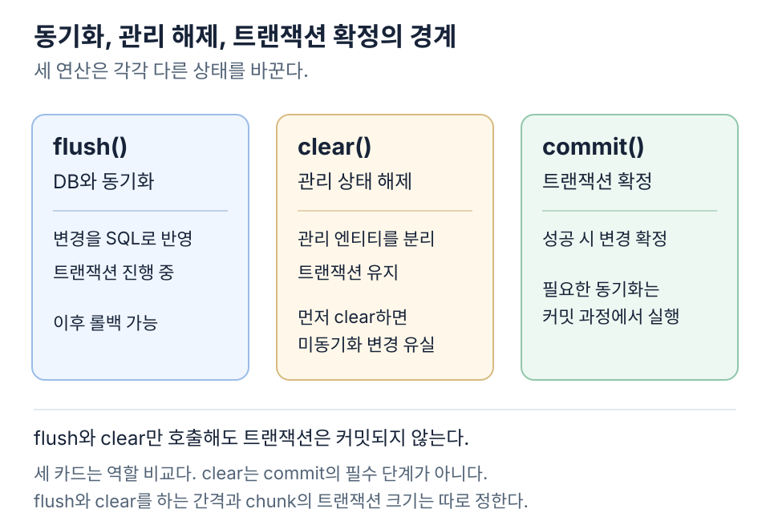

송금 내역 화면에 받는 사람 이름 한 칸을 붙여 보자. 송금 20건은 이미 읽었다. 반복문에서 `transfer.receiverAccount`를 꺼내 이름만 넣으면 되는데, 여기서 SQL이 스무 번 더 나갈 수 있다.



스무 건의 수신 계좌가 모두 다르고 캐시가 비어 있다고 가정했다. 위쪽에서는 목록을 읽은 뒤 이름을 찾으러 스무 번 더 간다. 아래쪽에서는 송금과 계좌를 조인해 필요한 열을 한 번에 받는다. 그림에서 센 것은 SQL 왕복 횟수다. 두 쿼리 중 어느 쪽이 얼마나 빠른지는 인덱스와 반환 행 수, 실행 계획까지 확인해야 한다.

## 조회 화면에 필요한 데이터부터 정한다

위쪽 경로처럼 목록을 한 번 읽고 각 항목에서 다시 조회하는 패턴을 N+1이라고 부른다. 다음 SQL에서는 첫 쿼리의 결과를 순회할 때 두 번째 쿼리가 반복된다. 같은 계좌가 여러 번 등장하거나 영속성 컨텍스트에 이미 들어 있으면 실제 횟수는 줄어들 수 있다.

```sql
-- 구조 설명용: 송금 목록 한 번
SELECT id, amount, receiver_account_id
FROM transfer
ORDER BY created_at DESC, id DESC
LIMIT 20;

-- 목록을 순회하며 계좌마다 반복될 수 있는 조회
SELECT id, display_name
FROM account
WHERE id = ?;
```

이 화면에서 계좌의 다른 필드는 쓸 일이 없다. 송금 ID, 금액, 표시 이름 세 개만 골라 DTO로 받으면 DB에 한 번만 다녀오면 된다. 왕복을 스무 번 줄여 얻는 시간은 조인에 쓴 인덱스와 데이터 분포, 실제로 옮긴 양에 달려 있다.

```sql
SELECT t.id, t.amount, a.display_name
FROM transfer t
JOIN account a ON a.id = t.receiver_account_id
ORDER BY t.created_at DESC, t.id DESC
LIMIT 20;
```

Spring Data JPA는 인터페이스 기반 projection과 DTO 반환을 지원한다. 조회 전용 값으로 필요한 데이터를 표현하면 엔티티 그래프 전체를 화면에 넘길 이유가 줄어든다. 중첩 projection이 원하는 열만 가져오는지와 어떤 조인이 생성되는지는 확인해야 한다. DTO가 엔티티 변경 감지까지 대신하는 것은 아니다. [Spring Data JPA projections](https://docs.spring.io/spring-data/jpa/reference/repositories/projections.html)

업무 규칙을 실행하면서 엔티티가 필요하다면 해당 조회의 fetch join이나 entity graph를 검토한다. 여러 연관을 묶어 읽는 batch fetch도 선택지다. fetch join은 한 SQL의 행 수를 늘릴 수 있고 batch fetch는 묶음별 추가 쿼리가 남는다. 요청의 결과 모양과 데이터 크기에 맞춰 선택한다. [Spring Data JPA entity graph](https://docs.spring.io/spring-data/jpa/reference/jpa/query-methods.html#jpa.entity-graph)

## 객체의 연관관계와 SQL 조회 계획을 나눠 본다

JPA는 Java 객체와 관계형 데이터를 연결하는 영속성 명세다. Hibernate는 그 구현체 중 하나다. 애플리케이션은 엔티티를 수정하고 영속성 컨텍스트는 관리 중인 엔티티의 상태를 DB와 동기화한다. 같은 영속성 컨텍스트에서 동일한 영속성 식별자의 엔티티를 다룰 때 객체의 동일성을 유지하는 것도 이 모델의 일부다. [Jakarta Persistence 3.2 명세](https://jakarta.ee/specifications/persistence/3.2/jakarta-persistence-spec-3.2.html)

`transfer.receiverAccount`처럼 객체로 연결해 두는 선택은 탐색과 상태 변경을 표현하기 편하다. 그 연관 데이터를 어느 SQL에서 함께 가져올지는 별도 문제다. LAZY는 접근 시 로딩을 지연하는 전략이며 이후 반복문에서 모든 연관 객체를 접근하면 추가 조회가 발생할 수 있다.

EAGER라고 SQL 한 번으로 읽는다고 단정할 수도 없다. Hibernate의 조회 방식과 fetch 계획에 따라 추가 조회가 생긴다. 연관관계 설정만 보고 N+1이 해결됐는지 판단하기보다 실제 SQL과 반환 행 수를 확인한다. Hibernate는 join fetch, batch fetch, subselect fetch를 서로 다른 연관 로딩 전략으로 설명한다. [Hibernate 7.1의 연관 데이터 조회](https://docs.hibernate.org/orm/7.1/introduction/html_single/#association-fetching)

연관관계를 없애고 `receiverAccountId`만 저장해도 JPA의 엔티티 관리와 변경 감지를 사용할 수 있다. 다만 객체 탐색, cascade 같은 연결 기능은 직접 다루게 된다. 필요한 계좌들을 ID 목록으로 한 번에 읽을 수도 있고 실수로 ID마다 조회해 다시 N+1을 만들 수도 있다. ORM 연관관계의 유무와 DB 외래키 제약의 유무도 별개의 결정이다.

## 컬렉션 fetch join과 페이지 경계가 충돌한다

송금 하나에 심사 이력 여러 개가 연결되면 조인 결과에서 송금 행이 반복된다. 조인 결과에 SQL의 행 제한을 적용하는 것과 송금 엔티티 개수를 제한하는 것은 다르다. 컬렉션 fetch join에 pagination을 결합하면 Hibernate가 메모리에서 제한을 적용하거나 설정에 따라 실패시킬 수 있다. 응답에 20개만 보인다고 DB에서도 20개만 읽었다고 판단하면 안 된다. [Hibernate HQL의 fetch join과 제한](https://docs.hibernate.org/orm/7.1/querylanguage/html_single/)

두 개의 to-many 연관을 동시에 조인하면 결과가 더 커진다. 한 송금에 이력 4개와 태그 3개가 있다고 가정하면 조합에 따라 12행이 생긴다. 엔티티 결과에서 중복을 제거해도 DB가 만들어 전송한 행의 비용까지 없애 주지는 않는다. 쿼리 수를 줄이는 변경이 전송량과 객체 조립 비용을 늘릴 수 있다.

페이지 단위를 유지하는 한 가지 설계는 먼저 정렬된 송금 ID 페이지를 읽고 그 ID들에 필요한 데이터를 묶어 조회하는 방식이다. `created_at`이 같은 행을 구분하도록 `id` 같은 추가 정렬 기준을 둔다. `IN`으로 조회한 결과의 순서는 보장되지 않으므로 처음 정한 순서로 조립한다.

이 설계에도 조건이 붙는다. 두 조회 사이에 데이터가 바뀔 때 어떤 일관성을 요구하는지 정해야 한다. 동일한 스냅샷이 필요하다면 사용하는 DB와 트랜잭션 격리 수준을 확인한다. 여러 화면을 넘기는 동안의 완전한 스냅샷까지 자동으로 생기는 것은 아니다. 큰 offset을 계속 건너뛰는 비용이 문제라면 마지막 정렬 키를 기준으로 이어 읽는 keyset pagination을 비교한다.

## 대량 처리에서는 영속성 컨텍스트의 수명이 비용이 된다

정산 대상 전체를 엔티티로 읽어 한 트랜잭션에서 갱신하면 관리 중인 객체가 계속 쌓일 수 있다. 엔티티 자체와 변경 감지에 필요한 상태가 메모리를 사용한다. 긴 트랜잭션은 연결을 오래 점유하고 갱신한 행의 락과 실패 시 되돌려야 할 작업도 커질 수 있다.

여기서 batch라는 단어를 나눠 읽어야 한다. 연관 데이터를 묶어서 읽는 batch fetch, 여러 SQL 쓰기를 묶어 보내는 JDBC batching, 업무 데이터를 일정 건수씩 처리하는 chunk는 서로 다른 단위다. JDBC fetch size도 결과를 가져오는 방식에 관한 설정이며 앞의 세 가지와 동일하지 않다.

`flush()`는 관리 상태의 변경을 SQL로 DB에 반영한다. `clear()`는 영속성 컨텍스트의 엔티티를 관리 대상에서 분리한다. 둘을 호출했다고 트랜잭션이 commit되는 것은 아니다. flush 이후에도 같은 트랜잭션이 rollback될 수 있으며 clear를 먼저 해 버리면 아직 동기화하지 않은 변경을 잃을 수 있다. [Hibernate의 배치 처리 문서](https://github.com/hibernate/hibernate-orm/blob/7.1/documentation/src/main/asciidoc/userguide/chapters/batch/Batching.adoc)



메모리를 줄이기 위한 flush·clear 간격과 트랜잭션을 나누는 chunk 크기는 따로 정한다. chunk마다 commit하면 실패 시 다시 처리할 범위가 줄어드는 대신 전체 작업의 부분 완료 상태를 다뤄야 한다. 마지막 처리 위치와 완료 여부를 기록하고 재실행이 이미 처리한 정산을 중복 반영하지 않도록 설계한다. Spring Batch도 chunk 처리를 트랜잭션 경계와 함께 설명한다. [Spring Batch의 chunk 처리](https://docs.spring.io/spring-batch/reference/step/chunk-oriented-processing.html)

JDBC batch 설정을 켰다고 모든 INSERT가 묶이는 것도 아니다. Hibernate에서는 IDENTITY 식별자 생성이 INSERT batching을 제한하는 경우가 있다. 사용하는 버전과 식별자 전략에서 실제 SQL batching이 일어나는지 확인한다. 한꺼번에 저장하는 메서드 이름이나 설정 파일의 값만으로 왕복 감소를 주장하기 어렵다.

## 한 번의 bulk SQL이 엔티티의 규칙을 대신하지는 않는다

같은 조건의 대량 갱신은 엔티티를 모두 읽는 방식보다 bulk UPDATE가 적합할 수 있다. 하지만 JPQL bulk 변경은 DB에 직접 반영되며 이미 읽은 엔티티의 상태와 어긋날 수 있다. 엔티티 메서드와 생명주기 콜백을 건별로 실행하는 경로도 거치지 않는다.

낙관적 잠금의 버전 조건과 갱신을 bulk 변경에서 어떻게 다룰지도 확인한다. 일반적인 엔티티 갱신에서 기대한 보호가 동일하게 적용된다고 가정하면 충돌을 놓칠 수 있다. 변경 전 필요한 flush와 변경 후 context 정리를 트랜잭션 흐름에 맞춰 정한다. [Jakarta Persistence의 bulk update·delete 규칙](https://jakarta.ee/specifications/persistence/3.2/jakarta-persistence-spec-3.2.html)

Spring Data JPA의 `@Modifying(clearAutomatically = true)`는 변경 후 context를 비우도록 요청하는 설정이다. 아직 flush하지 않은 변경이 남아 있는 상태에서 비우면 그 변경이 사라질 수 있다. 편의 옵션 하나로 트랜잭션의 앞뒤 상태까지 정리됐다고 보기는 어렵다. [Spring Data JPA의 modifying query](https://docs.spring.io/spring-data/jpa/reference/jpa/query-methods.html#jpa.modifying-queries)

수신 계좌의 표시 이름을 조회하는 일과 계좌 잔액을 변경하는 일은 요구가 다르다. 앞의 조회에서 엔티티가 불필요했다는 이유로 모든 쓰기까지 같은 방식으로 바꿀 근거는 없다. 도메인 규칙과 엔티티 수명주기가 필요한 쓰기에는 JPA를 쓰고 조회나 집계에는 DTO·SQL을 함께 사용하는 설계도 가능하다.

## 동시 송금에서는 빠른 계산보다 잔액 갱신 조건이 먼저다

두 요청이 같은 잔액을 읽고 각각 출금 가능하다고 판단하면, 읽은 값은 두 번째 갱신 시점에 오래된 값일 수 있다. 애플리케이션에서 잔액을 확인한 다음 별도 UPDATE를 하는 check-then-act 구조는 동시 요청을 제어하지 못한다.

조건부 UPDATE, `@Version`을 이용한 낙관적 잠금, 행 잠금은 서로 다른 선택지다. 조건부 UPDATE는 DB에서 갱신 조건을 함께 검사하고 영향을 받은 행 수로 성공 여부를 확인한다. 낙관적 잠금은 버전 충돌을 감지한다. 비관적 잠금은 충돌할 작업의 진행을 기다리게 한다. 충돌 빈도와 트랜잭션 길이에 따라 비용이 달라진다.

MySQL InnoDB의 `SELECT ... FOR UPDATE`는 트랜잭션 안에서 잠금 조회를 수행한다. 외부 이상 탐지 API 응답을 기다리는 동안 계좌 행 잠금을 오래 잡는 구조라면 다른 송금도 기다릴 수 있다. 여러 계좌를 갱신할 때는 잠금 순서를 일관되게 정하고 deadlock 이후 재시도는 멱등성을 포함한 전체 업무 단위로 설계한다. [MySQL 잠금 조회](https://dev.mysql.com/doc/refman/8.4/en/innodb-locking-reads.html), [InnoDB deadlock 처리](https://dev.mysql.com/doc/refman/8.4/en/innodb-deadlocks-handling.html)

실제 송금에서는 잔액 갱신만 성공했다고 끝나지 않는다. 업무 상태와 원장, 중복 요청 기록을 어떤 트랜잭션에 묶을지 정해야 한다. 외부 이체가 포함되면 DB 트랜잭션 하나로 외부 결과까지 되돌릴 수 없다. [송금 성공을 언제 약속하는가](/backend/transfer-performance/03-transfer-contract/)에서 정한 확정 조건과 상태 전이가 여기의 SQL 경계를 제한한다.

## 생성된 SQL과 실행 계획에서 다시 측정한다

스무 건짜리 목록에서 SQL이 딱 한 줄만 찍혔다고 하자. 이제 볼 것은 그 한 줄로 DB가 몇 행을 읽어서 몇 행을 돌려줬는지다. 인덱스를 탔더라도 조건에 맞는 행이 너무 많으면 정렬과 조인에 드는 비용은 여전히 크다.

MySQL의 `EXPLAIN`은 옵티마이저의 계획을 보여 준다. `EXPLAIN ANALYZE`는 지원하는 문장을 실제로 실행하며 관측한 행 수와 시간 정보를 제공한다. 실행 비용과 부하를 고려해 재현 환경에서 확인하는 도구다. 출력에 있는 예상 행 수와 실제 행 수도 구분해야 한다. [MySQL 8.4 EXPLAIN](https://dev.mysql.com/doc/refman/8.4/en/explain.html)

애플리케이션 지연과 DB 실행 시간의 차이도 남겨 둔다. 커넥션 획득 대기, 네트워크 전송, 객체 생성, JSON 직렬화가 요청 시간에 포함된다. SQL 한 건에서 줄인 시간이 전체 응답 시간에서 차지하는 비중을 확인해야 후속 변경을 고를 수 있다.

처음 예제의 조회에서는 21번 다녀오던 걸 한 번으로 줄였다. 여기까지는 SQL만 보고도 셀 수 있다. 운영자가 목록을 몇 초 덜 기다릴지는 같은 데이터와 유입률로 화면 응답까지 다시 재야 나온다. 잔액을 바꾸는 쿼리까지 손봤다면 동시에 보낸 송금과 재시도에서도 잔액이 맞는지 함께 본다.

## 이 편의 용어

| 용어 | 맡는 일 | 함께 확인할 비용 |
| --- | --- | --- |
| 영속성 컨텍스트 | 엔티티 식별성과 관리 상태 유지 | 관리 객체 수와 수명 |
| fetch join | 연관 데이터를 조인해 로딩 | 결과 행 증가와 pagination |
| projection | 필요한 조회 결과를 별도 타입으로 표현 | 실제 선택 열과 조인 |
| JDBC batching | 여러 쓰기 명령을 묶어 전달 | 식별자 전략과 드라이버 동작 |
| flush | 객체 변경을 SQL로 동기화 | commit과 다른 시점 |
| chunk | 일부 작업을 묶어 처리·확정 | 부분 완료와 재시작의 멱등성 |
