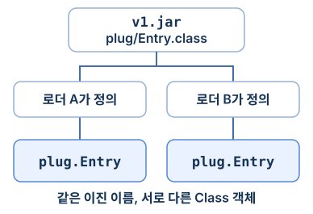

빌드 때는 있던 메서드가 운영에서 사라졌다. 서버에 JAR을 열어 보니 클래스 파일은 있다. 그 파일에 JVM이 찾던 **이름과 시그니처의 메서드**도 있을까? 잘못된 버전을 배포했다면 파일이 있어도 호출은 실패한다. 어느 단계가 실패했는지 보려고 같은 호출자에 서로 다른 JAR을 꽂아 봤다.

## 소스에서 첫 호출까지

`javac`는 소스를 읽어 클래스 파일을 만든다. 그 파일을 실행하는 JVM에서는 **로딩 → 연결 → 초기화**가 일어난다. 로딩은 이진 이름에 해당하는 바이트를 찾아 클래스를 정의하는 일이다. 연결할 때는 클래스 파일과 바이트코드의 유효성을 검증하고, 준비 단계에서 클래스 변수의 공간과 기본값을 마련한다. 해석(resolution) 단계에서는 이름과 디스크립터로 적힌 참조를 실제 클래스·필드·메서드에 연결한다. JVM은 해석을 앞당기거나 해당 참조를 처음 사용하는 시점까지 늦출 수 있다. 초기화는 클래스가 선언한 `static` 필드 초기화식과 `static` 블록을 실행하는 단계다. `new`, 상수 변수가 아닌 `static` 필드 읽기, `static` 메서드 호출 등이 초기화의 계기가 된다. [JVM 명세의 연결](https://docs.oracle.com/javase/specs/jvms/se25/html/jvms-5.html#jvms-5.4) · [클래스 초기화가 필요한 시점](https://docs.oracle.com/javase/specs/jls/se25/html/jls-12.html#jls-12.4.1)

기본 `ClassLoader.loadClass`는 이미 로드한 클래스를 확인한 뒤 부모에게 찾기를 맡긴다. 부모가 찾지 못하면 자신의 `findClass`가 찾는다. JDK 25에서 이 예제의 애플리케이션 로더 부모는 플랫폼 로더다. `String.class.getClassLoader()`의 결과는 `null`이었다. Java API에서 부트스트랩 로더를 나타내는 값이다. 이름 있는 모듈은 어느 로더가 그 모듈을 정의하는지도 관여하므로 부모로만 올라가는 그림 하나로 모든 탐색을 설명할 수는 없다. [ClassLoader의 기본 위임 규칙](https://docs.oracle.com/en/java/javase/25/docs/api/java.base/java/lang/ClassLoader.html) · [모듈과 내장 로더의 위임](https://openjdk.org/jeps/261)

Java 8에서 보던 순서는 애플리케이션 로더, 확장(extension) 로더, 부트스트랩 로더였다. JDK 9에서 확장 메커니즘이 사라지고 플랫폼 로더가 도입됐다. JDK의 클래스와 리소스는 모듈 이미지에서 제공된다. 배포 서버의 JDK 25에서 표준 클래스를 조사할 때는 `rt.jar` 대신 `jrt:/` 이미지와 모듈을 확인한다. [JDK 런타임 이미지의 변화](https://openjdk.org/jeps/220) · [모듈 시스템 도입](https://openjdk.org/jeps/261)

## 같은 호출자에 JAR만 바꿔 끼운 결과

`Caller`는 `plug.Entry.text()`가 문자열을 돌려주는 v1에 맞춰 컴파일했다. 클래스 파일의 상수 풀을 `javap -v -c`로 열면 호출 명령과 대상이 한 쌍으로 보인다. 바이트코드 오프셋 17의 `#21`은 메서드 이름과 반환 타입을 담은 심볼릭 참조다. JVM은 각 클래스의 런타임 상수 풀을 클래스 파일의 상수 풀로부터 만든다. [JVM의 런타임 상수 풀](https://docs.oracle.com/javase/specs/jvms/se25/html/jvms-2.html#jvms-2.5.5)

```text
#21 = Methodref  #22.#23  // plug/Entry.text:()Ljava/lang/String;
 17: invokestatic #21     // Method plug/Entry.text:()Ljava/lang/String;
```

| 실행 조건 | 가장 먼저 드러난 결과 |
| --- | --- |
| 클래스패스에 v1이 있다 | `v1` 출력. `-Xlog:class+load=info`에도 `plug.Entry`의 출처가 `v1.jar`로 찍혔다. |
| JAR을 빼고 `Class.forName("plug.Entry")` 실행 | 이름으로 명시적으로 찾던 코드에 `ClassNotFoundException`이 전달됐다. |
| JAR을 빼고 위 `invokestatic` 실행 | JVM이 대상 클래스를 연결하지 못해 `NoClassDefFoundError`가 났다. 원인 체인에 `ClassNotFoundException`이 남았다. |
| 문자열 대신 `int`를 반환하는 v2만 배포 | 클래스는 찾았다. 하지만 `()Ljava/lang/String;`에 맞는 메서드가 없어 `NoSuchMethodError`가 났다. |

`NoSuchMethodError`는 컴파일할 때와 실행할 때의 의존성이 달라지면 어떻게 되는지 보여 준다. 이 출력은 참조를 사용한 호출에서 실패가 드러났다는 관찰이다. VM이 내부 탐색 작업을 시작한 시점까지 알려 주지는 않는다. [심볼릭 참조의 해석과 실패](https://docs.oracle.com/javase/specs/jvms/se25/html/jvms-5.html#jvms-5.4.3) · [명령과 실제 예외 원인 체인](./evidence/loader-output.txt)

운영에서는 **처음 발생한 예외의 원인 체인**, 실행 중인 프로세스의 구성, 실제 배포 파일 순으로 대조한다. 같은 컨테이너와 사용자 권한에서 다음 항목을 확인한다. 클래스패스에 이름이 있어도 실행 중인 플러그인 로더에 그 JAR이 보이지 않을 수 있다.

1. `jcmd <pid> VM.command_line`과 `VM.system_properties`에서 실행한 JDK, `-cp`, `-jar`, 모듈 경로와 시작 모듈을 확인한다. `java -jar`로 실행했다면 JAR의 매니페스트와 애플리케이션 런처의 의존성 배치도 본다.
2. 서버가 실제로 읽는 JAR에 `jar tf`를 실행해 클래스 경로와 중복 버전을 찾는다. 모듈이면 `jar --describe-module --file app.jar`와 재현 실행의 `--show-module-resolution`으로 모듈 그래프를 대조한다. 클래스는 있는데 패키지가 열려 있지 않은 리플렉션 접근은 접근 권한 오류로 구별한다.
3. `jcmd <pid> VM.classloaders`로 로더 트리를 본다. 같은 기동 인자로 재현하면서 `-Xlog:class+load=info,class+resolve=debug`를 켜고 실패한 이름의 출처와 호출자의 로더를 확인한다. 찾은 바이트는 `javap -v -cp <배포된-JAR> <클래스>`로 호출자가 요구한 디스크립터와 비교한다. [JDK 25 jcmd](https://docs.oracle.com/en/java/javase/25/docs/specs/man/jcmd.html) · [Java 런처의 실행 모드](https://docs.oracle.com/en/java/javase/25/docs/specs/man/java.html)

## 같은 파일에서 서로 다른 타입이 생긴다



같은 `v1.jar`를 읽는 `URLClassLoader` 두 개를 만들었다. 둘의 부모인 플랫폼 로더에는 플러그인 JAR이 없다. 각 로더가 직접 정의한 `plug.Entry`의 이름은 같았고 `Class` 객체의 `==` 결과는 거짓이었다. B의 인스턴스를 A의 타입으로 변환하자 메시지는 `Cannot cast plug.Entry to plug.Entry`였다. 런타임에서 일반 클래스의 정체성은 **이진 이름과 정의한 로더의 쌍**이다. [JVM 명세의 클래스 생성](https://docs.oracle.com/javase/specs/jvms/se25/html/jvms-5.html#jvms-5.3)

서로 다른 라이브러리 버전이 필요한 플러그인은 자체 패키지만 먼저 찾도록 범위를 좁힌다. JDK 클래스와 호스트·플러그인이 주고받는 API는 공통 부모가 한 번 정의하게 한다. 플러그인 JAR에는 공유 API의 복사본을 싣지 않고, 로딩을 바꾼다면 중복 정의를 막기 위해 `getClassLoadingLock(name)` 안에서 `findLoadedClass`부터 확인한다. 부모로의 위임은 탐색 실패에 한정한다. 검증·접근 오류까지 무시하고 다른 클래스를 찾으면 충돌을 숨긴다. 신뢰할 수 없는 플러그인은 제한된 OS 권한의 별도 프로세스에서 실행한다. 로더는 클래스 이름을 나눌 수 있지만 파일·네트워크 권한을 격리하지 않는다. JDK 24부터 Security Manager는 영구 비활성화됐다. [ClassLoader API](https://docs.oracle.com/en/java/javase/25/docs/api/java.base/java/lang/ClassLoader.html) · [JEP 486](https://openjdk.org/jeps/486)

## 첫 초기화와 두 번째 접근의 예외가 다른 이유

정적 필드의 초기화식에서 `Integer.parseInt("broken")`을 호출했다. 첫 접근은 `NumberFormatException`을 원인으로 가진 `ExceptionInInitializerError`를 받았다. JVM은 해당 클래스를 초기화 실패 상태로 표시한다. 같은 로더의 두 번째 접근은 `NoClassDefFoundError`였다. 클래스 파일은 계속 그 자리에 있었다. 장애가 난 뒤 두 번째 오류만 보면 의존성 누락으로 오인하기 쉽다. [JLS의 상세 초기화 절차](https://docs.oracle.com/javase/specs/jls/se25/html/jls-12.html#jls-12.4.2)

초기화를 시작한 스레드가 자기 클래스에 재진입하면 스스로 기다리지 않고 진행한다. 예제의 `static final int value = read() + 1`에서 `read()`는 아직 대입 전인 같은 필드의 기본값 0을 읽었다. 최종값은 1이었다. **다른 스레드**가 초기화 중인 클래스를 사용하면 초기화가 끝날 때까지 기다린다. A와 B의 정적 초기화식이 각각 상대 클래스의 값을 읽게 하고 두 플랫폼 스레드를 동시에 진입시키자, 스레드 덤프의 `init-A`는 B의 초기화 완료를, `init-B`는 A의 초기화 완료를 기다렸다. 두 스레드 모두 진행할 수 없다. 클래스 초기화에 상대 클래스의 초기화 완료나 외부 작업 완료를 기다리는 로직을 넣지 않으면 이 순환을 끊을 수 있다. [실제 스레드 덤프](./evidence/loader-output.txt)

## 플러그인을 내렸는데 클래스가 남는 경우

호스트의 정적 레지스트리에 플러그인 로더를 등록하고 플러그인의 인스턴스를 하나 만들었다. JAR을 닫고 메서드에서 반환한 뒤에도 레지스트리가 로더를 붙들고 있었다. G1 수집을 요청한 뒤 로더의 약한 참조는 살아 있었다. 레지스트리 항목을 비운 뒤에는 `unloading class plug.Entry`가 찍혔고 약한 참조가 지워졌다. 인스턴스를 모두 지우거나 파일을 닫는 동작만으로는 정의 로더가 사라지지 않는다. GC 요청 뒤의 정확한 언로딩 시점은 VM이 정한다. [클래스 언로딩의 조건](https://docs.oracle.com/javase/specs/jls/se25/html/jls-12.html#jls-12.7)

실서비스에서 재배포할 때마다 메타스페이스가 늘면 `jcmd <pid> VM.classloader_stats`로 이전 로더 종류의 개수와 클래스 수를 배포 전후에 비교한다. 같은 부하에서 여러 차례 수집 후에도 오래된 로더가 늘어나는지 `class+unload` 로그와 맞춰 본다. 원인을 확정하려면 안전하게 수집한 힙 덤프에서 오래된 로더까지의 **GC 루트 경로**를 찾는다. 예제에서는 정적 레지스트리가 한 경로이고, 실제 서비스에서는 장수 스레드의 context class loader나 정리하지 않은 콜백도 조사 대상이다. [jcmd 진단 명령](https://docs.oracle.com/en/java/javase/25/docs/specs/man/jcmd.html)

실험은 macOS ARM64의 Temurin 25.0.4.1에서 실행했다. Python 3와 같은 JDK의 `java`, `javac`, `javap`, `jar`, `jcmd`가 있는 macOS·Linux 환경에서 두 파일을 같은 폴더에 두고 `python3 run-loaders.py`를 실행하면 된다. 스크립트는 임시 폴더 안에서 두 JAR을 만들고, 순환 초기화용 JVM의 덤프를 얻은 뒤 프로세스를 종료한다. [Java 실험 소스](./evidence/LoaderLab.java) · [재현 스크립트](./evidence/run-loaders.py) · [실행 결과](./evidence/loader-output.txt)

호출 대상 클래스를 찾았다면 다음은 메서드 안의 명령을 실행할 차례다. [다음 편에서 피연산자 스택과 JIT 인라이닝을 읽는다.](/backend/transfer-performance/02-jvm-execution/)
