## 세대별 수집이 기대하는 세 가지 분포

4 KiB짜리 배열을 계속 만들되 최근 32개만 남겨 놓으면 G1은 새 배열이 몰린 곳을 비워서 꽤 많은 자리를 되찾는다. 같은 코드에서 최근 8,192개를 붙들어 두면 어떨까. 같은 수의 배열을 만들어도 수집할 때 챙겨서 옮겨야 할 배열이 많아진다. 뒤에서 이 두 조건으로 로그를 찍어 봤다.

세대별 수집이 젊은 공간부터 자주 비우는 데에는 세 가지 기대가 깔려 있다. 객체가 얼마나 일찍 죽는지, 오래 산 객체는 그다음에도 살아 있는지, 오래된 객체에서 젊은 객체로 건너가는 참조가 얼마나 잦은지다.

| 가설 | 무엇을 기대하나 | 수집 방식에 미치는 영향 |
| --- | --- | --- |
| 약한 세대 가설 | 새로 만든 객체 중 많은 수가 일찍 죽는다. | 젊은 세대를 자주 회수하면 살아서 복사해야 할 양이 작다. |
| 강한 세대 가설 | 오래 살아남은 객체일수록 다음 구간도 살아남을 가능성이 높다. | 여러 차례 수집을 견딘 객체를 오래된 세대로 옮겨 반복 복사를 줄인다. |
| 세대 간 참조 가설 | 세대를 가로지르는 참조가 같은 세대 안의 참조보다 적은 편이다. | 오래된 쪽에서 젊은 쪽을 가리킬 가능성이 있는 위치를 기록하면, 젊은 세대만 수집할 때 검색 범위가 줄어든다. |

오랫동안 키운 캐시를 한꺼번에 비운다고 생각해 보자. 꽤 나이 든 객체들이 같은 순간에 우르르 회수 대상이 된다. 오래 살아남았으니 앞으로도 오래 살 거라는 두 번째 가설이 여기서는 빗나간다. 실제 프로그램에서 객체의 수명을 잰 연구에서도 강한 세대 가설을 따르는 분포와 벗어나는 분포가 모두 나왔다. [객체 수명 분포를 측정한 연구](https://web.cs.umass.edu/publication/docs/1998/UM-CS-1998-081.pdf) · [세대별 수집과 기억 집합의 초기 실측](https://prl.khoury.northeastern.edu/img/u-sde-1984.pdf)

[앞 편의 System.arraycopy 실험](/backend/transfer-performance/system-arraycopy/)처럼 오래된 참조 배열의 한 칸을 새 객체로 바꿨다고 하자. 젊은 세대만 뒤진다면 그 객체를 붙드는 화살표는 어디서 찾을까. G1은 쓸 때 단서를 남긴다. **쓰기 장벽**이 참조를 저장한 필드 주변의 메모리 구간인 **카드**를 기록한다. 나중에 수집할 때는 기억 집합(remembered set)으로 바깥에서 들어오는 참조를 찾는다. 덕분에 오래된 쪽을 죄다 훑을 필요가 줄지만, 오래된 배열을 자주 고치면 장벽과 카드 처리 비용도 늘 수 있다. [G1의 기억 집합](https://docs.oracle.com/en/java/javase/25/gctuning/garbage-first-g1-garbage-collector1.html) · [OpenJDK의 카드 기록 경로](https://github.com/openjdk/jdk25u/blob/7b65d74bcbd7c3a0b4c1f5c5bd85e64aa2e51b4a/src/hotspot/share/gc/g1/g1BarrierSet.inline.hpp#L76-L82)

## 빈 공간을 모으는 비용과 멈추는 시간

힙에 빈 곳이 4칸씩 두 군데 있다. 총 8칸이 남았는데도 6칸짜리 객체 하나가 못 들어간다. 살아 있는 객체를 표시하고 죽은 객체의 자리만 돌려주는 **mark-sweep**에서는 빈 공간이 이렇게 흩어지기도 한다. 이것을 단편화라고 한다. 살아 있는 객체를 한쪽으로 모으면 연속된 공간이 생긴다(**mark-compact**). 대신 객체의 새 주소를 계산하고 그 객체를 가리키던 참조도 고쳐야 한다. [OpenJDK Serial Full GC의 새 주소 계산, 참조 수정, 객체 이동](https://github.com/openjdk/jdk25u/blob/fda231468e56663992785ec199a6efb8eca3cc7a/src/hotspot/share/gc/serial/serialFullGC.cpp#L703-L744)

그동안 요청을 받은 애플리케이션 스레드는 기다려야 할까. **Serial GC**에서는 애플리케이션이 멈춘 동안 GC 스레드 하나가 일한다. **Parallel GC**도 애플리케이션을 멈춘다. 이때 여러 GC 스레드가 나눠 일해 처리량을 높인다. 예전 HotSpot의 **CMS**는 오래된 세대의 표시 작업 대부분과 쓸기 작업을 애플리케이션이 실행되는 동안 처리했다. 초기 표시와 재표시에서는 여전히 멈췄다. 또 평소 객체를 제자리에 두니 빈 공간이 흩어져 큰 할당이 실패할 수 있었다. [JDK 25의 Serial과 Parallel GC](https://docs.oracle.com/en/java/javase/25/gctuning/available-collectors.html) · [JDK 8의 CMS 수집 과정과 할당 실패 조건](https://docs.oracle.com/javase/8/docs/technotes/guides/vm/gctuning/cms.html)

**G1**은 한 번의 정지에서 객체를 옮길 범위를 리전 단위로 고른다. 살아 있는 객체가 적은 리전을 먼저 비우면 적게 복사하고도 같은 크기의 리전을 통째로 얻는다. 그 이득을 얻으려면 옮겨 갈 빈 공간이 필요하고 다른 리전에서 들어오는 참조도 추적해야 한다. [JDK 25의 G1 대피와 리전 선택 기준](https://docs.oracle.com/en/java/javase/25/gctuning/garbage-first-g1-garbage-collector1.html)

## 젊은 리전을 비울 때와 오래된 리전을 고를 때

G1은 힙을 일정한 크기의 리전으로 나눈다. Young GC에서는 애플리케이션 스레드를 잠시 멈추고 젊은 리전에서 살아 있는 객체를 빈 Survivor 또는 Old 리전으로 복사한다. 참조를 새 위치에 맞추고 대피(evacuation)에 성공한 리전은 통째로 다음 할당에 쓴다. 여러 GC 작업 스레드가 병렬로 복사해도 이 구간에 애플리케이션은 멈춘다. [OpenJDK 25.0.4.1의 G1YoungCollector::collect](https://github.com/openjdk/jdk25u/blob/7b65d74bcbd7c3a0b4c1f5c5bd85e64aa2e51b4a/src/hotspot/share/gc/g1/g1YoungCollector.cpp#L1088-L1144)

오래된 리전 중 어디부터 비울지 고르려면 살아 있는 객체가 얼마나 남았는지 알아야 한다. 여기서 [앞 글의 도달 가능성](/backend/transfer-performance/jvm-memory/)이 다시 나온다. G1은 `Concurrent Start`라는 Young 정지에서 마킹을 준비한다. 애플리케이션이 다시 실행되는 동안 참조를 따라가며 살아 있는 객체를 표시한다. **Remark** 때 다시 멈춰 남은 표시를 끝낸 뒤 기억 집합을 재구성하고 **Cleanup** 정지에서 다음 회수를 준비한다. 이 과정에서 세는 것은 다음에 옮겨야 할 객체다. 실제로 객체를 옮기는 일은 대피 단계에서 한다. [OpenJDK의 마킹 주기 실행 순서](https://github.com/openjdk/jdk25u/blob/7b65d74bcbd7c3a0b4c1f5c5bd85e64aa2e51b4a/src/hotspot/share/gc/g1/g1ConcurrentMarkThread.cpp#L271-L310) · [Remark에서 마무리하는 작업](https://github.com/openjdk/jdk25u/blob/7b65d74bcbd7c3a0b4c1f5c5bd85e64aa2e51b4a/src/hotspot/share/gc/g1/g1ConcurrentMark.cpp#L1384-L1423)

회수할 오래된 리전이 남으면 **Mixed GC**에서 젊은 리전과 선택한 오래된 리전을 함께 비운다. 한 번에 넣을 오래된 리전의 수에는 후보 수와 예상 정지 시간 예산이 영향을 준다. 로그에 `Pause Young (Mixed)`가 찍혔다면 젊은 세대만 비웠다고 읽을 수 없는 이유다. [Mixed 진행 여부](https://github.com/openjdk/jdk25u/blob/7b65d74bcbd7c3a0b4c1f5c5bd85e64aa2e51b4a/src/hotspot/share/gc/g1/g1Policy.cpp#L1426-L1430) · [수집할 오래된 리전을 고르는 코드](https://github.com/openjdk/jdk25u/blob/7b65d74bcbd7c3a0b4c1f5c5bd85e64aa2e51b4a/src/hotspot/share/gc/g1/g1CollectionSet.cpp#L343-L396)

## 26.924ms부터 32.740ms까지의 G1 로그

Temurin 25.0.4.1에 96 MiB 힙을 주고 배열을 반복해서 만들었다. 첫 마킹 주기 끝에 눈에 띄는 숫자가 하나 나왔다. `Concurrent Mark Cycle 2.899ms`. 여기서 2.899ms 전부를 정지 시간에 더하면 얼마나 틀릴까.

그림에서 위쪽 띠가 마킹 주기 전체다. 아래쪽에서 애플리케이션이 실제로 멈춘 파란 막대만 골라 봤다. 가로 길이는 JVM 기동 뒤 경과 시간에 비례한다. 움직이는 세로선만 읽기 좋게 늦췄다.



26.924ms에 `GC(6) Pause Young (Concurrent Start)`가 시작됐다. 이 정지를 0.457ms 만에 끝내고 `GC(7) Concurrent Mark Cycle`에 들어갔다. 그 안에 정지가 네 번 찍혔다. 별도의 Young GC인 `GC(8)`이 0.419ms, `GC(9)`가 0.416ms였다. `GC(7)` 자신의 Remark와 Cleanup도 각각 0.091ms와 0.010ms를 썼다.

합하면 **0.936ms**다. 앞에서 본 2.899ms는 이 네 번의 정지를 포함한 주기 전체 길이다. 그 숫자까지 더하면 애플리케이션과 동시에 마킹하던 시간도 정지로 세고 네 번의 정지는 두 번씩 세게 된다. [해당 구간의 연속된 원본 로그](./evidence/first-cycle.txt)

30.993ms에는 `Prepare Mixed`가 시작됐다. 실제 Mixed는 32.225ms에 시작한 `GC(11)`이다. 이 정지에서 힙 사용량이 75M에서 52M으로 줄었고 로그가 기록한 정지 길이는 0.515ms였다. 로그의 시작·종료 행을 출력한 시각과 내부 타이머로 잰 길이는 반올림과 기록 지점 때문에 마지막 자릿수가 다를 수 있다.

## 같은 양을 할당하고 힙만 두 배로 늘린 결과

방금 본 로그는 할당량을 같게 맞춘 여덟 번의 실행 중 하나다. 한 스레드에서 4 KiB 배열을 2,097,152개 만들었다. 데이터만 8 GiB다. 만든 순서대로 최근 128개를 보관하고 네 개 중 하나는 5,120칸짜리 순환 배열에도 넣었다. 그 칸을 한 바퀴 돌아와 덮어써야 이전 배열의 참조가 끊긴다. 마지막까지 보관한 배열로 계산한 체크섬은 여덟 번 모두 `1136000`이었다. [실험 Java 소스](./evidence/AllocationWindow.java)

Apple M4 Pro에서 G1이 인식하는 프로세서 수를 4로 고정했다. JVM이 시작할 때부터 끝날 때까지 힙 크기를 48 MiB 또는 96 MiB로 유지했다. 각 조건을 새 JVM에서 네 번씩, 48·96·96·48 MiB 순서를 두 차례 반복했다. 아래 값은 각 조건의 실행별 중앙값이다. 처리량은 배열 수를 JVM 프로세스 실행 시간으로 나눈 값이다. [실행별 측정값](./evidence/runs.csv)

| 측정 항목 | 힙 48 MiB | 힙 96 MiB |
| --- | ---: | ---: |
| JVM 시작부터 종료까지 | 551.92 ms | 423.87 ms |
| GC 정지 시간의 합 | 250.55 ms | 173.12 ms |
| 초당 처리한 배열 수 | 380만 개 | 495만 개 |
| Full GC 횟수 | 5회 | 0회 |

48 MiB에서는 실행할 때마다 Full GC가 3~6회 있었는데 힙을 두 배로 주니 네 번 다 사라졌다. 프로그램도 일찍 끝났다. 여기까지만 보면 가장 오래 멈춘 시간도 줄었을 것 같다. 그런데 **가장 긴 정지 한 번**을 고르면 48 MiB에서 1.098ms, 96 MiB에서 5.347ms다. 각각 네 번 돌린 로그 중 가장 큰 값이다. 전체를 빨리 끝낸 쪽이 한 번은 더 오래 멈췄다. 여기엔 네트워크 요청이 없어서 이 숫자로 요청 지연까지 말할 수는 없다. [8회 전체 원본 GC 로그 ZIP](./evidence/gc-logs.zip)

재현하려면 같은 디렉터리에 Java 소스와 아래 스크립트를 둔다. JDK 25의 `java`와 `javac`가 PATH에 있는 상태에서 실행하면, 빈 결과 디렉터리에 원본 로그 여덟 개와 CSV가 생긴다. 정지 합계는 `[gc]`의 `Pause` **종료 행**에 기록된 길이만 더한 값이다. 동시 마킹이 사용한 CPU 시간과 운영체제 스케줄링에 따른 대기는 별도로 측정하지 않았다. [측정·집계 스크립트](./evidence/run.py)

```bash
java -version
python3 run.py results
```

## 수집기가 정지 밖으로 옮겨 온 일

G1 로그에서 파란 막대로 남은 일 중 하나가 객체를 옮기는 일이다. JDK 9는 서버 구성에서 G1을 기본으로 골랐다. 일부 추적을 애플리케이션과 동시에 하고 한 번에 비울 리전을 제한해 긴 정지를 줄이는 선택이었다. ZGC에서는 객체를 옮기는 동안에도 애플리케이션이 계속 실행된다. 객체에 접근할 때 장벽을 거쳐 이동 중에도 올바른 참조를 찾기 때문이다. JDK 11에서 실험 기능으로 들어온 ZGC는 JDK 15에서 정식 기능이 됐다. JDK 21의 Generational ZGC는 젊은 객체를 더 자주 수집하도록 세대도 나눴다. [JDK 9의 G1 기본화](https://openjdk.org/jeps/248) · [ZGC의 동시 이동 설계](https://openjdk.org/jeps/333) · [JDK 15 정식 기능 전환](https://openjdk.org/jeps/377) · [JDK 21의 세대별 ZGC](https://openjdk.org/jeps/439)

## 큰 배열 세 개가 리전 여섯 개를 차지한 이유

G1은 큰 객체(humongous object)를 오래된 세대의 **연속된 리전**에 배치한다. JDK 25 안내서는 대략 리전 절반부터 이 범주로 설명한다. 실험 버전의 HotSpot은 헤더·정렬을 포함한 객체 크기를 워드 단위로 계산해 절반 **초과**인지 검사한다. `byte[]`의 `length`는 데이터의 바이트 수이므로 객체 전체 크기와 차이가 있다. [JDK 25의 큰 객체 할당](https://docs.oracle.com/en/java/javase/25/gctuning/garbage-first-g1-garbage-collector1.html) · [실험 버전의 크기 비교](https://github.com/openjdk/jdk25u/blob/7b65d74bcbd7c3a0b4c1f5c5bd85e64aa2e51b4a/src/hotspot/share/gc/g1/g1CollectedHeap.hpp#L1190-L1197)

리전 하나를 1 MiB로 고정하고 같은 길이의 배열 딱 세 개를 붙들어 둔 채 GC를 요청했다. `Humongous regions`가 길이 500,000바이트일 때 `0->0`, 600,000바이트일 때 `3->3`으로 나왔다. 배열 길이를 1,100,000바이트로 늘리니 `6->6`이다. 배열은 여전히 세 개다. 하나가 리전 한 칸을 조금 넘겨 각각 두 칸씩 차지했다. 두 번째 칸의 남는 공간은 이 배열을 회수할 때까지 다른 객체에 줄 수 없다. [할당 코드](./evidence/HumongousProbe.java) · [세 JVM의 옵션과 로그](./evidence/humongous.txt)

운영 로그에서는 먼저 `-Xlog:gc*,gc+heap=info`의 리전 크기, `Humongous regions`, Full GC의 원인과 회수 전후를 맞춰 본다. 큰 할당에는 연속 공간이 필요해 흩어진 빈 리전의 합계만으로 성공을 예측하기 어렵다. 리전 수만으로 단편화를 확정할 수도 없다. JFR 할당 표본에서 배열 타입·크기·호출 위치를 확인하고, 같은 부하에서 버퍼를 나누거나 리전 크기를 조정했을 때 여유 공간과 정지가 어떻게 변하는지 비교한다. 위 실험에서 확인한 것은 점유 리전 수다. 연속 리전 부족으로 인한 할당 실패는 발생하지 않았다. [큰 객체와 Full GC 진단](https://docs.oracle.com/en/java/javase/25/gctuning/garbage-first-garbage-collector-tuning.html)

## 객체가 오래 남을 때 수집기를 다시 고르는 기준

이번에는 힙을 96 MiB로 고정했다. 한 스레드에서 4 KiB 배열 262,144개를 만들고 맨 앞에서 궁금했던 보관 개수만 바꿨다. 최근 32개만 남긴 실행에서는 GC 직후 Old 리전 수가 많을 때도 **3개**였고 Full GC는 한 번도 없었다. 최근 8,192개를 남기니 Old 리전은 최대 **96개**, Full GC는 **16회**였다. 만든 바이트 수는 똑같다.

나이 1인 생존 객체들의 바이트를 합해도 차이가 보인다. 한 번의 수집에서 기록된 최댓값이 214,152바이트에서 4,194,240바이트로 늘었다. 한편 Old 리전 수는 승격만으로 변하는 값이 아니어서, 그 수를 곧바로 초당 승격 바이트로 바꿔 읽을 수는 없다. [참조를 유지하는 실험 코드](./evidence/SurvivalWindow.java) · [명령·로그와 집계 기준](./evidence/survival.txt)

서비스에서 같은 현상을 만나면 할당률과 `gc+age=trace`의 연령별 생존 바이트, 승격·Old 점유량 변화, 마킹을 마친 뒤의 생존 집합을 같은 시간축에 둔다. 정지 목표를 계속 넘기는 구간에는 대피 실패와 Full GC가 있었는지를 함께 본다. 재배포 때마다 클래스 메타데이터가 늘면 먼저 로더가 해제되는지도 확인한다. [정의 로더를 붙들었다가 놓는 실험](/backend/transfer-performance/class-loading/)

마지막 실행에서 Full GC를 늘린 건 보관 개수였다. 서비스에서도 쓸 일이 끝난 객체를 계속 붙들고 있다면 먼저 그 참조를 놓을 수 있는 곳을 찾겠다. 계속 보관해야 하는 데이터라면 운영의 할당률과 생존 분포를 가져와 같은 CPU·메모리와 요청 부하로 G1과 다른 수집기를 돌려 봐야 한다.

짧은 꼬리 지연이 필요하면 ZGC의 동시 작업에 얼마나 더 CPU와 메모리를 쓸 수 있는지, 처리량이 우선이면 Parallel GC의 정지를 얼마나 허용할 수 있는지가 달라진다. 그 비교에서 볼 값은 요청 p99·p99.9, 처리량과 오류율이다. GC 정지 분포와 GC CPU는 요청에서 보인 차이를 설명할 때 꺼낸다. 여기서 실제로 비교한 조건은 G1의 힙 크기와 객체 보관 개수까지다. [JDK 25 수집기 선택 기준](https://docs.oracle.com/en/java/javase/25/gctuning/available-collectors.html)

서버 응답이 늦었다면 같은 시간대의 GC 로그에서 파란 막대에 해당하는 구간을 먼저 찾겠다. 그런데 요청이 느려진 시간에 JVM이 멀쩡히 돌고 있었다면 어디를 봐야 할까. [TCP 편에서는 소켓에 쓴 바이트가 리눅스 커널을 거쳐 상대에게 도착할 때까지 따라갔다.](/backend/transfer-performance/tcp-linux/)
