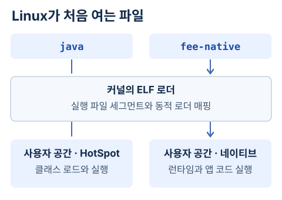

CPU는 기계어를 실행한다. 그런데 `javac`로 만든 클래스 파일에는 JVM이 읽는 바이트코드가 들어 있다. CPU는 바이트코드의 명령 번호를 그대로 실행할 수 없다. 바이트코드에 해당하는 일을 어떤 기계어가 맡는지 세 가지 실행 방식을 따라가 보자.


## 바이트코드 한 줄을 실행하는 세 가지 경로

예를 들어 JVM의 정수 덧셈 명령은 `iadd`다. **인터프리터**는 이 명령을 읽고 두 정수를 꺼내 더한 뒤 다음 명령으로 넘어간다. CPU가 그 순간 실행하는 것은 인터프리터의 기계어다. HotSpot에는 바이트코드별로 처리 루틴에 진입할 위치를 준비하는 코드가 있다. 같은 덧셈을 다시 만나면 그 루틴을 다시 쓸 수 있다. [HotSpot의 바이트코드 진입점 설정](https://github.com/openjdk/jdk25u/blob/fda231468e56663992785ec199a6efb8eca3cc7a/src/hotspot/share/interpreter/templateInterpreterGenerator.cpp#L277-L285)

같은 메서드를 수없이 실행하면 매번 그 안의 명령을 하나씩 읽는 비용이 쌓인다. **JIT(Just-In-Time) 컴파일러**는 애플리케이션이 도는 동안 메서드를 골라 CPU용 기계어를 만든다. HotSpot은 그 코드를 프로세스의 코드 캐시(code cache)에 설치한다. 이후 호출은 해당 기계어로 진입할 수 있다. 이때 자주 함께 실행되는 작은 메서드의 본문을 호출자에 포함시키는 최적화가 [앞 글에서 로그로 확인한 인라이닝](/backend/transfer-performance/02-jvm-execution/)이다. [C2가 호출 위치에서 인라이닝을 검토하는 코드](https://github.com/openjdk/jdk25u/blob/fda231468e56663992785ec199a6efb8eca3cc7a/src/hotspot/share/opto/doCall.cpp#L189-L204)

**AOT(Ahead-Of-Time)**는 실행에 앞서 컴파일한다는 뜻이다. GraalVM의 Native Image 빌더는 진입점인 `main`에서 도달할 코드를 분석해 지정한 OS와 CPU용 실행 파일을 만든다. 파일에는 앱 코드와 실행에 필요한 런타임, GC가 함께 들어간다. 배포 후에는 그 파일을 바로 실행할 수 있다. 대신 실행 중 이름으로 찾아 쓰는 클래스나 리소스를 빌드 분석에서 찾을 수 없으면 별도 메타데이터를 제공해야 한다. [GraalVM의 빌드와 런타임 설명](https://www.graalvm.org/jdk25/reference-manual/native-image/)

### 정수 덧셈 하나가 ARM64 명령이 되기까지

`return left + right`의 바이트코드는 두 인자를 올리고 `iadd`를 실행한다. C2 파서의 `_iadd` 분기는 스택에서 두 값을 꺼내 중간 표현인 `AddINode`를 만든다. 최적화를 거친 그래프에 두 레지스터의 정수 덧셈이 남으면 ARM64 백엔드의 `addI_reg_reg` 규칙이 이를 32비트 덧셈 명령으로 바꾼다. [C2 파서의 iadd 처리](https://github.com/openjdk/jdk25u/blob/fda231468e56663992785ec199a6efb8eca3cc7a/src/hotspot/share/opto/parse2.cpp#L2212-L2215) · [ARM64의 명령 선택과 인코딩](https://github.com/openjdk/jdk25u/blob/fda231468e56663992785ec199a6efb8eca3cc7a/src/hotspot/cpu/aarch64/aarch64.ad#L9890-L9900)

덧셈 메서드가 호출자 속으로 사라지지 않도록 이 실험에서만 인라이닝을 껐다. Linux에서 C2가 만든 코드의 바이트 `20 00 02 0b`를 역어셈블한 결과는 `add w0, w1, w2`였다. 두 입력을 담은 32비트 레지스터 `w1`, `w2`의 합을 결과 레지스터 `w0`에 쓴다. [덧셈 예제](./evidence/AddWarmup.java) · [javap부터 기계어까지 재현한 명령과 출력](./evidence/add-aarch64.txt)

### 한 번 호출한 루프에 두 진입점이 생긴 이유

`longLoop`는 누적값을 갱신하는 반복문을 1,200만 번 돌고 한 번 반환한다. Linux ARM64의 Temurin 25.0.5+8에서 로그를 켜자 같은 메서드에 다음 세 기록이 남았다. 맨 왼쪽은 컴파일 작업 번호다.

```text
54  %  3  HotPathProbe::longLoop @ 6
55     3  HotPathProbe::longLoop
56  %  4  HotPathProbe::longLoop @ 6
```

55번은 메서드 시작으로 들어올 호출을 위한 코드다. **`%`와 `@ 6`이 붙은 코드는 이미 실행 중인 호출을 위한 진입점**이다. 바이트코드 오프셋 6은 반복 조건을 읽는 곳이다. 이때 해석 중인 프레임의 인덱스와 누적값, 잡고 있는 모니터가 있다면 그 상태까지 넘겨 실행을 잇는다. 이를 온스택 치환(on-stack replacement, OSR)이라고 한다. 이 한 번의 호출이 끝날 무렵에는 56번 OSR 코드의 반복 종료 분기에서 역최적화 이벤트도 찍혔다. 인터프리터 전용 실행과 JIT 실행의 최종 체크섬은 같았다. [실행 코드](./evidence/HotPathProbe.java) · [javap와 실제 컴파일 기록](./evidence/osr-windows.txt) · [OpenJDK의 OSR 상태 이동](https://github.com/openjdk/jdk25u/blob/fda231468e56663992785ec199a6efb8eca3cc7a/src/hotspot/share/runtime/sharedRuntime.cpp#L3269-L3279)

54번이 큐에 들어갔을 때 메서드 진입은 **1회**, 반복문 뒤에서 앞으로 돌아가는 백에지(backedge)의 계수는 **60,416**이었다. 다른 메서드 `quote`는 관측한 진입 횟수 256에서 C1 레벨 3, 6,656에서 C2 레벨 4 작업이 등록됐다. 이 실행에서 C1은 실행 횟수와 수신 객체 타입 등의 프로파일을 모았고 C2는 그 정보를 사용했다. HotSpot의 진입 컴파일 정책은 호출 계수 또는 최소 호출 계수와 호출·백에지 합계를 본다. OSR 정책은 백에지 계수를 본다. 설정, 현재 단계, 컴파일 큐의 부하가 기준을 바꾸므로 ‘메서드를 2만 번 부르면 JIT가 돈다’는 규칙은 성립하지 않는다. [진입·백에지 정책](https://github.com/openjdk/jdk25u/blob/fda231468e56663992785ec199a6efb8eca3cc7a/src/hotspot/share/compiler/compilationPolicy.cpp#L307-L361) · [큐에 따른 기준 조정](https://github.com/openjdk/jdk25u/blob/fda231468e56663992785ec199a6efb8eca3cc7a/src/hotspot/share/compiler/compilationPolicy.cpp#L386-L403)

### 정률만 보던 호출에 정액 정책이 처음 들어오면

두 수수료 클래스는 실험 시작 때 이미 로드했다. 같은 인터페이스 호출에 정률 객체만 20만 번 넘긴 뒤 정액 객체를 넘겼다. 정률 타입을 가정해 컴파일된 `quote`에서 JFR은 **컴파일 번호 58, 호출 위치 3, 사유 `class_check`**를 기록했다. 가정이 깨진 실행을 기존 기계어에서 빠져나오게 하는 역최적화다. 타입 가드가 있는 코드 중에는 대체 분기로 다른 타입을 직접 처리하는 경우도 있다. 여기서는 실제 trap 이벤트로 경로를 확인했다. [타입 교체와 trap 결과](./evidence/osr-windows.txt)

인라이닝으로 여러 자바 호출이 물리 프레임 하나에 들어가도 HotSpot은 역최적화 지점에 논리 호출별 메서드, 바이트코드 위치, 지역 변수와 피연산자 위치를 기록해 둔다. 복구 시 레지스터와 스택의 값을 읽어 해당 지점에 필요한 인터프리터 프레임들로 펼친다. 이번 타입 검사 실패는 정액 메서드 본문에 들어가기 전이어서 `quote`의 인터페이스 호출을 다시 처리한다. 로그는 실패 지점을 보여 주고 프레임 복구 과정은 구현에서 확인할 수 있다. [논리 호출의 디버그 정보](https://github.com/openjdk/jdk25u/blob/fda231468e56663992785ec199a6efb8eca3cc7a/src/hotspot/share/code/scopeDesc.hpp#L46-L83) · [인터프리터 프레임 복구](https://github.com/openjdk/jdk25u/blob/fda231468e56663992785ec199a6efb8eca3cc7a/src/hotspot/share/runtime/deoptimization.cpp#L888-L905)

## 컴파일을 맡은 스레드를 누가 실행할까?

HotSpot의 한 스레드가 요청을 처리하는 사이 다른 스레드가 그 요청에서 자주 호출된 메서드를 컴파일할 수 있다. `CompileBroker`는 컴파일 작업을 큐에 넣는다. 컴파일러 스레드는 큐에서 작업을 꺼내고 C1이나 C2 같은 컴파일러를 호출한다. 아래에서 인용하는 OpenJDK 코드는 실험에서 쓴 JDK와 같은 `25.0.5+8` 소스에 고정했다. [컴파일 작업 등록](https://github.com/openjdk/jdk25u/blob/fda231468e56663992785ec199a6efb8eca3cc7a/src/hotspot/share/compiler/compileBroker.cpp#L1626-L1638) · [작업을 꺼내는 compiler_thread_loop](https://github.com/openjdk/jdk25u/blob/fda231468e56663992785ec199a6efb8eca3cc7a/src/hotspot/share/compiler/compileBroker.cpp#L1936-L1975)

소스에서 `CompilerThread`의 부모 타입은 `JavaThread`다. 여기서 `JavaThread`는 HotSpot 내부의 C++ 타입이다. 애플리케이션이 플랫폼 스레드를 시작할 때는 `JVM_StartThread`가 자바의 `run`으로 이어질 진입 함수를 지정한다. 컴파일러 스레드의 진입 함수는 컴파일 작업 루프로 간다. 각 스레드는 자기 진입 함수를 실행하고 종료 시 정리 절차를 밟는다. [플랫폼 스레드 생성](https://github.com/openjdk/jdk25u/blob/fda231468e56663992785ec199a6efb8eca3cc7a/src/hotspot/share/prims/jvm.cpp#L2820-L2828) · [CompilerThread의 타입](https://github.com/openjdk/jdk25u/blob/fda231468e56663992785ec199a6efb8eca3cc7a/src/hotspot/share/compiler/compilerThread.hpp#L38-L47) · [컴파일러 스레드의 진입점](https://github.com/openjdk/jdk25u/blob/fda231468e56663992785ec199a6efb8eca3cc7a/src/hotspot/share/compiler/compilerThread.cpp#L61-L68) · [JavaThread 실행과 종료](https://github.com/openjdk/jdk25u/blob/fda231468e56663992785ec199a6efb8eca3cc7a/src/hotspot/share/runtime/javaThread.cpp#L762-L790)

Linux에서 이 네이티브 스레드를 만드는 호출은 `pthread_create`다. 사용자 공간에서는 HotSpot이 C2에게 어떤 메서드를 줄지 정한다. 커널 스케줄러는 실행 가능한 태스크 중 다음에 CPU를 쓸 태스크를 고른다. 실행 중인 JVM의 `/proc/<pid>/task`를 열어 보니 `C1 CompilerThre`와 `C2 CompilerThre`가 각각 한 줄씩 있었다. 이 이름은 Linux의 `comm`에 보인 그대로다. [HotSpot의 pthread_create](https://github.com/openjdk/jdk25u/blob/fda231468e56663992785ec199a6efb8eca3cc7a/src/hotspot/os/linux/os_linux.cpp#L1086-L1092) · [스레드 관찰 명령과 출력](./evidence/elf-and-threads.txt)

같은 버전의 Windows 구현도 플랫폼 스레드를 만든다. `os::create_thread`가 C 런타임의 `_beginthreadex`를 호출해 스레드 핸들을 받는다. Linux 쪽의 `pthread_create`와 Windows 쪽의 이 호출이 같은 자바 API 아래에서 갈라지는 지점이다. 위의 실행 기록은 Linux에서 수집했다. [OpenJDK의 Windows 스레드 생성](https://github.com/openjdk/jdk25u/blob/fda231468e56663992785ec199a6efb8eca3cc7a/src/hotspot/os/windows/os_windows.cpp#L758-L772)

커널 코드에서 **kthread**라는 이름을 만날 때는 출발점이 다르다. Linux가 자기 작업을 실행하려고 만드는 커널 스레드로, 커널의 `kthread()`가 넘겨받은 `threadfn(data)`를 부른다. JVM 프로세스 안에서 네이티브 스레드로 일하는 C2와는 진입 함수도 일감도 다르다. 커널 코드는 Linux v6.12에서 읽었다. 실제 실행 환경의 커널 버전은 아래 실험에 따로 적었다. [커널 스레드의 진입 함수](https://github.com/torvalds/linux/blob/adc218676eef25575469234709c2d87185ca223a/kernel/kthread.c#L341-L393) · [스케줄러의 다음 태스크 선택과 문맥 교환](https://github.com/torvalds/linux/blob/adc218676eef25575469234709c2d87185ca223a/kernel/sched/core.c#L6642-L6695)

## Linux가 실행 파일을 여는 순간

셸에서 `java FeeRuns`를 실행하면 Linux가 처음 여는 실행 파일은 `java` 런처다. 반면 Native Image로 빌드한 뒤 `./fee-native`를 실행하면 첫 파일부터 앱의 기계어가 들어 있다. 두 파일의 헤더를 `readelf`로 읽어 보니 모두 Linux AArch64용 ELF64였다. 클래스 파일의 첫 4바이트는 `ca fe ba be`였다. [두 ELF 헤더와 클래스 파일 앞부분](./evidence/elf-and-threads.txt)



`execve` 요청을 받은 커널은 해당 파일 형식을 처리할 로더를 찾는다. ELF를 맡은 `load_elf_binary()`는 헤더를 확인하고 프로그램 헤더에 따라 실행 파일의 세그먼트를 프로세스 주소 공간에 매핑한다. 이번 두 파일에는 모두 `PT_INTERP`로 `/lib/ld-linux-aarch64.so.1`가 지정돼 있었다. 그래서 먼저 사용자 공간의 동적 로더에서 실행이 시작된다. 여기서 *interpreter*는 공유 라이브러리를 연결하는 ELF 동적 로더를 가리킨다. [실행 형식에 맞는 로더 호출](https://github.com/torvalds/linux/blob/adc218676eef25575469234709c2d87185ca223a/fs/exec.c#L1730-L1753) · [ELF 헤더와 PT_INTERP 처리](https://github.com/torvalds/linux/blob/adc218676eef25575469234709c2d87185ca223a/fs/binfmt_elf.c#L843-L881) · [동적 로더 진입점](https://github.com/torvalds/linux/blob/adc218676eef25575469234709c2d87185ca223a/fs/binfmt_elf.c#L1234-L1254) · [실행 레지스터 설정](https://github.com/torvalds/linux/blob/adc218676eef25575469234709c2d87185ca223a/fs/binfmt_elf.c#L1330-L1343)

런처 경로에서는 이어서 사용자 공간의 HotSpot이 `FeeRuns`를 읽고 바이트코드를 실행한다. 네이티브 경로에서는 빌드에 포함된 런타임과 앱의 기계어가 실행된다. 어느 쪽에서든 이 동적 로더가 자바의 메서드를 최적화할 이유는 없다.

## 커널 안에서 기계어를 만드는 경우

Linux 자체를 빌드할 때는 Kbuild가 GCC나 Clang을 호출해 C 파일을 오브젝트 파일로 만든다. 이미 부팅한 커널 안에도 작은 프로그램을 기계어로 바꾸는 경로가 있다. 소켓에 붙이는 **BPF 필터**가 한 예다. 이 컴파일러에 들어가는 입력은 패킷을 통과시킬지 결정하는 명령이다. [Kbuild의 C 컴파일 규칙](https://github.com/torvalds/linux/blob/adc218676eef25575469234709c2d87185ca223a/scripts/Makefile.build#L144-L147)

아래는 소켓 필터의 명령 하나다. 반환값 0은 메시지를 버리라는 뜻이다. 예제는 Unix 데이터그램 소켓 한 쌍을 만들고 수신 쪽에 이 필터를 붙인다. A를 보내면 수신 큐가 비어 있다. 허용할 바이트 수를 최댓값으로 바꿔 필터를 다시 붙이면 B는 도착한다.

```c
struct sock_filter code[] = { BPF_STMT(BPF_RET | BPF_K, 0) };
```

v6.12의 ARM64 구현을 읽을 때는 두 곳을 나란히 보면 된다. `net/core/filter.c`에서 이 고전 BPF 명령은 반환 레지스터에 상수를 넣고 종료하는 eBPF 명령으로 바뀐다. 이어 `bpf_prog_select_runtime`은 아키텍처별 JIT를 호출한다. ARM64의 `build_insn`은 마지막 `EXIT`에서 함수 종료 코드로 그대로 이어 가고, 종료 코드는 ARM64의 `RET`를 내보낸다. HotSpot의 JIT는 같은 CPU를 대상으로 자바 메서드를 컴파일하지만, 이 소켓 필터가 지나는 커널 코드는 별개다. [필터 변환](https://github.com/torvalds/linux/blob/adc218676eef25575469234709c2d87185ca223a/net/core/filter.c#L812-L820) · [JIT 선택](https://github.com/torvalds/linux/blob/adc218676eef25575469234709c2d87185ca223a/kernel/bpf/core.c#L2396-L2430) · [ARM64의 EXIT 처리](https://github.com/torvalds/linux/blob/adc218676eef25575469234709c2d87185ca223a/arch/arm64/net/bpf_jit_comp.c#L1392-L1401) · [RET 생성](https://github.com/torvalds/linux/blob/adc218676eef25575469234709c2d87185ca223a/arch/arm64/net/bpf_jit_comp.c#L877-L884)

예제는 ARM64 Linux 7.0.12에서 실행했다. 커널의 `CONFIG_BPF_JIT_ALWAYS_ON` 설정과 필터 교체 전후의 수신 결과를 기록했다. 생성된 기계어 버퍼는 이 실험에서 덤프하지 않았다. [실행할 C 코드](./evidence/KernelFilter.c) · [재현 명령과 출력](./evidence/kernel-filter.txt)

## 같은 합계를 세 방식으로 계산해 보니

두 경로에 같은 일을 시켜 보자. 아래 메서드는 송금액에 수수료 1%를 더한다. `main`에서 1원부터 100만 원까지 1원씩 늘리며 `quote`를 호출해 합계를 냈다. [실행한 FeeRuns.java](./evidence/FeeRuns.java)

```java
static int fee(int amountWon) {
    return amountWon / 100;
}

static int quote(int amountWon) {
    return amountWon + fee(amountWon);
}
```

소스는 macOS arm64의 Temurin `javac 25.0.4.1`로 한 번 컴파일했다. 그 클래스 파일을 Linux arm64로 옮겨 Temurin 25.0.5+8에서 두 번 실행했다. 첫 번째는 `java -Xint FeeRuns`로 바이트코드를 해석했다. 두 번째는 JIT를 켜고 컴파일 결정을 기록했다. 두 실행의 합계는 모두 `505000010000`이었다. [재현 명령과 출력](./evidence/execution.txt)

JIT 로그에서 `quote`의 레벨 4 컴파일 기록에는 `@ 2   FeeRuns::fee (5 bytes)   inline (hot)`이 따라왔다. `quote` 안의 오프셋 2에 있던 `fee` 호출을 컴파일러가 인라인했다는 기록이다. 두 실행은 같은 값을 냈고 두 번째 실행의 로그에서는 인라이닝 결정을 확인했다. 어느 쪽이 몇 초 빨랐는지는 재지 않았다.

세 번째에는 Linux arm64의 GraalVM CE 25.0.2로 같은 클래스에서 `fee-native`를 빌드했다. 빌드 출력에는 대상 CPU `armv8.1-a`와 Serial GC가 나왔다. 이 파일을 Java 런처가 PATH에 없는 Debian 13 컨테이너에서 `./fee-native`로 실행해도 같은 합계가 나왔다. Linux 커널은 Docker가 제공한 `7.0.12-linuxkit`이었다. 이 결과는 OS·CPU와 동적 라이브러리가 맞는 환경에서 실행한 사례다. [빌드·실행에 사용한 이미지와 로그](./evidence/execution.txt)

### 워밍업 중 1ms를 무엇이 차지했나

첫 정률 호출 묶음과 같은 입력의 두 번째 묶음에 JFR 사용자 이벤트로 경계를 표시했다. 각 경계 안에서 컴파일 이벤트와 겹친 횟수, 애플리케이션 정지 이벤트의 겹친 시간, 메인 스레드의 CPU 시간을 셌다. Linux의 `/proc/thread-self/schedstat` 둘째 값은 이 스레드가 실행 가능했지만 CPU를 배정받기까지 기다린 시간을 합산한다. 구간 앞뒤의 차이를 쟀다. [구간을 기록한 코드](./evidence/HotPathProbe.java) · [Linux schedstat 필드](https://docs.kernel.org/scheduler/sched-stats.html)

| 한 JVM의 연속 구간 | 경과 | 메인 스레드 CPU | 겹친 컴파일 | GC 정지 |
| --- | ---: | ---: | ---: | ---: |
| 정률 첫 10만 호출 | 1.923ms | 1.704ms | 2건 | 0ms |
| 같은 정률 다음 10만 호출 | 1.280ms | 1.214ms | 0건 | 0ms |
| 별도 배열 할당 구간 | 8.726ms | 4.547ms | 0건 | 4.009ms |

두 정률 구간의 실행 큐 대기는 기록상 0이었다. 컴파일러 스레드는 메인 스레드와 동시에 일할 수 있어 0.643ms 차이를 컴파일 시간으로 환산할 수 없다. 배열을 반복 할당한 대조 구간에서는 4.009ms가 실제 GC 정지와 겹쳤다. GC 정지는 이미 경과 시간에 들어 있으므로 합계에 다시 더하면 안 된다. 이 표는 한 JVM의 진단용 관찰이다. 운영 지연을 비교할 때는 같은 입력으로 새 JVM을 반복 실행해 첫 요청과 정상 상태의 분포를 따로 구하고, 진단 옵션을 끈 실행에서도 차이가 남는지 확인한다. [기록을 집계하는 코드](./evidence/window-report.py) · [재현 명령과 구간별 결과](./evidence/osr-windows.txt)

## JDK의 AOT 캐시로도 실행 파일을 만들 수 있을까?

JDK 25에도 이름에 AOT가 들어간 옵션이 있다. 이번에는 같은 클래스를 JAR로 묶은 뒤 HotSpot에 `fees.aot`를 만들게 했다. 첫 명령은 앱을 학습 실행한 뒤 캐시를 조립한다. 두 번째 명령을 보면 캐시를 여는 주체는 여전히 `java`다.

```bash
java -XX:AOTCacheOutput=fees.aot -cp fees.jar FeeRuns
java -Xlog:aot=info,class+load=info -XX:AOTCache=fees.aot -cp fees.jar FeeRuns
```

두 번째 실행의 클래스 로드 로그에는 `FeeRuns source: shared objects file`이 찍혔다. 여기서 `shared objects file`은 HotSpot이 만든 공유 아카이브다. 이 JDK에서는 미리 로드·링크한 클래스와 학습 실행의 메서드 프로파일 등을 다음 JVM 시작에 쓸 수 있다. 반면 앞에서 만든 `fee-native`는 운영체제가 직접 여는 ELF였다. 공유 아카이브에서 `FeeRuns`를 읽었다는 로그만으로 `quote`의 기계어까지 재사용했다고 말할 수는 없다. [캐시 생성과 클래스 로드 로그](./evidence/aot-cache.txt) · [Oracle의 JDK 25 AOT 변경 설명](https://docs.oracle.com/en/java/javase/25/migrate/significant-changes-jdk-25.html)

메서드를 인라인하면 기계어에 별도 호출이 남지 않을 수 있다. 그러면 소스에서 메서드 안에 만들고 밖으로 돌려준 객체는 어떻게 설명해야 할까? [다음 글에서는 JVM의 스택과 힙을 나눠 객체의 수명을 따라간다.](/backend/transfer-performance/jvm-memory/)
