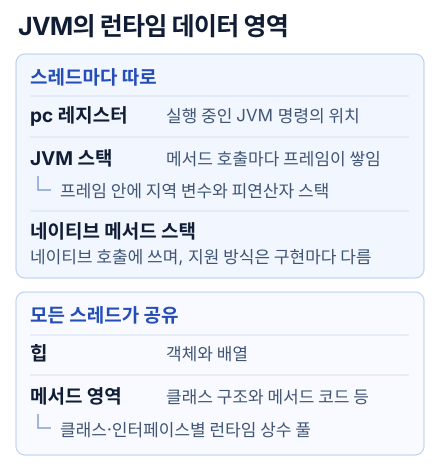

JVM에서 각 스레드는 **자기 스택**에 진행 중인 메서드 호출을 쌓는다. 호출 중에 만든 객체는 스레드들이 함께 쓰는 **힙**에 놓인다. 메서드가 끝나면 그 호출은 스택에서 빠진다. 다른 곳에서 여전히 쓰는 객체는 힙에 남는다.

## JVM의 런타임 데이터 영역



**스레드마다** 프로그램 카운터(PC)와 JVM 스택이 있다. PC는 현재 실행 중인 JVM 명령의 위치를 가리킨다. JVM 스택에는 아직 끝나지 않은 메서드 호출이 차례로 쌓인다. 네이티브 메서드를 실행하는 동안에는 JVM 명세가 PC 값을 정하지 않는다. C로 작성한 메서드 등을 실행할 때 네이티브 메서드 스택을 쓰는 구현도 있다.

**모든 스레드가 공유하는** 힙에는 클래스의 인스턴스와 배열이 놓인다. 메서드 영역에는 클래스별 필드·메서드 정보와 메서드의 바이트코드가 있다. 각 클래스나 인터페이스의 **런타임 상수 풀**도 여기에 속한다. 바이트코드가 다른 클래스의 메서드를 이름과 타입으로 가리킬 때 쓰는 정보가 그 예다. [JVM 명세 §2.5 런타임 데이터 영역](https://docs.oracle.com/javase/specs/jvms/se25/html/jvms-2.html#jvms-2.5)

명세에서는 메서드 영역을 논리적으로 힙에 포함한다. 그림에서는 객체를 담는 역할과 클래스 정보를 보관하는 역할을 따로 표시했다. 메서드 영역의 공간을 GC로 회수하거나 압축할지는 JVM 구현이 정한다. [JVM 명세 §2.5.4 메서드 영역](https://docs.oracle.com/javase/specs/jvms/se25/html/jvms-2.html#jvms-2.5.4)

OpenJDK의 JVM 구현인 HotSpot에서는 클래스 메타데이터가 주로 네이티브 메모리의 **메타스페이스**에 놓인다. JIT가 만든 기계어는 **코드 캐시**에 놓인다. 직접 버퍼가 쓰는 데이터도 힙 밖에 있을 수 있다. 그래서 `-Xmx`로 힙의 최댓값을 정해도 프로세스 전체 메모리는 그보다 커질 수 있다. [HotSpot의 클래스 메타데이터](https://docs.oracle.com/en/java/javase/25/gctuning/other-considerations.html) · [HotSpot 코드 캐시](https://docs.oracle.com/en/java/javase/25/vm/java-hotspot-virtual-machine-performance-enhancements.html) · [Java 직접 버퍼](https://docs.oracle.com/en/java/javase/25/docs/api/java.base/java/nio/ByteBuffer.html#direct)

## 스택 프레임 하나가 생기고 사라질 때

메서드를 한 번 호출할 때마다 JVM 스택에 **프레임**이 하나 생긴다. 같은 메서드를 재귀 호출해도 호출마다 별도의 프레임을 쓴다. 프레임에는 인자와 지역 변수를 담는 슬롯, 명령이 계산할 값을 잠시 올려놓는 **피연산자 스택**, 현재 메서드가 속한 클래스의 런타임 상수 풀에 대한 참조가 들어 있다. 재귀 호출이 너무 깊어져 스레드가 허용된 스택 크기를 넘으면 `StackOverflowError`가 발생한다. [JVM 명세 §2.6 프레임](https://docs.oracle.com/javase/specs/jvms/se25/html/jvms-2.html#jvms-2.6)

JVM을 **스택 머신**이라고 부르는 이유는 바이트코드가 계산에 쓸 값을 피연산자 스택에서 꺼내기 때문이다. 정수 덧셈 명령 `iadd`에는 더할 두 수의 위치가 적혀 있지 않다. 현재 프레임의 피연산자 스택 위에 3과 4가 있으면 `iadd`는 둘을 꺼내고 7을 올린다. 그동안 스레드의 호출 스택에는 같은 프레임이 그대로 있다. [JVM 명세 §2.6.2 피연산자 스택](https://docs.oracle.com/javase/specs/jvms/se25/html/jvms-2.html#jvms-2.6.2)

```java
record Box(int value) {}

static Box make(int value) {
    Box box = new Box(value);
    return box;
}
```

호출자가 `Box result = make(7)`을 실행한다고 하자. `make`의 지역 변수 `value`에는 정수 7이, `box`에는 힙의 객체를 가리키는 참조가 들어간다. 객체 안의 필드에도 정수 7이 저장된다. 같은 `int`라도 인자로 전달한 값과 객체에 저장한 값은 자리가 다르다.



`return box`가 호출자에게 건네는 값은 참조 하나다. 호출자는 자기 프레임에 저장한 `result`로 객체의 필드를 읽는다.

## new가 공간을 얻고 생성자가 값을 채우는 순서

`new Box(value)`를 컴파일하면 객체를 위한 공간을 확보하는 명령과 생성자를 호출하는 명령이 따로 나온다. JVM이 아직 `Box` 클래스를 초기화하지 않았다면 클래스 초기화부터 수행한다. JVM은 새 인스턴스의 필드를 기본값으로 준비한다. `int` 필드는 0에서 시작한다. 이어서 `Box` 생성자가 인자로 받은 7을 필드에 쓴다. [JVM 명세의 new 명령](https://docs.oracle.com/javase/specs/jvms/se25/html/jvms-6.html#jvms-6.5.new)



`dup`은 맨 위의 참조를 복제한다. `invokespecial`이 참조 하나와 정수 7을 소비해 생성자를 호출해도 원래 참조 하나는 남는다. 이어서 `astore_1`이 그 값을 지역 변수 `box`에 저장한다. `aload_1`이 값을 다시 올리면 `areturn`이 호출자에게 돌려준다. [앞 글에서 본 피연산자 스택](/backend/transfer-performance/02-jvm-execution/#diagram-01-stack-machine)

HotSpot 객체에는 필드 외에도 타입과 잠금 상태 등을 기록하는 헤더가 있다. `Box` 하나를 만들 때 필요한 공간에는 이 헤더와 정렬에 필요한 여백까지 들어간다. [HotSpot 객체 헤더](https://docs.oracle.com/en/java/javase/25/gctuning/other-considerations.html)

스레드는 공유 힙의 일부를 **TLAB**(스레드별 할당 버퍼)으로 받아 쓸 수 있다. 남은 공간이 충분하면 그 안에서 다음 빈 위치를 객체 크기만큼 옮겨 할당한다. 스레드끼리 매번 같은 할당 위치를 갱신할 필요가 줄어든다. 그 객체의 참조를 다른 스레드에 전달하면 다른 스레드도 객체에 접근할 수 있다. [OpenJDK 25의 TLAB 할당 코드](https://github.com/openjdk/jdk/blob/jdk-25-ga/src/hotspot/share/gc/shared/memAllocator.cpp)

JIT가 필요한 필드 값만으로 계산을 끝낼 수 있으면 실제 할당을 생략하기도 한다. 바이트코드의 `new` 개수만 세서는 힙 사용량을 계산하기 어렵다. [HotSpot의 탈출 분석](https://docs.oracle.com/en/java/javase/25/vm/java-hotspot-virtual-machine-performance-enhancements.html#GUID-6BD8FCB5-995B-4AE9-BFAA-B2C7DE2BA5CD)

## GC가 살아 있는 객체를 찾고 공간을 회수하는 과정

GC는 실행 중인 스레드가 계속 사용할 참조 등에서 출발해 객체 사이의 연결을 따라간다. 이런 출발점을 **GC 루트**라고 한다. 루트에서 일반 참조를 따라 도달하는 객체는 살아 있다. 메서드가 끝난 뒤에도 다른 객체의 필드나 배열에 참조가 남아 있으면 그 경로를 통해 계속 사용할 수 있다.



그림에서 목록의 항목을 지우는 순간 바뀌는 것은 **도달 가능성**이다. 서로만 가리키는 두 객체도 루트에서 둘 중 어느 쪽으로도 닿지 않으면 회수 대상이 된다. 반대로 사용 기한이 지난 항목을 계속 목록에 보관하면 GC가 여러 번 실행돼도 살아남는다. [Java의 도달 가능성 정의](https://docs.oracle.com/en/java/javase/25/docs/api/java.base/java/lang/ref/package-summary.html#reachability)

클래스 정보의 수명에는 **그 클래스를 정의한 로더**가 관여한다. 플러그인 인스턴스를 모두 지워도 프로그램이 해당 로더를 계속 보관하면 그 로더가 정의한 일반 클래스는 남는다. 로더 자체를 GC가 회수할 수 있게 되어야 JVM도 그 클래스의 언로딩을 선택할 수 있다. 어느 수집 때 실제로 언로드할지는 보장되지 않는다. 부트스트랩 로더가 로드한 클래스는 언로딩 대상에서 제외된다. [Java 언어 명세 §12.7 클래스와 인터페이스의 언로딩](https://docs.oracle.com/javase/specs/jls/se25/html/jls-12.html#jls-12.7)

실제로 빈 공간을 만드는 방식은 수집기마다 다르다. **G1**은 힙을 같은 크기의 리전(region)으로 나눈다. 작은 새 객체는 보통 Eden 리전에 들어간다. 젊은 세대 수집에서 살아남은 객체는 Survivor나 Old 리전으로 옮긴다. 일반적인 대피(evacuation) 과정에서는 선택한 리전의 살아 있는 객체를 다른 리전으로 복사하고 참조를 고친다. 대피를 마친 리전은 통째로 다시 할당에 쓸 수 있다. [JDK 25 G1의 힙 배치와 회수 과정](https://docs.oracle.com/en/java/javase/25/gctuning/garbage-first-g1-garbage-collector1.html)

## 짧은 실험으로 확인한 객체의 수명

송금 수수료 100원을 담은 영수증으로 두 시점을 확인했다. 먼저 메서드가 영수증의 참조를 클래스의 `static` 필드 `saved`에 저장하고 반환했다. 그 뒤 호출자에서 `saved.feeWon()`을 읽은 값은 100이었다. 이어서 `saved = null`로 마지막 강한 참조를 끊었다. 영수증에 연결해 둔 약한 참조(`WeakReference`)가 지워져 큐에 들어오는지 최대 2초 동안 기다렸다. [실행할 Java 소스](./evidence/ReceiptMemoryDemo.java) · [바이트코드 발췌](./evidence/receipt-javap.txt)

| 같은 코드, 다른 실행 조건 | 2초 안에 큐에서 약한 참조를 받았나? |
| --- | --- |
| G1에서 `System.gc()` 요청 허용 | 새 JVM에서 다섯 번 모두 받았다. |
| `-XX:+DisableExplicitGC`로 명시적 요청 무시 | 한 번 실행했다. 기다리는 동안 통지는 없었다. |

두 실행 모두 Temurin 25.0.4.1과 32MiB 힙을 썼다. 큐 통지는 GC가 약한 참조를 처리했다는 관찰값이다. 영수증이 차지하던 바이트를 다음 객체가 재사용한 시각까지 알려 주지는 않는다. [기본 실행 출력](./evidence/receipt-stdout.txt) · [G1 로그](./evidence/receipt-gc.txt) · [대조 실행 명령과 출력](./evidence/receipt-no-explicit-gc.txt)

## 자료의 그림을 실제 코드와 맞춰 보기

네이버 D2의 2011년 글에서 런타임 데이터 영역 그림을 펴고 스레드 하나를 더 그려 보자. 스택과 PC는 하나씩 늘고 두 스레드는 같은 힙을 본다. 그림에 나오는 당시 HotSpot의 PermGen은 JDK 25에서 클래스 메타데이터를 찾을 위치와 다르다. 위 실험에서 본 환경은 메타스페이스를 쓴다. [D2의 JVM Internal](https://d2.naver.com/helloworld/1230)

Pratik T의 예제처럼 지역 변수에서 객체를 가리키는 화살표를 그린 뒤, 그 객체 안에 `int` 필드 하나를 추가해 보자. 프레임의 지역 변수와 객체의 필드는 서로 다른 자리에 있다. 이렇게 그리면 “기본형은 어디에 저장되나?”에도 변수의 위치를 짚어 답할 수 있다. JIT가 할당을 제거한 실행에서는 소스의 상자 하나가 실제 힙의 객체 하나에 그대로 대응하지 않을 수도 있다. [Understanding JVM Memory Allocation](https://medium.com/@pratik.941/understanding-jvm-memory-allocation-a-tutorial-d06e830e615f) · [HotSpot의 탈출 분석](https://docs.oracle.com/en/java/javase/25/vm/java-hotspot-virtual-machine-performance-enhancements.html)

AdoptOpenJDK의 보관된 JDK 11 소스에서는 `ClassFileParser`가 로더 데이터를 넘겨 상수 풀을 할당한 뒤 클래스 파일의 항목을 읽는 두 호출을 차례로 볼 수 있다. 위에서 그린 ‘클래스별 상수 풀’에 대응하는 구현이다. [JDK 11의 상수 풀 할당과 파싱](https://github.com/AdoptOpenJDK/openjdk-jdk11/blob/19fb8f93c59dfd791f62d41f332db9e306bc1422/src/hotspot/share/classfile/classFileParser.cpp#L6061-L6070) · [클래스 로딩 오류 재현](/backend/transfer-performance/class-loading/)

책을 덮고 설명할 때는 먼저 호출 프레임에서 참조 하나가 사라지는 순간을 그린다. 그런 다음 그 객체가 여전히 살아 있을 조건을 하나만 바꿔 본다. [JVM 면접 연습 25문항과 『자바 최적화』 6·7장 복습](./evidence/interview.html)

배열에 담긴 참조를 다른 칸으로 복사하면 객체도 하나 더 생길까? 같은 배열 안에서 아직 읽지 않은 칸을 덮으면 어떻게 될까? [다음 편에서 System.arraycopy 호출 한 줄을 CPU 명령까지 따라간다.](/backend/transfer-performance/system-arraycopy/)
