반복문으로 배열을 복사하다가 그 자리에 `System.arraycopy(src, 0, dst, 0, n)`을 쓰면 코드가 한 줄이 된다. `n`에 1만을 넣든 10만을 넣든 호출은 딱 한 번이다. 그 한 줄 밑에 반복문은 어디로 갔을까?

두 `int[]`를 미리 만들어 두고 앞에서부터 유효한 원소 `n`개를 옮기는 경우만 떼어 봤다. 자바 쪽에서 호출 횟수를 세면 한 번이지만 목적지에 새로 써야 하는 값은 여전히 `n`개다. 이때 작업량은 복사할 원소 수에 비례한다(Θ(n)). 우선 OpenJDK가 한 번에 몇 바이트씩 옮기는지부터 확인했다.

## 한 번의 호출로 옮기는 바이트 수

`int` 한 개는 4바이트다. 목적지에 써야 할 데이터는 원소 1만 개면 40,000바이트, 10만 개면 400,000바이트다. Java API의 `length`도 바이트 수가 아니라 원소 수로 정의된다. [Java의 정수 타입](https://docs.oracle.com/javase/specs/jls/se25/html/jls-4.html#jls-4.2.1) · [System.arraycopy의 length](https://docs.oracle.com/en/java/javase/25/docs/api/java.base/java/lang/System.html#arraycopy(java.lang.Object,int,java.lang.Object,int,int))

OpenJDK 25의 ARM64용 HotSpot 소스에서 큰 구간을 복사하는 코드를 읽다 보면 `again`이라는 레이블이 있다. 한 바퀴에 64바이트를 옮긴 다음 남은 양에서 8워드를 뺀다. 옮길 게 더 있으면 `again`으로 돌아간다. 자바에서 한 번 호출한 복사가 여기서는 루프로 반복된다. 한 번에 여러 원소를 옮겨도 배열이 길어지면 이 루프를 더 많이 돌아야 한다. [큰 복사를 워드 단위로 넘기는 코드](https://github.com/openjdk/jdk25u/blob/fda231468e56663992785ec199a6efb8eca3cc7a/src/hotspot/cpu/aarch64/stubGenerator_aarch64.cpp#L1435-L1453) · [ARM64용 복사 루프 생성부](https://github.com/openjdk/jdk25u/blob/fda231468e56663992785ec199a6efb8eca3cc7a/src/hotspot/cpu/aarch64/stubGenerator_aarch64.cpp#L902-L924)

그렇다면 열 배 더 옮기는 데 시간도 대략 열 배가 들까. 측정에 배열 생성 시간이 섞이지 않게 `int[100_000]` 두 개를 먼저 만들어 두었다. JMH에서 매번 같은 배열의 앞부분을 복사하고 길이만 바꿨다. Apple M4 Pro의 Linux ARM64 컨테이너에 Temurin 25.0.5+8을 띄웠다. 길이마다 새 JVM 세 개에서 각각 3초 워밍업한 뒤 1초씩 다섯 번 쟀다.

| 한 번에 복사한 원소 | 목적지에 쓰는 데이터 | 평균 시간(JMH) |
| --- | ---: | ---: |
| `int` 1만 개 | 40,000바이트 | 341.336 ns |
| `int` 10만 개 | 400,000바이트 | 6,867.716 ns |

10만 개 쪽이 약 **20.1배** 오래 걸렸다. 쓰는 바이트 수는 정확히 열 배인데 시간은 열 배를 훌쩍 넘었다. Θ(n)으로 말할 수 있는 건 원소를 얼마나 옮겨야 하는지까지다. 이 표만 갖고는 어디서 시간을 더 썼는지, 특히 캐시가 얼마나 영향을 줬는지 짚기 어렵다. [측정 코드](./evidence/CopyLengthBench.java) · [재현 명령과 JVM별 측정값](./evidence/copy-length.txt)

### 4KiB씩 복사하고 다시 찾는 주소만 바꾸면

그래서 두 번째 JMH 실험에서는 길이를 `int` 1,024개로 고정했다. 매번 똑같이 **4KiB**를 옮기되, 같은 주소로 되돌아올 때까지 만지는 메모리 범위만 바꿨다. 미리 채운 두 배열에서 한 블록을 계속 복사하거나, 일정한 보폭으로 블록을 바꿔 가며 끝까지 순회한다. 표의 작업 집합은 입력과 출력에서 방문하는 데이터를 합한 크기다.

| 순회하는 블록 수 | 입력과 출력의 작업 집합 | 복사 한 번의 평균 |
| ---: | ---: | ---: |
| 1 | 8KiB | 35.8ns |
| 256 | 2MiB | 83.4ns |
| 16,384 | 128MiB | 377.0ns |

같은 블록을 다시 쓸 때는 35.8ns였고 128MiB를 돌아 같은 블록으로 돌아올 때는 377.0ns였다. M4 Pro의 성능 코어에서 L1 데이터 캐시는 128KiB, 해당 클러스터의 L2는 16MiB다. 세 작업 집합은 이 용량 안팎에 걸친다. 다만 게스트 vCPU가 어느 코어에 있었는지, 어디서 캐시 적중이 났는지까지는 재지 않았다. 어느 계층의 미스 때문인지 알려면 스레드를 한 코어로 고정하고 같은 실험과 대조 루프에서 캐시·TLB 카운터를 함께 봐야 한다. [블록 순회 코드](./evidence/CopyWindowBench.java) · [작업 집합·CPU 조건과 fork별 결과](./evidence/jni-window.txt)

## 원본과 목적지가 겹치면 어느 쪽부터 쓸까?

길이보다 쓰는 순서가 먼저 문제 되는 경우도 있다. 같은 배열에서 네 칸만 오른쪽으로 밀어 보자.

```java
String[] seats = {"A", "B", "C", "D", "E"};
System.arraycopy(seats, 0, seats, 1, 4);
```

출력은 `[A, A, B, C, D]`였다. 손으로 `seats[i + 1] = seats[i]`를 앞에서부터 네 번 반복하면 `[A, A, A, A, A]`가 된다. 첫 번째 쓰기에서 B를 지워 버리기 때문이다. 세 번째 칸에 남은 B는 어디서 온 걸까?

Java 명세는 출발지와 도착지가 같은 배열일 때 “as if”라는 말을 쓴다. 원래 구간을 임시 배열에 먼저 복사한 것처럼(“were first copied to a temporary array”) 목적지의 값이 정해진다는 뜻이다. 위 호출에서 `0`과 `1`은 각각 시작 인덱스이고 `4`는 복사할 **원소 수**다. 호출자는 이미 있는 목적지 배열을 건넨다. 메서드는 그 안의 값을 바꾼다. [Java SE 25의 arraycopy 계약](https://docs.oracle.com/en/java/javase/25/docs/api/java.base/java/lang/System.html#arraycopy(java.lang.Object,int,java.lang.Object,int,int))

C를 쓴다면 `memmove`가 떠오른다. 두 구간이 겹쳐도 호출 전의 원본을 기준으로 결과가 정해진다는 점이 같다. `memmove`의 길이 단위는 바이트다. Java에서는 `int[]`의 네 원소와 `String[]`의 네 참조가 서로 다른 복사 작업이다. C의 `memcpy`는 구간이 겹치면 동작이 정의되지 않는다. [Linux 매뉴얼의 memmove](https://man7.org/linux/man-pages/man3/memmove.3.html) · [memcpy의 겹침 조건](https://man7.org/linux/man-pages/man3/memcpy.3.html)

다섯 자리의 이름표를 지운 뒤 다시 쓸 수 있다고 하자. 맨 앞자리는 그대로 두고 A부터 D까지를 한 자리씩 오른쪽에 적어야 한다. D를 먼저 맨 끝에 적으면 원래 D가 있던 자리에 C를 적어도 된다. 반대로 A부터 쓰면 다음에 읽을 B가 사라진다. 왼쪽으로 당길 때는 앞자리부터 쓰면 된다.



이름표를 옮길 때처럼 순서를 고르면 사본 없이도 복사 전 값을 보존할 수 있다. 그렇다고 JVM이 실제로 같은 방법을 쓴다고 말하기엔 이르다. ‘임시 배열에 먼저 복사한 것처럼’이라는 표현을 글자 그대로 구현했다면 원본 하나만 겨우 들어가는 힙에서는 복사를 끝낼 수 없을 것이다.

## 17MiB 배열 하나만 들어갈 때

우선 겹침의 결과부터 확인했다. 길이 0부터 8까지의 `int[]`에서 가능한 출발 위치, 도착 위치, 복사 길이를 전부 조합했다. 따로 보관한 원본에서 기대값을 만들고 실제 호출은 한 배열 안에서 실행했다. 같은 출발지와 도착지, 길이가 0인 285개를 포함해 825개 조합의 값이 모두 맞았다. 기본 JVM과 `-Xint`로 실행한 출력도 같았다. [테스트 소스](./evidence/ArraycopyCases.java) · [재현 명령과 결과](./evidence/cases.txt)

그다음 힙을 32MiB로 고정하고 17MiB짜리 `byte[]` 하나를 만들었다. 배열을 똑같이 한 벌 더 만들려면 34MiB가 필요하다. 복사 후 모든 칸을 검사할 수 있도록 각 칸의 바이트는 원래 인덱스로 계산해 넣었다.

Linux ARM64의 Temurin 25.0.5+8과 Serial GC에서 두 방법을 별도 JVM으로 돌렸다.

| 같은 배열을 오른쪽으로 한 칸 미는 방법 | 관찰한 결과 |
| --- | --- |
| `arraycopy(data, 0, data, 1, data.length - 1)` 한 번 | 복사 성공. 첫 칸까지 포함한 17,825,792칸의 값이 모두 맞았다. |
| `new byte[data.length - 1]`에 담은 다음 다시 복사 | 임시 배열을 만드는 줄에서 `OutOfMemoryError`가 발생했다. |

임시 배열을 직접 만든 쪽은 그 줄에서 `OutOfMemoryError`가 났고 `arraycopy` 쪽은 17,825,792칸이 모두 맞았다. 명세의 ‘임시 배열에 먼저 복사한 것처럼’에서 중요한 단어는 ‘처럼’이었다. 적어도 이 호출은 복사할 구간만큼의 자바 힙 배열을 하나 더 만들지 않고 끝났다. 실제로 17MiB를 옮긴 명령까지 본 건 아니어서, 이번에는 `int` 네 개로 줄이고 JVM이 만든 기계어를 읽었다. [두 조건의 Java 코드](./evidence/HeapLimitProbe.java) · [힙 옵션과 실제 출력](./evidence/heap-limit.txt)

## System에서 CPU의 load와 store까지

이름부터 보면 `System`이 커널을 불러 복사를 맡길 것 같다. 선언을 열어 보면 `java.lang.System`의 `static` 메서드라서 `System.`을 붙이는 것이다. 인자 타입이 `Object`라서 `int[]`도 `String[]`도 받을 수 있다. Java 본문이 없는 `native` 옆에는 `@IntrinsicCandidate`가 붙어 있다. HotSpot이 이 호출을 알아보고 특별히 컴파일할 수 있다는 표시다. 여기서 자바 쪽 이름만으로 시스템 콜이 일어난다고 판단할 수는 없다. [OpenJDK의 Java 선언](https://github.com/openjdk/jdk25u/blob/fda231468e56663992785ec199a6efb8eca3cc7a/src/java.base/share/classes/java/lang/System.java#L479-L482)

자바 선언의 `native`를 따라가면 OpenJDK의 `System.c`가 이름과 시그니처를 `JVM_ArrayCopy`에 연결해 둔 코드가 나온다. `JVM_ArrayCopy`는 null을 확인하고 출발지의 실제 클래스에 `copy_array`를 요청한다. 기본형을 맡는 `TypeArrayKlass`는 목적지의 원소 타입과 범위를 보고 참조형의 `ObjArrayKlass`는 런타임 타입을 보고 각 원소까지 검사해야 할지 고른다. [네이티브 등록](https://github.com/openjdk/jdk25u/blob/fda231468e56663992785ec199a6efb8eca3cc7a/src/java.base/share/native/libjava/System.c#L42-L44) · [JVM 진입점](https://github.com/openjdk/jdk25u/blob/fda231468e56663992785ec199a6efb8eca3cc7a/src/hotspot/share/prims/jvm.cpp#L295-L307) · [기본형 검사](https://github.com/openjdk/jdk25u/blob/fda231468e56663992785ec199a6efb8eca3cc7a/src/hotspot/share/oops/typeArrayKlass.cpp#L108-L150) · [참조형 분기](https://github.com/openjdk/jdk25u/blob/fda231468e56663992785ec199a6efb8eca3cc7a/src/hotspot/share/oops/objArrayKlass.cpp#L186-L216)

그런데 `int[]` 복사를 감싼 메서드를 반복해서 호출해 보니 C2 로그의 오프셋 6에는 `(intrinsic)`이 찍혔다. C2는 클래스·이름·시그니처로 `arraycopy`를 알아보고 `ArrayCopyNode`를 만든다. 그 자리에 생성된 ARM64의 호출 명령 `bl`이 어디로 가는지 주소를 맞춰 봤다. 같은 JVM이 출력한 `StubRoutines::jint_arraycopy`, 곧 JVM이 미리 준비한 기계어 복사 루틴(stub)의 시작 주소였다.

이 intrinsic을 끄고 다시 돌리자 같은 자리에 `native method`가 찍혔고 최종 배열과 체크섬은 같았다. [HotSpot의 intrinsic 식별자](https://github.com/openjdk/jdk25u/blob/fda231468e56663992785ec199a6efb8eca3cc7a/src/hotspot/share/classfile/vmIntrinsics.hpp#L283-L286) · [C2의 복사 노드 생성](https://github.com/openjdk/jdk25u/blob/fda231468e56663992785ec199a6efb8eca3cc7a/src/hotspot/share/opto/library_call.cpp#L5966-L5982) · [반복 호출 코드](./evidence/IntrinsicProbe.java)

그 루틴은 목적지와 원본의 시작 주소 차이를 복사할 바이트 수와 **부호 없이** 비교한다. 목적지가 원본보다 왼쪽이거나 원본 끝 이후라면 앞에서 읽어도 안전하다. 목적지가 원본 구간 안쪽의 오른편이면 겹침을 처리하는 경로로 간다. 그렇다고 네 칸을 한 칸씩 역순으로 써야만 할까? `int` 네 개는 16바이트다. 이 크기에 해당하는 분기에서 생성된 명령은 다음과 같다. [ARM64의 주소 비교와 분기](https://github.com/openjdk/jdk25u/blob/fda231468e56663992785ec199a6efb8eca3cc7a/src/hotspot/cpu/aarch64/stubGenerator_aarch64.cpp#L1778-L1802) · [8~16바이트 복사 코드 생성부](https://github.com/openjdk/jdk25u/blob/fda231468e56663992785ec199a6efb8eca3cc7a/src/hotspot/cpu/aarch64/stubGenerator_aarch64.cpp#L1330-L1340)

```text
ldr  x3, [x0]        // 원본의 첫 8바이트를 x3에 읽는다
ldur x4, [x17, #-8]  // 원본 끝의 8바이트를 x4에 읽는다
str  x3, [x1]        // 목적지 앞쪽에 쓴다
stur x4, [x16, #-8]  // 목적지 끝쪽에 쓴다
```

쓰기를 시작하는 `str` 앞에 이미 `ldr`, `ldur`이 둘 다 있다. 첫 8바이트와 끝 8바이트, 그러니까 옮길 네 값이 전부 레지스터 두 개에 들어간 뒤다. 이 정도 길이라면 앞에서부터 써도 B가 지워질 일이 없다. 이름표를 하나씩 뒤에서부터 옮기는 방법과는 순서가 달랐다.

위 네 줄은 JVM이 **생성한** 기계어를 역어셈블한 결과다. CPU가 실행한 순간을 한 명령씩 추적한 기록은 아니다. [실행 옵션·호출 주소·역어셈블 원본](./evidence/intrinsic.txt)

### 직접 만든 JNI 함수에서 C의 memcpy를 부르면

HotSpot이 만든 복사 루틴까지 봤으니, C의 `memcpy`를 직접 불러도 비슷할까 싶다. 그런데 `memcpy`에 넘길 `int[]` 주소부터 구해야 한다. JNI의 `GetIntArrayElements`는 원본을 가리킬 수도, 임시 복사본을 가리킬 수도 있다. 이 HotSpot에서 16칸과 4,096칸을 각각 확인했더니 둘 다 `isCopy=true`였다. 이 방법은 소스와 목적지의 복사본을 얻어 `memcpy`한 뒤 목적지 버퍼만 원래 배열에 반영했다.

다른 C 함수는 256원소짜리 스택 버퍼를 두고 `GetIntArrayRegion`과 `SetIntArrayRegion`으로 구간을 옮겼다. [JNI 배열 접근 계약](https://docs.oracle.com/en/java/javase/25/docs/specs/jni/functions.html#getprimitivetypearrayelements-routines) · [HotSpot의 복사본 생성](https://github.com/openjdk/jdk25u/blob/fda231468e56663992785ec199a6efb8eca3cc7a/src/hotspot/share/prims/jni.cpp#L2418-L2446) · [목적지 반영과 버퍼 해제](https://github.com/openjdk/jdk25u/blob/fda231468e56663992785ec199a6efb8eca3cc7a/src/hotspot/share/prims/jni.cpp#L2478-L2493)

| 같은 두 배열 사이의 복사 한 번 | 16개(64바이트) | 4,096개(16KiB) |
| --- | ---: | ---: |
| `System.arraycopy` | 1.46ns | 144.6ns |
| JNI 전체 배열 접근 후 `memcpy` | 34.19ns | 947.4ns |
| JNI 구간 읽기·쓰기 | 29.65ns | 801.2ns |

복사가 아주 짧을 때는 C로 건너가는 시간만 해도 무시하기 어렵다. 같은 정수 하나를 그대로 돌려주는 대조 실험에서 자바는 평균 0.30ns, JNI 함수는 3.92ns였다. 이 장비에서는 정수 하나를 JNI로 돌려받은 시간이 `arraycopy`로 16개를 복사한 시간보다 길었다. 4,096개로 늘려도 임시 버퍼의 할당과 데이터 왕복에 드는 비용이 붙어 두 JNI 방법 모두 느렸다. 계산을 여러 개 묶거나 입력을 네이티브 메모리에 오래 둔다면 조건이 달라진다. **한 번 건너가서 줄이는 계산 시간**이 호출과 데이터 왕복에 든 시간을 넘는지 다시 재야 한다. [JMH 호출 코드](./evidence/JniCopyBench.java) · [실제로 컴파일한 C 함수](./evidence/copybench.c) · [분리한 실험과 측정 오차](./evidence/jni-window.txt)

`GetPrimitiveArrayCritical`로 접근할 때 이 HotSpot은 배열을 이동하지 못하게 고정(pin)한 뒤 주소를 준다. 사용 후 즉시 해제하면 배열의 이동 제한이 풀린다. JNI 명세는 critical 구간을 짧게 유지하고 다른 JNI 호출이나 다른 자바 스레드를 기다리는 블로킹을 피하도록 제한한다. 이 방식은 위 벤치마크에 넣지 않았다. [JNI critical 배열 접근](https://docs.oracle.com/en/java/javase/25/docs/specs/jni/functions.html#getprimitivearraycritical-releaseprimitivearraycritical) · [HotSpot의 고정과 해제](https://github.com/openjdk/jdk25u/blob/fda231468e56663992785ec199a6efb8eca3cc7a/src/hotspot/share/prims/jni.cpp#L2804-L2826)

## 42에서 실패하면 첫 칸은 무엇일까?

```java
Object[] src = {"ok", 42, "later"};
String[] dst = {"x", "y", "z"};
System.arraycopy(src, 0, dst, 0, 3);
```

예외를 잡고 `dst`부터 찍었다. **`[ok, y, z]`**. `String[]`에는 문자열과 `null`만 들어가는데 `Object[]`인 출발지만 봐서는 각 칸에 뭐가 들어 있을지 모른다. 첫 칸의 `"ok"`는 이미 복사했고 둘째 칸의 `Integer` 값 42에서 `ArrayStoreException`이 났다. 실패한 원소 앞까지 복사한 값을 남기는 것이 명세에 적힌 결과다. [부분 복사에 관한 원문](https://github.com/openjdk/jdk25u/blob/fda231468e56663992785ec199a6efb8eca3cc7a/src/java.base/share/classes/java/lang/System.java#L447-L464)



이 차이는 컴파일 결과에도 보였다. `String[] → String[]`를 받는 메서드에는 참조를 한꺼번에 복사하는 루틴이, `Object[] → String[]`를 받는 메서드의 재컴파일 결과에는 개별 타입을 확인하는 `checkcast_arraycopy` 경로도 있었다. [두 호출을 비교한 Java 코드](./evidence/ReferencePaths.java) · [C2의 타입 검사 루틴 호출](https://github.com/openjdk/jdk25u/blob/fda231468e56663992785ec199a6efb8eca3cc7a/src/hotspot/share/opto/macroArrayCopy.cpp#L1125-L1155) · [실험 로그](./evidence/intrinsic.txt)

| 입력을 하나만 바꾸면 | 결과와 이유 |
| --- | --- |
| 위 코드에서 `42`를 `null`로 바꾼다 | 세 칸 모두 복사할 수 있다. 출발지 배열의 선언만으로 실패가 결정되지는 않는다. |
| `int[] → long[]`, 길이 0 | `ArrayStoreException`. 기본형 배열끼리는 원소 타입부터 같아야 한다. 자동 숫자 변환은 없다. |
| `Integer[] → String[]`, 유효한 위치에서 길이 0 | 성공한다. 두 참조 배열 사이에서 실제로 검사할 원소가 없다. |
| 복사 구간이 배열 끝을 넘는다 | `IndexOutOfBoundsException`. 이 오류는 쓰기 전에 정해진다. 잘못된 범위 8개에서 목적지가 그대로였다. |

문자열 대신 `StringBuilder` 하나를 넣고 복사해 봤다. 양쪽 칸의 참조를 `==`로 비교하면 같았고 목적지 쪽에서 `"B"`를 덧붙이자 원본 쪽에서도 `"AB"`라고 읽혔다. 참조를 복사했으니 같은 객체를 보고 있는 셈이다.

참조형 배열을 복사하면 G1이 추적하는 목적지의 참조도 바뀐다. 동시 마킹 중에 이미 채워진 칸을 덮는다면 쓰기 전 장벽이 이전 참조를 기록할 수 있다. 쓰기 후 장벽은 참조가 바뀐 메모리 구간(카드)을 추적한다. `int[]`에는 GC가 따라갈 참조가 없어서 이런 장벽을 건너뛴다. [참조 복사에만 장벽을 적용하는 코드](https://github.com/openjdk/jdk25u/blob/fda231468e56663992785ec199a6efb8eca3cc7a/src/hotspot/cpu/aarch64/gc/shared/modRefBarrierSetAssembler_aarch64.cpp#L30-L44) · [G1의 배열 복사 장벽](https://github.com/openjdk/jdk25u/blob/fda231468e56663992785ec199a6efb8eca3cc7a/src/hotspot/cpu/aarch64/gc/g1/g1BarrierSetAssembler_aarch64.cpp#L47-L97)

## 면접에서 “안전한 복사인가요?”라고 묻는다면

이름표 다섯 칸과 가장 닮은 실제 코드는 `ArrayList.add(index, element)`였다. 삽입 위치부터 끝까지를 같은 배열 안에서 오른쪽으로 한 칸 밀고 빈자리에 새 원소를 쓴다. 다른 스레드가 동시에 그 배열을 바꾸지 않는 동안에는 두 구간이 겹쳐도 원래 원소를 보존할 수 있다. [ArrayList에서 삽입 공간을 여는 네 줄](https://github.com/openjdk/jdk25u/blob/fda231468e56663992785ec199a6efb8eca3cc7a/src/java.base/share/classes/java/util/ArrayList.java#L517-L521)

예외를 잡고 재시도할 때는 얘기가 달라진다. 범위를 벗어났으면 쓰기를 시작하기 전에 실패했지만 `42`에서 타입 오류가 난 배열의 첫 칸은 이미 `"ok"`다. 재시도 코드가 목적지를 처음 상태라고 가정하면 이 차이를 놓친다.

또 한 가지, 다른 스레드가 복사 중인 배열을 읽어도 될까. `arraycopy` 자체는 스레드 사이를 동기화해 주지 않는다. 다른 스레드에서 복사가 끝난 값만 읽도록 하려면 변하지 않는 원본을 **새 배열에 끝까지 복사한 뒤** 그 배열의 참조를 `volatile` 필드에 저장한다. 읽는 스레드에서는 그 필드를 한 번 읽어 얻은 배열을 사용한다. 참조를 공유한 뒤에는 배열을 다시 수정하지 않는다. [Java 메모리 모델의 happens-before 규칙](https://docs.oracle.com/javase/specs/jls/se25/html/jls-17.html#jls-17.4.5)

직접 쓴 루프와 속도를 비교할 때도 같은 일을 시켰는지부터 따져야 한다. 앞에서 A 다섯 개를 만든 루프와 값을 지킨 `arraycopy`의 시간을 비교해 봐야 어느 쪽을 쓸지 정할 수 없다. 겹쳤을 때의 결과를 맞춘 뒤 원소 타입과 길이, 복사 방향, 워밍업을 맞춰 잰다. 새 배열을 만드는 시간까지 포함하고 싶을 때는 `Arrays.copyOf`가 비교 대상이다. [OpenJDK의 int 배열 copyOf](https://github.com/openjdk/jdk25u/blob/fda231468e56663992785ec199a6efb8eca3cc7a/src/java.base/share/classes/java/util/Arrays.java#L3587-L3595)

참조 한 칸을 옮겼을 뿐인데 G1 쪽에는 바뀐 카드가 남았다. [그 카드를 언제 읽고 애플리케이션이 얼마나 기다리는지 G1 로그에서 확인했다.](/backend/transfer-performance/gc-timeline/)
