송금 번호와 금액을 소켓에 두 줄 썼다. 상대 프로그램은 아직 한 줄도 읽지 않았는데 패킷 캡처에는 벌써 18바이트를 다 받았다는 ACK가 찍혔다. 이 ACK를 보낸 쪽을 찾아 소켓 코드까지 내려가 봤다.

TCP가 양 끝에 제공하는 것은 순서가 있는 바이트 스트림이다. 각 방향에서 바이트에 번호를 매기고 어디까지 받았는지 상대 TCP에 알려 준다. 송신 프로그램이 두 번 썼다는 사실만으로는 중간에 세그먼트가 몇 개였는지, 상대 프로그램이 몇 번 읽어야 하는지 알 수 없다. [RFC 9293의 TCP 서비스](https://www.rfc-editor.org/rfc/rfc9293.html#section-2.2)

## 연결의 시작점은 어떻게 정해지나

같은 서버 포트에 두 클라이언트가 접속해도 TCP는 둘을 구별한다. 양쪽의 IP 주소와 포트, 이렇게 네 값이 한 연결을 가리킨다. 연결 하나를 골라 캡처를 봐도 번호가 두 벌 나온다. 클라이언트가 보내는 바이트와 서버가 보내는 바이트는 각자 세기 때문이다. [RFC 9293의 연결과 소켓 쌍](https://www.rfc-editor.org/rfc/rfc9293.html#section-3.4.1)

보통의 3단계 핸드셰이크에서는 클라이언트가 SYN에 자기 초기 번호 `x`를 담는다. 서버도 자기 번호 `y`를 실은 SYN을 보내면서 `ACK x+1`로 답한다. 마지막으로 클라이언트가 `ACK y+1`을 보내면 양쪽이 상대의 시작 번호를 안다. 처음부터 1을 더하는 건 SYN이 번호 하나를 쓰기 때문이다. 이 예처럼 SYN에 데이터를 싣지 않으면 첫 데이터 번호는 각자 고른 초기 번호의 바로 다음이다. [RFC 9293의 연결 수립 예시](https://www.rfc-editor.org/rfc/rfc9293.html#section-3.5)



그림에서는 첫 데이터 번호를 1000으로 잡았다. 8바이트가 순서대로 들어왔다면 마지막 바이트는 1007번이다. 그런데 ACK에 찍히는 번호는 **1008**, 그다음에 받고 싶은 바이트다. 이 숫자 어디에도 상대 프로그램이 읽은 위치는 없다. [RFC 9293의 시퀀스 번호](https://www.rfc-editor.org/rfc/rfc9293.html#section-3.4)

## write에서 tcp_sendmsg까지

번호가 어디서 붙는지 보려고 평문 소켓에 쓰는 자바 코드 한 줄, `socket.getOutputStream().write(bytes)`부터 내려가 봤다. OpenJDK 25 GA 기본 구현인 `NioSocketImpl`은 요청한 길이를 다 쓸 때까지 쓰기를 이어 간다. Unix 쪽 `SocketDispatcher.write0`에서 만나는 호출은 평범한 `write(fd, buf, len)`다. 자바의 `write`가 정상 반환하면 로컬 쓰기가 끝난 것이다. 상대의 ACK는 커널이 따로 처리한다. [OpenJDK의 소켓 쓰기](https://github.com/openjdk/jdk/blob/6c48f4ed707bf0b15f9b6098de30db8aae6fa40f/src/java.base/share/classes/sun/nio/ch/NioSocketImpl.java#L395-L455) · [Unix 네이티브 호출](https://github.com/openjdk/jdk/blob/6c48f4ed707bf0b15f9b6098de30db8aae6fa40f/src/java.base/unix/native/libnio/ch/SocketDispatcher.c#L68-L75)

그 아래는 **Linux v6.12**의 일반 IPv4 TCP 소스를 봤다. 소켓 파일에 `write`하면 진입점은 `sock_write_iter`다. 뒤에 나올 실험 코드처럼 `send`를 쓰면 `sendto`와 마찬가지로 `__sys_sendto`를 지난다. 입구는 달라도 두 경로는 `__sock_sendmsg`에서 만나고, IPv4의 `inet_sendmsg`가 해당 소켓의 프로토콜에 맞는 송신 함수를 고른다. [write 진입점](https://github.com/torvalds/linux/blob/adc218676eef25575469234709c2d87185ca223a/net/socket.c#L1148-L1166) · [send 진입점](https://github.com/torvalds/linux/blob/adc218676eef25575469234709c2d87185ca223a/net/socket.c#L2182-L2236) · [IPv4의 송신 함수 선택](https://github.com/torvalds/linux/blob/adc218676eef25575469234709c2d87185ca223a/net/ipv4/af_inet.c#L846-L855)

TCP 소켓이면 `tcp_sendmsg`가 소켓을 잠그고 `tcp_sendmsg_locked`를 부른다. 앞서 쓰던 송신 버퍼에 여유가 있으면 데이터를 이어 붙이고, 자리가 더 필요하면 새 `sk_buff`를 송신 큐에 단다. 블로킹 쓰기는 버퍼 자리가 날 때까지 여기서 기다릴 수도 있다. 자바 코드 한 줄을 따라왔는데 아직 송신 측 버퍼다. [TCP 송신 버퍼와 대기](https://github.com/torvalds/linux/blob/adc218676eef25575469234709c2d87185ca223a/net/ipv4/tcp.c#L1137-L1358)

## 세그먼트의 크기와 전송 시점

첫 줄과 둘째 줄은 각각 9바이트다. 이 두 줄을 세그먼트 몇 개로 보낼지는 `write`를 부르는 쪽에서 정하지 않는다. Linux의 `tcp_write_xmit`은 큐에서 전송할 데이터를 꺼내기 전에 MSS(세그먼트 하나에 실을 수 있는 TCP 데이터의 최대 크기)와 두 윈도우의 여유를 본다.

**수신 윈도우**는 상대가 더 받을 수 있다고 알려 준 범위다. **혼잡 윈도우**는 송신 측에서 아직 확인받지 않은 채 경로에 내보낼 수 있는 양을 제한한다. 상대 버퍼가 아무리 넉넉해도 혼잡 윈도우가 꽉 차 있으면 보통 새 데이터는 더 보내지 못한다. [Linux의 전송 판단과 세그먼트 분할](https://github.com/torvalds/linux/blob/adc218676eef25575469234709c2d87185ca223a/net/ipv4/tcp_output.c#L2734-L2828) · [RFC 5681의 혼잡·수신 윈도우](https://www.rfc-editor.org/rfc/rfc5681.html#section-2)

전송 조건이 맞으면 `tcp_transmit_skb`가 버퍼를 하위 계층에 넘긴다. TSO(TCP 세그멘테이션 오프로딩)를 쓰면 큰 버퍼를 그대로 넘기고 분할도 아래에 맡긴다. 중복 ACK 등에서 손실을 추정하거나 재전송 타이머가 만료되면 송신 측은 해당 바이트를 다시 보낸다. 이때 같은 바이트에는 같은 번호가 붙는다. 수신 측은 이 번호로 이미 받은 바이트를 가려낸다. [Linux의 세그먼테이션 오프로딩](https://github.com/torvalds/linux/blob/adc218676eef25575469234709c2d87185ca223a/Documentation/networking/segmentation-offloads.rst) · [빠른 재전송](https://www.rfc-editor.org/rfc/rfc5681.html#section-3.2) · [재전송 타이머](https://www.rfc-editor.org/rfc/rfc6298.html#section-5)

## 수신 커널의 ACK와 애플리케이션의 read

이제 수신 측이다. 일반적인 IPv4 연결에서 세그먼트는 `tcp_v4_rcv`로 들어와 `tcp_v4_do_rcv`를 거치고, 연결을 이미 맺은 소켓이면 `tcp_rcv_established`로 넘어간다. 보통 데이터가 순서대로 오면 커널이 수신 큐에 넣고 ACK를 보낼지 판단한다. 상대 프로그램의 읽기 호출은 이 경로에 없다.

순서가 어긋나면 먼저 온 데이터를 따로 보관할 수도 있다. 그래도 누적 ACK는 중간에 비어 있는 바이트를 건너뛰지 않는다. 반대로 순서대로 다 왔어도 커널이 ACK를 잠시 늦출 수 있다. 캡처에서 ACK 개수를 세어 송신 코드의 `write` 횟수를 복원할 수 없는 이유다. [IPv4 TCP 진입점](https://github.com/torvalds/linux/blob/adc218676eef25575469234709c2d87185ca223a/net/ipv4/tcp_ipv4.c#L2176) · [연결된 소켓의 수신](https://github.com/torvalds/linux/blob/adc218676eef25575469234709c2d87185ca223a/net/ipv4/tcp_ipv4.c#L1894-L1916) · [수신 큐와 ACK 판단](https://github.com/torvalds/linux/blob/adc218676eef25575469234709c2d87185ca223a/net/ipv4/tcp_input.c#L6208-L6267)

상대 프로그램이 일반 소켓에서 `read`나 `recv`를 호출하고 나서야 `tcp_recvmsg`에서 수신 큐의 데이터를 사용자 버퍼로 복사한다. 큐에 18바이트가 들어 있어도 `recv(4)`를 불렀다면 한 번에 최대 4바이트까지다. 요청 길이를 크게 잡아도 지금 읽을 수 있는 만큼만 돌아올 수 있다. [읽기 함수](https://github.com/torvalds/linux/blob/adc218676eef25575469234709c2d87185ca223a/net/ipv4/tcp.c#L2836-L2853) · [사용자 버퍼로 복사](https://github.com/torvalds/linux/blob/adc218676eef25575469234709c2d87185ca223a/net/ipv4/tcp.c#L2742-L2755)

## 실험에서 ACK와 read의 순서 확인하기

소스에서 본 순서를 그대로 확인하려고 송신 소켓과 수신 소켓을 한 스레드에 놓았다. 식별자와 금액을 두 줄 보내고, 수신 소켓은 열어만 뒀다. 같은 스레드가 별도 캡처 소켓에서 두 줄의 끝까지 확인하는 ACK를 기다린다. 그래야 ACK를 보기 전에 다른 스레드가 데이터를 읽었을 가능성이 없다.

```text
send(b'T17 1000\n') -> 9
send(b'T18 2000\n') -> 9
capture: cumulative ACK +18; receiver recv() calls so far: 0
recv(4) -> b'T17 '
recv(8) -> b'1000\nT18'
recv(6) -> b' 2000\n'
```

캡처의 `+18`은 첫 데이터 번호를 기준으로 센 값이다. 두 줄의 18바이트가 빈틈없이 들어왔을 때 수신 프로그램의 `recv` 횟수는 여전히 **0**이었다. 그제야 4바이트, 8바이트, 남은 6바이트를 차례로 읽어 봤다. 두 번째 결과인 `1000\nT18`에는 첫 송금의 금액과 다음 송금의 번호가 함께 들어 있다. 둘을 다시 나눠 준 건 송신 때의 호출 횟수가 아니라 코드에 넣어 둔 줄바꿈이었다. [RFC 9293의 시퀀스 번호](https://www.rfc-editor.org/rfc/rfc9293.html#section-3.4)

캡처는 Docker Desktop에서 Linux 7.0.12-linuxkit(aarch64), Python 3.12.16으로 실행했다. 아래 명령은 외부 네트워크를 끄고 컨테이너의 `lo`만 본다. 여기서 관찰할 수 있는 건 ACK와 첫 읽기의 순서까지다. 물리망에서 지연이 얼마나 생기고 패킷이 몇 개로 나뉘는지는 별도로 재야 한다. [재현 코드](./evidence/ack_before_read.py) · [실행 출력](./evidence/loopback.txt)

```bash
docker run --rm --network none -i python:3.12-slim python - < ack_before_read.py
```

송금 요청을 보낸 뒤 ACK만 돌아왔다고 해 보자. [앞 글의 GC 정지](/backend/transfer-performance/gc-timeline/)처럼 서버 프로그램이 멈춰 있어도 커널은 버퍼에 여유가 있는 동안 데이터를 받을 수 있다. 반대로 서버가 벌써 계좌에 금액을 기록했고 그 응답만 유실됐을 수도 있다. 두 경우는 클라이언트에서 똑같이 보인다. 그래서 송금을 다시 보내려면 먼저 기존 거래 식별자로 처리 상태를 조회해야 한다. 읽기만 하는 독립적인 조회 두 건이라면 이번에는 응답을 기다리는 시간을 겹쳐 볼 수 있다. [두 개의 외부 조회를 함께 보내 본 실험](/backend/transfer-performance/parallel-io/)
