자바로 개발할 때는 다 쓴 객체의 메모리를 직접 반납할 일이 없다. 자주 호출하는 메서드가 있으면 JVM이 그 메서드를 기계어로 컴파일하기도 한다.

『자바 최적화』 3장 첫머리에 ‘자바 가상 머신 기술 스택의 기본’이라는 말이 나온다. 성능 문제를 들여다볼 때는 JVM이 대신 해 주던 일도 알아야 한다는 얘기다.

여기서 말하는 기술 스택의 기본이 뭘까?

## JVM 기술 스택의 개괄

자바 프로그램 하나를 실행할 때 각 layer가 맡는 일은 다음과 같다.

<table id="diagram-runtime-layers" class="runtime-layers" aria-label="자바 프로그램을 실행하는 각 layer의 역할">
  <thead><tr><th scope="col">Layer</th><th scope="col">무슨 일을 맡는가?</th></tr></thead>
  <tbody>
    <tr><th scope="row">자바 애플리케이션</th><td>프로그램 로직 정의</td></tr>
    <tr><th scope="row">JVM</th><td>클래스 로딩과 바이트코드 실행</td></tr>
    <tr><th scope="row">운영체제</th><td>메모리 할당과 스레드 스케줄링</td></tr>
    <tr><th scope="row">하드웨어 (CPU)</th><td>기계어 명령 실행</td></tr>
  </tbody>
</table>

표에서 JVM이 맡은 일은 '바이트코드 실행'이다. 그럼 `Hello, World!`를 출력할 때 JVM은 어떤 명령을 실행할까?

```java
public class HelloWorld {
    public static void main(String[] args) {
        System.out.println("Hello, World!");
    }
}
```

`HelloWorld.java`로 저장하고 실행해 봤다.

```sh
javac HelloWorld.java
java HelloWorld
```

```text
Hello, World!
```

`javac`가 만든 `HelloWorld.class`를 `javap -c`로 열면 방금 실행한 `main`의 바이트코드를 볼 수 있다.

```sh
javap -c HelloWorld
```

```text
0: getstatic     #7     // Field java/lang/System.out:Ljava/io/PrintStream;
3: ldc           #13    // String Hello, World!
5: invokevirtual #15    // Method java/io/PrintStream.println:(Ljava/lang/String;)V
8: return
```

소스에 한 줄 쓴 `println`은 세 번째 명령에 나온다. 그 앞의 두 줄은 어디에 쓰일까?

## 인터프리팅과 클래스 로딩

`java HelloWorld`를 실행하면 JVM의 클래스 로더가 `HelloWorld.class`를 읽는다. JVM이 `HelloWorld` 클래스를 준비하고 초기화한 뒤 `main`을 호출한다. 메서드를 호출하면 그 스레드의 JVM 스택에 **프레임**이 생긴다. 프레임 안에는 명령을 실행하면서 값을 잠시 올려 두는 **피연산자 스택**이 있다. 인터프리터는 바이트코드를 한 명령씩 읽어서 실행한다.

첫 줄의 `getstatic`은 `System.out` 필드에서 표준 출력에 쓰는 `PrintStream` 객체의 참조를 읽어 스택에 올린다. 두 번째 줄의 `ldc`는 문자열 `"Hello, World!"`의 참조를 그 위에 올린다.

<figure data-play-on-view id="diagram-println">


</figure>

세 번째 줄의 `invokevirtual`에서 이 두 값이 쓰인다. 위에 있던 문자열을 인수로 꺼내고, 그 아래에 있던 `System.out`의 `println`을 호출한다. 그래서 터미널에 `Hello, World!`가 찍혔다. 마지막 `return`은 반환값 없이 `main`을 끝낸다.

<details>
<summary>HotSpot은 자바 힙 밖의 메모리를 어디에 쓸까?</summary>

앞의 그림에 나온 힙과 JVM 스택은 JVM 명세의 **런타임 데이터 영역**이다. 운영체제에서 볼 때 자바 힙은 JVM 프로세스가 쓰는 메모리의 일부다. OpenJDK의 JVM 구현체인 HotSpot(핫스팟)은 클래스 메타데이터를 메타스페이스에, JIT 컴파일러가 만든 기계어를 코드 캐시에 둔다. GC가 쓰는 자료와 공유 라이브러리도 같은 프로세스의 주소 공간에 있다.


</details>

### `return a + b;`

`HelloWorld`에 두 정수를 더하는 메서드를 하나 더 넣었다. 이번에는 스택에 숫자가 올라간다.

```java
static int add(int a, int b) {
    return a + b;
}
```

다시 컴파일하고 `javap -c HelloWorld`으로 `add`의 명령을 출력해 봤다.

```text
0: iload_0
1: iload_1
2: iadd
3: ireturn
```

`iadd`는 `int` 두 개를 더하라는 명령이다. 그런데 옆에는 `a`도 `b`도 없다. 그럼 뭘 더하라는 걸까?

`add(2, 3)`으로 호출해 보자. 첫 번째 인수 2는 프레임의 지역 변수 0번 자리에, 두 번째 인수 3은 1번 자리에 들어간다.

덧셈 바로 위의 두 줄은 그 값을 읽어 오는 명령이다. `iload_0`이 0번 자리의 2를 스택에 올리고, `iload_1`이 그 위에 1번 자리의 3을 올린다. `iadd`는 스택에서 그 둘을 꺼내 더하고 5를 올린다. 다음 명령이 바로 `ireturn`이다. 스택에 남은 5를 꺼내 호출자에게 돌려준다.

더할 값도 결과도 피연산자 스택에 있으니 명령 옆에 변수 이름이 필요 없다. 책에서 JVM을 **스택 기반**이라고 한 이유다.

<figure data-play-on-view>



</figure>

<details>
<summary>RISC-V의 덧셈 명령과 비교하면</summary>

RISC-V의 덧셈 명령은 `add x5, x6, x7`처럼 쓴다. `x6`와 `x7`에서 값을 읽어 더하고 `x5`에 쓰라는 뜻이다. JVM의 `iadd`에서는 두 입력값과 결과가 놓일 자리가 피연산자 스택으로 정해져 있다.

</details>

<details>
<summary>인터프리터는 이 네 명령을 어떻게 실행할까?</summary>

`iload_1`에서는 값을 올리고, 바로 다음 줄 `iadd`에서는 두 개를 꺼낸다. 책은 인터프리터의 이 동작을 `while` 안의 `switch`로 설명한다. 루프를 한 번 돌 때마다 명령을 하나 읽고, 그 명령에 맞는 `case`로 간다.

```text
while (실행할 명령이 남아 있다) {
    switch (다음 명령을 읽는다) {
        case iload_0:
            stack.push(locals[0])
            break
        case iload_1:
            stack.push(locals[1])
            break
        case iadd:
            b = stack.pop()
            a = stack.pop()
            stack.push(a + b)
            break
        case ireturn:
            return stack.pop()
    }
}
```

</details>

<details>
<summary>객체 하나를 반환할 때는 왜 dup이 나올까?</summary>

`HelloWorld`에 아래 메서드를 추가한 다음 다시 컴파일했다.

```java
static Object make() {
    return new Object();
}
```

`javap -c HelloWorld`의 `make()` 부분이다.

```text
0: new           #2    // class java/lang/Object
3: dup
4: invokespecial #1    // Method java/lang/Object."<init>":()V
7: areturn
```

`new`는 힙에 객체를 하나 만들고 스택에 그 참조를 올린다. 바로 다음 줄의 `dup`은 스택 맨 위의 값을 하나 복사한다. 그래서 같은 객체를 가리키는 참조가 두 개다.

`invokespecial`은 그중 하나를 꺼내 `Object()` 생성자를 호출한다. 생성자는 아무 값도 반환하지 않는다. 마지막 `areturn`이 호출자에게 돌려주는 건 `dup` 덕분에 스택에 남아 있던 참조다.

</details>

## 참고자료

- 『자바 최적화』 3장, 「자바 가상 머신 개요」
- JVM 명세 25, [런타임 데이터 영역](https://docs.oracle.com/javase/specs/jvms/se25/html/jvms-2.html#jvms-2.5), [프레임](https://docs.oracle.com/javase/specs/jvms/se25/html/jvms-2.html#jvms-2.6), [피연산자 스택](https://docs.oracle.com/javase/specs/jvms/se25/html/jvms-2.html#jvms-2.6.2), [클래스 로딩](https://docs.oracle.com/javase/specs/jvms/se25/html/jvms-5.html#jvms-5.3), [링킹](https://docs.oracle.com/javase/specs/jvms/se25/html/jvms-5.html#jvms-5.4), [초기화](https://docs.oracle.com/javase/specs/jvms/se25/html/jvms-5.html#jvms-5.5)
- JVM 명세 25의 바이트코드 명령, [getstatic](https://docs.oracle.com/javase/specs/jvms/se25/html/jvms-6.html#jvms-6.5.getstatic), [ldc](https://docs.oracle.com/javase/specs/jvms/se25/html/jvms-6.html#jvms-6.5.ldc), [invokevirtual](https://docs.oracle.com/javase/specs/jvms/se25/html/jvms-6.html#jvms-6.5.invokevirtual), [return](https://docs.oracle.com/javase/specs/jvms/se25/html/jvms-6.html#jvms-6.5.return), [new](https://docs.oracle.com/javase/specs/jvms/se25/html/jvms-6.html#jvms-6.5.new), [dup](https://docs.oracle.com/javase/specs/jvms/se25/html/jvms-6.html#jvms-6.5.dup), [invokespecial](https://docs.oracle.com/javase/specs/jvms/se25/html/jvms-6.html#jvms-6.5.invokespecial), [areturn](https://docs.oracle.com/javase/specs/jvms/se25/html/jvms-6.html#jvms-6.5.areturn), [iadd](https://docs.oracle.com/javase/specs/jvms/se25/html/jvms-6.html#jvms-6.5.iadd), [ireturn](https://docs.oracle.com/javase/specs/jvms/se25/html/jvms-6.html#jvms-6.5.ireturn)
- [HotSpot의 클래스 메타데이터](https://docs.oracle.com/en/java/javase/25/gctuning/other-considerations.html)
- [RISC-V 정수 연산 명령](https://docs.riscv.org/reference/isa/v20260120/unpriv/rv32.html)
- [Pratik T의 JVM 구성도](https://medium.com/@pratik.941/understanding-jvm-memory-allocation-a-tutorial-d06e830e615f)
