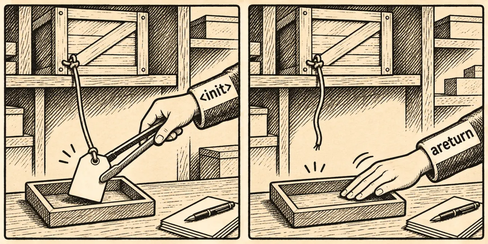

자바로 개발할 때는 다 쓴 객체의 메모리를 직접 반납할 일이 없다. 자주 호출하는 메서드가 있으면 JVM이 그 메서드를 기계어로 컴파일하기도 한다.

『자바 최적화』 3장 첫머리에 ‘자바 가상 머신 기술 스택의 기본’이라는 말이 나온다. 성능 문제를 들여다볼 때는 JVM이 대신 해 주던 일도 알아야 한다는 얘기다.

여기서 말하는 기술 스택의 기본이 뭘까?

## JVM 기술 스택의 개괄

자바 프로그램 하나를 실행할 때 각 layer가 맡는 일은 다음과 같다.

<table id="diagram-runtime-layers" class="runtime-layers" aria-label="자바 프로그램을 실행하는 각 layer의 역할">
  <thead><tr><th scope="col">Layer</th><th scope="col">무슨 일을 맡는가?</th></tr></thead>
  <tbody>
    <tr><th scope="row">자바 애플리케이션</th><td>프로그램 로직 정의</td></tr>
    <tr><th scope="row">JVM</th><td>클래스 로딩과 바이트코드 실행</td></tr>
    <tr><th scope="row">운영체제</th><td>메모리 할당과 스레드 스케줄링</td></tr>
    <tr><th scope="row">하드웨어 (CPU)</th><td>기계어 명령 실행</td></tr>
  </tbody>
</table>

표에 나온 바이트코드는 JVM이 실행하는 명령이다. 자바에서 주문 객체 하나를 만들어 돌려줄 때는 `return new Order();` 한 줄이면 된다. JVM에서도 명령 하나면 될까?

```java
class Order {
    int quantity;
}

class Checkout {
    static Order createOrder() {
        return new Order();
    }
}
```

두 클래스를 `Checkout.java`에 같이 저장하고 컴파일한다.

```sh
javac Checkout.java
```

`Order.class`와 `Checkout.class`가 생긴다. `createOrder()`를 쓴 곳은 `Checkout`이니, `javap -c`로 `Checkout.class` 안의 바이트코드를 출력해 봤다.

```sh
javap -c Checkout
```

출력에서 `createOrder()`의 본문만 가져왔다.

```text
0: new           #7    // class Order
3: dup
4: invokespecial #9    // Method Order."<init>":()V
7: areturn
```

명령이 네 개다. 아직 주문 객체를 만든 건 아니다. `javap`는 파일에 적힌 명령을 보여 줄 뿐이다.

그럼 `Checkout.createOrder()`를 호출하면 JVM은 이 네 줄을 어떻게 실행할까?

## 인터프리팅과 클래스 로딩

아까 `javap`로 읽은 `Checkout.class`를 이번에는 클래스 로더가 읽는다. JVM은 그 내용으로 `Checkout` 클래스를 만든다. 이게 **클래스 로딩**이다.

JVM이 `Checkout`을 검증하고 초기화하면 `createOrder()`의 본문을 실행할 수 있다. 인터프리터로 실행하면 첫 줄의 `new`부터 한 명령씩 읽어서 처리한다. 이걸 **인터프리팅**이라고 한다.

`createOrder()`를 호출하면 그 스레드의 JVM 스택에 **프레임**이 하나 생긴다. 프레임 안에는 **피연산자 스택**이 있다. 메서드를 실행하면서 값을 올리고 꺼내는 곳이다. 아직은 비어 있다.

`new`를 실행하면 힙에 `Order` 객체가 하나 생긴다.

<p id="order-reference-question">그럼 <code>new</code>는 방금 만든 주문 객체의 참조를 어디에 둘까?</p>

<figure data-play-on-view id="diagram-order-allocation">


<figcaption>주문 객체는 힙에 있다. 스택의 화살표는 그 주문을 가리킨다.</figcaption>
</figure>

주문 수량은 `int quantity;`라고만 선언했다. 초깃값을 따로 쓰지 않아도 JVM이 객체를 만들면서 기본형(primitive type)인 `int` 필드를 초기화한다. 이때 값은 0으로부터 시작한다.

<details>
<summary>운영체제에서 보면 자바 힙 바깥에는 무엇이 있을까?</summary>

앞의 그림에 나온 힙과 JVM 스택은 JVM 명세의 **런타임 데이터 영역**이다. 운영체제에서 볼 때 자바 힙은 JVM 프로세스가 쓰는 메모리의 일부다. OpenJDK의 JVM 구현체인 HotSpot(핫스팟)은 클래스 메타데이터를 메타스페이스에, JIT 컴파일러가 만든 기계어를 코드 캐시에 둔다. GC가 쓰는 자료와 공유 라이브러리도 같은 프로세스의 주소 공간에 있다.


</details>

힙에 주문 객체는 생겼다. 그럼 `Order()` 생성자는 언제 부를까? 세 번째 줄의 `4: invokespecial` 옆에 `Order."<init>"`가 보인다. 여기서 생성자를 부를 때 스택에서 참조 하나를 꺼낸다.

아까 `new`가 올려놓은 참조는 하나였는데. 그걸 생성자에 넘겨주면 마지막 `areturn`은 뭘 돌려주지?



두 번째 줄을 건너뛰었다. `3: dup`. 여기서 스택 맨 위의 참조를 복사한다. 같은 주문을 가리키는 참조가 두 개니까 하나를 생성자에 넘기고도 하나가 남는다. 그게 `areturn`이 돌려줄 참조다.

### `return a + b;`

그럼 `a + b`에서 더할 두 값도 스택을 거칠까? 같은 `Checkout` 클래스에 메서드 하나를 더 넣어 보자.

```java
static int add(int a, int b) {
    return a + b;
}
```

다시 컴파일하고 `javap -c Checkout`으로 `add`의 명령을 출력해 봤다.

```text
0: iload_0
1: iload_1
2: iadd
3: ireturn
```

`iadd`는 `int` 두 개를 더하라는 명령이다. 그런데 옆에는 `a`도 `b`도 없다. 그럼 뭘 더하라는 걸까?

`add(2, 3)`으로 호출해 보자. 첫 번째 인수 2는 프레임의 지역 변수 0번 자리에, 두 번째 인수 3은 1번 자리에 들어간다.

덧셈 바로 위의 두 줄은 그 값을 읽어 오는 명령이다. `iload_0`이 0번 자리의 2를 스택에 올리고, `iload_1`이 그 위에 1번 자리의 3을 올린다. `iadd`는 스택에서 그 둘을 꺼내 더하고 5를 올린다.

RISC-V의 덧셈 명령은 `add x5, x6, x7`처럼 쓴다. `x6`와 `x7`에서 값을 읽어 더하고 `x5`에 쓰라는 뜻이다. JVM의 `iadd` 옆은 비어 있다. 더할 두 값은 피연산자 스택 맨 위에 있고, 결과도 같은 스택에 올리기 때문이다. 책에서 JVM을 **스택 기반**이라고 한 이유다.

<figure data-play-on-view>


</figure>

`iload_1`에서는 값을 올렸고 `iadd`에서는 두 값을 꺼냈다. 인터프리터는 언제 올리고 언제 꺼낼지 어떻게 알까? 책은 이걸 `while` 안의 `switch`로 설명한다. 명령을 하나 읽을 때마다 그 명령에 맞는 `case`로 간다.

```text
while (실행할 명령이 남아 있다) {
    switch (다음 명령을 읽는다) {
        case iload_0:
            stack.push(locals[0])
            break
        case iload_1:
            stack.push(locals[1])
            break
        case iadd:
            b = stack.pop()
            a = stack.pop()
            stack.push(a + b)
            break
        case ireturn:
            return stack.pop()
    }
}
```

이번에는 `dup` 없이 바로 `ireturn`이다. `iadd`가 올려 둔 5를 그사이에 꺼내 쓰는 명령이 없으니 그대로 돌려주면 된다.

## 참고자료

- 『자바 최적화』 3장, 「자바 가상 머신 개요」
- JVM 명세 25, [런타임 데이터 영역](https://docs.oracle.com/javase/specs/jvms/se25/html/jvms-2.html#jvms-2.5), [프레임](https://docs.oracle.com/javase/specs/jvms/se25/html/jvms-2.html#jvms-2.6), [피연산자 스택](https://docs.oracle.com/javase/specs/jvms/se25/html/jvms-2.html#jvms-2.6.2), [클래스 로딩](https://docs.oracle.com/javase/specs/jvms/se25/html/jvms-5.html#jvms-5.3), [링킹](https://docs.oracle.com/javase/specs/jvms/se25/html/jvms-5.html#jvms-5.4), [초기화](https://docs.oracle.com/javase/specs/jvms/se25/html/jvms-5.html#jvms-5.5)
- JVM 명세 25의 바이트코드 명령, [new](https://docs.oracle.com/javase/specs/jvms/se25/html/jvms-6.html#jvms-6.5.new), [dup](https://docs.oracle.com/javase/specs/jvms/se25/html/jvms-6.html#jvms-6.5.dup), [invokespecial](https://docs.oracle.com/javase/specs/jvms/se25/html/jvms-6.html#jvms-6.5.invokespecial), [areturn](https://docs.oracle.com/javase/specs/jvms/se25/html/jvms-6.html#jvms-6.5.areturn), [iadd](https://docs.oracle.com/javase/specs/jvms/se25/html/jvms-6.html#jvms-6.5.iadd), [ireturn](https://docs.oracle.com/javase/specs/jvms/se25/html/jvms-6.html#jvms-6.5.ireturn)
- [HotSpot의 클래스 메타데이터](https://docs.oracle.com/en/java/javase/25/gctuning/other-considerations.html)
- [RISC-V 정수 연산 명령](https://docs.riscv.org/reference/isa/v20260120/unpriv/rv32.html)
- [Pratik T의 JVM 구성도](https://medium.com/@pratik.941/understanding-jvm-memory-allocation-a-tutorial-d06e830e615f)
