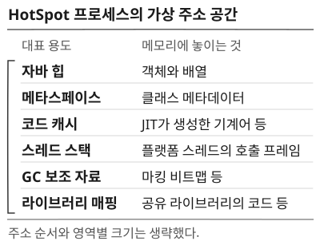

자바로 개발할 때는 객체를 쓰고 나서 그 메모리를 언제 회수할지 정하지 않아도 된다. 자주 호출하는 메서드를 기계어로 최적화하는 일도 JVM이 맡는다.

『자바 최적화』 3장은 성능을 다루려면 이렇게 JVM에 맡겨 둔 일도 알아야 한다고 한다. 책에서 처음 꺼내는 말이 ‘자바 가상 머신 기술 스택의 기본’이다.

여기서 말하는 기술 스택의 기본이 뭘까?

## JVM 기술 스택의 개괄

자바 프로그램 하나를 실행할 때 각 layer가 맡는 일은 다음과 같다.

<table id="diagram-runtime-layers" class="runtime-layers" aria-label="자바 프로그램을 실행하는 각 layer의 역할">
  <thead><tr><th scope="col">Layer</th><th scope="col">무슨 일을 맡는가?</th></tr></thead>
  <tbody>
    <tr><th scope="row">자바 애플리케이션</th><td>프로그램 로직 정의</td></tr>
    <tr><th scope="row">JVM</th><td>클래스 로딩과 바이트코드 실행</td></tr>
    <tr><th scope="row">운영체제</th><td>메모리 할당과 스레드 스케줄링</td></tr>
    <tr><th scope="row">하드웨어 (CPU)</th><td>기계어 명령 실행</td></tr>
  </tbody>
</table>

JVM이 실행하는 명령을 바이트코드라고 한다. 자바에서는 주문 객체를 하나 만들어 돌려주는 데 한 줄이면 된다. 바이트코드로도 한 줄일까?

```java
class Order {
    int quantity;
}

class Checkout {
    static Order createOrder() {
        return new Order();
    }
}
```

두 클래스를 한 파일 `Checkout.java`에 저장하고 컴파일한다.

```sh
javac Checkout.java
```

`Order.class`와 `Checkout.class`가 하나씩 생긴다. 우리가 쓴 `return new Order();`는 `Checkout`의 메서드 안에 있으니, 볼 파일은 `Checkout.class`다.

`javap -c`로 컴파일된 명령을 읽을 수 있다.

```sh
javap -c Checkout
```

출력에서 `createOrder()`의 본문만 가져왔다.

```text
0: new           #7    // class Order
3: dup
4: invokespecial #9    // Method Order."<init>":()V
7: areturn
```

소스에는 `return new Order();` 한 줄인데 클래스 파일에는 명령이 네 개다. 여기까지는 `javap`가 파일에서 읽어 낸 내용이다. 그럼 `Checkout.createOrder()`를 호출하면 JVM은 이 네 줄을 어떻게 실행할까?

## 인터프리팅과 클래스 로딩

먼저 JVM에 `createOrder()`가 속한 클래스가 있어야 한다. 클래스 로더가 `Checkout.class`를 읽어 JVM에 `Checkout` 클래스를 정의한다. 이 과정이 **클래스 로딩**이다. 이제 JVM에도 우리가 `javap`로 본 메서드의 바이트코드가 있다.

JVM은 `Checkout`의 검증과 클래스 초기화를 마친 뒤 `createOrder()`의 본문을 실행할 수 있다. 여기서는 인터프리터로 실행하는 경우를 보자. 인터프리터는 첫 줄의 `new`부터 한 명령씩 읽어 실행한다. 이 방식이 **인터프리팅**이다.

메서드를 호출할 때마다 그 스레드의 JVM 스택에 **프레임**이 하나 생긴다. 이번 호출의 프레임 안에는 `createOrder()`의 명령들이 값을 주고받을 **피연산자 스택**이 있다. 첫 명령을 실행하기 전에는 비어 있다.

`new`를 실행하면 힙에 `Order` 객체가 하나 생긴다.

<p id="order-reference-question">그럼 <code>new</code>는 방금 만든 주문 객체의 참조를 어디에 둘까?</p>

<figure data-play-on-view id="diagram-order-allocation">



<figcaption>힙에는 주문 객체가 생기고, 현재 프레임의 피연산자 스택에는 그 객체의 참조가 남는다.</figcaption>
</figure>

코드에는 주문 수량을 담을 필드를 `int quantity;`라고만 썼다. `quantity`의 타입은 자바의 기본형(primitive type)인 `int`다. JVM은 `new`로 객체를 할당하면서 이 필드에 기본값을 넣는다. 이때 값은 0으로부터 시작한다.

<details>
<summary>운영체제에서 보면 자바 힙 바깥에는 무엇이 있을까?</summary>

앞의 그림에 나온 힙과 JVM 스택은 JVM 명세의 **런타임 데이터 영역**이다. 운영체제에서 볼 때 자바 힙은 JVM 프로세스가 쓰는 메모리의 일부다. OpenJDK의 JVM 구현체인 HotSpot(핫스팟)은 클래스 메타데이터를 메타스페이스에, JIT 컴파일러가 만든 기계어를 코드 캐시에 둔다. GC가 쓰는 자료와 공유 라이브러리도 같은 프로세스의 주소 공간에 있다.



</details>

`new`가 끝난 지금은 아직 `Order()` 생성자를 호출하기 전이다. 출력의 세 번째 줄에서 `invokespecial`이 호출하는 `Order."<init>"`가 그 생성자다. 이때 스택에서 주문 객체의 참조를 하나 꺼내 쓴다. 참조가 하나뿐이라면 마지막 `areturn`에서 무엇을 돌려줄까?

그래서 `new` 바로 뒤에 `dup`이 있다. 방금 올린 참조를 복사하면 스택에는 같은 주문 객체를 가리키는 참조가 두 개 놓인다. 하나는 생성자를 호출할 때 쓰고, 남은 하나는 `areturn`이 꺼내 호출한 쪽에 돌려준다.

### 피연산자 스택에서 두 정수 더하기

그럼 `a + b`에서 더할 두 값도 스택을 거칠까? 같은 `Checkout` 클래스에 메서드 하나를 더 넣어 보자.

```java
static int add(int a, int b) {
    return a + b;
}
```

`javac Checkout.java`로 다시 컴파일한 뒤 `javap -c Checkout`의 출력에서 `add`를 보면 덧셈은 세 번째 줄에 있다.

```text
0: iload_0
1: iload_1
2: iadd
3: ireturn
```

`iadd`는 `int` 두 개를 더하라는 명령이다. 그런데 옆에는 `a`도 `b`도 없다. 그럼 뭘 더하라는 걸까?

바로 위의 두 줄에 답이 있다. `add(2, 3)`을 호출하면 지역 변수 0번 자리에 2, 1번 자리에 3이 들어간다. `iload_0`이 2를 스택에 올리고, `iload_1`이 그 위에 3을 올린다. 이제 `iadd`가 맨 위에서 두 값을 꺼내 더하고 결과인 5를 다시 올린다.

레지스터로 계산하는 RISC-V CPU에서는 `add x5, x6, x7`처럼 두 값을 읽을 곳(`x6`, `x7`)과 결과를 쓸 곳(`x5`)을 명령에 적는다. JVM의 `iadd`는 피연산자 스택에서 두 값을 받고 결과도 거기에 남긴다. 책에서 JVM을 **스택 기반**이라고 한 건 이 때문이다.

<figure data-play-on-view>


</figure>

그림에서 화살표가 `iload_1`에서 `iadd`로 내려가면 인터프리터가 하는 일도 바뀐다. 방금까지 값을 올리다가 이번에는 두 값을 꺼낸다. 책에서는 이 동작을 `while` 안의 `switch`로 설명한다. 반복할 때마다 다음 명령을 하나 읽고 그 명령에 맞는 `case`를 실행하는 식이다.

```text
while (실행할 명령이 남아 있다) {
    switch (다음 명령을 읽는다) {
        case iload_0:
            stack.push(locals[0])
            break
        case iload_1:
            stack.push(locals[1])
            break
        case iadd:
            b = stack.pop()
            a = stack.pop()
            stack.push(a + b)
            break
        case ireturn:
            return stack.pop()
    }
}
```

마지막 `ireturn`이 꺼내는 값은 `iadd`가 남긴 5다. `createOrder()`에서는 생성자 호출 뒤에도 참조가 남아야 해서 `dup`이 필요했다. `add()`에서는 덧셈 결과가 이미 스택 맨 위에 있어서 그대로 반환할 수 있다.

## 참고자료

- 『자바 최적화』 3장, 「자바 가상 머신 개요」
- JVM 명세 25, [런타임 데이터 영역](https://docs.oracle.com/javase/specs/jvms/se25/html/jvms-2.html#jvms-2.5), [프레임](https://docs.oracle.com/javase/specs/jvms/se25/html/jvms-2.html#jvms-2.6), [피연산자 스택](https://docs.oracle.com/javase/specs/jvms/se25/html/jvms-2.html#jvms-2.6.2), [클래스 로딩](https://docs.oracle.com/javase/specs/jvms/se25/html/jvms-5.html#jvms-5.3), [링킹](https://docs.oracle.com/javase/specs/jvms/se25/html/jvms-5.html#jvms-5.4), [초기화](https://docs.oracle.com/javase/specs/jvms/se25/html/jvms-5.html#jvms-5.5)
- JVM 명세 25의 바이트코드 명령, [new](https://docs.oracle.com/javase/specs/jvms/se25/html/jvms-6.html#jvms-6.5.new), [dup](https://docs.oracle.com/javase/specs/jvms/se25/html/jvms-6.html#jvms-6.5.dup), [invokespecial](https://docs.oracle.com/javase/specs/jvms/se25/html/jvms-6.html#jvms-6.5.invokespecial), [areturn](https://docs.oracle.com/javase/specs/jvms/se25/html/jvms-6.html#jvms-6.5.areturn), [iadd](https://docs.oracle.com/javase/specs/jvms/se25/html/jvms-6.html#jvms-6.5.iadd), [ireturn](https://docs.oracle.com/javase/specs/jvms/se25/html/jvms-6.html#jvms-6.5.ireturn)
- [HotSpot의 클래스 메타데이터](https://docs.oracle.com/en/java/javase/25/gctuning/other-considerations.html)
- [RISC-V 정수 연산 명령](https://docs.riscv.org/reference/isa/v20260120/unpriv/rv32.html)
- [Pratik T의 JVM 구성도](https://medium.com/@pratik.941/understanding-jvm-memory-allocation-a-tutorial-d06e830e615f)
