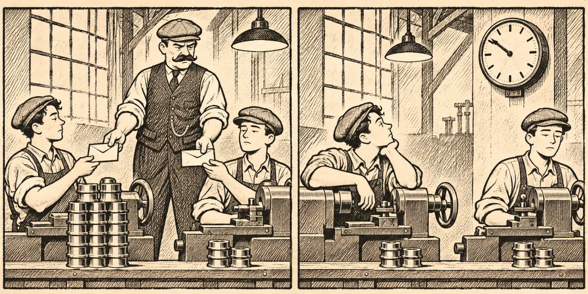

『과학적 관리법』을 펴기 전, 테일러라는 이름에서 먼저 떠올린 것은 영화 《모던 타임즈》의 컨베이어 벨트였다. 화장실에 가는 시간까지 재던 공장과 책에서 테일러가 그린 공장 사이에는 얼마나 거리가 있을까.

## 문제의 출발점은 경영자였다

책에서 먼저 나온 건 임금 얘기였다. 일을 더 해도 보상이 따라오지 않는 공장에서 누가 먼저 속도를 올릴까. 테일러는 당시 노동자들이 일부러 작업 속도를 늦추는 이유를 여기서 찾았다.

작업 방법도 노동자 개인에게 맡겨 두고 있었다. 내가 예상한 건 일을 빨리 하라고 노동자부터 다그치는 장면이었는데, 테일러가 먼저 따진 건 경영자가 무슨 일을 하고 있느냐는 점이었다.

## 테일러가 성과급까지 쓴 이유

테일러는 숙련자의 감에 맡겨 두던 일을 시간과 동작으로 나눠 관찰하고, 가장 효율적인 작업 방법을 찾아 표준으로 정하자고 했다. 여기까지만 보면 역시 효율을 앞세운 사람 아닌가 싶었다.

그런데 그 다음에 나오는 말이 고용주와 노동자의 ‘공동 번영’이었다. 경영자가 작업 방법을 찾아 노동자를 훈련시키는 데까지 맡는다. 테일러는 그 덕에 생산량이 늘면 더 번 돈을 차등 성과급으로 나누자고 했다.

## 작업 속도만 높인 공장들

실제로는 시간을 재서 작업 속도만 높이고 이익은 나누지 않은 공장들도 있었다. 내가 처음에 《모던 타임즈》를 떠올린 것도 이쪽에 가까웠다.

작업 조건도 임금도 같은데 일하는 방식이 달라지면 그건 어떻게 설명할까. 뒤이어 메이요의 호손 실험을 바탕으로 한 인간관계론에서는 함께 일하는 동료 사이의 관계도 들여다봤다.

## 책을 덮으며

관리자의 감으로 정했던 작업 시간을 실제로 재 보자는 제안은 산업공학과 경영학에 남았다. 지금도 업무 시간을 재서 줄이고 그 기록으로 성과를 계산한다.

책을 덮고 나니 작업 시간을 줄였다면 그 덕을 누가 보는지도 같이 묻게 됐다. 100여 년 전 테일러가 성과급과 협력에 지면을 쓴 이유가 이제는 조금 이해된다.
