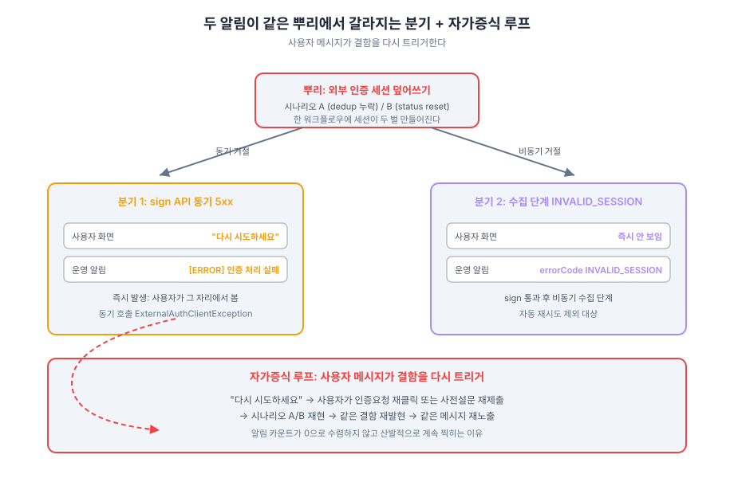

인증 세션을 두 번 만들던 코드를 고쳤다. 이제 같은 알림은 잠잠해질 줄 알았는데 오전 9시 56분에 네 건, 10시 34분에 또 한 건이 왔다.

## 수정 배포 후에도 알림이 계속 발생했다

[앞 편](../why2/)에서 세션 덮어쓰기 결함을 찾아 두 입구를 모두 막았다. 배포 뒤에도 알림 건수는 이렇게 움직였다.

```text
09:56 → 4건
10:34 → 1건
11:08 → 3건
12:45 → 2건
13:51 → 4건
```

내려가다가 다시 튄다. 머지는 끝났고 알림은 남았다. 운영자는 숫자만 본다. 숫자가 남아 있으면 장애도 남아 있는 것처럼 보인다.

이 시점에서 후보는 둘이다. 배포가 아직 덜 깔렸거나, 우리가 막은 결함이 전부가 아니었거나. 둘 다 확인해보자.

## 배포 상태와 추가 발생 경로를 확인했다

첫 가설은 배포 지연. 서버 3대에 rolling update가 진행 중이면 일부 인스턴스가 옛 버전이라 알림이 산발적으로 남을 수 있다. 배포 상태를 확인했다. 전부 끝나 있었다. 기각.

두 번째로 같은 결함을 유발하는 추가 경로를 조사했다. 확인한 코드에서는 새 경로를 찾지 못했다. 이 결과만으로 다른 결함이 전혀 없다고 단정할 수는 없으므로 사용자별 재현 흐름을 추가로 확인했다.

코드와 배포 상태만으로는 잔여 알림을 설명하기 어려웠다. 사용자별 재시도 이력과 화면 안내를 함께 확인했다.

## 사용자별 재시도 패턴을 확인했다

알림 로그를 시간순으로 볼 때는 산발적인 잔여 알림처럼 보였다. 사용자별로 묶는 순간 그림이 바뀌었다.

```text
사용자 X: 09:56, 10:34, 11:08  (3건)
사용자 Y: 12:45, 13:51         (2건)
```

같은 사용자의 반복 요청에서 동일한 실패가 발생했다. 사용자가 재시도하게 된 이유를 확인하기 위해 화면의 오류 안내를 검토했다.

```kotlin
class ExternalAuthClientException(
    message: String = "인증 처리 실패입니다. 다시 시도하세요"
) : ...
```

사용자는 안내에 따라 인증요청을 다시 누르거나 사전 설문을 재제출했다. 앞 편에서 수정한 두 경로와 겹치는 행동이다. 다만 수정 배포 후의 알림만으로 세션 덮어쓰기가 다시 발생했다고 단정할 수는 없다. 이미 무효화된 세션의 복구 여부와 반복 요청의 실패 원인을 구분해야 한다.

| 사용자 행동 | 재현되는 입구 | 결과 |
|---|---|---|
| 인증요청 다시 클릭 | 입구 A | 기존 실패 상태에서 요청 반복 |
| 사전 설문 다시 제출 | 입구 B | 기존 실패 상태의 복구 여부 확인 필요 |

실패 안내에 따라 사용자가 재시도해도 세션 상태가 복구되지 않으면 같은 실패와 알림이 반복된다. 재시도로 회복 가능한 상태인지 먼저 구분해야 했다.

<style>
.metric-fig{--fig-surface:#ffffff;--fig-ink:#0f172a;--fig-ink2:#334155;--fig-muted:#94a3b8;--fig-hair:#e6eaf1;--fig-baseline:#d0d7e2;--c-green:#16a34a;--c-greenink:#15803d;--c-red:#ef4444;--c-redink:#b91c1c;--c-blue:#2f6fed;--c-blueink:#1d4ed8;--c-amber:#d97706;--c-amberink:#b45309;margin:2.4em 0;border:1px solid var(--fig-hair);border-radius:18px;background:var(--fig-surface);padding:18px 20px 10px;overflow:hidden;box-shadow:0 1px 2px rgba(2,6,23,.05),0 14px 40px rgba(2,6,23,.09)}
.metric-fig svg{width:100%;height:auto;display:block;max-width:100%}
.metric-fig svg text{font-family:ui-monospace,"SF Mono","JetBrains Mono",Menlo,monospace}
.metric-fig figcaption{font-size:13.5px;color:var(--fig-muted);line-height:1.6;padding:12px 2px 6px;font-family:ui-monospace,SFMono-Regular,Menlo,monospace}
.metric-fig figcaption b{color:var(--fig-ink2);font-weight:600}
@media (prefers-reduced-motion: reduce){.metric-fig svg animate,.metric-fig svg animateMotion{display:none}}
</style>

<figure class="metric-fig">
  <svg viewBox="0 0 660 234" role="img" aria-label="실패 화면의 다시 시도하세요 문장을 사용자가 따라 하면 결함이 다시 트리거되는 루프가 끝없이 돈다" xmlns="http://www.w3.org/2000/svg">
    <path d="M330 44 H520 Q556 44 556 80 V152 Q556 188 520 188 H140 Q104 188 104 152 V80 Q104 44 140 44 Z" fill="none" stroke="var(--fig-baseline)" stroke-dasharray="4 5"/>
    <circle r="6" fill="var(--c-red)">
      <animateMotion dur="6s" repeatCount="indefinite" path="M330 44 H520 Q556 44 556 80 V152 Q556 188 520 188 H140 Q104 188 104 152 V80 Q104 44 140 44 Z"/>
    </circle>
    <rect x="252" y="30" width="156" height="26" rx="7" fill="var(--c-red)" opacity="0.14"/>
    <text x="330" y="47" font-size="11" fill="var(--c-redink)" text-anchor="middle" font-weight="700">세션 덮어쓰기, 실패</text>
    <rect x="474" y="103" width="164" height="26" rx="7" fill="var(--c-amber)" opacity="0.16"/>
    <text x="556" y="120" font-size="11" fill="var(--c-amberink)" text-anchor="middle" font-weight="700">"다시 시도하세요"</text>
    <rect x="238" y="175" width="184" height="26" rx="7" fill="var(--c-blue)" opacity="0.14"/>
    <text x="330" y="192" font-size="11" fill="var(--c-blueink)" text-anchor="middle" font-weight="700">사용자, 시키는 대로 재시도</text>
    <rect x="30" y="103" width="148" height="26" rx="7" fill="var(--fig-baseline)" opacity="0.4"/>
    <text x="104" y="120" font-size="11" fill="var(--fig-ink2)" text-anchor="middle" font-weight="700">인증 재트리거</text>
    <text x="330" y="110" font-size="11" fill="var(--fig-muted)" text-anchor="middle">코드 픽스를 머지해도</text>
    <text x="330" y="128" font-size="11" fill="var(--fig-muted)" text-anchor="middle">이 원은 계속 돈다</text>
    <text x="330" y="152" font-size="13" fill="var(--c-redink)" text-anchor="middle" font-weight="800">운영 알림 +1
      <animate attributeName="opacity" values="0;1;0;0" keyTimes="0;0.05;0.2;1" dur="6s" repeatCount="indefinite"/>
    </text>
  </svg>
  <figcaption>실패 상태에서 재시도 안내에 따라 같은 요청을 반복하면 실패 알림이 추가된다. 알림은 한 바퀴에 <b>+1</b>씩 쌓인다.</figcaption>
</figure>

## 실패 안내 시점에 따라 재시도 빈도가 달라졌다

세션 덮어쓰기 이후의 거절은 두 갈래로 나뉜다고 했다. 이 분기가 루프의 세기도 가른다.



| 분기 | 거절 시점 | 사용자 노출 | 운영자 알림 |
|---|---|---|---|
| 동기 5xx | sign API 호출 단계 | "인증 처리 실패입니다. 다시 시도하세요" | `[ERROR] 인증 처리 실패입니다…` |
| 비동기 거절 | sign 통과 후 수집 단계 | 즉시 안 보임. 수집 결과 후 안내 | `errorCode: INVALID_SESSION` |

동기 실패는 사용자가 그 자리에서 보고 그 자리에서 다시 누른다. 루프가 초 단위로 돈다. 비동기 거절은 사용자가 한참 뒤에야 알게 되므로 즉시 따라 할 행동이 없다. 루프가 약하다.

실패를 사용자에게 빨리 보여주는 건 보통 좋은 UX다. 그런데 그 실패에 "다시 시도"라는 출구를 붙여놓고 그 출구가 다시 실패로 이어진다면, 빠른 피드백은 빠른 재발이 된다.

## 문장을 고치다

코드 픽스는 결함의 발현을 막는다. 하지만 이미 사용자 화면에 나간 문장은 여전히 재시도를 시키고 있다. 그래서 픽스 범위가 문장까지 넓어졌다.

```kotlin
when {
    isRecentRetry(workflowCode, withinSeconds = 30) -> {
        "잠시 후 다시 시도해 주세요. 이전 인증이 처리 중입니다."
    }
    else -> {
        "인증 처리 실패입니다. 다시 시도하세요."
    }
}
```

같은 워크플로우에서 짧은 시간 안에 재시도가 감지되면 안내를 바꾼다. "다시 시도하세요"를 무조건 내보내지 않는 것이다.

전체 조치를 자리별로 정리하면 이렇다.

| 조치 | 막는 자리 |
|---|---|
| 입구 차단 (앞 편의 A, B) | 결함의 발현 (코드) |
| 외부 idempotency 계약 | 결함이 나도 외부에서 흡수 |
| 메시지 분기 | 결함의 증폭 (사용자 행동) |

메시지 분기는 재시도를 줄이는 보조 조치다. 코드 차단이 빠지면 첫 발현은 그대로 일어난다. 그리고 `isRecentRetry`의 시간창 30초는 아직 감이다. 너무 짧으면 의미가 없고, 너무 길면 정말로 다시 시도해야 하는 사용자에게 엉뚱한 안내가 나간다. 이 임계값은 운영 데이터를 근거로 검증해야 한다.

## 이 루프는 어디서 끝나는가

사용자가 같은 인증을 계속 시도해도 이미 무효가 된 세션으로는 진행할 수 없었다. `INVALID_SESSION`을 자동 재시도 대상에서 뺀 뒤에도 복구하려면 두 가지 방법뿐이었다.

외부 세션의 TTL인 120분이 지나 새 세션을 발급받거나, 그 전에 운영자가 세션을 수동으로 초기화해야 했다.

## 머지가 끝점이 아닌 결함

코드 수정은 머지와 배포만으로 완료됐다고 판단하기 어렵다. 신규 발생이 차단됐는지, 기존 실패 상태가 복구됐는지, 사용자 안내가 복구 절차에 맞는지 확인해야 한다.

복구되지 않은 상태에서 재시도를 안내하면 같은 실패 요청이 반복될 수 있다. 오류 안내와 재시도 허용 조건을 함께 검토해야 한다.

| 결함 종류 | 끝점 | 사용자 1명당 알림 |
|---|---|---|
| 신규 발생 차단 | 수정 배포 후 동작 검증 | 결함과 재시도 조건에 따라 다름 |
| 반복 발생 | 세션 TTL 만료 또는 운영자 reset | 재시도 횟수만큼 |

운영자가 머지를 끝점으로 보고 알림이 0으로 가길 기다리는데 0이 오지 않는 이유가 이것이다. 사용자가 문장을 따라 행동하는 한, 코드 결함이 사라져도 알림은 한참 더 떨어진다.

## 마치며

배포 상태를 확인하고 코드를 두 번 훑는 동안에는 답이 없었다. 시스템 안에서만 원인을 찾고 있었기 때문이다. 단서는 로그를 사용자별로 묶는 순간 나왔다. 같은 사람이 같은 실패를 다시 밟고 있다는 사실이 보인 뒤에야, 화면의 문장이 픽스 대상 목록에 올라갔다.

장애 분석의 기본 질문은 "어디서 일어났나"다. 그런데 이 루프는 그 질문으로는 안 잡힌다. "누구에게 반복됐나"를 물어야 보인다. 다음에 픽스를 머지했는데도 알림이 수렴하지 않으면, 배포 상태 다음으로 확인할 것은 알림의 사용자별 분포다. 그리고 하나 더. 에러 화면에 "다시 시도하세요"를 넣기 전에, 그 재시도가 정말 상황을 바꾸는지 한 번만 자문해보자. 사용자에게 보여주는 문장은 출력이 아니라 다음 입력이다.
