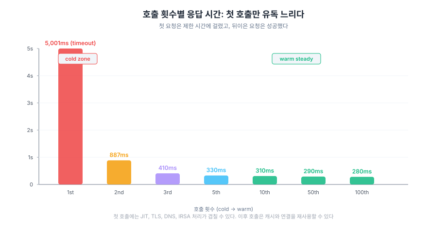
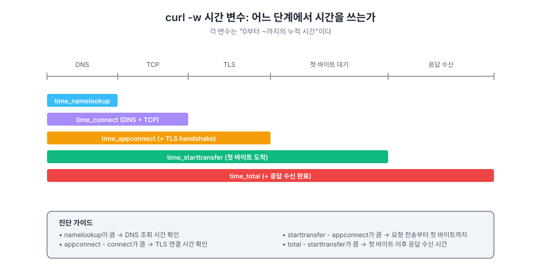
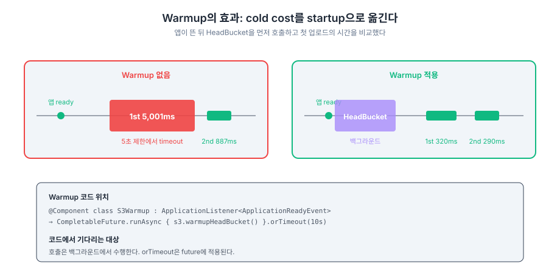
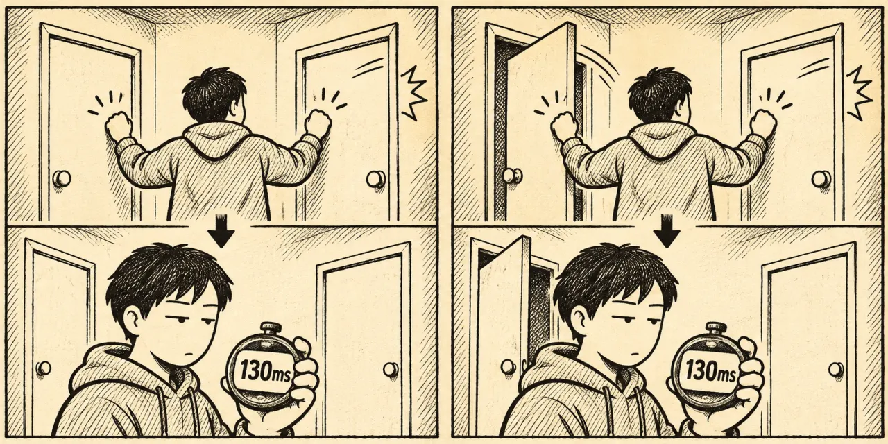

S3 업로드는 앱을 띄운 직후 몇 초씩 걸렸다. 몇 번 더 호출하면 0.3초 안팎으로 내려왔다. 같은 앱에서 외부 OCR 호출도 실패하고 있었다. S3에서 본 패턴이 워낙 익숙해서 OCR도 같이 워밍업하면 될 줄 알았다.

## 이름이 너무 빨리 나왔다

Spring + JDK 21 앱이 EKS 위에서 돈다. 외부로 나가는 호출은 세 갈래. S3 업로드, 외부 OCR API, 사내 LLM Proxy. 우선 S3에서 본 패턴이다.

```text
1st call: 5~10s   (cold)
2nd call: 0.3s    (warm)
3rd call: 0.3s
```



처음만 느리고 다음부터 빠르다. "아, cold start네."

warmup을 넣자. S3에서 이 생각을 했을 때까지는 괜찮았다.

문제는 OCR에서도 첫 호출만 실패하는지 확인하기 전에 같은 처방을 썼다는 데 있었다.

## cold start를 의심한 근거

S3 클라이언트에 아직 쓸 연결이 없으면 주소를 찾고 TCP 연결을 맺고 TLS 핸드셰이크를 거친다. IRSA로 임시 자격증명을 처음 받아야 할 수도 있다. 이미 열린 연결과 캐시된 자격증명을 쓰는 다음 요청에선 이 일들이 줄어든다.

앱 쪽에서도 클래스를 처음 로딩하거나 지연 초기화한 빈을 만들 수 있다. 다만 업로드 로그에 찍힌 건 요청 전체 시간이었다. 5,001ms 중 몇 초를 STS에서 썼는지, JIT 컴파일을 기다린 시간이 있었는지는 이 로그로 알 수 없다.

## 5초를 어디서 썼을까

네트워크 쪽부터 좁히려면 같은 Pod에서 요청을 보내고 시각을 나눠 볼 수 있다. HTTPS 주소 하나에 새로 연결할 때 curl은 다음 값을 찍는다.



```bash
curl -w "
  DNS:           %{time_namelookup}s
  CONNECT:       %{time_connect}s
  SSL_HANDSHAKE: %{time_appconnect}s
  TTFB:          %{time_starttransfer}s
  TOTAL:         %{time_total}s
" -s -o /dev/null https://...
```

전부 요청 시작부터 잰 누적 시간이다. TLS 연결에 걸린 시간은 `time_appconnect - time_connect`로 본다. 그 뒤 첫 바이트가 올 때까지는 요청 전송과 서버 처리, 응답이 돌아오는 시간도 함께 들어간다. curl 한 번으로 서버 내부에서 쓴 시간까지 떼어낼 수는 없다.

## S3: 첫 호출 비용을 warmup으로 줄였다

S3에는 앱이 뜬 뒤 `HeadBucket` 요청을 보내는 코드를 넣었다. 첫 업로드가 오기 전에 S3를 한 번 써 두자는 의도였다.

```kotlin
@Component
class S3Warmup(
    private val s3Service: S3Service?,
) : ApplicationListener<ApplicationReadyEvent> {

    private val log = LoggerFactory.getLogger(javaClass)

    override fun onApplicationEvent(event: ApplicationReadyEvent) {
        val s3 = s3Service ?: return
        // 앱 시작 스레드는 HeadBucket 응답을 기다리지 않는다.
        CompletableFuture.runAsync {
            runCatching { s3.warmupHeadBucket() }
                .onFailure { log.warn("S3 warmup failed (ignored): {}", it.message) }
        }.orTimeout(10, TimeUnit.SECONDS)
    }
}
```



warmup 전 첫 업로드에 찍힌 5,001ms는 우리가 정해 둔 5초에 걸려 요청이 끝난 시각이다. 성공까지 얼마나 더 기다려야 했는지는 그 숫자에 없다. 그래서 비교할 때는 timeout을 임시로 30초로 늘렸다. warmup 뒤의 첫 업로드는 320ms에 성공했다.

코드에 나오는 10초는 별개다. `orTimeout`은 시간이 지나면 future를 예외로 완료한다. 이미 시작한 `HeadBucket` 호출을 그 자리에서 중단시키지는 않는다.

## OCR: 반복 연결 실패는 warmup으로 해결되지 않았다

같은 앱의 OCR API에도 같은 warmup을 넣었다. S3에서 방금 효과를 본 처방이라 더 의심 없이 넣었다. 그런데 숫자가 다르게 나왔다.

| 외부 호출 | 첫 호출 | 두 번째 | 패턴 |
|---|---|---|---|
| S3 PutObject | 5001ms timeout | 887ms 성공 | 두 번째 성공 |
| 외부 OCR API | 130ms RST | 130ms RST | 두 번 모두 연결 실패 |
| 사내 LLM Proxy | 정상 | 정상 | 무관 |

OCR 줄은 시간부터 S3와 달랐다. 130ms면 S3가 두 번째에 성공한 887ms보다도 짧다. 느린 호출이 아니었다. 약 130ms 만에 연결이 리셋(RST)된 호출이었다.



두 번째에는 어땠을까. S3 업로드는 성공했고 OCR은 또 130ms에 끊겼다. 첫 요청을 미리 보내 두자는 처방으로는 이 두 번째 실패를 설명할 길이 없었다.

그래서 outbound 정책과 네트워크 경로를 확인할 필요가 있었다. 다만 실패 시간이 일정하다는 것만으로 차단 위치를 특정할 수는 없다.

<style>
.metric-fig{--fig-surface:#ffffff;--fig-ink:#0f172a;--fig-ink2:#334155;--fig-muted:#94a3b8;--fig-hair:#e6eaf1;--fig-baseline:#d0d7e2;--c-green:#16a34a;--c-greenink:#15803d;--c-red:#ef4444;--c-redink:#b91c1c;--c-blue:#2f6fed;--c-blueink:#1d4ed8;--c-amber:#d97706;--c-amberink:#b45309;margin:2.4em 0;border:1px solid var(--fig-hair);border-radius:18px;background:var(--fig-surface);padding:18px 20px 10px;overflow:hidden;box-shadow:0 1px 2px rgba(2,6,23,.05),0 14px 40px rgba(2,6,23,.09)}
.metric-fig svg{width:100%;height:auto;display:block;max-width:100%}
.metric-fig svg text{font-family:ui-monospace,"SF Mono","JetBrains Mono",Menlo,monospace}
.metric-fig figcaption{font-size:13.5px;color:var(--fig-muted);line-height:1.6;padding:12px 2px 6px;font-family:ui-monospace,SFMono-Regular,Menlo,monospace}
.metric-fig figcaption b{color:var(--fig-ink2);font-weight:600}
@media (prefers-reduced-motion: reduce){.metric-fig svg animate,.metric-fig svg animateMotion{display:none}}
</style>

<figure class="metric-fig">
  <svg viewBox="0 0 660 250" role="img" aria-label="S3는 첫 호출만 느리고 이후 빨라지지만 OCR은 몇 번을 불러도 똑같이 130ms에 끊긴다" xmlns="http://www.w3.org/2000/svg">
    <text x="40" y="26" font-size="12" fill="var(--fig-muted)" font-weight="600">S3: 첫 호출만 비싸다 (cold start)</text>
    <line x1="40" y1="110" x2="360" y2="110" stroke="var(--fig-baseline)"/>
    <rect x="40" y="38" width="22" height="72" rx="3" fill="var(--c-amber)" opacity="0"><animate attributeName="opacity" values="0;0;0;0" keyTimes="0;0.5;0.9;1" dur="7s" repeatCount="indefinite"/></rect>
    <rect x="40" width="22" rx="3" fill="var(--c-amber)" y="110" height="0"><animate attributeName="height" values="0;0;72;72;0;0" keyTimes="0;0.06;0.09;0.88;0.92;1" dur="7s" repeatCount="indefinite"/><animate attributeName="y" values="110;110;38;38;110;110" keyTimes="0;0.06;0.09;0.88;0.92;1" dur="7s" repeatCount="indefinite"/></rect>
    <rect x="80" width="22" rx="3" fill="var(--c-green)" y="110" height="0"><animate attributeName="height" values="0;0;12;12;0;0" keyTimes="0;0.06;0.09;0.88;0.92;1" dur="7s" repeatCount="indefinite"/><animate attributeName="y" values="110;110;98;98;110;110" keyTimes="0;0.06;0.09;0.88;0.92;1" dur="7s" repeatCount="indefinite"/></rect><rect x="120" width="22" rx="3" fill="var(--c-green)" y="110" height="0"><animate attributeName="height" values="0;0;12;12;0;0" keyTimes="0;0.13;0.16;0.88;0.92;1" dur="7s" repeatCount="indefinite"/><animate attributeName="y" values="110;110;98;98;110;110" keyTimes="0;0.13;0.16;0.88;0.92;1" dur="7s" repeatCount="indefinite"/></rect><rect x="160" width="22" rx="3" fill="var(--c-green)" y="110" height="0"><animate attributeName="height" values="0;0;12;12;0;0" keyTimes="0;0.2;0.23;0.88;0.92;1" dur="7s" repeatCount="indefinite"/><animate attributeName="y" values="110;110;98;98;110;110" keyTimes="0;0.2;0.23;0.88;0.92;1" dur="7s" repeatCount="indefinite"/></rect><rect x="200" width="22" rx="3" fill="var(--c-green)" y="110" height="0"><animate attributeName="height" values="0;0;12;12;0;0" keyTimes="0;0.27;0.3;0.88;0.92;1" dur="7s" repeatCount="indefinite"/><animate attributeName="y" values="110;110;98;98;110;110" keyTimes="0;0.27;0.3;0.88;0.92;1" dur="7s" repeatCount="indefinite"/></rect><rect x="240" width="22" rx="3" fill="var(--c-green)" y="110" height="0"><animate attributeName="height" values="0;0;12;12;0;0" keyTimes="0;0.34;0.37;0.88;0.92;1" dur="7s" repeatCount="indefinite"/><animate attributeName="y" values="110;110;98;98;110;110" keyTimes="0;0.34;0.37;0.88;0.92;1" dur="7s" repeatCount="indefinite"/></rect><rect x="280" width="22" rx="3" fill="var(--c-green)" y="110" height="0"><animate attributeName="height" values="0;0;12;12;0;0" keyTimes="0;0.41;0.44;0.88;0.92;1" dur="7s" repeatCount="indefinite"/><animate attributeName="y" values="110;110;98;98;110;110" keyTimes="0;0.41;0.44;0.88;0.92;1" dur="7s" repeatCount="indefinite"/></rect><rect x="320" width="22" rx="3" fill="var(--c-green)" y="110" height="0"><animate attributeName="height" values="0;0;12;12;0;0" keyTimes="0;0.48;0.51;0.88;0.92;1" dur="7s" repeatCount="indefinite"/><animate attributeName="y" values="110;110;98;98;110;110" keyTimes="0;0.48;0.51;0.88;0.92;1" dur="7s" repeatCount="indefinite"/></rect>
    <text x="51" y="32" font-size="10" fill="var(--c-amberink)" text-anchor="middle" font-weight="700">5s
      <animate attributeName="opacity" values="0;0;1;1;0" keyTimes="0;0.06;0.1;0.88;1" dur="7s" repeatCount="indefinite"/>
    </text>
    <text x="440" y="102" font-size="11" fill="var(--c-greenink)" font-weight="700">두 번째부터 0.3s</text>
    <text x="40" y="150" font-size="12" fill="var(--fig-muted)" font-weight="600">OCR: 몇 번을 불러도 130ms RST (원인 확인 중)</text>
    <line x1="40" y1="228" x2="360" y2="228" stroke="var(--fig-baseline)"/>
    <rect x="40" width="22" rx="3" fill="var(--c-red)" y="228" height="0"><animate attributeName="height" values="0;0;10;10;0;0" keyTimes="0;0.06;0.09;0.88;0.92;1" dur="7s" repeatCount="indefinite"/><animate attributeName="y" values="228;228;218;218;228;228" keyTimes="0;0.06;0.09;0.88;0.92;1" dur="7s" repeatCount="indefinite"/></rect><rect x="80" width="22" rx="3" fill="var(--c-red)" y="228" height="0"><animate attributeName="height" values="0;0;10;10;0;0" keyTimes="0;0.13;0.16;0.88;0.92;1" dur="7s" repeatCount="indefinite"/><animate attributeName="y" values="228;228;218;218;228;228" keyTimes="0;0.13;0.16;0.88;0.92;1" dur="7s" repeatCount="indefinite"/></rect><rect x="120" width="22" rx="3" fill="var(--c-red)" y="228" height="0"><animate attributeName="height" values="0;0;10;10;0;0" keyTimes="0;0.2;0.23;0.88;0.92;1" dur="7s" repeatCount="indefinite"/><animate attributeName="y" values="228;228;218;218;228;228" keyTimes="0;0.2;0.23;0.88;0.92;1" dur="7s" repeatCount="indefinite"/></rect><rect x="160" width="22" rx="3" fill="var(--c-red)" y="228" height="0"><animate attributeName="height" values="0;0;10;10;0;0" keyTimes="0;0.27;0.3;0.88;0.92;1" dur="7s" repeatCount="indefinite"/><animate attributeName="y" values="228;228;218;218;228;228" keyTimes="0;0.27;0.3;0.88;0.92;1" dur="7s" repeatCount="indefinite"/></rect><rect x="200" width="22" rx="3" fill="var(--c-red)" y="228" height="0"><animate attributeName="height" values="0;0;10;10;0;0" keyTimes="0;0.34;0.37;0.88;0.92;1" dur="7s" repeatCount="indefinite"/><animate attributeName="y" values="228;228;218;218;228;228" keyTimes="0;0.34;0.37;0.88;0.92;1" dur="7s" repeatCount="indefinite"/></rect><rect x="240" width="22" rx="3" fill="var(--c-red)" y="228" height="0"><animate attributeName="height" values="0;0;10;10;0;0" keyTimes="0;0.41;0.44;0.88;0.92;1" dur="7s" repeatCount="indefinite"/><animate attributeName="y" values="228;228;218;218;228;228" keyTimes="0;0.41;0.44;0.88;0.92;1" dur="7s" repeatCount="indefinite"/></rect><rect x="280" width="22" rx="3" fill="var(--c-red)" y="228" height="0"><animate attributeName="height" values="0;0;10;10;0;0" keyTimes="0;0.48;0.51;0.88;0.92;1" dur="7s" repeatCount="indefinite"/><animate attributeName="y" values="228;228;218;218;228;228" keyTimes="0;0.48;0.51;0.88;0.92;1" dur="7s" repeatCount="indefinite"/></rect><rect x="320" width="22" rx="3" fill="var(--c-red)" y="228" height="0"><animate attributeName="height" values="0;0;10;10;0;0" keyTimes="0;0.55;0.58;0.88;0.92;1" dur="7s" repeatCount="indefinite"/><animate attributeName="y" values="228;228;218;218;228;228" keyTimes="0;0.55;0.58;0.88;0.92;1" dur="7s" repeatCount="indefinite"/></rect>
    <rect x="420" y="196" width="128" height="24" rx="7" fill="var(--c-red)" opacity="0.14"/>
    <text x="484" y="212" font-size="11" fill="var(--c-redink)" text-anchor="middle" font-weight="700">반복 호출
      <animate attributeName="opacity" values="1;1;0.3;1;1" keyTimes="0;0.7;0.75;0.8;1" dur="7s" repeatCount="indefinite"/>
    </text>
    <text x="484" y="234" font-size="10.5" fill="var(--fig-muted)" text-anchor="middle">변화 없음</text>
  </svg>
  <figcaption>S3는 두 번째부터 업로드에 성공했다. OCR은 warmup 뒤에도 약 130ms 만에 연결이 끊겼다.</figcaption>
</figure>

## OCR 연결은 어디서 끊겼을까

| 외부 호출 | 진단 | 처방 |
|---|---|---|
| S3 PutObject | 첫 호출 지연, warmup 후 첫 업로드 성공 | warmup 코드 추가 |
| 외부 OCR API | Outbound 차단 의심 (확인 중) | SRE 담당자에게 확인 요청, ServiceEntry 등록 요청 |
| 사내 LLM Proxy | 무관 | 그대로 유지 |

의심한 곳은 Istio 사이드카였다. outbound 정책이 `REGISTRY_ONLY`면 프록시는 레지스트리에 없는 호스트로 요청을 보내지 않는다. 기본값인 `ALLOW_ANY`에서는 그 요청도 통과한다. 그래서 ServiceEntry 등록을 요청한 것만으로는 진단이 끝나지 않았다.

먼저 이 클러스터에 어떤 정책이 걸려 있었는지, 같은 시각 프록시가 요청을 어디까지 보냈는지 확인해야 했다. 등록 후 같은 pod에서 OCR 호출을 다시 해 본 결과까지는 당시 기록에 없다.

실제로 한 일은 S3의 첫 호출을 보고 OCR에도 warmup을 넣은 것이었다. 그 전에 둘을 한 번씩만 더 불렀으면 됐다. S3는 성공했고 OCR은 또 끊겼으니까.

## 곁가지 두 개

이 사건을 파는 동안 두 가지 흔한 오해도 같이 정리됐다.

하나, "K8s probe가 있으면 되는 것 아닌가?" readiness probe를 통과하면 Pod로 트래픽을 보낼 수 있다. 그래도 JIT 컴파일이 덜 됐거나 커넥션 풀이 비어 있을 수 있다. 롤링 업데이트 중 준비되지 않은 Pod를 피하는 일과 첫 요청을 빠르게 처리하는 일은 따로 봐야 한다.

둘, IDEA의 Spring Boot 실행 설정에서 시작 최적화를 켜면 `-XX:TieredStopAtLevel=1`이 붙는다. 이 옵션으로 띄운 JVM은 C2까지 컴파일하지 않는다. 로컬의 두 번째 호출과 서버의 두 번째 호출을 비교할 때는 실행한 JAR와 JVM 옵션부터 맞춰야 한다.

## 마치며

S3에는 미리 한 번 호출하는 코드가 남았다. OCR은 ServiceEntry 등록을 요청했고 OkHttp의 connect/read timeout 설정도 남아 있다. 등록 뒤 같은 Pod에서 다시 호출했을 때 두 번째 130ms가 사라졌는지, 거기까지 봐야 이 진단이 끝난다.

## 참고자료

- [Istio 문서: Accessing External Services](https://istio.io/latest/docs/tasks/traffic-management/egress/egress-control/)
- [curl 매뉴얼, 요청 단계별 누적 시간](https://curl.se/docs/manpage.html#-w)
- [Java 21 CompletableFuture.orTimeout](https://docs.oracle.com/en/java/javase/21/docs/api/java.base/java/util/concurrent/CompletableFuture.html#orTimeout(long,java.util.concurrent.TimeUnit))
- [IntelliJ IDEA의 Spring Boot 실행 옵션](https://www.jetbrains.com/help/idea/run-debug-configuration-spring-boot.html)
