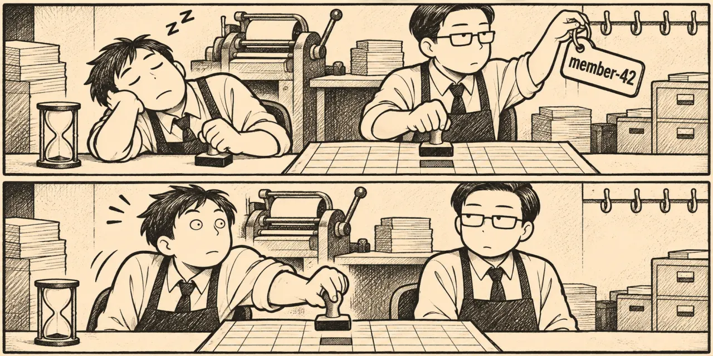

같은 회원의 쿠폰 발급 요청을 워커 두 개가 동시에 처리하면 쿠폰이 두 번 나갈 수 있다. 이를 막으려고 하나의 Redis 인스턴스에 회원별 락을 건다고 하자.

워커 A가 락을 잡고 발급을 시작했다. A가 쿠폰을 저장하기 전에 락의 유효 시간 5초가 먼저 끝나면, 다음 요청을 받은 워커 B는 어떻게 될까?

## 락 획득과 만료를 한 명령에 담는다

여기서 쿠폰은 행사당 회원 한 명에게 한 장만 발급한다. 두 워커는 같은 행사와 회원에 대해 같은 키를 쓴다. 아래에서 `token-A`는 워커 A가 이번 획득 시도에만 쓰는 값이다. 실제로는 시도할 때마다 새로운 무작위 값을 만든다.

```text
SET lock:coupon:summer:member-42 token-A NX PX 5000
```

처음 키가 비어 있으면 A는 `OK`를 받는다. `NX` 때문에 B가 같은 키로 시도하면 빈 응답을 받고 멈춘다. 이 조건이 유지되는 시간은 `PX 5000`, 즉 5초다. 키와 만료 시간을 한 명령으로 저장하니 A가 중간에 죽더라도 만료 시간 없는 키가 남지 않는다. [Redis SET 명령](https://redis.io/docs/latest/commands/set/)

## 락을 풀기 전에 소유자를 비교한다

A가 멈춘 사이 5초가 지나 B가 락을 얻었다고 하자. 키 이름은 아까와 같아도 값은 이제 B의 토큰이다. 이때 A가 깨어나 `DEL`을 보내면 누구의 락을 지우게 될까? 해제 요청에도 처음에 넣었던 토큰이 필요한 이유다.

```lua
if redis.call("GET", KEYS[1]) ~= ARGV[1] then
    return 0
end
return redis.call("DEL", KEYS[1])
```

이 Lua 스크립트에서 `KEYS[1]`은 락 키, `ARGV[1]`은 획득할 때 넣은 토큰이다. Redis는 값 비교와 삭제를 한 스크립트 안에서 실행한다. 키가 이미 만료됐거나 B의 토큰이 들어 있으면 A의 해제 요청은 0을 반환한다. [Redis의 단일 인스턴스 락과 해제](https://redis.io/docs/latest/develop/clients/patterns/distributed-locks/#correct-implementation-with-a-single-instance)

## 발급 건수가 한 건인지는 DB에서 결정한다

A가 쿠폰을 저장하기 직전에 오래 멈췄다고 하자. 락은 만료되고 B가 새 락을 얻어 쿠폰을 발급한다. 그 직후 A가 다시 움직이면 A도 저장을 시도한다. 토큰 비교는 B의 락을 지켜 주지만 이미 실행 중인 A의 DB 쓰기까지 멈추지는 않는다.



이 예에서는 쿠폰 발급 테이블의 `(행사 ID, 회원 ID)` 조합에 유니크 제약을 둔다. B가 먼저 저장했다면 A의 삽입은 중복으로 거절된다. A는 이미 저장된 발급 건을 읽어 돌려줄 수 있다. A가 얼마나 오래 멈췄는지 몰라도, 두 워커가 두 번째 쿠폰 행을 만들 수는 없다.
