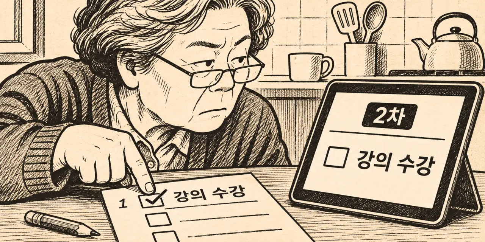

기획서에는 “모든 이력은 보존한다”는 한 줄이 있었다. 사용자가 같은 과정을 두 번째로 시작하면 첫 회차에서 체크한 항목까지 다시 보여 줘야 할까? 첫 회차를 완료했다는 사실과 날짜만 남으면 될까? 그 차이로 테이블 설계안이 네 개나 나왔다.

## 지난 회차에서 무엇을 다시 볼 수 있어야 하나

수행, 결과, 실패, 적립, 방문 기록은 이미 각 이력 테이블에 남았다. 확인해야 했던 건 따로 있었다. 지난 회차를 다시 열어 그날의 체크 표시와 묶음 완료 시각, 제외 범위, 날짜별 제시 목록을 그대로 보는 화면이 있는가. 그런 화면은 없었다. 진행 중에 그만둬도 그때의 체크 표시를 복원할 필요가 없었다.

처음 낸 안은 회차마다 항목 행을 만드는 것이었다. `sessionId`를 볼 때마다 ‘이 행은 몇 회차의 이력인가’부터 생각했다. 1회차 행과 2회차 행을 따로 두면 지난 상태를 조회하기는 쉽다. 그런데 정작 화면에서 필요한 건 ‘이 항목을 **이번 회차**에 완료했는가’ 하나였다.

## 새 회차가 시작돼도 항목을 초기화하지 않는다

현재 상태 행에 마지막으로 완료한 회차 번호를 남겨 두면 이 질문에 답할 수 있다.

```sql
-- 이번 회차 완료
completed_session_id = current_session_id

-- 이번 회차 미완료
completed_session_id <> current_session_id
```

1회차에 완료한 항목에는 1이 남는다. 사용자가 2회차를 시작하면 현재 회차는 2다. 두 번호가 다르므로 이전 행을 지우지 않아도 이번 화면에서는 미완료로 보인다. 아직 한 번도 완료한 적 없는 항목도 미완료다. 위 비교는 저장된 회차 번호가 있는 경우를 나타낸 것이다.



대신 2회차에서 같은 항목을 완료해 마지막 번호가 2로 바뀌면, 이 행 하나로는 1회차 당시의 체크 상태까지 조회할 수 없다. 여기까지 보니 어느 설계안이 어떤 화면을 전제로 했는지 구분할 수 있었다.

| 그때 세운 안 | 폐기한 이유 |
| --- | --- |
| 별도 `session_item` | 과거 회차의 항목 상태를 여는 화면이 없다 |
| 기존 테이블을 회차마다 초기화 | 중단 시 복원이 필요 없는데 초기화 시점 관리가 생긴다 |
| 별도 `session_group` | 묶음 완료 시각을 회차별로 요구하는 화면이 없다 |
| 회차 마커 컬럼 | 채택 |

결국 새로 만든 건 계획과 회차 테이블이었다. 기존 이력 테이블은 그대로 두고 현재 상태 행에 회차 마커를 더했다.

## 설계안이 네 번 오간 이유

초반에는 안을 비교할 때마다 기준도 바뀌었다. 그때 던진 질문을 나란히 놓고 보니 처음 세 질문은 전부 같은 곳으로 돌아왔다.

| 그때의 질문 | 그 질문의 답 |
| --- | --- |
| 가장 정합적인 도메인 모델은 무엇인가 | 회차 자식 테이블 |
| 기존 이력을 건드리지 않는 구조는 무엇인가 | 회차 자식 테이블 |
| 묶음 완료 시각까지 회차별로 보존하려면 | 회차 자식 테이블 |
| 지금 요구사항을 가장 적은 변경으로 구현하려면 | 기존 테이블 + 회차 마커 |

AI에게 물어볼 때도 비슷했다. 과거 상태를 보존할 수 있으면 좋겠다는 답을 읽고, 다음 질문에서는 이미 보존하기로 한 것처럼 테이블을 비교했다. 그래서 `session_group`이나 `session_item`을 빼면 무엇을 못 하게 되는지부터 다시 적었다.

| 이번에 확인한 것 | 답 |
| --- | --- |
| 지금 조회하는 값 | 현재 회차의 진도 |
| 지난 회차에서 다시 보는 값 | 과정을 끝낸 회차와 그 날짜 |
| 기존 이력에 남는 값 | 수행, 결과, 실패, 적립, 방문 기록 |
| 이번 화면에서 쓰지 않는 값 | 지난 회차의 항목과 묶음 상태 스냅샷 |

묶음 완료일을 되살릴 때 쓸 테이블을 제안하려면, 그 완료일을 누가 어디서 볼지부터 답할 수 있어야 했다. 이번에 그 답이 나온 건 현재 진도와 완료 날짜까지였다.

나중에 2회차와 3회차의 상세 진도를 한 화면에서 비교해야 한다면 판단도 달라진다. 그때는 기존 사건 기록으로 두 상태를 복원해 본다. 화면에 필요한 상태가 빠져 있거나 조회 비용이 크면 회차별 테이블을 다시 검토할 이유가 생긴다.
