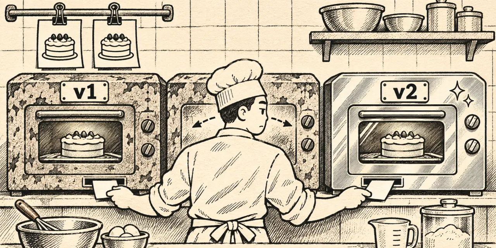

주문 API가 세 개의 Pod에서 돌아가고 있다. 새 버전을 올리는 동안에도 고객은 주문 버튼을 누른다. 새 Pod 하나가 준비됐을 때 들어온 첫 주문, 그다음 주문은 각각 어느 버전이 받을까?

## 롤링 배포에서는 두 버전이 함께 주문을 받는다

아래는 주문 Deployment에서 교체 속도를 정하는 설정이다.

```yaml
spec:
  replicas: 3
  strategy:
    type: RollingUpdate
    rollingUpdate:
      maxSurge: 1
      maxUnavailable: 0
```

유지할 Pod 수는 3개다. `maxSurge: 1`이므로 교체를 시작할 때 새 Pod 하나를 추가로 띄울 수 있다. 새 Pod가 준비되어 가용 복제본 수를 채우면 기존 Pod 하나를 줄일 수 있다. 이 과정을 반복하며 버전을 교체한다. [Kubernetes의 RollingUpdate 설정](https://kubernetes.io/docs/concepts/workloads/controllers/deployment/#rolling-update-deployment)

첫 새 Pod가 준비됐을 때는 구버전 Pod도 아직 남아 있다. 둘 다 같은 Service의 요청을 받을 수 있으니, 연달아 들어온 두 주문이 서로 다른 버전에서 처리될 수 있다.



새 버전이 DB에 새로운 주문 상태를 기록한다면 구버전도 그 상태를 읽을 수 있어야 한다. Pod 수를 유지하는 설정은 이 호환성까지 검사해 주지 않는다.

## 블루그린 배포에서는 새 요청의 목적지를 바꾼다

이번에는 새 Pod 세 개를 기존 Pod 옆에 따로 띄운다. 기존 Deployment가 blue, 새 Deployment가 green이다. green이 준비돼도 운영 Service의 selector가 blue를 가리키는 동안에는 고객의 주문을 blue가 받는다. 그 사이 green에 테스트 요청을 보내 볼 수 있다. 응답을 확인한 뒤 selector를 green으로 바꾸면 Kubernetes가 EndpointSlice를 갱신한다. 새 연결은 이 변경이 반영된 경로부터 green으로 들어온다. [Kubernetes Service와 selector](https://kubernetes.io/docs/concepts/services-networking/service/#defining-a-service)

전환 직전에 blue가 받은 주문은 여전히 처리 중일 수 있다. 그래서 green이 첫 주문을 받았다는 사실만으로 blue를 바로 내리기 어렵다. 기존 연결과 요청이 끝날 시간을 주려면 두 환경을 함께 운영할 자원이 필요하다.

## 되돌릴 때는 이미 쓴 데이터도 확인한다

새 버전에서 오류가 늘었다고 하자. 롤링 배포에서는 이전 Pod 템플릿으로 다시 교체하고, 블루그린에서는 blue가 살아 있다면 Service의 목적지를 되돌릴 수 있다. 어느 쪽이든 새 버전이 이미 저장한 주문은 DB에 남는다. [Kubernetes Deployment 롤백](https://kubernetes.io/docs/concepts/workloads/controllers/deployment/#rolling-back-a-deployment)

그래서 롤백을 확인할 때는 이전 버전에서 새 주문을 한 건 조회해 본다. Pod를 모두 되돌려도 그 주문의 상태를 읽지 못하면 고객에게는 여전히 장애다. 롤링 배포에서는 두 버전이 섞이는 동안부터 이 조건이 필요하고, 블루그린 배포에서는 green에서 blue로 되돌아가는 순간에도 필요하다.
