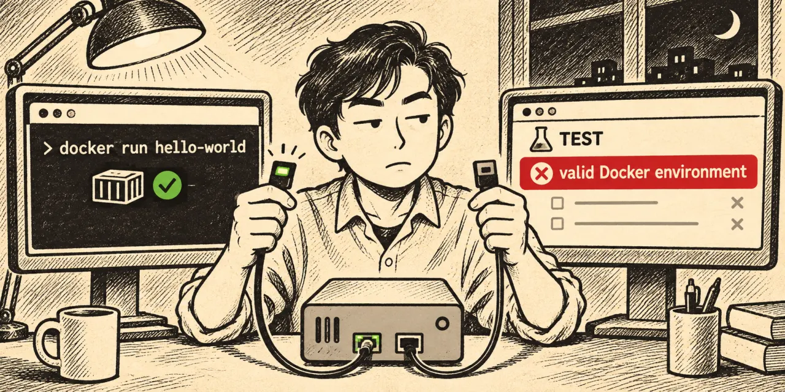

## 환경을 의심할까, 코드를 의심할까

회원가입 E2E 테스트가 실패했습니다.  
Testcontainers가 실행되지 않았습니다.

```
Could not find a valid Docker environment
```

에러 메시지의 의미는 명확했습니다.
"Docker Engine과 정상적인 프로토콜 통신이 성립하지 않는다."

터미널에서 `docker ps`를 쳐봤는데요, 정상이었습니다.
`docker run hello-world`도 문제없이 돌아갔습니다.

hello-world 컨테이너는 떴는데, Testcontainers는 `valid Docker environment`를 못 찾겠다고 합니다.
같은 Docker Engine을 두고 CLI는 붙었고, 회원가입 테스트는 연결조차 못 했습니다. 지금 돌아보면 여기서 두 클라이언트가 Docker에 붙는 방식부터 비교했어야 했습니다.



이 시점에서 두 가지 방향 중 하나를 선택해야 했습니다.

- **환경을 의심하는 방향**: Docker와 Testcontainers 사이의 통신 경로를 추적합니다.
- **코드를 의심하는 방향**: 테스트 설정 구조에 문제가 있다고 보고 코드를 수정합니다.

저는 후자를 골랐어요.
이유가 있었는데요.

제공된 testFixtures 설정이 `@Configuration` + `companion object init` 구조였기 때문입니다.
이 구조는 Spring의 ApplicationContext lifecycle과 무관하게 클래스 로딩 시점에 Docker 컨테이너를 기동합니다.
테스트가 아니어도 컨테이너가 뜹니다. 병렬 테스트에서 리소스 충돌 위험이 있습니다. Bean lifecycle과 무관하게 외부 리소스를 점유할 수 있습니다.

구조가 의심스러우니까 이게 원인이라고 믿고 싶었어요.

그래서 AI에게 말했습니다.

`Q: 테스트 인프라의 제어권이 모듈 경계를 넘어가고 있는 것 같은데 맞아?`  

`A: 네 맞습니다, @TestConfiguration + @Import 방식으로 명시적으로 로딩하도록 변경하겠습니다.`

환경을 확인하기 전에 코드 수정부터 시작하면서 조사 범위가 넓어졌습니다.


## 원인을 확인하지 않은 채 커진 수정 범위

Claude에 코드 수정 중심의 요청을 전달했습니다.  
내가 "코드 문제"라는 전제를 제공하자, 그 전제 안에서 할 수 있는 모든 것을 시도했습니다.  

- `@Configuration`을 `@TestConfiguration`으로 전환
- `companion object eager start()`를 `by lazy`로 변경
- `System.setProperty` 제거
- `@Container + @DynamicPropertySource`로 전환
- docker-java 버전 강제 업그레이드
- Testcontainers 버전 변경

하나를 바꾸면 다른 곳에서 에러가 났습니다.  
에러를 잡으면 또 다른 에러가 나왔습니다.  

Claude은 매번 "이렇게 수정하면 해결될 것입니다"라고 했고,   
저는 매번 "그래 끝까지 가보는 거야"라고 했습니다.

돌이켜보면 이 시점에서 이미 이상 신호가 있었습니다.  

수정 한 번으로 끝나지 않고 꼬리에 꼬리를 무는 수정이 이어진다면,   

전제 자체를 의심했어야 했습니다.


## BOM 기준으로 의존성 호환성 확인하기


코드 수정으로 해결이 안 되니, 다음 수순으로 docker-java를 수동 업그레이드했습니다.

```kotlin
// 추가된 docker-java 의존성
testImplementation("com.github.docker-java:docker-java-api:3.5.1")
```

이 버전은 누가 정하고 있었을까요?
Spring Boot 3.4.4의 Dependency Management BOM에는 Testcontainers 1.20.6과 JUnit Jupiter 5.11.4가 있습니다. docker-java 항목은 없습니다.

docker-java 버전은 Testcontainers가 정합니다.
Testcontainers core 1.20.6의 POM이 `docker-java-api`와 `docker-java-transport-zerodep`를 3.4.1로 선언합니다. Boot가 고른 Testcontainers를 쓰면 docker-java 3.4.1이 전이 의존성으로 따라옵니다.

그런데 `docker-java-api`만 3.5.1로 올리면, Testcontainers 1.20.6이 선언한 조합에서 한 모듈만 벗어납니다.
추가한 줄은 `docker-java-api` 하나뿐이라, 같은 POM이 선언한 `docker-java-transport-zerodep` 3.4.1은 이 줄로 바뀌지 않습니다.

그때 `context7에서 현재 버전과 일치하는 버전으로 체크 부탁해`라고 요청했다면, 적어도 docker-java 버전을 바꾸기 전에 그 버전이 어디서 오는지부터 확인했을 겁니다.
BOM이 고른 Testcontainers와, 그 Testcontainers가 선언한 docker-java 조합을 신뢰했어야 했습니다.

## 22 files changed, AM 5시


docker-java 업그레이드도 효과가 없었습니다.  
이쯤 되면 의심해야 할 것은 코드가 아니라 전제였는데요,   
저와 Claude은 이미 너무 깊이 와 있었습니다..

코드 전반에 걸쳐 Testcontainers 설정 방식을 통일하기 시작했습니다.  

`@TestConfiguration`, `@Container`, `System.setProperty`,  `withReuse(true)`, testFixtures 방식이 혼재되어 있었고, 

이걸  `@Container + @DynamicPropertySource` 하나로 단일화하려 했습니다.

좋은 취지인 것은 알지만, Testcontainers 패턴은 프로젝트 내에서 단일화하는 것이 맞습니다.  

하지만 지금 이 시점에서 해야 할 일은 아니였다는점.

이게 문제는 "Docker 환경을 못 찾겠다"였습니다.   
그런데 어느새 "Testcontainers 설정 구조 전체 리팩토링"을 하고 있었습니다.  

> 변경된 파일: 22 files changed.
> 현재시각: AM 5시

아차 싶었습니다..

> "문제를 해결하고 있는 게 아니라, 문제를 키우고 있다는 것을."


## 진짜 원인은 뭐였을까?


해가 뜨고 나서야 정신을 차렸습니다.  
처음으로 돌아가서, 이번에는 환경부터 확인했습니다.  

AI에게 한 줄만 던졌습니다.  

> Docker Desktop의 버전과 현재 프로젝트 환경이 충돌하는 게 있는지 확인해.

당시 환경은 이랬습니다.

- Docker Desktop에 들어 있던 Docker Engine 29.1.2
- docker-java 3.4.1 (Testcontainers 1.20.6이 선언한 버전)

Docker Desktop을 Engine 28 계열로 downgrade하니,
무슨 문제였는지 기억조차 흐려질 정도로 빠르게 해결되었습니다.

밤새 22개 파일을 수정한 그 모든 작업은 필요 없었습니다.

> CLI 정상 ≠ 라이브러리 정상

같은 엔진에서 CLI는 성공했고, Testcontainers는 실패했습니다. Docker Desktop을 내리자 E2E가 돌아왔습니다. 여기까지가 제가 본 사실입니다.

둘의 차이로 의심하는 지점은 API 버전입니다.
Docker 공식 버전표에서 Engine 29.1은 API 1.52까지 지원하고, 받아들이는 최소 API는 1.44입니다. 28 계열의 최소 API는 1.24입니다.
Docker CLI는 데몬과 API 버전을 협상해 둘 다 지원하는 가장 높은 버전을 씁니다.
docker-java가 1.44보다 낮은 API 버전으로 요청했다면 29.1.2는 거절하고 28 계열은 받아들였을 것입니다. CLI 성공, Testcontainers 실패, downgrade 후 복구가 모두 이 가설로 설명됩니다.

다만 가설입니다.
당시 로그에서 docker-java가 요청한 경로의 API 버전(`/v1.xx/info` 같은)과 데몬의 응답 본문을 확인하지 않았습니다.
downgrade는 최소 API만 바꾼 게 아니라 Docker Desktop과 엔진 전체를 바꿨습니다. 그래서 복구만으로는 버전 거절인지, 다른 엔진 차이인지 갈라지지 않습니다.
처음에 비교했어야 했던 접속 방식(CLI의 context와 Testcontainers가 고른 소켓 경로)도 함께 확인해야 원인을 하나로 좁힐 수 있습니다.


## AI는 언제 멈춰야 할까?

이번 경험을 복기하면, 잘못된 것은 AI가 아니라 제 플래닝이었습니다.

AI는 내가 제공한 전제 안에서 가능한 모든 해결책을 시도합니다.  

"코드 문제"라는 전제를 주면 코드 안에서 답을 찾으려 합니다.   
심지어 점점 더 많은 파일을 수정하죠.  

수정 범위가 커졌지만 원래의 연결 실패는 해결되지 않았습니다.

원인을 코드로 한정한 요청 때문에 환경 호환성 검토가 늦어졌습니다.

올바른 플래닝은 이랬어야 해요

1. 환경 확인 (`docker info`, Docker Desktop 버전)
2. 네트워크/소켓 직접 테스트 (docker-java가 사용하는 소켓 경로)
3. 라이브러리 버전 호환성 확인 (BOM과 전이 의존성 기준)
4. 그 다음에 코드 수정

저는 4번부터 시작했어요.
환경 확인을 먼저 했다면 불필요한 코드 수정을 줄일 수 있었을 것입니다.

"과잉"이다 싶을 때 던져야 할 질문이 있습니다.

- "이 수정은 과한가?"
- "문제의 범위를 벗어나고 있지 않은가?"

이 질문을 던지고 멈추는 것이, 끝까지 가보는 것보다 훨씬 더 중요했습니다.

`그렇지 않으면, 파급력을 감당할 수 없게 됩니다.`

> 플래닝을 1번부터 출발하게끔 통제할 것.
> 의도와 달리 모호한 답변이 나오지 않고, 의도대로 조율하게 된다면,
> 통제 성공의 객관적인 지표가 될 것입니다.


## TL;DR

- Docker 연결 실패는 코드 문제가 아니었습니다. Docker Engine을 29.1.2에서 28 계열로 내리자 해결됐습니다.
- docker-java의 요청 API 버전이 29.1 계열의 최소 API 1.44보다 낮았다는 가설은 요청 경로와 데몬 응답으로 아직 확인하지 않았습니다.
- BOM이 고른 Testcontainers와, 그 Testcontainers가 선언한 docker-java 조합을 신뢰했어야 했죠.
- AI에 수정을 요청할 때도 재현 조건과 검증 범위를 명시해야 합니다.

> "AI를 멈추는 판단"의 중요성을 깨달았습니다.


### 다음에는

회원가입 E2E를 다시 돌릴 수 있게 됐지만, 테스트 환경에 관해서는 세 가지 질문이 남았습니다.

- Integration과 E2E를 어떻게 구조적으로 분리할 것인가?
- Testcontainers 공통 베이스를 만들 것인가?
- CI 환경에서 Docker 전략은 어떻게 가져갈 것인가?

## 참고자료

- [Spring Boot 3.4.4 spring-boot-dependencies POM](https://repo.maven.apache.org/maven2/org/springframework/boot/spring-boot-dependencies/3.4.4/spring-boot-dependencies-3.4.4.pom): Testcontainers 1.20.6, JUnit Jupiter 5.11.4 관리. docker-java 항목 없음
- [Testcontainers 1.20.6 POM](https://repo.maven.apache.org/maven2/org/testcontainers/testcontainers/1.20.6/testcontainers-1.20.6.pom): docker-java-api, docker-java-transport-zerodep 3.4.1 선언
- [Docker Engine API 버전표](https://docs.docker.com/reference/api/engine/): Engine 29.1의 API 1.52와 최소 API 1.44, CLI의 API 버전 협상
