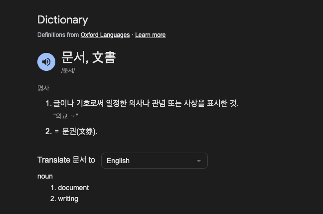
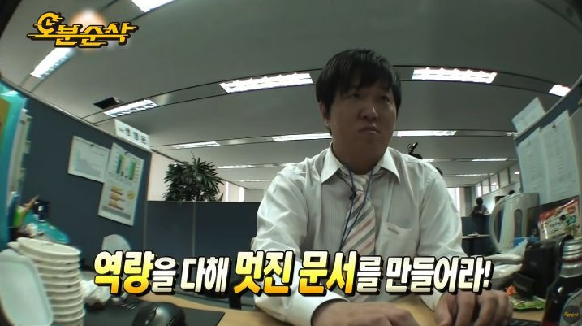
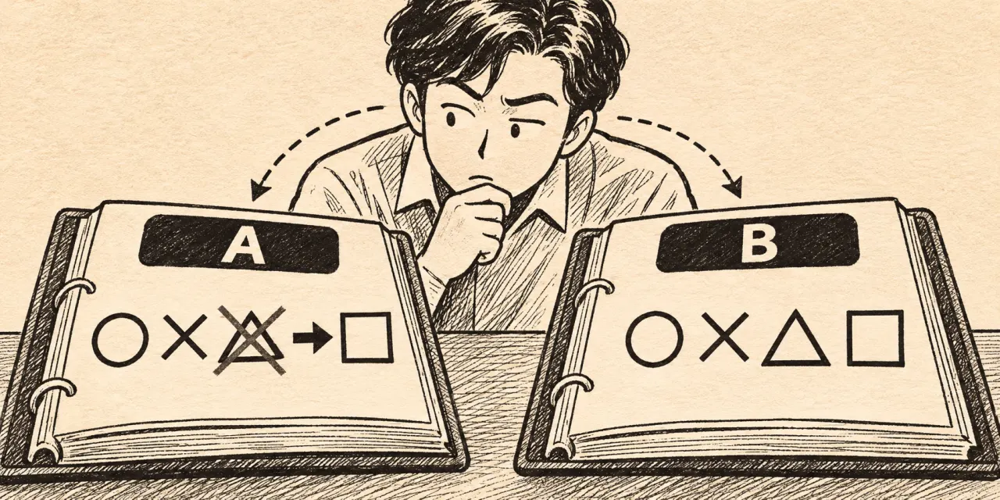

요구사항 정의서를 쓰다가 기획자와 QA가 같은 문서에서 서로 다른 답을 찾고 있다는 걸 알았습니다. 기획자는 정책이 결정됐는지, QA는 경계에서 어떤 동작을 기대해야 하는지 알고 싶어 했습니다. 구현을 맡은 사람에게는 두 답이 어떻게 연결되는지도 필요했습니다.

QA가 예외 조건 하나를 확인할 때마다 데이터 구조와 운영 절차까지 읽어야 한다면, 조건이 문서에 적혀 있어도 찾기 어렵습니다.

한 문서에 다 담고 싶은 마음은 이해합니다. 구현할 사람에게는 데이터 구조가, 새로 합류한 사람에게는 전체 구조와 맥락이 필요하니까요.

## 요구사항과 설계 문서에 나눠 적은 것

“이 문서를 읽고 누가 어떤 행동을 해야 하는가?” 저는 정책이 바뀌었을 때 무엇을 고치고, 이전 설계의 이유가 궁금할 때 어디를 열지부터 나눴습니다.

- 요구사항 정의 문서 = 무엇을 해야 하는가
- 설계 문서 = 어떻게 구현할 것인가
- ADR = 왜 그렇게 선택했는가
- 운영 문서 = 장애 시 무엇을 해야 하는가

시스템 구조를 처음 보는 사람에게는 서비스가 어떻게 연결되는지 보여 주는 그림이 필요합니다. 장애가 난 서비스를 맡은 사람은 배포된 위치와 대응 절차를 찾습니다. 같은 시스템을 설명해도 먼저 보여 줄 게 달라집니다.

| 상황 | 효과적인 문서 유형 | 목적 |
|------|------------------|------|
| 시스템 구조를 빠르게 파악해야 하는 경우 | Context / Container / Component Diagram | 외부 관계와 전체 구조 이해 |
| 특정 서비스의 내부 동작을 이해해야 하는 경우 | Component Diagram / Code 수준 설명 | 세부 구현 흐름 파악 |
| 정합성과 예외 처리가 중요한 도메인 | 상태 머신 / LLD / ADR | 상태 전이 규칙과 설계 의도 명확화 |
| 설계 결정의 근거를 공유해야 하는 경우 | ADR | 의사결정의 이유 기록 |
| 협업 전반을 위한 공통 이해가 필요한 경우 | Overall Architecture / HLD | 서비스 구조와 책임 정의 |
| 운영 및 장애 대응이 필요한 경우 | Deployment Diagram / Runbook | 배포 구조 및 대응 절차 공유 |

## 아직 결정하지 못한 예외 정책

문서를 처음부터 다 갖춰야 한다고 생각하면 쓰기 전부터 부담스럽습니다. 요구사항 정의서 한 장에서도 QA와 개발자가 먼저 확인할 수 있는 게 있습니다.

어떤 기능에 관한 정책인지 짧게 쓰고, 예외에서 어떻게 동작해야 할지 아직 정하지 못했다면 그 대목을 표시해 둡니다. 빈칸만 남으면 구현을 맡은 사람이 그 자리에서 규칙까지 정해야 합니다. 나중에 답이 정해졌을 때 QA도 어디를 다시 볼지 알아야 하고요.

운영 중에 예외 정책이 하나 생겼다고 해 봅시다. 요구사항 문서에서 기존 규칙을 찾아 한 줄 고치면 QA도 새 경계 조건을 확인할 수 있습니다. 같은 정책을 설계 문서와 운영 문서에 각각 옮겨 적었다면, 다음 사람은 어느 쪽이 최신인지부터 물어야 합니다.

기획자가 정한 정책과 QA가 확인할 예외는 요구사항 정의서에서 같이 볼 수 있어야 합니다. 개발자가 예전 구현을 왜 골랐는지 찾을 때는 ADR을 열면 되고요. 예외 하나를 고칠 때마다 두 문서를 펴 놓고 어느 쪽이 맞나 따지는 일은 피하고 싶습니다.
