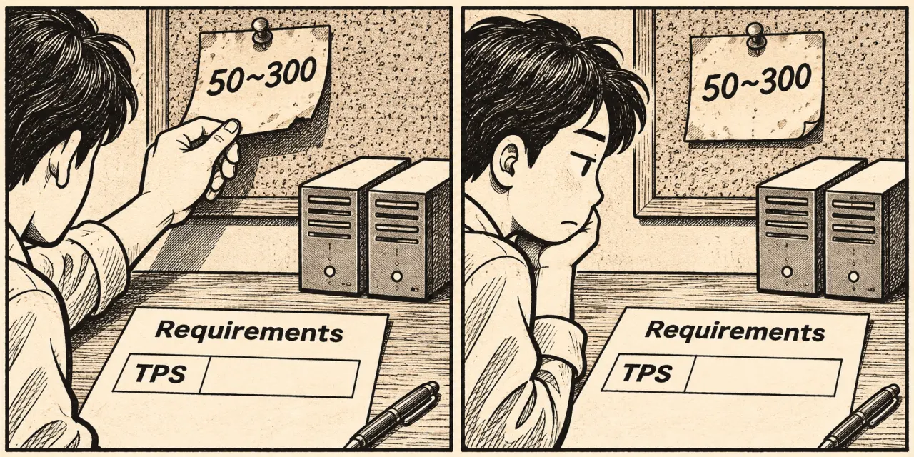

## 변경 비용을 기준으로 설계를 검토하다

Loopers Round 1에서는 구현보다 의존 관계와 변경 범위를 검토하는 데 많은 시간을 썼다. 모든 환경에 통하는 구조를 찾기보다, 현재 확인된 요구사항에서 어떤 비용을 줄이고 어떤 비용을 감수할지 정리했다.

새로 합류한 사람이 이해하기 쉬운 구조, 현재 구현이 빠른 구조, 향후 변경이 쉬운 구조는 항상 일치하지 않는다. 추상화를 늘리면 변경 지점을 분리할 수 있지만 지금 코드를 이해하고 수정하는 비용도 늘 수 있다.

팀에서 이런 변경을 제안할 때는 개인 작업으로 감당하기보다 문제와 기대 효과를 기록하고 우선순위와 단계별 적용 범위를 합의할 필요가 있다.

## 이번 과제에서 확인하지 못한 조건

Redis와 Kafka는 사용할 수 있었지만 예상 TPS와 도메인의 변경 빈도는 명확하지 않았다. 이전 서비스에서 경험한 평시 TPS 50~300이나 일시적인 트래픽 증가를 이번 과제의 확정 조건으로 삼을 수는 없었다.

예전 서비스의 TPS를 가져와도 이 과제에서 무엇을 나눠야 할지는 알 수 없었다. 당장 확인할 수 있는 건 저장소를 바꿀 때 어느 코드까지 같이 바뀌느냐였다.

## 의존 방향을 정한 이유

이번 과제에서는 도메인 쪽으로 의존 방향을 맞췄다.

- interfaces → application → domain
- infrastructure → domain

도메인 규칙 하나를 고쳤을 때 DB까지 연결해야 하는 테스트는 피하고 싶었다. 반대로 저장소만 바꿨는데 규칙을 검사하는 테스트까지 다시 써야 한다면, DB 연결 방식이 그쪽까지 들어온 셈이다. 그래서 저장소는 포트 뒤에 뒀다.

## 구현 도구와 관계없이 정해야 할 것

AI로 코드 초안을 작성하더라도 트랜잭션 범위, 실패 처리, 외부 시스템과의 계약은 요구사항을 기준으로 검토해야 한다. 생성된 코드의 양보다 변경 시 함께 수정해야 하는 범위와 검증 가능성을 판단 기준으로 삼았다.

이번 과제에서는 다음 원칙을 적용하기로 했다.

- 도메인 규칙을 외부 기술의 구체 구현과 분리한다.
- 트랜잭션 범위를 유스케이스에서 명시한다.
- Redis와 Kafka 같은 외부 시스템은 포트를 통해 연결한다.
- 이벤트가 필요한 요구사항이 확인되기 전에는 동기 흐름을 유지한다.
- 향후 분리가 필요할 때 변경할 지점을 추적할 수 있게 한다.

## 동작 검증과 의존 규칙 검증

기능 테스트가 통과해도 의도하지 않은 의존 관계가 생길 수 있다. 기능의 기대 결과와 아키텍처 규칙은 별도로 검사할 필요가 있다.

| 방법 | 확인 시점 | 한계 |
| --- | --- | --- |
| 주석 | 코드를 읽을 때 | 규칙 준수를 자동 검사하지 못한다 |
| 코드 리뷰 | 변경 검토 시 | 검토 범위와 판단에 따라 누락될 수 있다 |
| ArchUnit | 테스트 실행 시 | 명시한 규칙만 검사한다 |
| 멀티모듈과 internal | 컴파일 시 | 모듈 경계와 가시성으로 표현한 규칙에 한정된다 |

반복해서 위반되는 규칙은 자동 검사 대상으로 검토한다. 강제 수단을 늘리는 비용과 방지하려는 변경 위험을 함께 비교해야 한다.

## 지금 분리해야 하는가

현재는 추가 분리를 서두르지 않기로 했다. 다음 현상이 반복되면 경계를 다시 검토한다.

- 기능 하나의 변경이 관련 없는 파일까지 전파된다.
- 실행 흐름을 설명하거나 추적하는 비용이 계속 커진다.
- 도메인 규칙 테스트에 저장소 구현이 불필요하게 필요하다.
- 트랜잭션 처리가 여러 계층에 분산된다.

한 기능을 고치느라 파일을 여러 개 열었더라도 전부 같은 이유로 바뀌었다면 일단 같이 둔다.

다음 기능을 붙일 때는 어떤 파일을 함께 고쳤는지, 규칙 하나를 확인하는 데 DB까지 띄워야 했는지를 보려 한다. 예상 TPS도 모르는 지금은 그 두 가지가 구조를 다시 살펴볼 가장 가까운 단서다.
