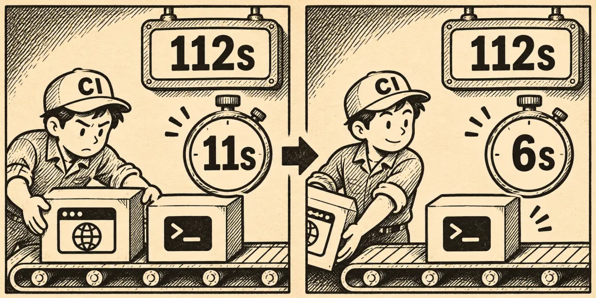

CI 로그를 열었더니 Playwright 설치가 176초였다. 전체 job이 4분 27초였으니 66%다. 여기를 줄이면 되겠다고 적었다.

틀렸다. 176초가 무엇 때문인지 그 로그로는 알 수 없었고, 다시 재보니 재현되지도 않았다.

## 스텝 하나에 여덟 개가 들어 있었다

GitHub Actions는 스텝 단위로만 시간을 기록한다. 명령을 몇 개 이어 붙이든 로그에는 한 줄로 나온다.

당시 workflow는 이랬다.

```yaml
- name: Install Playwright Chromium when used
  run: pnpm exec playwright install --with-deps chromium
- name: Run quality checks
  run: pnpm check
```

`pnpm check`는 이런 체인이다.

```
architecture:check && test && test:storybook && lint && typecheck
  && build && build:storybook && test:e2e:prebuilt
```

여덟 개가 한 스텝이라 로그에는 총합 65초만 남는다. 그중 무엇이 느린지 알 수 없다.

Playwright 쪽도 같다. `install --with-deps`는 **apt 시스템 의존성 설치와 브라우저 다운로드를 함께** 한다. 176초가 어느 쪽인지 가를 방법이 없다.

브라우저 다운로드에 캐시를 붙일지 결정하려면 먼저 이 176초에서 다운로드가 차지한 시간을 알아야 했다.

## 명령을 바꾸지 않고 스텝만 나눴다

검증 항목과 순서는 그대로 두고 스텝만 갈랐다. `pnpm check`의 여덟 개를 여덟 스텝으로, Playwright 설치를 둘로.

```yaml
- name: Install Playwright system deps
  run: pnpm exec playwright install-deps chromium
- name: Download Playwright Chromium
  run: pnpm exec playwright install chromium
- name: Architecture check
  run: pnpm architecture:check
- name: Unit and DOM tests
  run: pnpm test
# ... 나머지 여섯 개
```

같이 넣은 것 셋.

`timeout-minutes`로 멈춘 job이 무한히 기다리지 않게 했다. `concurrency` 그룹에는 ref를 넣었다. 넣지 않으면 같은 workflow의 main push까지 취소된다. 취소 여부도 이벤트로 갈랐다. PR은 다음 push가 답이지만 main push는 그 자체가 기록이다.

```yaml
concurrency:
  group: ${{ github.workflow }}-${{ github.ref }}
  cancel-in-progress: ${{ github.event_name == 'pull_request' }}
```

## 176초는 재현되지 않았다

같은 커밋에서 네 번 돌렸다. 첫 실행은 pnpm 캐시가 없는 상태라 통계에서 뺐다.

| 스텝 | R1 | R2 | R3 | 중앙값 |
| --- | ---: | ---: | ---: | ---: |
| Install dependencies | 2 | 2 | 2 | 2 |
| Install Playwright system deps | 14 | 28 | 13 | 14 |
| Download Playwright Chromium | 11 | 11 | 11 | **11** |
| Architecture check | 1 | 1 | 0 | 1 |
| Unit and DOM tests | 20 | 17 | 20 | **20** |
| Storybook tests | 9 | 10 | 8 | 9 |
| Lint | 5 | 4 | 5 | 5 |
| Typecheck | 4 | 4 | 4 | 4 |
| Build | 11 | 10 | 10 | 10 |
| Build Storybook | 3 | 4 | 4 | 4 |
| E2E | 14 | 14 | 14 | 14 |
| **job 전체** | 111 | 130 | 112 | **112** |

Playwright 설치는 `install-deps` 14초와 다운로드 11초로 갈렸다. 합쳐도 25초다. 176초는 네 표본 어디에도 없었다.

그리고 다운로드 11초는 **세 번 모두 11초**다. 편차가 0이다. 여기에 캐시를 붙여도 최대 11초를 아끼는데 복원 비용을 빼면 남는 게 없다. Playwright 문서가 브라우저 캐시를 권장하지 않는 이유와 측정이 맞아떨어진다. 캐시는 후보에서 내렸다.

setup 구간은 27초, 검증 체인은 65초였다. 검증 항목과 실행 횟수는 유지하기로 했으므로 줄일 수 있는 건 setup 27초이고 그중 25초가 Playwright다.

## 채택 기준을 먼저 고정했다

실험 전에 무엇을 만족해야 채택할지 적었다. 결과를 보고 기준을 만들면 어떤 결과든 성공이 된다.

```
기능 검증 동일 (Storybook 18개와 E2E 12개 통과)
AND setup 중앙값이 측정 편차보다 크게 감소
AND job 전체 중앙값도 감소
```

다운로드 스텝은 줄어도 job 전체가 평소 범위 안에서 끝날 수 있다. 그렇게 나오면 다운로드 시간만 줄었다고 기록하기로 했다.

## 실험: 받는 범위를 쓰는 범위에 맞췄다

다운로드 로그를 보니 셋을 받고 있었다.

```
Chrome for Testing 151.0.7922.34
FFmpeg (playwright ffmpeg v1011)
Chrome Headless Shell 151.0.7922.34
```

이 저장소는 channel 지정 없이 headless로만 쓴다. Playwright 프로젝트도 `devices['Desktop Chrome']` 하나이고, Storybook 브라우저 테스트도 `headless: true`다. 전체 Chrome for Testing을 받을 이유가 없다.

```yaml
run: pnpm exec playwright install chromium --only-shell
```

같은 커밋에서 세 번 돌렸다.

| 항목 | 중앙값 | 기준 |
| --- | ---: | ---: |
| Download Chromium | **6s** | 11s |
| Install Playwright system deps | 15s | 14s |
| setup 합 | 23s | 27s |
| **job 전체** | **112s** | **112s** |

받는 대상도 실제로 줄었다.

```
Chrome for Testing 151.0.7922.34   ← 사라짐
FFmpeg (playwright ffmpeg v1011)
Chrome Headless Shell 151.0.7922.34
```

기능 검증은 세 번 모두 같았다. 단위 테스트와 통합 테스트를 합해 375개, Storybook 18개, E2E 12개가 통과했다.

## 그런데 채택하지 않았다

다운로드는 11초에서 6초로 줄었다. 절반이다. 그런데 job 전체는 112초에서 112초다.



setup 합은 27초에서 23초로 줄었지만, 그 4초는 `install-deps`의 변동 범위 안에 있다. `install-deps`는 13초에서 28초 사이를 오간다. 4초는 그 안에 묻힌다.

미리 정한 세 기준 중 셋째를 넘지 못했다. 그래서 되돌렸다.

되돌리면서 하고 싶었던 말이 하나 있었다. 처음 본 176초가 다운로드 쪽 꼬리 위험이고, 받는 양을 절반으로 줄이면 그 위험이 준다는 것이다. 쓰지 않았다. 근거가 없다.

- 그 값은 스텝을 나누기 전 단일 스텝에서 나왔다
- 시스템 의존성과 브라우저 다운로드를 구분할 수 없다
- 현재 조건에서 재현되지 않는다
- 다운로드 용량이 줄면 이상치 확률이 낮아지는지도 재지 않았다

넷 다 "모른다"이지 "그렇다"가 아니다.

실험 커밋은 히스토리에 남기고 복구를 별도 커밋으로 뒀다. 다운로드가 실제로 병목이 되는 날 이 측정이 출발점이 된다.

## 부분이 빨라져도 전체는 그대로일 수 있다

같은 프로젝트 7주차에 비슷한 걸 겪었다. 가장 긴 LCP 구간을 줄였는데 전체 성능 점수는 나빠졌다. 이번엔 방향이 반대다. 국소 시간은 절반이 됐는데 전체는 움직이지 않았다.

7주차에는 화면을, 이번에는 PR에서 기다리는 시간을 바꾸고 싶었다. 브라우저 다운로드는 11초에서 6초로 줄었지만 job은 여전히 112초였다. 실험 커밋을 되돌린 이유다. 처음의 176초가 또 찍힌다면 이제는 시스템 의존성 설치와 다운로드 시간을 따로 볼 수 있다.
