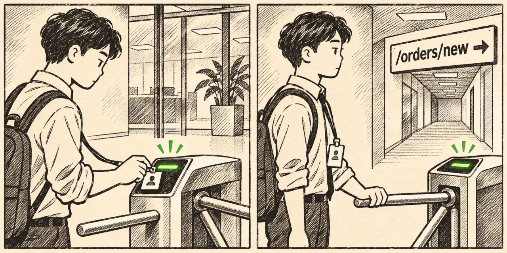

로그인과 상품 검색 중 하나에 브라우저 테스트를 붙인다면 무엇을 고를까. 이 프로젝트에서는 실제 사용 기록을 대신하는 시드 로그를 세션별로 세고, 이미 통합 테스트가 검증하는 흐름을 먼저 뺐다.

이번 주에는 인증을 붙이면서 E2E 대상을 정해야 했다. 통합 테스트 하나가 200ms면 브라우저 테스트는 20초다. 100배 차이는 실행 시간만의 이야기다. 더 큰 비용은 문구 하나가 바뀔 때 고칠 곳이 몇 군데인가에 있다.

30일치 시드 이벤트 22,427건을 펼쳐 보니, 목록에서 정렬을 여러 번 바꾼 사람은 이벤트도 여러 건 남겼다. 어느 화면을 많이 썼는지 비교하려면 먼저 한 세션 안의 반복을 걷어 내야 했다.

## 이벤트 수로 세면 한 사람이 여러 명이 된다

시드 로그에는 목록 진입, 필터 변경, 상세 진입, 담기, 로그인, 주문 같은 이벤트가 섞여 있다. 그대로 세면 정렬을 다섯 번 바꾼 한 사람이 주문을 완료한 사람보다 위로 올라온다.

세션 기준으로 다시 셌다. 한 세션에서 같은 이벤트가 몇 번 발생했든 1로 센다.

| 경로 | 세션 수 | 전체 대비 |
| --- | ---: | ---: |
| 목록 진입 | 7,514 | 100.0% |
| 상품 상세 진입 | 4,656 | 62.0% |
| 카테고리 변경 | 3,056 | 40.7% |
| 담기 | 1,309 | 17.4% |
| 로그인 성공 | 586 | 7.8% |
| 주문 시작 | 419 | 5.6% |
| 주문 완료 | 277 | 3.7% |

퍼널로 보면 이탈이 몰린 구간이 드러난다. 상세에서 담기로 넘어가지 못한 세션이 71.9%, 담기에서 로그인까지 가지 못한 세션이 55.2%다.

## 봇 486세션을 걸러도 순위는 그대로였다

로그에는 사람이 아닌 트래픽이 섞여 있다. 표시는 없다. 세 가지가 동시에 나타나는 세션을 봇 후보로 봤다.

- 단말 정보가 없다 (`device: null`)
- 세션 전체가 이벤트 한 건이다
- 시각의 밀리초가 `.000`이다

이벤트 한 건이면 봇일까? 그렇게 치면 1,621세션이 걸린다. 사람도 상품 하나만 보고 나갈 수 있다.

밀리초만 봐도 어디까지 셌느냐에 따라 답이 달랐다. 시드 8,000세션 중 모든 이벤트가 `.000`인 세션은 488개, 하나라도 `.000`인 세션은 513개였다. 단말 정보가 비어 있던 486세션은 전부 이벤트가 한 건이고 시각도 `.000`이라 두 집합에 모두 들어간다. 그 486개를 빼면 첫 기준에는 2개, 둘째 기준에는 27개가 남는다. 이번 집계에서는 세 조건이 다 겹친 486개만 후보로 뺐다.

거른 결과는 이렇다.

```
원본       8,000 세션 / 22,427 이벤트
필터 후    7,514 세션 / 21,761 이벤트

중복 전송     77줄   세션, 이름, 시각, 속성이 모두 같은 줄
봇 후보     486세션  위 세 조건을 동시에 만족
오류 이벤트  103줄   사용자 경로가 아니라 실패 관측
```

순위는 바뀌지 않았다. 1위와 2위 사이가 3,000세션 넘게 벌어져 있어서 486개로는 뒤집히지 않는다.

목록에 들어오고 다음 이벤트 없이 끝난 세션은 전체의 20.4%였다. 봇 후보 486개가 전부 여기에 들어 있었다. 이들을 빼고 남은 7,514세션에서 다시 세니 15.2%였다. 시드 로그만 보고 “다섯 명 중 한 명은 목록만 보고 나간다”고 했다면 이 486세션까지 사람으로 센 셈이다.

## 빈도 1위는 이미 통합 테스트가 덮고 있었다

세션 100%인 목록 진입에 E2E를 붙이지 않았다. 카테고리를 고르거나 정렬 순서나 페이지를 바꾸는 동작도 마찬가지였다.

이미 통합 테스트가 있기 때문이다. MSW로 응답을 제어한다. URL에 조건이 반영되는지 보고 로딩과 실패 복구까지 확인한다. 여기에 브라우저가 있어야만 성립하는 단언이 없다. 빈도가 1위라는 이유로 20초짜리 테스트를 더 붙이면 같은 것을 100배 비싼 도구로 다시 확인하는 셈이다.

담기도 마찬가지다. 토글 규칙은 단위 테스트로, 헤더 배지 반영은 화면 통합 테스트로 본다. 주문 E2E가 준비 동작으로 한 번 지나가지만 별도 시나리오로 세지 않았다.

상품 상세는 로그에서 2위인데 이 코드베이스에 화면이 없다. 로그 스키마가 구현보다 먼저 정의되거나 오래 살아남는 일은 흔하다. 없는 화면을 만들 이유는 없다. 왜 빠지는지만 남겨 두면 된다.

## 로그인은 7.8%였지만 붙였다

빈도만 보면 로그인은 뒤쪽이다. 그런데 로그인이 막히면 주문도 주문 내역도 못 쓴다. 빈도가 낮고 실패 반경이 가장 넓은 경로다.

이메일 형식이 틀리면 어떤 문구가 뜨는지는 브라우저를 띄우지 않고도 확인할 수 있다. 로그인 뒤 브라우저가 쿠키를 어떤 속성으로 저장했는지까지 보려면 브라우저의 쿠키 저장소를 열어 봐야 한다. 인증에서 확인할 항목을 하나씩 놓고 브라우저가 필요한 자리를 골랐다.

| 검증 대상 | 레벨 | 근거 |
| --- | --- | --- |
| 이메일 형식 오류 메시지 | 단위 | 입력에서 출력이 정해진다 |
| 비밀번호 오류 시 인라인 표시 | 통합 | MSW로 401을 주면 재현된다 |
| 로그인 후 헤더가 이름으로 바뀜 | 통합 | 상태 변화에서 UI 변화까지 |
| 권한별 메뉴 노출 차이 | 통합 | 세션 값만 다른 렌더링 |
| 쿠키의 `HttpOnly`와 `SameSite` | E2E | 속성을 해석하는 주체가 브라우저다 |
| 미로그인 진입 시 307과 경로 복원 | E2E | 미들웨어는 서버에서만 실행된다 |
| 초기 HTML의 로그인 상태 | E2E | jsdom에는 서버 렌더 단계가 없다 |

표에서 E2E로 분류한 세 줄에는 서버 응답을 만든 뒤에도 브라우저에서 확인할 일이 남아 있다.

MSW로 `Set-Cookie` 헤더를 흉내 내면 통합 테스트는 통과한다. 그래서 이미 검증했다고 느끼기 쉽다. 하지만 그때 확인된 건 서버가 쿠키를 응답했다는 사실뿐이다. 브라우저가 그 쿠키를 다음 요청에 싣는지는 확인되지 않는다. `SameSite=Strict`를 걸어두고 결제사 리다이렉트에서 세션이 사라지는 사고가 여기서 난다.

## 다섯 줄이 테스트 세 개가 됐다

E2E로 올린 항목은 다섯 줄인데 테스트는 세 개다. 쿠키 발급, 미들웨어 리다이렉트, 초기 HTML 반영은 한 번 로그인하는 동안 같이 확인된다. 진입 조건이 다른 세션 만료와 잘못된 자격 증명만 따로 남는다.

| 시나리오 | 확인 대상 |
| --- | --- |
| 미로그인 보호 경로 진입 → 로그인 → 복원 | 307과 `next` 파라미터, 쿠키 발급, 초기 HTML |
| 세션 만료 경계 | 만료 안내와 재인증 경로 |
| 잘못된 자격 증명 | 인라인 오류, 이동 없음 |

항목을 나열하지 않고 시작하면 이 목록은 열 개가 된다. 나열하고 거른 뒤 진입 조건으로 묶으면 세 개다. 여기에 주문 완료 흐름 하나를 더해 최종 두 흐름, 테스트 열 개로 끝났다.

## 브라우저에서만 드러난 것이 세 개 있었다

재현 난이도를 근거로 삼았으니 그 근거가 맞는지도 확인해야 한다. 구현하는 동안 통합 테스트에서는 끝까지 안 보이던 문제가 셋 나왔다.

**로그인 후 이동이 무시됐다.** `router.replace('/orders/new')`를 부르는데 요청이 아예 안 나가고 URL도 그대로였다. 오류가 없어서 요청 기록을 볼 때까지 원인을 못 찾았다.



로그아웃 상태에서 헤더의 보호 경로 링크를 미리 가져오면서 로그인으로 가는 리다이렉트가 클라이언트 라우터 캐시에 남았다. 로그인을 막 끝낸 사람에게 라우터는 아까 받아 둔 ‘로그인하세요’를 돌려줬다. 보호 경로 링크의 프리페치를 끄고 해결했다.

**무한 리다이렉트가 났다.** 서버는 세션을 유효하다고 보는데 조회 API만 401을 주면, 만료 이동과 로그인 화면의 자동 이동이 번갈아 반복된다. 세어 보니 6초에 문서 이동이 398번이었다. 화면은 깜빡이기만 하고 로그도 없다.

```js
const nav = []
page.on('framenavigated', (f) => { if (f === page.mainFrame()) nav.push(f.url()) })
await page.reload()
await page.waitForTimeout(6000)
console.log(nav.length)   // 398
```

**초기 HTML의 로그인 상태.** JavaScript 실행 전 응답에 사용자 이름이 들어 있는지는 jsdom 테스트로 볼 수 없다. 이미 컴포넌트를 실행한 뒤의 DOM을 보기 때문이다. 응답 본문을 직접 열어야 확인된다.

```
$ curl -s -b "session=$SESSION" http://127.0.0.1:3000/ | grep session-user
<span data-testid="session-user">루퍼1<!-- -->님</span>
```

셋 다 예외를 던지지 않는다. 콘솔도 깨끗하다. 재현 난이도를 E2E의 근거로 쓴 판단이 맞았다는 증거이기도 하다.

## httpOnly를 지웠는데 E2E 열 개가 전부 통과했다

마지막으로 테스트가 실제로 무엇을 잡는지 확인했다. 구현을 한 곳씩만 바꾸고 테스트 코드는 건드리지 않았다.

| 망가뜨린 곳 | 결과 |
| --- | --- |
| 복원 경로를 `/`로 고정 | 잡힘 |
| 만료 판정을 미로그인으로 변경 | 잡힘 |
| 로그인 쿠키의 `httpOnly` 제거 | 살아남음 |

세 번째가 통과했다. 로그인도 되고 경로 복원도 되니 기존 단언은 전부 초록이었다.

문제는 이 항목이 **E2E로 올린 근거 그 자체**였다는 점이다. "쿠키 속성은 브라우저가 있어야 확인된다"를 이유로 E2E에 배치해 놓고 정작 단언에는 그 속성이 없었다. 근거와 단언이 어긋난 자리였다.

브라우저가 저장한 쿠키를 직접 확인하는 단언을 넣었다.

```ts
const sessionCookie = (await page.context().cookies()).find(
  (cookie) => cookie.name === 'session',
)
expect(sessionCookie).toMatchObject({
  httpOnly: true,
  sameSite: 'Lax',
  path: '/',
})
```

같은 변경을 다시 넣으니 `true`와 `false` 차이로 실패했다. 라우트 통합 테스트도 `Set-Cookie` 문자열을 검사한다. 이 단언은 브라우저의 쿠키 저장소에 속성이 반영됐는지를 본다. 확인 대상이 다르다.

`secure`는 단언하지 않았다. 로컬 서버가 HTTP라 값이 `false`인데, 그걸 고정하면 운영 HTTPS와 다른 것을 지키게 된다.

## E2E 열 개로 어디까지 확인했나

가령 테스트 100개가 트래픽의 20%만 덮을 수도 있다. 이번 시드에서 고른 두 흐름에 붙인 10개는 쿠키 속성 하나를 확인하지 않고도 전부 통과한 적이 있다. 테스트 수를 늘리기 전에, 시나리오를 끝낸 브라우저에 무엇이 남아야 하는지부터 적는 편이 낫겠다.

포기한 목록은 이렇게 남겼다. 로그인 500 응답의 fallback 문구, 만료 상황을 재현한 뒤 다시 로그인했을 때의 상태 복구, 주문 화면의 상품명과 금액, 시각적 회귀. 나중에 "이건 왜 안 잡혔지"를 물을 때 여기부터 보면 된다.

다음에 쿠키 설정을 바꾸면 로그인 화면을 통과했는지와 브라우저에 어떤 속성으로 저장됐는지를 함께 확인한다.
