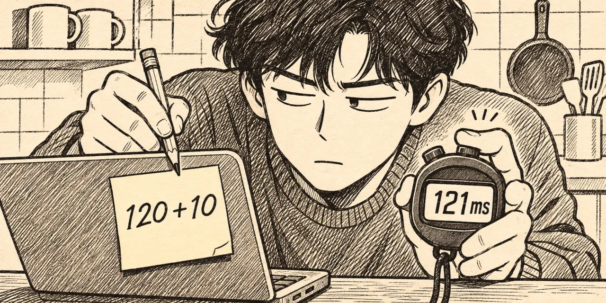
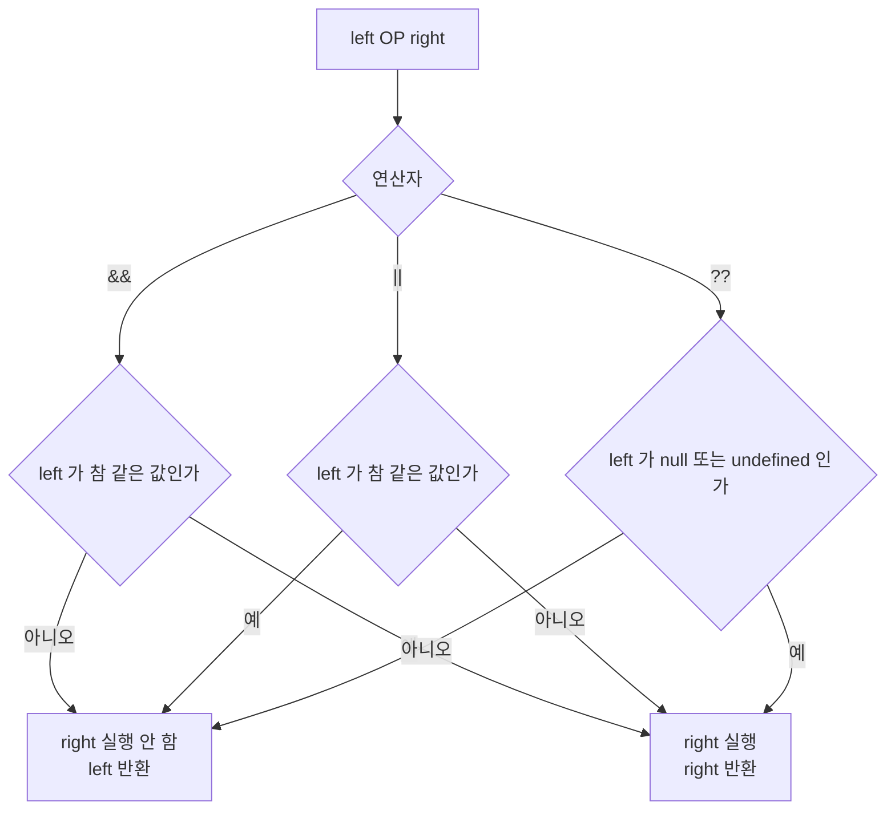

120ms 걸리는 작업과 10ms 걸리는 작업을 그 순서로 `Promise.all`에 넘겼다. 두 번째 작업이 먼저 끝나도 반환값은 입력 순서대로 배열의 두 번째 칸에 놓였다.

빠른 작업의 결과가 첫 번째 칸에 들어가지 않은 이유는 뭘까? 5번 Promise.all Resolve Order에서는 작업이 시작한 시각, 끝난 시각, 결과를 놓은 자리를 나눠서 본다. 7번 Short-Circuit Notification에서는 알림 함수가 실제로 호출되는지를 센다.

## 느린 작업이 먼저 나오는 결과 배열

늦게 끝난 작업이 결과 배열의 앞자리에 있다.

```js
const delay = (ms, value) => new Promise(resolve => setTimeout(() => resolve(value), ms))

const slow = delay(120, 'slow')
const fast = delay(10, 'fast')

await Promise.all([slow, fast]) // [ 'slow', 'fast' ]
```

실행 로그로 보면 `fast`가 먼저 끝났다.

```
fast 완료 @015ms
slow 완료 @125ms
결과 배열 [ 'slow', 'fast' ] @125ms
```

`Promise.all`은 받은 이터러블을 순회하면서 각 항목에 인덱스를 붙인다. 어떤 프로미스가 이행되면 그 프로미스의 인덱스 자리에 값을 넣고 남은 개수를 하나 줄인다. 남은 개수가 0이 되면 배열을 완성해 이행한다. 자리는 순회 시점에 정해지고 값은 완료 시점에 채워진다. 두 시점이 다르다.



전체 완료 시각은 가장 느린 작업이 정한다. 위 로그에서 `Promise.all`이 이행된 시점은 125ms로 `slow`가 끝난 시점과 같다.

먼저 끝난 순서가 필요하면 다른 함수를 쓴다.

```js
await Promise.race([delay(80, '느림'), delay(5, '빠름')]) // '빠름'
await Promise.any([delay(80, '느림'), delay(5, '빠름')])  // '빠름'
```

`race`는 가장 먼저 결정된 것을 그대로 따르고 거부도 결과로 받는다. `any`는 가장 먼저 이행된 것을 고르고 전부 거부됐을 때만 `AggregateError`로 실패한다. 타임아웃을 붙일 때는 `race`, 여러 미러 중 먼저 응답에 성공한 하나를 선택할 때는 `any`다.

빈 배열을 넘기면 기다릴 작업이 없다.

```js
await Promise.all([]) // []
```

`Promise.all([])`이 돌려주는 프로미스는 이미 빈 배열로 이행된 상태다. 그런데 이걸 `await`하면 아래 두 로그 중 어느 것이 먼저 찍힐까?

```js
const run = async () => {
  await Promise.all([])
  console.log('await 뒤')
}
run()
console.log('동기 코드 끝')
// 동기 코드 끝
// await 뒤
```

`동기 코드 끝`이 먼저다. 이미 이행된 프로미스라도 `await` 다음 줄은 마이크로태스크에서 다시 시작한다. [ECMAScript의 Await](https://tc39.es/ecma262/multipage/control-abstraction-objects.html#await)

그 짧은 틈에 로딩 표시를 한 프레임 보여줄 수 있을까? 같은 클릭 핸들러에서 표시를 켜고 `await Promise.all([])` 직후에 바로 끄면 브라우저는 다음 렌더링 전에 두 변경을 모두 처리한다. 예를 들어 실제 네트워크 응답을 기다리는 경우에는 그사이에 표시가 그려질 기회가 생긴다. [HTML 이벤트 루프](https://html.spec.whatwg.org/multipage/webappapis.html#event-loop-processing-model)

## 배열에 담긴 순간 이미 시작한 작업들

`Promise.all`이 작업을 시작한다고 읽으면 다음 코드의 소요 시간을 설명하지 못한다.

```js
const tasks = [delay(120, 'a'), delay(10, 'b')]
for (const t of tasks) await t
// 총 121ms
```

120ms에 10ms. `await`도 두 번 썼다. 근데 130ms가 아니라 121ms다. 뒤의 10ms는 언제 지나갔지?



`delay(120, 'a')`가 평가되는 순간 `setTimeout`이 이미 등록됐다. 배열 리터럴이 만들어지는 시점에 두 타이머가 모두 돌기 시작한다. 첫 `await`가 풀린 120ms 무렵이면 `b`의 10ms 타이머는 끝난 지 오래다. `await`는 시작 신호가 아니라 결과를 기다리는 지점이다.

그렇다면 프로미스를 만드는 자리를 루프 안으로 옮기면 130ms 언저리가 나와야 한다.

```js
for (const ms of [120, 10]) await delay(ms)
// 총 133ms
```

첫 `delay`가 끝난 뒤에 두 번째 `delay`가 호출되므로 타이머가 순차로 돈다. 코드 두 줄의 차이는 `await` 위치가 아니라 프로미스를 만드는 위치다.

거부 시점도 같은 방식으로 읽는다.

```js
const noisy = delay(60, 'x').then(() => console.log('거부 이후에도 계속 실행됨'))

try {
  await Promise.all([Promise.reject(new Error('boom')), noisy])
} catch (e) {
  console.log('all 거부', e.message)
}
// all 거부 boom      @380ms
// 거부 이후에도 계속 실행됨  @441ms
```

`Promise.all`은 첫 거부에서 바로 거부된다. 나머지 프로미스는 취소되지 않는다. 이미 시작된 요청은 응답을 받고 `then` 콜백도 실행된다. `Promise.all`이 반환한 프로미스와 그 안의 작업들은 수명이 다르다.

전부 끝난 뒤 성공과 실패를 함께 보려면 결과 형태를 바꾼다.

```js
await Promise.allSettled([Promise.resolve(1), Promise.reject(new Error('no'))])
// [ { status: 'fulfilled', value: 1 },
//   { status: 'rejected', reason: Error: no } ]
```

`allSettled`는 거부해도 이행된다. 실패 항목을 골라내는 일은 호출자 몫이 된다. `try/catch`로는 아무것도 잡히지 않는다.

> `Promise.all`은 스케줄러가 아니라 수집기다. 동시 실행을 만드는 것은 프로미스를 생성하는 위치다.

`Promise.all`이 보장하는 범위는 결과 수집까지다. 요청 100개를 배열에 담으면 100개가 한꺼번에 나간다. 동시 실행 개수를 제한하는 일은 이 API 밖에 있다. 취소도 `AbortController` 같은 별도 경로가 필요하다.

## `count && notify()`가 알림을 보내지 않는 이유

읽지 않은 알림 개수를 검사한 뒤 알림을 보낸다.

```js
let calls = 0
const notify = () => { calls++; return 'sent' }

const unread = 0
unread && notify()
// 값은 0, calls 는 0
```

`notify`가 호출되지 않는다. 예외도 경고도 없고 표현식의 값은 `0`이다.

`a && b`에서 `a`가 조건식에서 거짓이면 `a`를 그대로 반환한다. 이때 `b`는 실행하지 않는다. 참일 때만 `b`를 평가해 그 값을 반환한다.

`a || b`는 반대다. `a`가 참이면 `a`에서 끝나고, 거짓일 때만 `b`를 평가한다. 그래서 두 연산식의 결과에는 `true`나 `false`뿐 아니라 피연산자의 원래 값이 그대로 나온다.

숫자와 문자열만 봐도 놓치기 쉬운 값이 있다.

```js
[0, -0, 0n, '', null, undefined, NaN].map(Boolean)
// [ false, false, false, false, false, false, false ]
```

`0`과 빈 문자열이 이 목록에 있다는 사실이 실무에서 걸리는 대목이다. "값이 없음"을 검사하려던 코드가 "값이 0"까지 같이 걸러 낸다.

```js
Boolean('0') // true
Boolean([])  // true
Boolean({})  // true
```

빈 배열과 빈 객체는 참으로 평가되는 값이다. 길이로 판단하려면 `list.length`를 직접 봐야 한다.

기본값 병합에서 두 연산자가 갈린다.

```js
const config = { count: 0 }

config.count || 10 // 10
config.count ?? 10 // 0
```

`??`는 왼쪽 값이 `null`이나 `undefined`일 때만 오른쪽 기본값을 쓴다. 재시도 횟수를 `0`으로 설정했다면 `count ?? 10`은 그대로 `0`이고, `count || 10`은 `10`이 된다. 빈 검색어나 `false`를 설정값으로 받을 때도 차이가 난다.

```js
'' || 'default' // 'default'
'' ?? 'default' // ''
false ?? true   // false
```

대입 연산자도 같은 규칙을 물려받는다.

```js
let a = 0; a ||= 10; a // 10
let b = 0; b ??= 10; b // 0
```

옵셔널 체이닝도 단축 평가다.

```js
const target = null
let evaluated = 0
target?.[(evaluated++, 'key')]
evaluated // 0
```

`target`이 `null`이면 대괄호 안의 표현식이 아예 평가되지 않는다. 인덱스 계산에 부수 효과를 넣어 두면 그 효과도 함께 사라진다. 메서드 호출도 마찬가지라 `logger?.write(buildMessage())`에서 `logger`가 없으면 `buildMessage`도 실행되지 않는다.



> 단축 평가는 조건문이 아니라 값 선택이다. 선택되지 않은 쪽은 실행되지 않는다. 실행되지 않은 코드는 실패도 하지 않는다.

이 구분이 답하는 것은 어떤 값이 통과하는지까지다. `??`로 바꿔도 서버가 `null` 대신 빈 문자열을 보내면 기본값은 적용되지 않는다. 어떤 표현이 "값 없음"인지는 API 계약에서 정해지고 연산자가 정하지 않는다.

## 두 문제가 남긴 규칙

느린 작업과 빠른 작업을 먼저 만들어 두면 둘은 이미 진행 중이다. 순서대로 `await`해도 두 작업이 끝나는 데 130ms 대신 121ms가 걸린 이유다. `fast`는 15ms에 먼저 끝나도 결과 배열에서는 여전히 두 번째다.

알림 예제에서는 기다려도 새 로그가 생기지 않는다. `unread && notify()`가 왼쪽의 `0`을 그대로 반환하는 바람에 호출 횟수도 0에 머문다. 실행 시간을 찍는 것과 호출 횟수를 세는 것은 서로 다른 질문에 답한다.

> **이 글에서 다루지 않은 것**: 마이크로태스크와 매크로태스크의 우선순위. `await`와 `then`이 마이크로태스크 큐로 가고 `setTimeout`이 매크로태스크 큐로 가는 차이는 위 예제들의 밀리초 단위 값에는 나타나지 않는다. 두 큐가 렌더 타이밍과 얽히는 자리는 별도로 봐야 한다.

## 다섯 편이 같은 곳을 가리킨다

열 문제는 서로 다른 API를 다뤘다. 남은 규칙은 세 문장으로 줄어든다.

기본값은 편의가 아니라 규격이다. 생략한 비교자, 생략한 초깃값, 생략한 진법 인자 자리에 언어가 무엇을 넣는지가 결과를 정한다. 1편과 4편이 같은 자리다.

2편과 3편에서는 객체 두 개가 같은 참조를 들고 있는지 확인했다. 얕은 복사 뒤에도 중첩 객체를 함께 가리킬 수 있고, 바깥을 동결해도 안쪽 객체는 바뀔 수 있다. 4편에서 본 프로토타입 조회는 다르다. 자기 프로퍼티가 없으면 프로토타입 체인을 따라 올라간다.

틀린 결과가 정상 값의 모양을 한다. `[1, 10, 100, 9]`도 배열이고 `'123'`도 문자열이며 `size 2`도 숫자다. 예외가 나는 자리는 빈 배열 `reduce`와 동결 객체 쓰기 정도다. 나머지는 값을 만든 곳이 아니라 그 값을 쓰는 곳에서 드러난다.

마지막 문장이 이 시리즈에서 가장 다루기 어렵다. 타입 검사는 `[1, 10, 100, 9]`를 막지 못하고 테스트는 두 자리 숫자만 넣어 두면 통과한다. 남은 방법은 규격을 코드에 적는 것뿐이다. 비교자를 쓰고, 초깃값을 주고, 진법을 넘기고, 중복 판정의 키를 꺼내 놓는다. 이 시리즈에서 반복해서 나온 처방이 전부 같은 형태였다.
