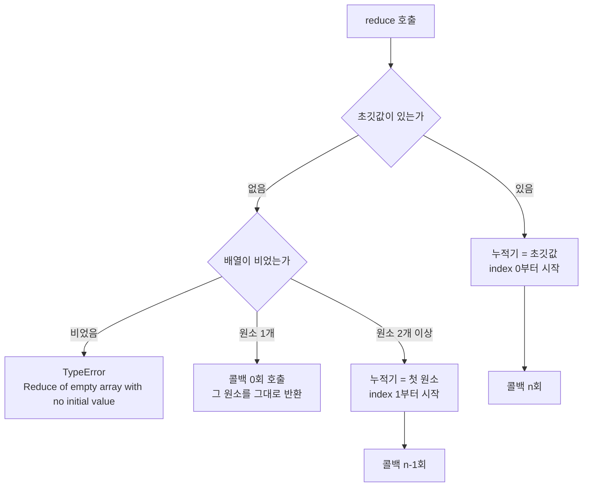

`[10, 9, 100, 1].sort()`의 마지막 값은 9다. 비교 함수를 생략하면 숫자도 문자열로 바꾼 뒤 UTF-16 코드 단위로 순서를 정한다.

`reduce()`에서는 초깃값을 생략할 수 있다. 그러면 배열에 존재하는 첫 원소가 누적기의 시작값이 되고, 그다음 원소부터 콜백을 호출한다. 빈 배열에 초깃값까지 빠지면 예외가 난다.

첫 예제는 1번 Array Sort Comparison, 둘째는 6번 Reduce Math다. 가격을 담은 배열에서 비교 함수와 초깃값을 각각 생략해 본다.

## 가격 배열을 정렬했더니 9가 맨 뒤로 간 이유

상품 가격 네 개를 오름차순으로 놓으려고 `sort()`를 부른다.

```js
const prices = [10, 9, 100, 1]
console.log(prices.sort())
// [ 1, 10, 100, 9 ]
```

1과 10과 100은 순서가 맞고 9만 맨 뒤에 있다. 에러도 경고도 없다.

비교자를 넘기지 않으면 `Array.prototype.sort`는 두 원소를 비교하기 전에 각각에 문자열 변환을 적용한다. 비교되는 값은 `10`과 `9`가 아니라 `"10"`과 `"9"`다. 문자열 비교는 앞에서부터 코드 유닛을 하나씩 본다. `'1'`은 U+0031이고 `'9'`는 U+0039다. 첫 글자에서 이미 `"10"`이 작다는 답이 나오고 남은 자릿수는 읽히지 않는다.



이 규칙은 자릿수가 모두 같을 때 우연히 정답을 만든다.

```js
[30, 12, 45].sort()   // [ 12, 30, 45 ]
[1, 5, 20, 10].sort() // [ 1, 10, 20, 5 ]
```

앞 줄은 맞고 뒷줄은 틀렸다. 두 줄의 코드는 같다. 데이터가 두 자리로만 채워져 있던 동안에는 문제가 드러나지 않는다. 목록에 세 자리 값이 처음 들어오는 날 정렬이 어긋난다.

음수는 자릿수가 같아도 깨진다.

```js
[-1, -10, -2].sort() // [ -1, -10, -2 ]
```

`"-1"`, `"-10"`, `"-2"`는 이미 문자열 오름차순이라 자리를 바꿀 이유가 없다. 정렬 함수가 정상적으로 끝났고 배열은 그대로다.

숫자 순서를 원하면 비교자로 순서를 직접 선언한다.

```js
[10, 9, 100, 1].sort((a, b) => a - b) // [ 1, 9, 10, 100 ]
```

`undefined`는 비교자와 무관하게 움직인다.

```js
[3, undefined, 1].sort()             // [ 1, 3, undefined ]
[3, undefined, 1].sort((a, b) => a - b) // [ 1, 3, undefined ]
```

`undefined`인 원소는 비교자에 전달되지 않고 정렬이 끝난 배열의 뒤로 모인다. 이 예제에서는 비교자에 `3`과 `1`만 들어가므로 `undefined`를 빼서 `NaN`이 나올 일이 없다. 비교자를 붙였다고 해서 모든 원소가 비교자를 거치는 것은 아니다.

`sort`는 새 배열을 만들지 않고 원본을 정렬한 뒤 그 원본을 반환한다. 정렬 결과를 다른 변수에 담아도 원본은 이미 바뀌어 있다. 원본을 남기려면 `toSorted`를 쓰거나 복사본을 정렬한다.

> 정렬 함수에 넘기지 않은 비교자는 "기본"이 아니라 "문자열 기준"이라는 선언이다.

정렬 대상이 실제로 문자열이면 기본 비교자가 맞는 선택이다. 한글과 영문이 섞인 목록에서 사람이 기대하는 순서를 원한다면 코드 유닛 순서는 답이 아니고 `localeCompare`가 필요하다. 이 절은 순서 규칙만 다뤘고 로케일 정렬은 범위 밖이다.

## `a > b` 비교자를 넘겼더니 배열이 그대로 나왔다

비교자를 붙이면 안전할 것 같지만 반환값의 형태가 틀리면 예외 없이 엉뚱한 결과가 나온다.

```js
[3, 1, 2].sort((a, b) => a > b) // [ 3, 1, 2 ]
```

원소 서른 개로 늘려도 이 Node 20 실행에서는 입력 순서가 남았다.

```js
const big = Array.from({ length: 30 }, (_, i) => (i * 7 + 3) % 30)
big.join(',')
// 3,10,17,24,1,8,15,22,29,6,13,20,27,4,11,18,25,2,9,16,23,0,7,14,21,28,5,12,19,26

[...big].sort((a, b) => a > b).join(',')
// 3,10,17,24,1,8,15,22,29,6,13,20,27,4,11,18,25,2,9,16,23,0,7,14,21,28,5,12,19,26
```

비교자가 반환하는 값은 순서 신호다. 음수면 `a`가 앞, 양수면 `b`가 앞, 0이면 둘을 같다고 본다. 불리언은 숫자 자리에서 `true`가 1, `false`가 0으로 바뀐다. `3`과 `1`을 이 순서로 넘기면 1이 나와 `1`이 앞이라는 신호가 된다. 같은 두 값을 `1`과 `3`의 순서로 넘기면 -1이 아니라 0이 나온다. 묻는 순서에 따라 같은 쌍의 답이 '`1`이 앞'과 '둘이 같다'로 갈린다.

[명세](https://tc39.es/ecma262/multipage/indexed-collections.html#sec-sortindexedproperties)는 비교자가 이런 조건을 지키길 요구한다. `a`와 `b`를 바꿔 넘기면 부호도 반대가 되어야 하고, 같다고 판정한 관계는 이어져야 한다. `a > b`는 앞의 조건을 어기는 일관성 없는 비교자다. 이런 비교자를 넘기면 정렬 결과는 구현이 정한다.

Node 20에서는 이 배열의 순서가 그대로였다. 원소를 바꿔 물었을 때 답이 모순되니, 다른 엔진도 이 순서를 내놓으리라고 기대할 수 없다.

숫자 문자열을 정렬한다면 `(a, b) => a - b`를 쓸 수 있다. `'10' - '9'`는 1이다. 그런데 같은 코드를 이름 필드에 쓰면 어떨까? `'kim' - 'lee'`는 `NaN`이고, 정렬은 그 비교에서 두 값을 같다고 취급한다. 전부 숫자로 바꿀 수 없는 이름들이면 안정 정렬은 원래 순서를 유지한다. 이때 배열이 그대로인 이유는 앞의 불리언 비교자와 다르다.

## reduce에서 초깃값을 생략하면 사라지는 것

장바구니 합계를 구하는 코드가 숫자 대신 문자열을 내놓는다.

```js
const parts = ['1', '2', '3']
parts.reduce((acc, cur) => acc + cur) // '123'
```

초깃값이 없으면 배열의 첫 원소가 그대로 누적기가 된다. 첫 누적기가 `'1'`이라는 문자열이고 `+`는 피연산자 한쪽이 문자열이면 덧셈 대신 연결을 한다. 콜백 안의 `+`는 정상 동작했다. 누적기의 타입이 처음부터 문자열이었을 뿐이다.

객체 배열에서는 결과가 더 알아보기 어렵다.

```js
const items = [{ price: 1200 }, { price: 800 }]

items.reduce((sum, item) => sum + item.price)    // '[object Object]800'
items.reduce((sum, item) => sum + item.price, 0) // 2000
```

첫 줄의 누적기는 `{ price: 1200 }`이고 객체와 숫자를 `+`로 묶으면 객체가 문자열로 변환된다. 화면에는 `[object Object]800`이 찍힌다. 타입 오류로 잡히지 않고 문자열 하나로 통과한다.

초깃값 유무는 타입만 바꾸지 않는다. 순회 자체가 달라진다.



원소 하나짜리 배열에 초깃값을 주지 않으면 콜백이 한 번도 실행되지 않는다.

```js
let calls = 0
const r = [7].reduce((a, b) => { calls++; return a + b })
// r === 7, calls === 0
```

콜백 안에 로깅이나 검증을 넣어 뒀다면 그 한 원소만 검사를 건너뛴다. 배열 길이가 1이 되는 순간에만 나타나는 분기다.

인덱스도 한 칸 밀린다.

```js
const seen = []
;[10, 20, 30].reduce((a, c, i) => { seen.push(i); return a + c })
// seen: [1, 2]

const seenWithSeed = []
;[10, 20, 30].reduce((a, c, i) => { seenWithSeed.push(i); return a + c }, 0)
// seenWithSeed: [0, 1, 2]
```

인덱스로 다른 배열을 참조하는 콜백이라면 초깃값을 붙이거나 빼는 것만으로 참조 대상이 통째로 어긋난다.

빈 배열은 유일하게 예외를 던지는 자리다.

```js
[].reduce((a, b) => a + b)    // TypeError: Reduce of empty array with no initial value
[].reduce((a, b) => a + b, 0) // 0
```

필터링 결과가 빈 배열이면 합계 계산에서 예외가 발생한다. 초깃값 `0`은 이 예외까지 같이 막는다.

> 초깃값은 시작 숫자가 아니라 누적기의 타입 선언이다. 이 선언이 없으면 타입은 데이터의 첫 원소가 정한다.

초깃값으로 배열이나 객체를 주는 경우도 있다. 같은 객체를 여러 번의 `reduce` 호출에 넘겨 콜백에서 수정하면, 이전 호출의 결과가 다음 호출에도 남는다. 참조를 공유하는 경우는 3편에서 따로 본다.

## 두 문제가 남긴 규칙

`[30, 12, 45]`만 정렬해 보면 숫자 비교와 문자열 비교의 결과가 우연히 같다. 여기에 자릿수가 다른 값을 넣어 보자. `[10, 9, 100, 1].sort()`에서는 9가 100 뒤로 밀린다. 가격 정렬 테스트에 둘을 같이 넣어야 비교 함수가 빠진 걸 알아볼 수 있다.

합계도 결과 타입까지 봐야 한다. `['1', '2', '3'].reduce((a, b) => a + b)`는 문자열 `'123'`을 돌려준다. 합계가 있어야 하는 화면에도 예외 없이 이 값이 도착한다.

> **이 글에서 다루지 않은 것**: 정렬 안정성과 로케일 정렬. 현재 명세는 `sort`가 안정 정렬임을 보장하지만 같은 키를 가진 원소들의 순서를 설계 근거로 삼는 문제는 별도 판단이 필요하다. `localeCompare`와 `Intl.Collator`의 비용도 여기서는 재지 않았다.

다음 편에서는 Set의 중복 판정 기준을 다룬다. sort의 정렬 기준과 달리 값의 동일성을 비교하며, Set에서는 `===`와 다른 SameValueZero 규칙을 적용한다.
