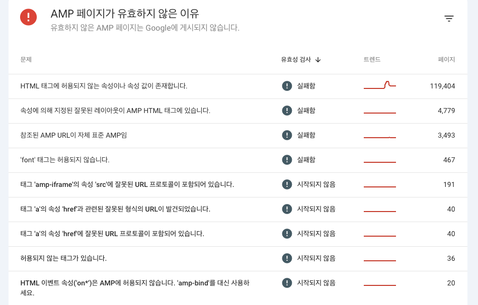
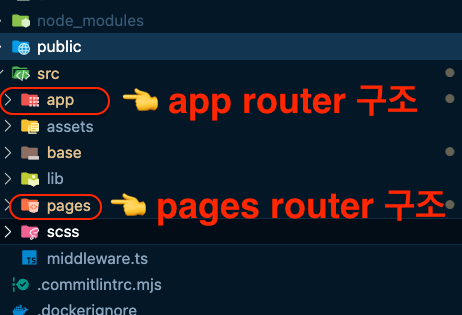
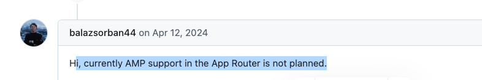
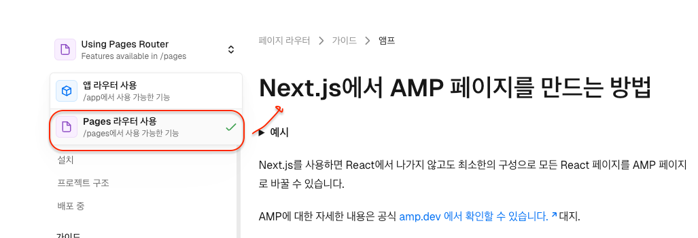

입사 첫날이었다. 뉴스 사이트를 구축한 외주 개발자분들이 철수하면 내가 운영을 맡기로 했다. 커피를 마시며 한 분씩 인사를 드렸고, 남은 이슈를 듣겠다고 노트북을 켰다.


**“형기 씨 ... 정말 미안한데, 급해.”**


## AMP 뭔데요?

부장님 말씀으로는 사이트를 리뉴얼하고 트래픽이 1/3 정도 줄었다고 했다. 기사 AMP 페이지에는 검증 오류가 떠 있었다. 기존 AMP 페이지를 걷어내야 할지, 별도 프로젝트에서 다시 만들어야 할지 검토해 달라고 하셨다.

AMP가 뭔지도 모르는 나는 그동안의 사정을 듣고, 반나절 정도 살펴볼 시간을 달라고 말씀드렸다. (쪼금만 기다려주세요. 입사 첫날이라서요..)

AMP는 모바일에서 페이지를 빠르게 보여 주려고 만든 웹 프레임워크다. 검색 유입 때문에 급하다는데, 구글에 기사가 뜨려면 꼭 AMP로 만들어야 하는 걸까? <strike>구글이 만든 기술이니 구글에 맞는 스킬이겠지.</strike>

구글은 2021년에 모바일 검색의 주요 뉴스(Top Stories)에서 AMP 요건을 뺐다. 구글 뉴스 정책을 충족하면 일반 기사 페이지도 노출 대상이다. ‘퇴직금 계산법’ 같은 검색어로 예전 기사를 찾아오는 독자 역시 일반 기사 페이지로 들어올 수 있다. 2023~2024년 뉴스 이용 자료를 읽어도 우리 사이트에서 줄었다는 트래픽 중 얼마나 AMP 때문인지는 알 수 없었다.

그럼 기사 AMP 페이지에는 무슨 오류가 난 걸까?

## 기사 본문을 고쳐도 남은 오류



Search Console 보고서 첫 줄에 **119,404**라고 적혀 있었다. HTML 태그에 허용되지 않는 속성이나 값이 있다는 항목의 페이지 수였다. 아래에는 `font` 태그를 썼다고 걸린 페이지도 467개 있었다. 두 숫자 모두 기사 HTML을 검사한 결과다. 여기서 방문자가 몇 명 줄었는지까지 읽을 수는 없다.


브라우저에서 기사 주소를 열면 본문이 보여도 AMP 검증에는 걸릴 수 있다. 검증에서 탈락한 문서는 Google AMP Cache에 올라가지 않는다. 기사에 스크립트를 붙이는 일도 평소와 다르다. 직접 만든 자바스크립트 파일을 연결할 때는 `amp-script`의 `src`에 그 주소를 적는 식이다.

```html
<amp-script layout="container" src="https://당신의-회사-cdn-주소-혹은-프로젝트-내에-별도-스크립트-파일이-필요합니다-젠장/script.js">
  <p>이곳에 스크립트가 삽입됨.</p>
</amp-script>
```

이 사이트의 기사 본문은 대부분 글과 사진이었다. 허용되지 않는 태그부터 고쳤는데, 이번에는 스크립트가 검증에 걸렸다. 기사 본문 어디에도 넣은 적 없는 `/_next/static/` 경로의 자바스크립트였다. Next.js가 페이지를 만들면서 붙인 번들이라면 본문 태그를 아무리 바꿔도 남을 텐데. 이 페이지는 어떤 라우터에서 만들고 있었지?

## AMP 페이지가 있던 디렉터리



기사 AMP 페이지는 `app` 아래에 있었다. 같은 증상을 찾아보니 App Router에서는 내장 AMP 기능을 지원하지 않는다는 답이 여러 번 나왔다.


<details>
<summary>같은 문제를 겪은 개발자들이 받은 답변</summary>




</details>



공식 문서의 AMP 예제에도 **Pages Router**라고 적혀 있었다. 천만다행으로 당시 Next.js에서는 한 프로젝트 안에 `app`과 `pages`를 함께 쓸 수 있었다. 따로 프로젝트를 만들기 전에, `pages` 아래에 테스트용 AMP 페이지 하나만 만들어 봤다. 이번에는 AMP Validator를 통과했다.


다시 부장님께 AMP가 필요한 페이지가 어디까지인지 여쭤봤다. **기사 상세 페이지만** 대상이라고 하셨다. 그래서 기사 상세의 AMP 버전만 Pages Router에 두기로 했다.

테스트 페이지에 실제 기사 본문을 넣으면 또 다른 문제가 나온다. 예전에 작성한 기사에는 사진의 가로와 세로 크기가 없었다. [사진 크기가 없는 기사를 AMP로 옮긴 과정은 2편에 적었다.](/frontend/performance/phase2/)

## 참고 자료

- [Google Search Central의 Top Stories 노출 요건 변경 공지](https://developers.google.com/search/blog/2021/04/more-details-page-experience)
- [Google 검색에서 AMP 페이지를 다루는 기준](https://developers.google.com/search/docs/crawling-indexing/amp)
- [AMP 검증 오류와 Google AMP Cache](https://amp.dev/documentation/guides-and-tutorials/learn/validation-workflow/validate_amp)
- [AMP에서 사용자 스크립트를 실행하는 amp-script](https://amp.dev/documentation/components/amp-script/)
- [Next.js 14 Pages Router의 AMP 설정](https://nextjs.org/docs/14/pages/building-your-application/configuring/amp)
- [Next.js 14에서 app과 pages를 함께 쓰는 방법](https://nextjs.org/docs/14/app/building-your-application/upgrading/app-router-migration)
- [당시 열어 본 Next.js 라우팅 문서](https://nextjs.org/docs/app/building-your-application/routing/pages-and-layouts#amp)
- [2023 언론수용자 조사 - 한국언론진흥재단](https://www.journalist.or.kr/news/article.html?no=57770&utm_source=chatgpt.com)
- [포털 방문자, 뉴스보다 다른 콘텐츠 찾나… 뉴스 이용 '뚝' - 한국기자협회](https://www.journalist.or.kr/news/article.html?no=55137)
- [검색이 통로아닌 목적지로 변화](https://publishinstitute.org/news/search-engine-seo-google-news/)
- 시간을 아껴주신 분들
  - [버셀에 문의까지 주신분](https://www.reddit.com/r/nextjs/comments/1dpuvj7/how_do_i_configure_a_page_to_be_amp_in_app_router/)
  - [Next.js AMP 관련 논의](https://github.com/vercel/next.js/discussions/76918)
  - [Next.js AMP 관련 이슈](https://github.com/vercel/next.js/issues/64354)
