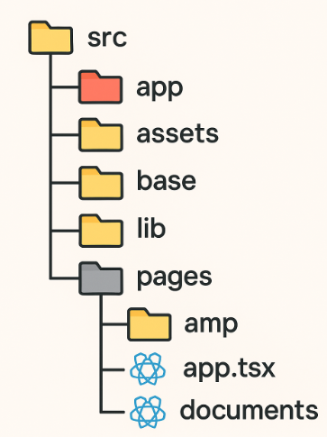
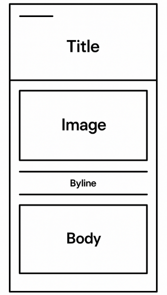
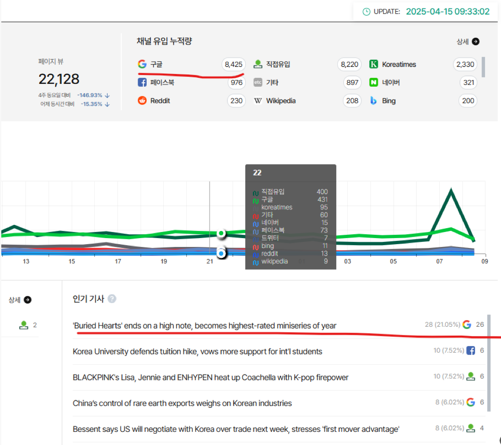
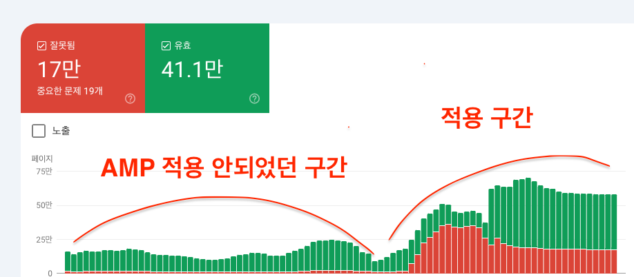
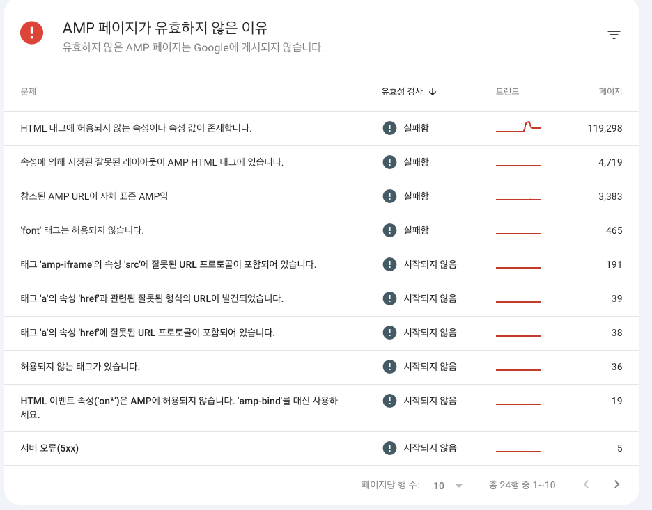
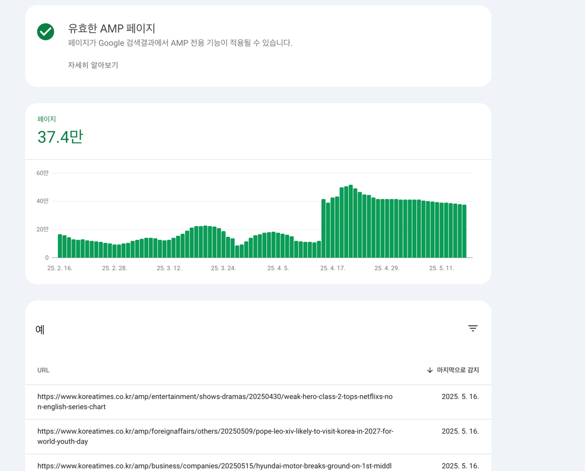

기사 상세만 Pages Router에 따로 두기로 했다. Pages Router에 만든 테스트 페이지로는 AMP 검증을 통과했다. 이제 거기에 기자가 쓴 기사 한 편을 넣어야 했다.

본문 API에서 온 건 HTML 문자열이었다. 에디터에서는 멀쩡하게 보이는 사진도 AMP에 그대로 넣을 수는 없다. 태그를 `amp-img`로 바꿔야 하고, 예전에 쓴 기사에는 정작 그 태그에 필요한 이미지 폭과 높이가 없었다.


--- 

## 첫 배포에서 기사 한 편을 여는 데 필요한 일

첫 배포의 기준은 AMP 주소로 기사 한 편을 열어서 본문과 사진을 읽을 수 있느냐였다. 요청을 받을 라우트에서 시작해, 기사 API가 준 HTML을 검증 가능한 페이지로 바꾸는 순서로 작업을 나눴다.
- Pages Router 기반의 디렉토리 구조 설계
- AMP 대상 페이지 컴포넌트 설계
- middleware.ts 에서 /amp 로 시작하는 URL을 감지하여 해당 페이지를 AMP 페이지로 리다이렉트하도록 설정
- GPT의 도움을 받아 AMP 페이지용 스타일 작성
- 본문내용 api call 이후 제약 태그 -> amp 태그로 변환 util 만들기
- SEO 메타 태그 작성과 검수

## 되짚고 넘어가는 제약 사항 ⚠️
AMP는 일반적인 React 환경과 달리 아래 제한이 있다

☝️. **React Hook 사용 제한**  
- 이 AMP 기사에는 브라우저에서 React를 실행하지 않는다. 클릭 뒤 `useState`로 상태를 바꾸거나 `useEffect`로 화면을 갱신하는 코드는 옮길 수 없다.

✌️. **Sass/SCSS 등 외부 스타일 방식 제한**  
- 컴파일 전 스타일을 무엇으로 작성했든, AMP 검증기는 완성된 HTML에서 CSS가 어디에 몇 바이트 들어갔는지 본다.

🫰. **일반 script 태그 사용 불가**  
- AMP 런타임과 허용된 확장 스크립트는 사용할 수 있다. 기존 기사 페이지의 임의 자바스크립트를 그대로 옮길 수는 없었다.

> 전체 AMP 검증은 [AMP Validator](https://validator.ampproject.org/) 를 통해 실시간 확인 가능

---

## 디렉터리 구성 🗂️
pages 디렉토리 를 기반으로 amp 디렉토리를 생성한다. 하위에 slug 페이지를 작성한다.

> 🔖 slug 란 ?
> - ex ) /news/2025/04/17/기사제목
> - URL의 일부를 사람이 읽기 좋고 검색엔진 친화적으로 만든 문자열


middleware.ts 에서 /amp 로 시작하는 URL을 감지해 해당 페이지를 AMP 페이지로 리다이렉트하도록 설정했다.


```text
 
📁 src
|── components                     
    ├── amp                        # amp 페이지 내 공통컴포넌트 ( Header, Body, Footer 등 재사용 컴포넌트들 쭉쭉 넣어주고 ~ )
    |... 원래 있던 친구들 내비두고 ~
├── pages                         
│   ├── amp                        # AMP 페이지 전용 디렉토리
│   │   └── [slug].tsx             # section 카테고리별 디렉토리
|   |     └── [depth1].tsx         # amp depth 1 본문 페이지
|   |         └── [depth2].tsx     # amp depth 2 본문 페이지
|   |             └── [depth3].tsx # amp depth 3 본문 페이지
```

결과적으로 **사용자** 에게 보이는 기사 뷰 페이지는 2벌이다.
- 일반 페이지 [ PC / MO ] <-- 다행이 반응형으로 통합되어 있어서 아멘...
- AMP 페이지 ( depth 별 )

기존 기사 본문 URL은 **slug url** 형식이니 amp 페이지 유입 시 해당 본문의 amp 페이지로 redirect하면 된다.
pages에서 화면 뼈대부터 만든 뒤, 여러 페이지에서 같이 쓸 부분을 컴포넌트로 빼면 되겠다.



> AMP는 제약이 많다. 그래도 뉴스 도메인에선 여전히 유의미하다.
> 
> React hook이나 script 사용은 어렵지만 콘텐츠 위주 뉴스 페이지엔 큰 무리가 없다.
> 
> middleware.ts + slug 기반으로 AMP 라우팅을 처리하면 깔끔하게 대응된다.
> 
> AMP 페이지는 별도로 구성하되 디자인과 구조는 기존 화면에 최대한 맞춘다.

## 기사 본문에서 amp 태그로 변환하는 util 함수 만들기 
- `div`, `article` 같은 표준 HTML 태그는 그대로 쓴다. 바꾸거나 빼야 하는 태그만 골라 처리한다
- `` 태그는 `<amp-img>`로, `<iframe>`은 `<amp-iframe>`으로 바꿔야 한다
- 직접 작성한 `<script>`는 쓸 수 없다. AMP 런타임과 확장 컴포넌트 스크립트, `application/ld+json` 같은 JSON 타입만 남는다
- `<style amp-custom>`과 인라인 `style` 속성을 합쳐 **75,000바이트까지** CSS 작성 가능
- 애니메이션 전용 `<style amp-keyframes>`는 따로 **최대 500,000바이트까지** 허용된다.
  단, `<body>`의 마지막 자식으로만 둘 수 있다
- JS 이벤트 핸들러 제거 , javascript: 링크 제거 
- 하위 호환이 필요한 태그 정리
  - font, area
- form은 금지 태그가 아니다. amp-form 확장을 넣어야 쓸 수 있다

👉 크기 한도의 근거는 [ AMP HTML 명세 ](https://amp.dev/documentation/guides-and-tutorials/learn/spec/amphtml)에 있다

---

## ⚡️ AMP 페이지 구조 예시 (실제 구현을 단순화한 코드)
```html
<!DOCTYPE html>
<html ⚡>

  <!-- 공통 대상 Header -->
  <head>
    <meta charset="utf-8">
    <meta name="viewport" content="width=device-width,minimum-scale=1,initial-scale=1">
    <link rel="canonical" href="원본 URL 잘 집어넣어야 합니다.">
    <meta name="amp-google-client-id-api" content="googleanalytics">
    
    <!--  공통 대상 : Style  -->
    <style amp-custom>
      /* AMP 전용 CSS 들어올 자리 ( 인라인 style 까지 합쳐 75,000바이트 안넘기게 살살 다뤄줘 ) */
    </style>
    
  </head>
  
  <body>
    
    <!--  공통 대상 : 뉴스 기사 Body -->
    <main>
      <!--  공통 대상 : 예쁘게 컴포넌트 화 -->
      <article>
        기사 본문이 들어갈 자리
      </article>
      
      <!--  갖가지 광고 예쁘게 공통으로 말아 -->
      <!-- 실제 광고를 넣을 때는 amp-ad 확장을 등록하고 광고사 설정을 넣는다. -->
      
    </main>
    
    <!--  공통 대상 : footer 야 뭐...  -->
    <footer>푸터 들어갈 자리</footer>
  </body>
</html>
```

기사 본문의 자리를 보기 위해 필수 `amp-boilerplate`와 런타임 스크립트는 예제에서 생략했다. 광고를 넣을 때는 `amp-ad` 컴포넌트를 쓴다.

---

## AMP 규칙에 맞는 Style 

Amp 용으로 style 잡는게 좀 까다로웠다 ( sass 방식이 왜 안돼 ... 하나하나 분석하다가 이건 도저히 아니다 싶었다. )

기사 스타일을 넣을 `<style amp-custom>`은 하나만 둘 수 있다.
- 사용자 정의 스타일은 `<head>` 안의 `<style amp-custom>`이나 요소의 인라인 `style` 속성에 쓴다.
- `<style amp-custom>`이 두 개 이상 있으면 AMP 유효성 검사에서 실패. ( 별 ... )
  - 필수 `amp-boilerplate` 스타일과 `<body>` 끝의 `amp-keyframes`는 이 개수에 넣지 않는다.
- `<style amp-custom>`과 인라인 `style`을 합친 크기가 75,000바이트를 넘으면 안 됨.
- Next.js 14 Pages Router 문서는 AMP 페이지에서 CSS-in-JS만 지원하고 CSS Modules는 지원하지 않는다고 적어 두었다. 이건 개발 도구 쪽 제한이다. 어떤 방식으로 쓰든 검증받는 건 빌드가 만든 AMP HTML이고, 위의 개수와 크기 조건도 완성된 HTML에 적용된다.
- 조건을 넘으면 AMP 검증에 실패하고, 그 문서는 유효한 AMP 페이지로 제공되지 않는다. 일반 기사 페이지 열람이나 검색 노출 전체가 막히는 건 아니다.

미지원 CSS 속성/기능
- @import 사용 불가 
- !important 사용 불가
- transition과 animation은 GPU 가속이 되는 속성(`opacity`, `transform`)에만 쓸 수 있다
- `position: fixed`, `filter`, `backdrop-filter`, `mix-blend-mode`는 AMP 명세의 금지 항목에 없다. 쓰기 전에 AMP Validator로 확인한다.

AMP 구성요소의 스타일링
- `<amp-img>`,`<amp-carousel>`, `<amp-sidebar>` 등 AMP 컴포넌트는 반드시 지정된 방식으로 스타일링해야 함.
- 특히 layout="responsive" 등 AMP layout 시스템에 맞는 설정 필수.

---

## 1차 배포 결과 🏰
검색 색인과 AMP 페이지 1차 반영 이후 구글 유입이 조금씩이나마 바로 잡혀가는 모습이 너무 보기 좋다.





구글 Search Console 에서 AMP 메뉴를 확인하니 Google Amp validator 검증에 실패해
유효하지 않은 AMP 페이지로 판단해 AMP 버전을 노출하지 않은 모양이다.



허용되지 않는 태그 누락, 미디어 속성 태그에 src 가 http 로 되어있는 경우,  
<기사이름> 처럼 태그가 아닌데 태그로 오인식하는 문제가 있었다.  

( 이미지 혹은 뷰어 용 태그에 src 는 https 가 아니라 http 로 되어있는 부분은 server 에서 처리가 필요 ) 

> 이걸 어떻게 표준화 할까 ...?

---

## 🤔 라이브러리를 안 쓰고 처리 할 수 없었을까 ?

DOMParser 를 쓸 수 없었다. 
브라우저 런타임에서만 동작하는 Web API 이기 때문이다. Next.js SSR, 즉 Node.js 환경에서는 사용 불가다.

기사 본문은 **서버 사이드 데이터 페칭** 시점에 가져온다. amp guide 에 맞는 dom 변환 util 함수 안에서  
정규식으로 문자열을 바꾸거나 지우려니 너무 위험했다.

(기사 본문 내용이 틀어지거나 inline Style 이 깨지거나 보여야 할 내용이 일부분 사라지거나 ...)

| 작업 예시                          | 라이브러리 없이 가능? | 설명                        |
|--------------------------------| ----------- | ------------------------- |
| `` -> `<amp-img>` 변환      | 어려움       | HTML 구조 파싱이 필요, 정규식으론 불안정 |
| `<iframe>` -> `<amp-iframe>`   | 어려움      | 조건 분기 및 속성 매핑 복잡          |
| `onClick`, `onMouseOver` 속성 제거 | 가능하지만 복잡 | 수백 개 태그 모두 순회해야 함         |
| 불필요한 태그 제거 (`<font>`, `<map>`) | 가능하지만 비효율 | 정규식 + 수작업으로 불안정           |
| 최종 HTML 문자열로 재조립               | 위험       | 구조 깨질 확률 높음               |


이 과정에서 라이브러리를 여럿 도입했다. 목표는 간단했다.  

- HTML 태그를 파싱해서 변형하거나 제거할 것.
- DOM을 조작할 수 있는 라이브러리가 필요했다.

---
## 라이브러리 도입 결정

기사 HTML을 문자열 치환으로 고칠 때는 본문에 남겨야 할 내용까지 지워졌다. Cheerio로 HTML을 읽으면 기자 정보는 `.writer`로, 사진은 `img`로 골라 서로 다른 작업을 할 수 있다.
```jsx
const $ = cheerio.load(html);
$(".writer").remove(); // 불필요한 요소 제거
$("img").each(...);    // 이미지 태그 변환
```

> 대안은?  
> jsdom도 있었지만 성능과 문법 직관성에서 cheerio가 더 낫다고 판단했다.  
> - ( 훨씬 무겁다. DOM 구현이 브라우저 수준이지만 cheerio보다 느림 )  
> 단순한 조작에는 cheerio가 가장 맞다.  

isTag (from domhandler): 안정성 있는 노드 필터링  

모든 DOM 노드가 태그는 아니다. cheerio("*").each(...) 루프를 돌릴 때는 노드 타입 검사가 필요하다.  
isTag()를 쓰면 태그 여부를 안정적으로 확인한다.  

```js
if (isTag(el)) {
    // 태그일 때만 속성 제거
}
```

image-size + fetch ⚠️

원격 이미지 크기 하나를 알아내려고 요청을 얼마나 더 보내야 할지가 고민이었다.

기사에 쓰는 `<amp-img layout="responsive">`는 `width`와 `height`가 있어야 이미지가 오기 전에도 자리를 잡는다.
그런데 콘텐츠에 이 정보가 누락된 경우도 있어서 서버에서 이미지를 직접 fetch하고 image-size로 크기를 추출해야 했다.  

img 태그의 크기를 알 수 없는 경우에만 별도 호출하기로 했다. 

```js
const res = await fetch(src);
const buffer = new Uint8Array(await res.arrayBuffer());
const { width, height } = imageSize(buffer);

```

이 방식은 이미지가 깨지지 않게 하려는 의도지만 단점이 있다.
- SSR 성능 저하 가능성 (네트워크 fetch + 버퍼 파싱)
- 이미지 수가 많아질수록 병목 발생

> 최근 기사 editor 에서 이미지 크기를 지정하는 경우가 대부분이다.
> 
> 오래된 기사에만 이미지 크기(width, height)가 빠져 있어 해당 이슈를 공유했다.
> 
> 이미지 의 크기를 알 수 없는 경우에만 코드레벨에서 조건을 분기하였다.  
> ( 서버에서 이미지를 직접 fetch하고 image-size로 크기를 추출하는 방식 )

---

## 마무리 


오래된 기사에서 폭과 높이를 찾을 수 없는 사진만 서버가 한 번 더 내려받아 크기를 읽는다. 에디터가 이미 크기를 적어 준 사진에는 그 값을 쓴다. AMP 검증 한 건을 잡겠다고 기사를 열 때마다 본문 사진 전부를 다시 받을 필요는 없었다.

참고
- [AMP HTML 명세: 허용 태그와 스타일시트 크기](https://amp.dev/documentation/guides-and-tutorials/learn/spec/amphtml/)
- [AMP 페이지 스타일 작성법](https://amp.dev/documentation/guides-and-tutorials/develop/style_and_layout/style_pages/)
- [Next.js 14 Pages Router의 AMP 지원](https://nextjs.org/docs/14/pages/building-your-application/configuring/amp)
