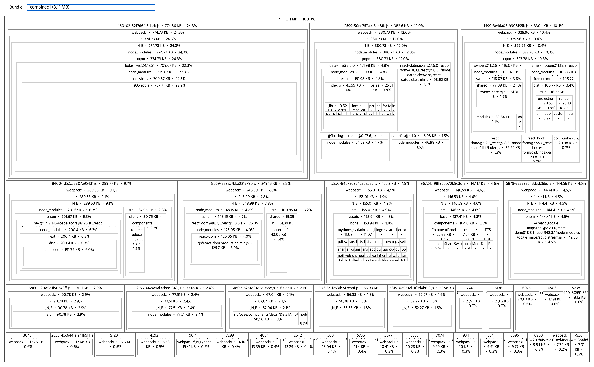
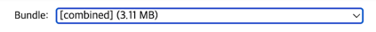
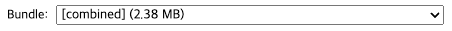

뉴스 사이트의 네트워크 탭을 보니 JS 파일이 꽤 컸다. 어떤 코드가 그만큼 내려오는지는 파일 이름만 봐선 알 수가 없었다. 빌드에 번들 분석기를 붙여 봤다.

## JS 번들 구성 점검

```bash

$ yarn add -D @next/bundle-analyzer
```

그런다음 next.config.js 에서 analyzer 를 활성화.
```js


import createBundleAnalyzer from "@next/bundle-analyzer";

// ...

const withBundleAnalyzer = createBundleAnalyzer({
    enabled: process.env.ANALYZE === "true",
    openAnalyzer: false,
});

// ... 

export default withBundleAnalyzer(nextConfig);
```

package.json script 부분역시, 명령어 활성화 필요. 

```js
"script": {
 ... 
  "analyze": "ANALYZE=true next build", 
  "analyze-explorer": "source-map-explorer '.next/static/chunks/*.js'",
 ...
}
 
```

먼저 어떤 라이브러리들이 번들에 포함되어 있는지 확인하기 위해 bundle-analyzer 를 설치해 주고 분석해 보니, lodash-es 와 moment-timezone 이 포함되어 있었다.
700KB 와 500KB 먹음직 스럽게 제거할 수 있는 크기였다.



 
## lodash 최적화

프로젝트 내에서 lodash-es가 설치되어 있었다. 실제 사용하는 함수는 debounce 하나뿐이었다.  
아마도 Tree Shaking을 노리고 lodash-es를 선택했던 것 같다.   

> tree shaking 이란 ?
> 실상 쓰는 코드만 번들에 포함시키고 안 쓰는 코드를 제거하는 기능인 Tree Shaking

하지만 애석하게도, lodash-es는 ESM 구조이다.  
Tree Shaking이 가능하다고 알려져 있지만 내부적으로 많은 공통 유틸 함수들이 함께 import되기 때문에     
debounce 하나만 불러와도 수많은 내부 의존성 코드가 함께 번들된다.  

즉, 다음과 같은 코드 는 실제 번들 사이즈를 눈에 띄게 줄이지 못한다.
```js
import { debounce } from "lodash-es";
```

함수 단위 패키지로 대체 가 가능한 lodash 로 변경하기로 결정하였다.  
개별 모듈(함수)로 쪼개서 npm 패키지를 배포하고 monorepo로 관리하기 때문에 번들 다이어트에 유리하다고 봤다.  

lodash.debounce를 import하려면 lodash.debounce 패키지를 따로 설치해야 한다.  
타입스크립트 환경에서는 타입 정의 패키지(@types/lodash.debounce)도 필요하다.

```bash

$ yarn add lodash.debounce

$ yarn add -D @types/lodash.debounce
````

최소한의 코드만 번들에 포함되고, 사용방법은 다음과 같다.

```js
import debounce from "lodash.debounce";
```

## moment-timezone ⏰ 최적화 

앞서 말했듯 lodash는 함수별로 npm 패키지가 분리되어 있거나 ES 모듈 구조라서 개별 함수만 import할 수 있지만,   
moment/moment-timezone 는 하나의 큰 번들(모듈)로 배포되고 내부적으로 모든 기능이 단일 객체(moment)에 결합되어 있다.

즉, moment-timezone은 하나의 큰 번들이다. 부분 import 안 된다. 구조 상 ESM도 아니고 트리셰이킹도 불가능.

```js
import { tz } from "moment-timezone"; <- ❌
import moment from "moment/timezone"; <- ❌
```

구버전 브라우저(특히  Edge, 구형 크롬/파이어폭스 등)까지 완벽히 커버하면서 타임존 목록 및 오프셋, 타임존 변환 등 기능을 제공하려면  
moment-timezone을 계속 사용하는 것이 가장 안전한 선택이라.. 이대로 두기로 하였다. ( 언론 뉴스 페이지다 보니, 해외 구형 디바이스 까지 커버 해야 한다. )  

moment-timezone은 오래된 브라우저까지 호환성을 고려해 설계되어 있다 (IE9 이상, 구형 모바일 브라우저 등 포함)
최신 방식인 Intl.supportedValuesOf('timeZone')는 최신 브라우저(크롬 104+, 사파리 16.4+ 등)에서만 지원되고  
구버전 브라우저에서는 동작하지 않는다.

굳이 하려면, 데이터 범위를 줄여서 번들 사이즈를 최적화 하는게 유일한 방법이다.   

```bash

# slim 빌드 사용
$ npx moment-timezone-data-builder --zones="Asia/Seoul" --start-year=1990 --end-year=2026 > data/packed/latest.json
```

## 추가로 줄일 수 있는 번들 확인
next.config.js 내부 설정 중 `optimizePackageImports` 를 쓰면 소위말해 조금 더 영끌 다이어트가 된다.  

date-fns, moment, swiper 같은 덩치 큰 라이브러리에서 "쓰는 것만 가져오도록" 자동 변환해줘서 번들 크기를 줄여준다. ( 아 물론 lodash-es 는 효과가 미미...)  
```js

experimental: {
  optimizePackageImports: ["moment-timezone", "date-fns", "react-share", "swiper"],
   ...
},
```

## 결과 ✨  
  ➡️


3.11MB에서 2.38MB. 빌드 결과에서 빠진 건 약 23.5%다. 프로젝트가 lodash에서 쓰던 함수는 `debounce` 하나였는데, 그 사실은 분석기 그림만으로 몰라서 실제로 import한 자리까지 찾아봐야 했다.

이 뉴스 사이트에는 해외에서 접속하거나 구형 기기를 쓰는 독자도 있다. JS를 덜 받으면 그만큼 다운로드 부담은 줄 텐데, 홈에서도 기사가 눈에 띄게 빨리 뜰까? 번들 크기만으로는 답이 안 나왔다. [다음에는 뉴스 홈을 열어 시간을 쟀다.](../phase4/)
