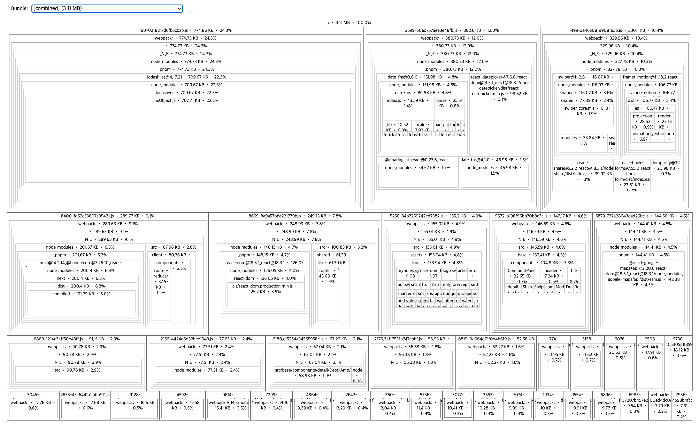
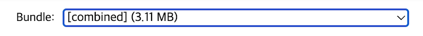
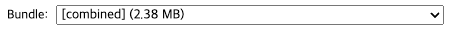

뉴스 사이트의 네트워크 탭을 보니 JS 파일이 꽤 컸다. 어떤 코드가 그만큼 내려오는지는 파일 이름만 봐선 알 수가 없었다. 빌드에 번들 분석기를 붙여 봤다.

## JS 번들 구성 점검

```bash

$ yarn add -D @next/bundle-analyzer
```

설치한 분석기를 `next.config.js`의 빌드 설정에 붙였다.
```js


import createBundleAnalyzer from "@next/bundle-analyzer";

// ...

const withBundleAnalyzer = createBundleAnalyzer({
    enabled: process.env.ANALYZE === "true",
    openAnalyzer: false,
});

// ... 

export default withBundleAnalyzer(nextConfig);
```

`package.json`의 `scripts`에 분석 명령을 추가했다.

```js
"scripts": {
 ... 
  "analyze": "ANALYZE=true next build", 
  "analyze-explorer": "source-map-explorer '.next/static/chunks/*.js'",
 ...
}
 
```

분석 결과에서 먼저 눈에 들어온 건 `lodash-es`와 `moment-timezone`이었다. 700KB와 500KB. 둘 다 커 보였지만, 실제로 어디서 어떤 함수를 쓰는지부터 찾아봤다.



 
## lodash 최적화

프로젝트에서 `lodash-es`를 import한 곳은 `debounce`를 쓰고 있었다. ESM 패키지니까 안 쓰는 코드가 tree shaking으로 빠졌을 거라고 생각할 수 있다. 그런데 이 빌드의 분석 결과에는 lodash 코드가 크게 남았다.

사용처는 이 한 줄이었다.
```js
import { debounce } from "lodash-es";
```

프로젝트 전체에서 쓰는 함수가 하나라면 패키지의 진입점도 그 함수 하나로 좁힐 수 있다. `lodash.debounce`로 바꿔 같은 조건에서 다시 빌드했다.

lodash.debounce를 import하려면 lodash.debounce 패키지를 따로 설치해야 한다.  
타입스크립트 환경에서는 타입 정의 패키지(@types/lodash.debounce)도 필요하다.

```bash

$ yarn add lodash.debounce

$ yarn add -D @types/lodash.debounce
````

최소한의 코드만 번들에 포함되고, 사용방법은 다음과 같다.

```js
import debounce from "lodash.debounce";
```

## moment-timezone ⏰ 최적화 

앞서 말했듯 lodash는 함수별로 npm 패키지가 분리되어 있거나 ES 모듈 구조라서 개별 함수만 import할 수 있지만,   
moment/moment-timezone 는 하나의 큰 번들(모듈)로 배포되고 내부적으로 모든 기능이 단일 객체(moment)에 결합되어 있다.

즉, moment-timezone은 하나의 큰 번들이다. 부분 import 안 된다. 구조 상 ESM도 아니고 트리셰이킹도 불가능.

```js
import { tz } from "moment-timezone"; <- ❌
import moment from "moment/timezone"; <- ❌
```

구버전 브라우저(특히  Edge, 구형 크롬/파이어폭스 등)까지 완벽히 커버하면서 타임존 목록 및 오프셋, 타임존 변환 등 기능을 제공하려면  
moment-timezone을 계속 사용하는 것이 가장 안전한 선택이라.. 이대로 두기로 하였다. ( 언론 뉴스 페이지다 보니, 해외 구형 디바이스 까지 커버 해야 한다. )  

moment-timezone은 오래된 브라우저까지 호환성을 고려해 설계되어 있다 (IE9 이상, 구형 모바일 브라우저 등 포함)
최신 방식인 Intl.supportedValuesOf('timeZone')는 최신 브라우저(크롬 104+, 사파리 16.4+ 등)에서만 지원되고  
구버전 브라우저에서는 동작하지 않는다.

굳이 하려면, 데이터 범위를 줄여서 번들 사이즈를 최적화 하는게 유일한 방법이다.   

Moment Timezone 문서가 안내하는 길은 두 가지다. 연도 범위를 줄여 둔 빌드 파일(`moment-timezone-with-data-10-year-range.js`, `moment-timezone-with-data-1970-2030.js`)을 쓰거나, `moment-timezone-utils`의 `filterLinkPack`으로 필요한 시간대와 연도만 남긴 데이터를 직접 만든다.

`filterLinkPack`은 풀어 둔(unpacked) 번들과 시작 연도, 끝 연도를 받아 다시 압축한(packed) 번들을 돌려준다. 입력과 출력 모두 `{ version, zones, links }` 모양의 객체다. 서울 시간대만 1990년부터 2026년까지 남긴다고 가정하면 이렇게 된다.

```js
// scripts/build-tz-data.js : Node에서 한 번 실행해 데이터 파일을 만든다
const fs = require("fs");
const moment = require("moment-timezone/moment-timezone-utils");
const latest = require("moment-timezone/data/packed/latest.json");

const unpacked = {
  version: latest.version,
  zones: latest.zones
    .map((packed) => moment.tz.unpack(packed))
    .filter((zone) => zone.name === "Asia/Seoul"),
  links: [],
};

const filtered = moment.tz.filterLinkPack(unpacked, 1990, 2026);
fs.mkdirSync("data", { recursive: true });
fs.writeFileSync("data/tz-seoul-1990-2026.json", JSON.stringify(filtered));
```

프로젝트 루트에서 `node scripts/build-tz-data.js`를 실행하면 `data/tz-seoul-1990-2026.json`이 생긴다. 브라우저 번들에서는 데이터가 빠진 본체를 불러와 이 파일만 넣는다. `moment-timezone`을 그대로 import하면 전체 데이터인 `data/packed/latest.json`도 함께 들어온다.

```js
import moment from "moment-timezone/moment-timezone";
import tzData from "../data/tz-seoul-1990-2026.json";

moment.tz.load(tzData);
```

## 추가로 줄일 수 있는 번들 확인
next.config.js 내부 설정 중 `optimizePackageImports` 를 쓰면 소위말해 조금 더 영끌 다이어트가 된다.  

여러 모듈을 한곳에서 재노출하는 라이브러리는 사용하는 export에 맞춰 import 경로를 나눌 수 있다. 이 옵션에 `moment-timezone` 이름을 적어도 시간대 데이터가 자동으로 잘려 나가지는 않는다.
```js

experimental: {
  optimizePackageImports: ["moment-timezone", "date-fns", "react-share", "swiper"],
   ...
},
```

## 결과 ✨  
  ➡️


3.11MB에서 2.38MB. 빌드 결과에서 빠진 건 약 23.5%다. 프로젝트가 lodash에서 쓰던 함수는 `debounce` 하나였는데, 그 사실은 분석기 그림만으로 몰라서 실제로 import한 자리까지 찾아봐야 했다.

이 뉴스 사이트에는 해외에서 접속하거나 구형 기기를 쓰는 독자도 있다. JS를 덜 받으면 그만큼 다운로드 부담은 줄 텐데, 홈에서도 기사가 눈에 띄게 빨리 뜰까? 번들 크기만으로는 답이 안 나왔다. [다음에는 뉴스 홈을 열어 시간을 쟀다.](../phase4/)

참고
- [npm scripts](https://docs.npmjs.com/cli/v11/using-npm/scripts/)
- [Moment Timezone 데이터 유틸리티](https://momentjs.com/timezone/docs/#/data-utilities/)
