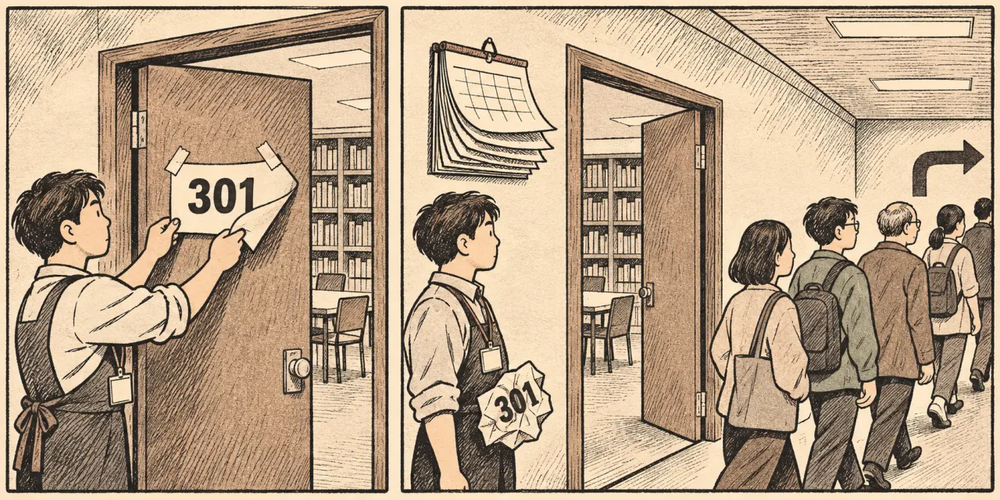

뉴스 홈의 주요 기사를 첫 HTML에 담자 브라우저가 자바스크립트로 화면을 조립하는 일은 줄었다. 그런데 수천 명이 같은 홈을 열면 서버는 같은 HTML을 몇 번이나 만들어야 할까?

## 같은 홈을 열었는데 요청이 계속 서버에 갔다

서버 앞에 CloudFront를 붙였다. 공개 기사라면 앞선 방문자에게 보냈던 HTML을 다음 사람에게도 바로 줄 수 있다. 막상 콘솔을 열어 보니 캐시 적중률은 한 자릿수였다. 서버가 응답에 적어 보낸 캐시 지시부터 확인했다.


---

## CloudFront 캐시 hit률이 낮았던 이유

CloudFront까지 온 응답을 다시 열어 캐시 적중 여부와 원본이 보낸 헤더를 맞춰 봤다.

```text
Cache-Control: private, no-cache, no-store, must-revalidate
```

홈, 섹션, 기사 상세 페이지 대부분의 응답에 `no-store`가 붙어 있었다. 이 헤더를 따르면 CloudFront는 받은 HTML을 캐시에 저장하지 않는다.

처음엔 `next.config.mjs`에 캐시 헤더를 잘못 넣었나 했다. 해당 설정은 없었다. Next.js가 응답에 자동으로 붙이는 헤더였다.

그럼 왜 붙였을까. 빌드 로그를 보면 페이지마다 마크가 찍힌다.

```text
○  Static (build time)
●  ISR (revalidate)
λ  Server (dynamic at runtime)
```

거의 다 `λ` 였다. 페이지가 다 *dynamic* 으로 잡혀 있었다.

> 아 그래서 캐시가 안 먹혔구나.

---

## 어떤 한 줄이 페이지 전체를 dynamic으로 만들었나?

Next 14 App Router 가 좀 까다로웠다.

페이지 트리 어디에든 다음 중 하나만 들어가도 *그 페이지 전체가* dynamic 으로 바뀐다.

- `cookies()`, `headers()` 호출
- `searchParams` 사용
- `fetch(..., { cache: 'no-store' })`
- `export const dynamic = 'force-dynamic'`

우리 홈에서는 로그인 상태를 확인하는 코드가 `cookies()`를 읽고, 검색 진입을 처리하는 코드가 `searchParams`를 읽었다. 공개 기사 목록을 보여 주는 같은 라우트 안에 둘 다 있었다. 뉴스 홈 전체가 요청마다 서버에서 만들어진 이유를 캐시 적중률을 보고서야 여기까지 따라왔다.

---

## ISR 한 줄로 끝낼 수 있었나?

처음엔 답이 단순해 보였다.

> 그러면 다 `revalidate = 60` 박으면 되잖아?

근데 그게 답이 아닌 페이지들이 따로 있었다.

- `account` 페이지는 로그인한 사람 본인 정보다. 다른 사람과 캐시 공유하면 사고.
- `mytimes` 도 같은 이유.
- `search` 는 쿼리마다 응답이 다르다.
- `oauth/callback` 은 인증 콜백. 한 번 쓰고 버리는 응답이다.
- `preview` 는 운영자가 발행 전에 보는 페이지. 캐시되면 미공개가 새어나간다.

여기에 `revalidate` 박는 순간 *보안 사고 아니면 기능 깨짐* 이다.

그래서 페이지를 세 갈래로 갈랐다.

```ts
// 개인화 / 인증 / preview
export const dynamic = "force-dynamic"

// 콘텐츠 디테일 (섹션, 카테고리, 기사 상세)
export const revalidate = 60

// _next/static, 폰트, 빌드 산출물
// → next.config 에서 1년 immutable
```

기준은 두 가지였다.

1. *응답이 모든 사용자에게 같은가.* 같으면 공용 캐시 가능, 다르면 dynamic.
2. *얼마나 신선해야 하는가.* 콘텐츠는 60초 stale 허용. 기사 첫 발행 직후엔 운영팀이 별도 invalidate.

`force-dynamic` 으로 둔 페이지는 영원히 origin 이 받는다.  
그건 어쩔 수 없다. 공용 캐시 못 하는 자리니까.

포기한 것: 모든 페이지를 60초 ISR로 묶는 방식.
대신 개인화/인증/preview는 origin으로 보내고 공개 콘텐츠만 공유 캐시에 올렸다.

---

## CloudFront 헤더는 왜 path별로 갈랐나?

페이지 단위 갈래만으로는 부족했다.

`/api/*` 같은 endpoint, `/_next/static/*` 같은 빌드 산출물,  
`/images/*` 같은 사용자 업로드까지 다 캐시 정책이 달라야 했다.

`next.config.mjs` headers 에서 path 별로 박았다.

```text
/api/*            no-store, no-cache, must-revalidate
/_next/static/*   public, max-age=31536000, immutable
/_next/data/*     public, s-maxage=60, stale-while-revalidate=60
/images/*         public, max-age=86400
/fonts/*          public, max-age=31536000, immutable
/:path*           Vary: Accept, Accept-Encoding
```

각 줄이 한 가지 결정이다.

- `/api/*` 는 캐시 X. 사용자 데이터를 다른 사람한테 흘리지 않게.
- `/_next/static/*` 는 파일명에 hash 가 박혀 있다. 1년 immutable.
- `/_next/data/*` 는 Pages Router 페이지로 클라이언트 전환할 때 받는 JSON이다. App Router의 RSC payload는 이 경로로 오지 않는다. 60초 캐시 + 60초 stale 허용.
- `/images/*` 는 CMS 업로드 이미지. 하루 캐시.
- 마지막 `Vary: Accept, Accept-Encoding` 이 진짜 함정 자리였다.

---

## 같은 URL에서 응답이 두 개면 어떻게 되나?

Next App Router 는 같은 URL 을 두 가지 응답으로 준다.

- 첫 진입 → HTML
- 클라이언트 라우팅 진입 → RSC payload (`text/x-component`)

브라우저 주소창에는 같은 기사 주소가 남는다. 네트워크 탭에서 보면 요청은 다르다. Next.js 14.2.35는 화면을 이동할 때 `RSC: 1`과 현재 라우터 상태를 보내고, 자동 prefetch에는 `Next-Router-Prefetch: 1`도 붙인다. 요청 URL에도 라우터 상태와 prefetch 여부 등을 반영한 `_rsc` 쿼리가 붙는다. [14.2.35 라우터의 요청 코드](https://github.com/vercel/next.js/blob/v14.2.35/packages/next/src/client/components/router-reducer/fetch-server-response.ts#L62-L111)

근데 CloudFront는 그 차이를 어디까지 볼까? 원본으로 헤더를 전달하는 것과, 캐시에서 꺼낼 응답을 고를 때 그 헤더를 쓰는 건 서로 다른 설정이다. 예를 들어 `RSC`를 원본에 전달하더라도 캐시 키에서 그 헤더와 `_rsc` 쿼리를 모두 빼면, 같은 기사 경로로 받은 HTML과 RSC가 한 자리에 들어갈 수 있다. 브라우저가 기사 HTML을 기다리는데 `text/x-component`가 온다.

당시 내가 적어 둔 `Vary: Accept`만으로는 이 문제를 해결했다고 말할 수 없다. CloudFront는 캐시 키에 넣을 헤더와 쿼리를 **해당 경로의 cache policy**에서 고른다. 캐시하려면 화면 이동과 prefetch를 포함해 다른 응답을 만드는 요청이 다른 키를 쓰는지 확인해야 한다. 그 구분을 확인할 수 없으면 해당 응답은 공유 캐시에서 빼는 편이 낫다.

확인할 때는 HTML 요청과 실제 라우터 요청을 번갈아 보내 본다. `X-Cache`가 Hit여도 엉뚱한 응답에 맞은 것일 수 있다. 각 요청의 `Content-Type`과 본문이 원래 기대한 형식인지까지 봐야 한다.

압축은 또 다른 설정이다. CloudFront 캐시 정책에서 gzip이나 Brotli 지원을 켜면 정규화한 `Accept-Encoding`이 캐시 키에 들어간다.

---

## redirect도 캐시될 수 있나?

이건 한 번 운영에서 부딪혔다.

기사 하나가 정책으로 한 시간만 다른 URL 로 301 redirect 되고 있었다.  
정책 끝나서 redirect 제거했는데 다음 1년 동안 그 자리 사용자가 계속 옛 redirect 로 가더라.



CF 가 *301 응답을 캐시* 하고 있었다.

해결은 두 가지였다.

1. 301 대신 302 로. 영구 X.
2. `Cache-Control: no-store` 같이 박기.

```ts
return new Response(null, {
  status: 302,
  headers: {
    Location: redirectUrl,
    "Cache-Control": "no-store",
  },
})
```

이걸로 끝이었다.

근데 한 번 부딪히기 전에는 *redirect 가 캐시될 수 있다* 는 생각 자체가 잘 안 든다.

---

## prefetch에서 origin 요청이 30번 발생한 이유

Next 의 `<Link>` 는 viewport 에 들어온 링크를 자동으로 prefetch 한다.

뉴스 홈은 한 화면에 기사 카드가 30개 이상이다.  
사용자가 스크롤만 해도 prefetch 요청이 30번 나간다.

그게 CF 로 안 가고 *origin 직격* 으로 가는 자리가 있었다.

자동 prefetch에는 `Next-Router-Prefetch: 1`이 붙었다. 카드 30장의 요청은 애초에 서로 다른 기사 주소로 간다. 같은 기사라도 prefetch와 클릭 이동의 캐시 키를 나누면 한쪽이 채운 캐시를 다른 쪽에서는 쓸 수 없다. 그때의 헤더 하나만으로 캐시 미스 30건을 모두 설명할 수는 없다.

뉴스 홈 카드는 *30개 중 사용자가 평균 1~2개* 만 본다.  
나머지 28개 prefetch 는 origin 비용만 만든다.

해결은 두 갈래.

```tsx
// 트래픽 무거운 카드
<Link href="..." prefetch={false}>...</Link>
```

또 다른 방법은 CloudFront에서 `Next-Router-Prefetch` 헤더를 원본 서버에는 전달하되 캐시 키에서는 빼는 것이다. 이 방법은 prefetch 응답과 클릭해서 이동할 때의 응답이 같을 때만 쓸 수 있다. Next.js 14 문서에 따르면 동적 라우트의 prefetch는 첫 `loading.js` 까지만 담는다. 두 응답이 다른데 헤더를 캐시 키에서만 빼면, prefetch가 받아 간 일부 응답이 클릭 이동에 재사용될 수 있다. 그런 경로는 헤더를 캐시 키에 남기거나 캐시를 우회해야 한다.

prefetch 끄면 클릭 직후 응답 시간이 100~200ms 늘어난다.  
이 홈에서는 클릭할 때 조금 더 기다리더라도, 대부분 읽지 않는 기사 28건을 미리 요청하지 않는 쪽을 택했다.

---

## 압축은 누가 해야 하는가

이중 압축이 함정이었다.

Next 는 default 로 gzip 압축을 켠다 (`compress: true`).  
CloudFront도 behavior에서 자동 압축을 켤 수 있다.

원본 응답에 이미 `Content-Encoding: gzip`이 있으면 CloudFront는 다시 압축하지 않고 그 응답을 전달한다.
근데 더 큰 문제는 따로 있었다.

brotli 압축을 지원하는 브라우저에 *gzip 응답이 고정*돼서 내려간다.  
edge 단에서 더 좋은 압축으로 바꿔주지 못한다.

선택은 단순했다.

```ts
// next.config.mjs
compress: false,
```

압축은 CF 에서만 한다.  
브라우저 `Accept-Encoding` 보고 gzip 또는 brotli 를 고른다.

origin 은 압축 안 한 응답을 그대로 내려보낸다.

---

## 결국 LCP 가 아니라 TTFB 였다

`eager`, `fetchPriority`, `srcset`, `sizes`를 조정하고 홈 상단을 RSC로 옮겨도 그 HTML이 도착하기 전에는 기사 사진을 받을 수 없다.

캐시 적중률이 5%면 대부분의 요청이 원본 서버의 응답을 기다린다. 첫 바이트를 받기까지 800ms가 걸리니, 이미지 로딩에서 100ms를 줄여도 점수 차이를 보기 어려웠다.

이 phase 정리하고 나서야 LCP 작업의 효과가 진짜로 측정에 잡혔다.

이미지를 더 일찍 불러오는 방법부터 찾느라, 그 이미지 주소가 담긴 HTML은 얼마나 늦게 왔는지 한참 뒤에 봤다. 이걸 LCP보다 먼저 봤어야 했다.

---

## 다음 문제

홈의 HTML을 공유할 수 있게 됐어도 기사 본문의 사진에는 공통 컴포넌트의 props를 건넬 자리가 없다. CMS 에디터가 보낸 HTML 문자열 안에 ``가 들어 있기 때문이다. 다음 편에서는 그 문자열에서 첫 사진을 찾는다.

참고
- [Next.js 14 getStaticProps: HTML과 JSON을 함께 만드는 이유](https://nextjs.org/docs/14/pages/building-your-application/data-fetching/get-static-props)
- [Next.js 14.2 App Router 요청 헤더 정의](https://github.com/vercel/next.js/blob/v14.2.35/packages/next/src/client/components/app-router-headers.ts)
- [Next.js 14 Linking and Navigating: 정적 라우트와 동적 라우트의 prefetch](https://nextjs.org/docs/14/app/building-your-application/routing/linking-and-navigating)
- [CloudFront 캐시 정책으로 캐시 키 정하기](https://docs.aws.amazon.com/AmazonCloudFront/latest/DeveloperGuide/controlling-the-cache-key.html)
- [CloudFront origin request policy와 캐시 정책의 관계](https://docs.aws.amazon.com/AmazonCloudFront/latest/DeveloperGuide/controlling-origin-requests.html)
- [CloudFront가 원본 응답의 Vary를 다루는 방식](https://docs.aws.amazon.com/AmazonCloudFront/latest/DeveloperGuide/RequestAndResponseBehaviorCustomOrigin.html)
